# LWD 边云按角色加载 —— commit `24f7d84f5` 改动详解

> 分支：`vllm` 仓 `model_load_update`（基线 `prefill_only_chunked_prefill_mm`）
> 提交：`24f7d84f570875bddd127c0470143afb2b7f0dc7` —— `feat(lwd): load only the parameters each edge/cloud role runs`
> 规模：12 个文件，`+487 / −22`；vllm-ascend 仓本提交**无改动**

---

## 0. 一句话总结

LWD `prefill_only` 下，边侧只做 embed/unembed、云侧只做 transformer，但**两侧都被构建了对方才用得上的模块**（边侧多一个语言模型尾部 `norm`，云侧多一个多模态视觉塔），并且云侧还额外加载 tokenizer 与多模态 processor。

本次提交做三件事：

| 面 | 内容 | 效果 |
|---|---|---|
| **A. 模块裁剪** | 用 `LwdConfig.skips_module()` 让"本角色永不执行"的模块不再构建，位置换成 `PPMissingLayer` | 省显存；参数不出现在 `named_parameters()` |
| **B. 云侧去掉 tokenizer/处理器** | 云侧强制 `skip_tokenizer_init` + 新增 `mm_encoder_remote` 闸门 | 云侧不再加载 tokenizer，也不再构建 HF 多模态 processor |
| **C. 加载期权重过滤** | 新增 `lwd_weight_filter.py`，在 safetensors 取张量**之前**丢掉占位模块的权重 | 两侧都能直接吃"完整 checkpoint"或"自己那份裁剪后的 checkpoint" |

A + C 合起来＝**每个角色可以只放自己那一份权重文件**；A + B 合起来＝**云侧模型目录只需要 `config.json` + 权重**。

---

## 1. 背景与前提

### 1.1 LWD `prefill_only` 的角色分工

| | 边侧 edge（1 NPU） | 云侧 cloud（4 NPU） |
|---|---|---|
| 语言模型层 | **不建**（`PPMissingLayer`） | **全建** |
| `embed_tokens` | 建（对 prompt 做嵌入） | 建（decode 行本地嵌入，`gpu_model_runner.py:3632-3662`） |
| `lm_head` | 建（rank-replay 还原 token） | 建（采样 + 算秩） |
| `model.norm` | 本次改动前**建**、改动后**不建** | 建 |
| 视觉塔 `visual` | 建（自己编码图像） | 改动前**建**、改动后**不建** |
| MTP drafter | 不建 | 建（若开投机解码） |
| KV cache / 前向 | **不跑**（`get_kv_cache_spec()` 返回空 → 不 profile、不 warmup） | 跑（`_model_forward`） |

### 1.2 改动前就存在的四个机制（本次改动全部围绕它们）

| 机制 | 位置 | 作用 |
|---|---|---|
| `_LWD_FULL_HEAD_TAIL` | `vllm/distributed/parallel_state.py:351`（默认 `False`）、`:368`（getter）、`:1808-1809`（置位） | 中和 PP 首/尾 rank 判定：让边、云**都**把自己当作 PP 的首/尾 stage，于是两侧都构建 head + tail 模块 |
| `make_lwd_layers` + `PPMissingLayer` | `vllm/model_executor/models/utils.py:632` / `:619` | 只构建本进程拥有的层，其余位置放 `PPMissingLayer`（`nn.Identity` 子类，**零参数**、`forward` 原样返回输入） |
| `StageMissingLayer` | `utils.py:521` | 整段模块缺失时的同类占位（如被裁掉的视觉塔、`no_init_weights` 场景） |
| `track_weights_loading` | `vllm/model_executor/model_loader/default_loader.py:466` | 权重装载完成后**严格校验**：`named_parameters()` 里有、checkpoint 里没有 → 抛 `ValueError: Following weights were not initialized from checkpoint ...` |

### 1.3 根因：`_LWD_FULL_HEAD_TAIL` 带来"多建"

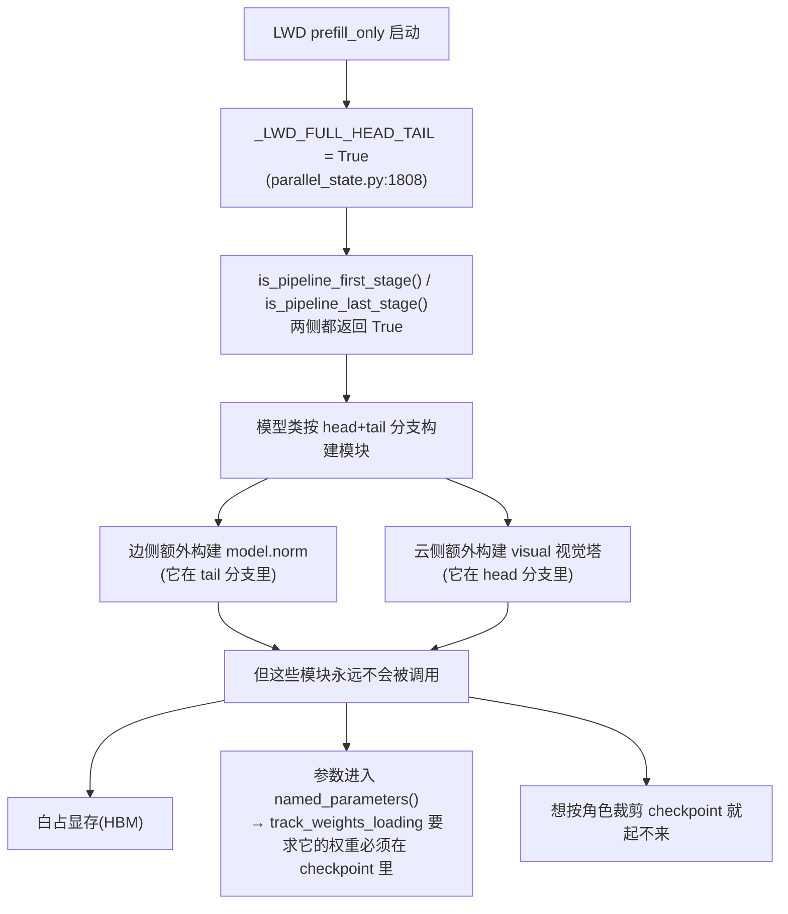

**为什么说它们永不执行**（提交信息原文）：

- 边侧只做嵌入/反嵌入，它收到的 hidden states **已经是 post-norm** 的，`compute_logits` 只用 `lm_head`；
- 云侧吃的是边侧算好的 embeddings，**`embed_multimodal` 永远不会被调用**。

---

## 2. 改动前：模型如何加载与运行

### 2.1 启动与加载链路（改动前）

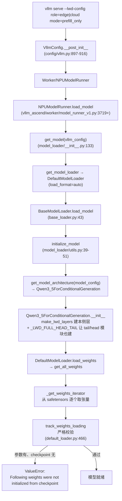

### 2.2 改动前的模块构建结果

| 模块 | 边侧 | 云侧 | 是否真的会执行 |
|---|---|---|---|
| `model.language_model.layers.*` | 占位（`make_lwd_layers`） | 全建 | 边 ✗ / 云 ✓ |
| `model.language_model.embed_tokens` | 建 | 建 | 两侧 ✓（云侧 decode 行要本地嵌入） |
| `lm_head` | 建 | 建 | 两侧 ✓ |
| `model.language_model.norm` | **建（浪费）** | 建 | 边 ✗ / 云 ✓ |
| `model.visual.*` | 建 | **建（浪费）** | 边 ✓ / 云 ✗ |
| tokenizer | 建（要对外服务） | **建（浪费）** | 边 ✓ / 云 ✗ |
| HF 多模态 processor | 建 | **建（浪费）** | 边 ✓ / 云 ✗ |

### 2.3 权重加载与严格校验（改动前的细节）

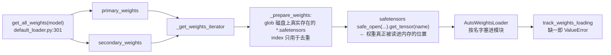

关键点：**过滤点越靠前越省**——在 `get_tensor` 之前丢掉，就完全不会读盘、不会占内存；塞进模块之后再忽略就晚了。

### 2.4 云侧额外的启动期依赖：tokenizer + 多模态 processor

改动前，云侧虽然不跑视觉塔，却在**启动期**被迫加载 tokenizer 与 HF processor（因此云侧目录里必须有 `tokenizer*.json`、`vocab.json`、`merges.txt`、`preprocessor_config.json` 等）：

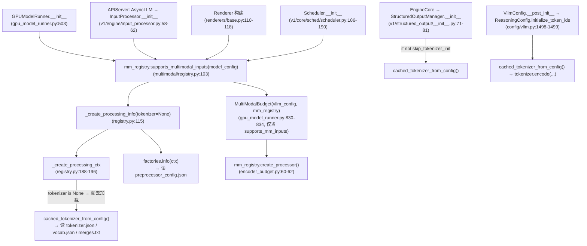

注意其中三点：

1. `supports_multimodal_inputs()` 是**先建 processor/tokenizer、再判断模态上限**——所以即使把模态上限配成 0 也绕不过 tokenizer 加载；
2. 上面 4 个入口（runner / InputProcessor / Renderer / Scheduler）**都以 `supports_multimodal_inputs()` 为闸门**，这是本次改动选它当"单点开关"的原因；
3. `StructuredOutputManager` 与 `ReasoningConfig` 是另外两条独立路径，由 `skip_tokenizer_init` 覆盖。

### 2.5 运行期：边云真正在做什么（改动前后都一样）

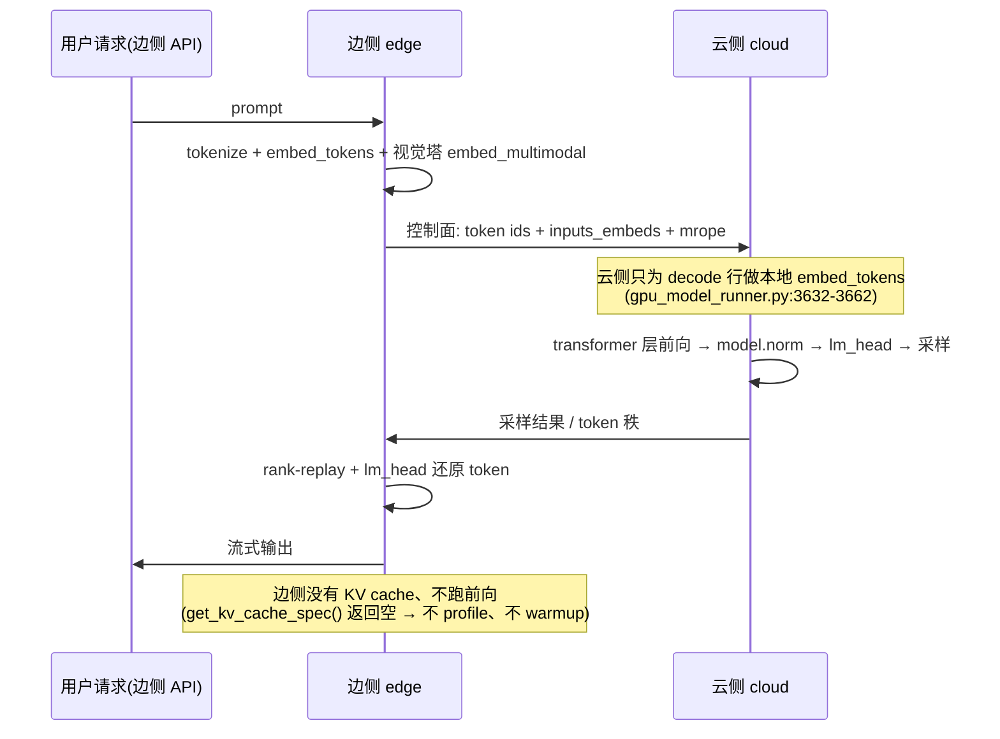

**这张图解释了为什么"多建"纯属浪费**：边侧那条路径上永远不会走 `model.norm`，云侧那条路径上永远不会有图像进入 `visual`。

### 2.6 改动前的三个后果

| # | 后果 | 具体表现 |
|---|---|---|
| 1 | **显存浪费** | 边侧白占一个 `norm`（hidden=5120 的 norm 很小，但仍是参数）；云侧白占整座视觉塔（约 1.4 GiB 量级） |
| 2 | **无法按角色裁剪 checkpoint** | `track_weights_loading` 严格要求 `named_parameters()` 都能在 checkpoint 里找到 → 把边侧目录裁到只剩 embed/lm_head/visual 后**根本起不来** |
| 3 | **云侧启动依赖一堆用不到的文件** | 必须保留 tokenizer/processor 配置，否则 `InputProcessor` → `MultiModalBudget` → `image_processor` 直接 `OSError: Can't load image processor ... preprocessor_config.json` |

---

## 3. 改动后：模型如何加载与运行

### 3.1 改动总览

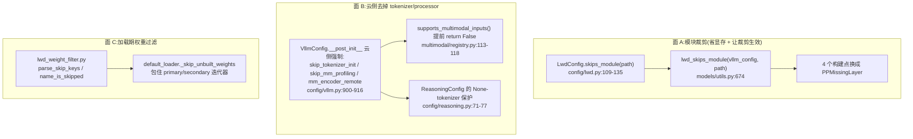

### 3.2 面 A：模块裁剪

**策略**（`vllm/config/lwd.py:109-135`）：

```python
_EDGE_UNUSED_MODULE_SUFFIXES  = ("model.norm",)   # 边侧:语言模型尾部 norm
_CLOUD_UNUSED_MODULE_SUFFIXES = ("visual",)       # 云侧:多模态视觉塔

def skips_module(self, path: str) -> bool:
    if not self.enabled or self.mode != "prefill_only":
        return False                              # head_tail/embedding_only 下 tail 在边侧,不能裁
    suffixes = _EDGE_UNUSED_MODULE_SUFFIXES if self.is_edge else _CLOUD_UNUSED_MODULE_SUFFIXES
    return any(path == suffix or path.endswith("." + suffix) for suffix in suffixes)
```

**改造点**（4 处，全部是"把原本一定构建的模块改成占位"）：

| 文件:行 | 位置 | 改法 |
|---|---|---|
| `models/qwen3_5.py:244` | 语言模型尾部 norm | `if get_pp_group().is_last_rank and not lwd_skips_module(vllm_config, maybe_prefix(prefix, "norm")): ... else PPMissingLayer()` |
| `models/qwen3_5.py:583` | `Qwen3_5ForConditionalGeneration.visual` | `PPMissingLayer()` 替代 |
| `models/qwen3_5.py:804` | `Qwen3_5MoeForConditionalGeneration.visual` | 同上（MoE 变体） |
| `models/qwen3_vl.py:1673` | `Qwen3VLForConditionalGeneration.visual` | 同上，并加 deepstack 守卫：`if self.use_deepstack and not isinstance(self.visual, PPMissingLayer)` |

**判定流程**：

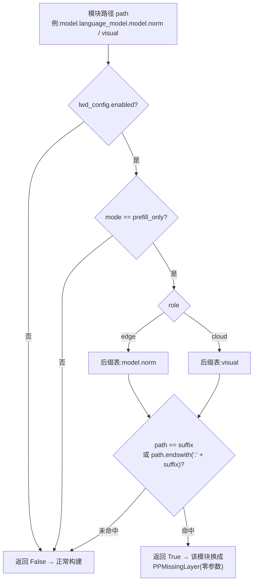

> 为什么必须是**路径后缀**而不是"属性名包含"：Qwen3-VL 里存在 `visual.merger.norm` 这种同名子模块，若按属性名匹配，边侧规则（裁 `norm`）会**误伤视觉塔里的 norm**。

### 3.3 面 B：云侧不再初始化 tokenizer / 多模态 processor

**配置侧**（`vllm/config/vllm.py:900-916`，只对 `prefill_only` 且非边侧生效）：

```python
if self.lwd_config.mode == "prefill_only" and not self.lwd_config.is_edge:
    if self.model_config is not None:
        self.model_config.skip_tokenizer_init = True          # ← 干掉 StructuredOutputManager / ReasoningConfig 两条路径
        multimodal_config = getattr(self.model_config, "multimodal_config", None)
        if multimodal_config is not None:
            multimodal_config.skip_mm_profiling = True         # ← 不再做多模态显存 profile
            multimodal_config.mm_encoder_remote = True         # ← 新字段:多模态输入由远端(边侧)编码
    logger.info_once("[LWD] cloud: tokenizer and multimodal encoder are not initialized (the edge owns both)")
```

**注册表侧**（`vllm/multimodal/registry.py:113-118`，新增 4 行，是**唯一的闸门**）：

```python
mm_config = model_config.get_multimodal_config()
if mm_config is not None and mm_config.mm_encoder_remote:
    # 多模态输入由别的进程(边侧)编码:processor 及其 tokenizer 永远不会被用到,
    # 没必要为了"探测支持哪些模态"把它们建出来。
    return False
try:
    info = self._create_processing_info(model_config, tokenizer=None)
```

**保护侧**（`vllm/config/reasoning.py:71-77`）：`skip_tokenizer_init=True` 时 `cached_tokenizer_from_config()` 返回 `None`（`tokenizers/registry.py:269-270`），原代码会 `None.encode(...)` 崩，现在直接 return（reasoning 关闭）。

**改动后的云侧启动依赖**：

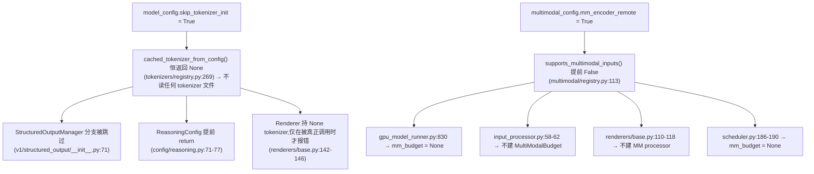

结果：**云侧模型目录里 `config.json` 之外的非权重文件全都不需要了**（权重仍需 `config.json` 来定模型类与结构）。

### 3.4 面 C：加载期权重过滤

**为什么要它**：面 A 让模块不再构建（参数不进 `named_parameters()`），但如果这个进程被指向**完整 checkpoint**（部署过渡期的常态），checkpoint 里那些"没有对应模块"的张量会被 `AutoWeightsLoader` 报成 unexpected / 或者白读一遍。`ep_weight_filter` 对专家权重已经这么做了，这里照抄同一思路。

**算法**（`vllm/model_executor/model_loader/lwd_weight_filter.py`）：

```python
def parse_skip_keys(placeholder_names):
    # "model.layers.3." → ["model", "layers", "3"]
    return [name.rstrip(".").split(".") for name in placeholder_names if name]

def name_is_skipped(weight_name, skip_keys):
    parts = weight_name.split(".")
    for key in skip_keys:                       # 组件级"连续子序列"匹配
        for start in range(len(parts) - len(key) + 1):
            if parts[start:start + len(key)] == key:
                return True
    return False
```

**接入点**（`vllm/model_executor/model_loader/default_loader.py`）：

```python
def get_all_weights(self, model, model_config):
    ...
    yield from self._skip_unbuilt_weights(model, self._get_weights_iterator(primary_weights))
    for source in secondary_weights:
        yield from self._skip_unbuilt_weights(model, self._get_weights_iterator(source))

def _skip_unbuilt_weights(self, model, weights):
    skip_keys = parse_skip_keys(self._placeholder_module_names(model))
    if not skip_keys:                 # 非 LWD 或没有占位模块 → 完全等价于原逻辑
        yield from weights
        return
    for name, tensor in weights:
        if name_is_skipped(name, skip_keys):
            continue                  # ← 发生在 safetensors.get_tensor 之前
        yield name, tensor

@staticmethod
def _placeholder_module_names(model):
    config = get_current_vllm_config_or_none()
    lwd_config = getattr(config, "lwd_config", None) if config is not None else None
    if lwd_config is None or not lwd_config.enabled:
        return []                     # ← 双重门槛:必须 LWD enabled
    return get_pp_missing_layer_names(model)   # models/utils.py:741
```

**数据流（改动后）**：

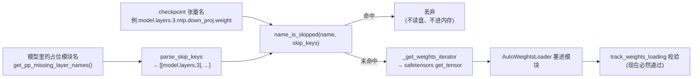

**为什么必须"组件级"匹配**（而不是 `startswith`）：

| 陷阱 | `startswith` 的后果 | 组件级匹配 |
|---|---|---|
| `layers.3` vs `layers.30` | `layers.3` 会把 `layers.30.*` 一起吞掉 | 组件不同，不匹配 |
| VL checkpoint 与 vLLM 模块名不一致：checkpoint 存 `model.visual.*`，vLLM 模块是 `visual` | 前缀匹配**漏掉**（前缀根本对不上） | 作为连续子序列匹配到 |
| `visual.merger.norm`（子模块） | 若用属性名可能误伤 | 按完整路径列表匹配 |

### 3.5 改动后的完整链路

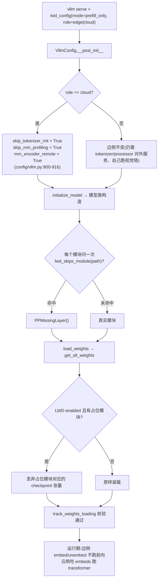

---

## 4. 关键设计点（为什么这么做）

| # | 设计点 | 原因 / 取舍 |
|---|---|---|
| 1 | **占位用 `PPMissingLayer`，而不是 `del` 掉属性或置 `None`** | 名字仍留在模块树里：① 完整 checkpoint 里的多余张量会被 `AutoWeightsLoader` 当作"占位模块"跳过，而不是报 `no module or parameter named ...`；② 零参数 → 不进 `named_parameters()`，不占显存；③ `forward` 原样返回输入，若某条路径意外走到它不会立刻崩（但会静默返回输入——所以真正的保护是"该路径永不执行"这个前提） |
| 2 | **策略放在 `LwdConfig`，而不是散落在模型文件里** | 模型文件只调 `lwd_skips_module(vllm_config, path)`（`models/utils.py:674`），策略可单测（`tests/config/test_lwd_module_scope.py` 12 例） |
| 3 | **路径后缀匹配**（`model.norm` / `visual`） | 避免"同名子模块被误伤"（`visual.merger.norm`），也表达"必须是这条路径本身" |
| 4 | **只在 `enabled and mode == prefill_only` 生效** | `head_tail` / `embedding_only` 模式下 tail 在边侧、语义不同，不能裁 norm；`skips_module` 其他模式一律返回 `False` |
| 5 | **云侧保留 `embed_tokens` 与 `lm_head`** | 协议约束：云侧 decode 行要做本地嵌入（`gpu_model_runner.py:3632-3662`），采样/算秩也要 `lm_head`。**"云侧只要 transformer 层"在权重层面做不到**，除非改协议（把 decode 行嵌入也搬到边侧） |
| 6 | **权重过滤放在 `get_all_weights`，不是放到 `load_weights` 之后** | 过滤点在 `get_tensor` 之前 → 不读盘、不进内存；放在后面就只是"读完再扔" |
| 7 | **双重门槛 `lwd_config.enabled`** | 非 LWD 部署完全零开销（`_placeholder_module_names()` 直接返回 `[]`） |
| 8 | **`mm_encoder_remote` 取代"到处加 if"** | 4 个启动期入口都以 `supports_multimodal_inputs()` 为闸门，改一处即可全覆盖；且语义直白："多模态输入由远端编码" |
| 9 | **已知边界：`arity` 陷阱** | `qwen3_next.py:541` 的 `norm` 是双返回值 `hidden_states, _ = self.norm(...)`；若在那种模型上给边侧裁 `norm`，`PPMissingLayer.forward`（返回第一个参数）会让解包失败。取舍：**边侧永不执行该路径**（无 KV cache → 不 profile、不 warmup，`lwd_edge_worker.py:156-163` 覆盖 warmup），所以采用 fail-fast 而非兜底；`qwen3_next.py` 本次**未改** |
| 10 | **与"物理裁剪 checkpoint"是互补而非替代** | 面 A/C 让"裁剪后的目录能起来、完整目录也能起来"；物理裁剪只是省磁盘。两者独立：只做裁剪不做代码改动会报缺权重；只做代码改动不做裁剪则磁盘不变 |

---

## 5. 效果对照

| 维度 | 改动前 | 改动后 |
|---|---|---|
| 边侧构建的模块 | 层全占位 + embed + lm_head + **norm** + visual | 层全占位 + embed + lm_head + visual（**norm 不建**） |
| 云侧构建的模块 | 全层 + embed + lm_head + norm + **visual** + MTP | 全层 + embed + lm_head + norm + MTP（**visual 不建**） |
| 云侧启动期加载 tokenizer | **是** | 否（`skip_tokenizer_init`） |
| 云侧启动期构建 MM processor | **是**（会读 `preprocessor_config.json`） | 否（`mm_encoder_remote` 提前短路） |
| 云侧最小模型目录 | `config.json` + tokenizer/processor + 权重 | **`config.json` + 权重**（+ 拆分脚本生成的 index） |
| 边侧最小模型目录 | 全部（因为要 tokenizer/processor） | `config.json` + tokenizer/processor 配置 + `lm_head`/`embed_tokens`/`visual` 权重 |
| 用完整 checkpoint 启动裁剪后的角色 | **失败**（`Following weights were not initialized ...`） | 成功（多余张量在取盘前被丢弃） |
| 显存 | 云侧白占视觉塔（GB 量级）、边侧白占 norm | 不再白占 |
| 非 LWD 部署 | — | 行为完全不变（所有开关都以 `lwd_config.enabled` 为前提） |

---

## 6. 部署配套（与本次提交配套但不含在提交里）

| 工具 | 位置 | 作用 |
|---|---|---|
| Python 拆分脚本 | `assets/vllm-ascend/split_lwd_checkpoint.py` | 按角色把完整 checkpoint 切成子集（原生 `safetensors` 写分片） |
| Java 拆分工具 | `assets/vllm-ascend/split_java/SplitLwdCheckpoint.java`（+ 已构建的 `split-lwd-checkpoint.jar`） | 同上，零第三方依赖，纯字节搬运，交付单文件 |
| 本说明 | `assets/vllm-ascend/LWD按角色加载-commit24f7d84f5详解.md` | 本文 |
| 全链路梳理 | `assets/vllm-ascend/模型加载全链路-边云分侧.md` | 加载流程逐行位置 |

**各侧需要的文件**（脚本 `--metadata auto` 已按角色区分）：

| | 非权重文件 | 权重前缀 |
|---|---|---|
| **边侧** | 全部（`config.json` + `tokenizer*` + `vocab` + `merges` + `chat_template.jinja` + `preprocessor*` + `generation_config`） | `lm_head.`、`model.language_model.embed_tokens.`（或 `model.embed_tokens.`）、`model.visual.` |
| **云侧** | **仅 `config.json`**（依赖本次提交的 `skip_tokenizer_init` + `mm_encoder_remote`） | `lm_head.`、`model.language_model.`（或 `model.layers.`+`model.norm.`+`model.embed_tokens.`）、`mtp.`/`model.mtp.` |

> ⚠️ 云侧若仍跑**未打本次补丁**的 vllm，必须保留 `preprocessor_config.json`（+ `tokenizer*`），否则会在 `InputProcessor → MultiModalBudget → image_processor` 处报
> `OSError: Can't load image processor ... preprocessor_config.json`。

---

## 7. 验证

### 7.1 本地（无需 NPU）

| 项 | 命令 / 结果 |
|---|---|
| 模块作用域单测 | `tests/config/test_lwd_module_scope.py`（12 例：边/云 × 路径 × 模式开关 × `visual.merger.norm` 不误伤） |
| 权重过滤单测 | `tests/model_executor/model_loader/test_lwd_weight_filter.py`（15 例：组件匹配、`layers.3` vs `layers.30`、`model.visual.*` vs `visual`） |
| 合计 | **27 passed** |
| 拆分脚本 dry-run | `[size] 将写出 X GiB / 源 Y GiB` + `[meta] 将拷贝 ...`，用合成 checkpoint 校验边/云两条路径与多分片 + index |

### 7.2 上机（NPU）观察点

```bash
# 1) 云侧新日志出现(证明面 B 生效)
grep -n "tokenizer and multimodal encoder are not initialized" <cloud-log>

# 2) 两份目录的权重清单核对(不需要 NPU,只看拆分结果)
python - <<'PY'
import json
for role, path in (("edge", "./Qwen3.6-27B-edge"), ("cloud", "./Qwen3.6-27B-cloud")):
    wm = json.load(open(f"{path}/model.safetensors.index.json"))["weight_map"]
    layers = sum(k.startswith(("model.language_model.layers.", "model.layers.")) for k in wm)
    norm = sum(k.endswith("norm.weight") for k in wm)
    visual = sum(".visual." in k or k.startswith("visual.") for k in wm)
    print(f"{role:5s} tensors={len(wm):5d} layers={layers:4d} norm={norm:2d} visual={visual:4d}")
# 期望:edge layers=0;cloud visual=0
PY

# 3) 启动期自检:边侧启动后不应出现任何 layers.* 参数被装载的迹象;
#    两侧若都能正常起来且不报 "Following weights were not initialized",说明面 A+C 生效

# 3) 数值对拍:改动前后各跑同一组请求(含一次带图请求)
VLLM_ASCEND_LWD_LAYER_TRACE=1 <启动命令>
# 逐层输出应完全一致

# 4) 最小目录试跑:云侧目录只放 config.json + 云侧权重
```

### 7.3 回退

- 面 A：`LwdConfig.skips_module()` 返回 `False`（或删掉 4 个构建点的判断）即恢复"多建"行为；
- 面 B：去掉 `config/vllm.py:900-916` 里的三个赋值；
- 面 C：`default_loader._skip_unbuilt_weights` 直接 `yield from weights`（或 revert 本提交）。

---

## 8. 变更清单

| 文件 | 变更 |
|---|---|
| `vllm/config/lwd.py` | +38：`_EDGE_UNUSED_MODULE_SUFFIXES` / `_CLOUD_UNUSED_MODULE_SUFFIXES`、`LwdConfig.skips_module()` |
| `vllm/model_executor/models/utils.py` | +22：`lwd_skips_module(vllm_config, path)`（`models/utils.py:674`） |
| `vllm/model_executor/models/qwen3_5.py` | ±42：import(:102)、norm(:244)、visual(:583)、MoE visual(:804) |
| `vllm/model_executor/models/qwen3_vl.py` | ±21：import(:137)、visual(:1673) + deepstack 守卫 |
| `vllm/config/multimodal.py` | +8：`mm_encoder_remote` 字段 |
| `vllm/config/vllm.py` | +19：云侧强制 `skip_tokenizer_init`/`skip_mm_profiling`/`mm_encoder_remote` + 日志 |
| `vllm/multimodal/registry.py` | +5：`supports_multimodal_inputs()` 提前返回 |
| `vllm/config/reasoning.py` | +6：`None` tokenizer 保护 |
| `vllm/model_executor/model_loader/lwd_weight_filter.py` | 新增 74 行：`parse_skip_keys` / `name_is_skipped` |
| `vllm/model_executor/model_loader/default_loader.py` | +56：`get_all_weights` 包装、`_skip_unbuilt_weights`、`_placeholder_module_names` |
| `tests/config/test_lwd_module_scope.py` | 新增 80 行（12 例） |
| `tests/model_executor/model_loader/test_lwd_weight_filter.py` | 新增 138 行（15 例） |

---

## 附录 A：改动前 vs 改动后（一张图）

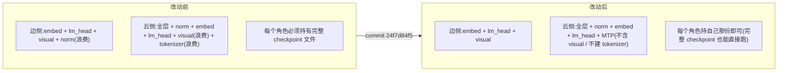

## 附录 B：一句话记住三个面

- **面 A**：不该建的模块不建（`skips_module` + `PPMissingLayer`）；
- **面 B**：云侧不该加载的 tokenizer/processor 不加载（`skip_tokenizer_init` + `mm_encoder_remote`，单闸门在 `supports_multimodal_inputs()`）；
- **面 C**：checkpoint 里属于"没建的模块"的张量在**读盘前**丢掉（`lwd_weight_filter`，组件级匹配）。

A 决定"模型有什么"，B 决定"启动时读什么文件"，C 决定"从 checkpoint 取什么张量"——三者合起来才让"边侧只加载 embed/unembed、云侧只加载 transformer（并各自持有自己那份文件）"真正落地。
