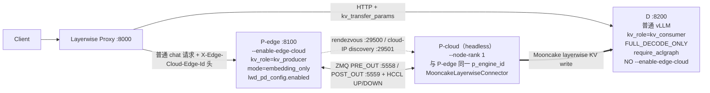
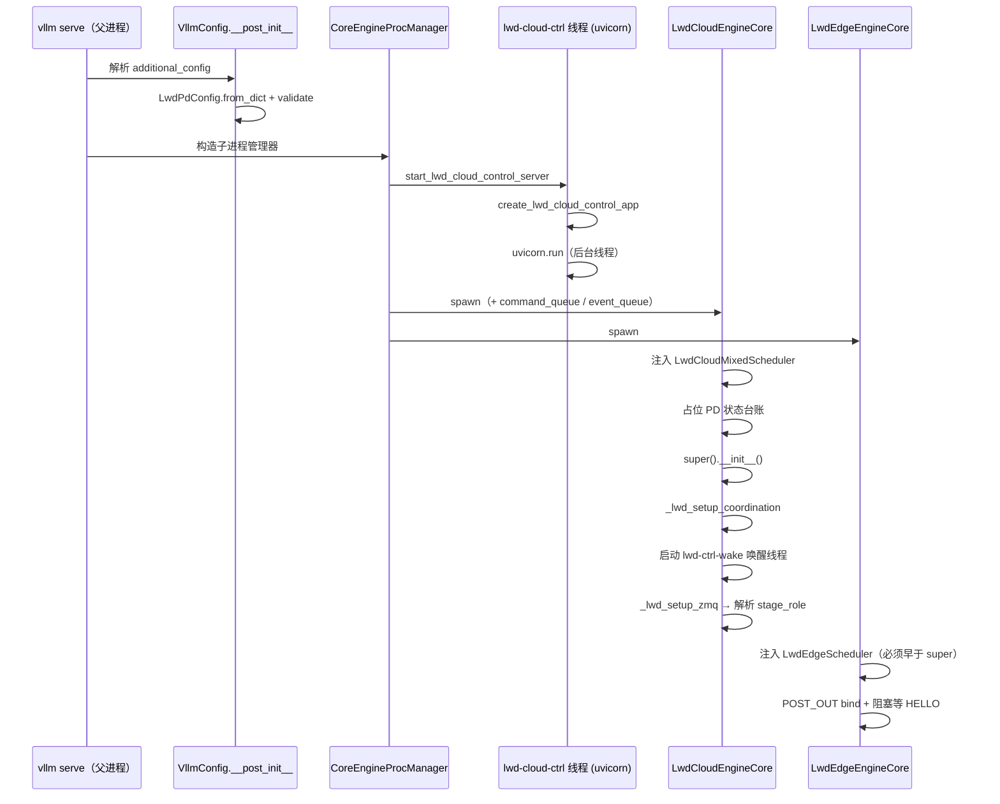
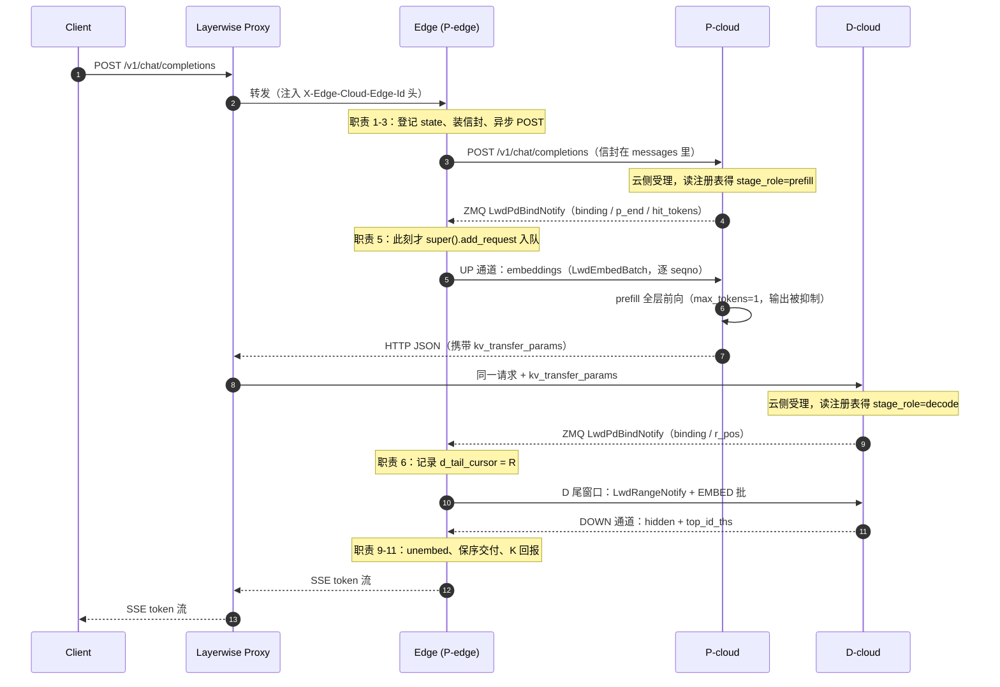
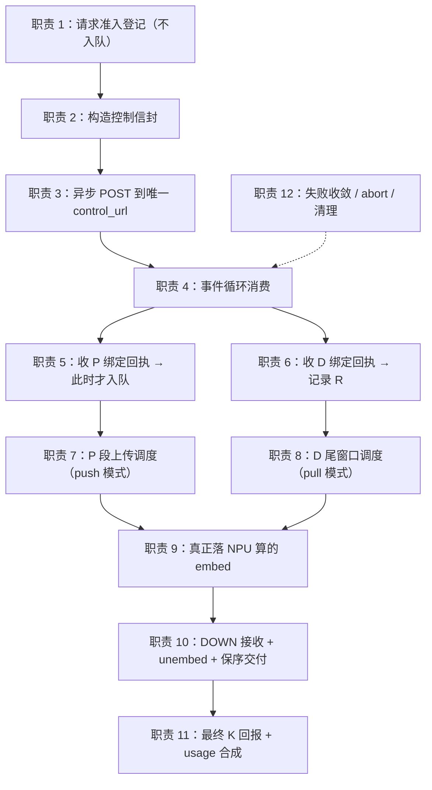
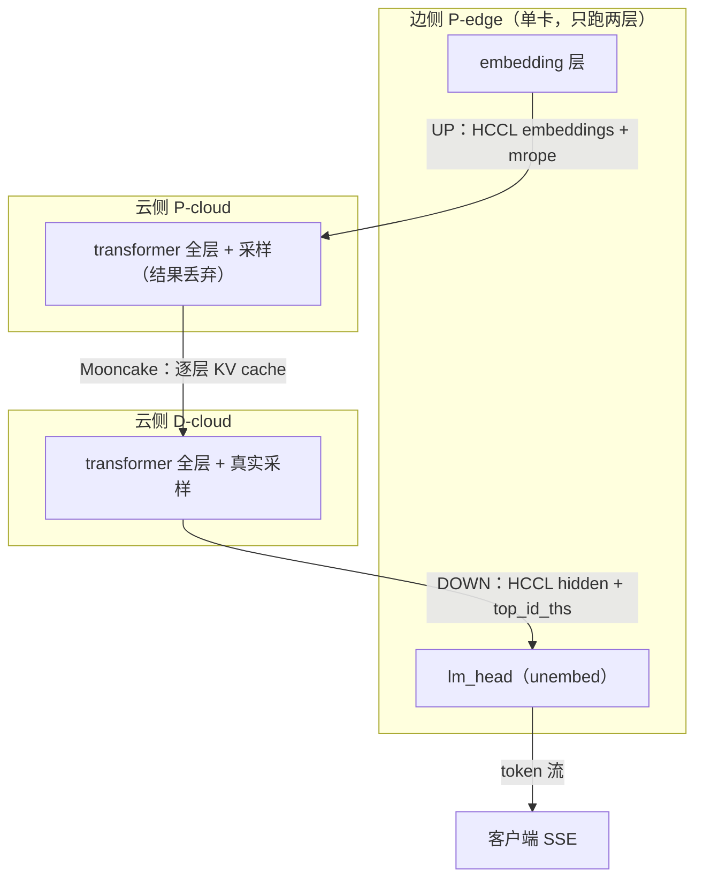
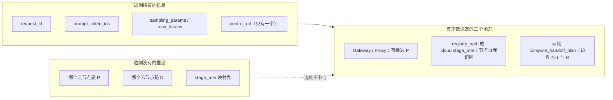
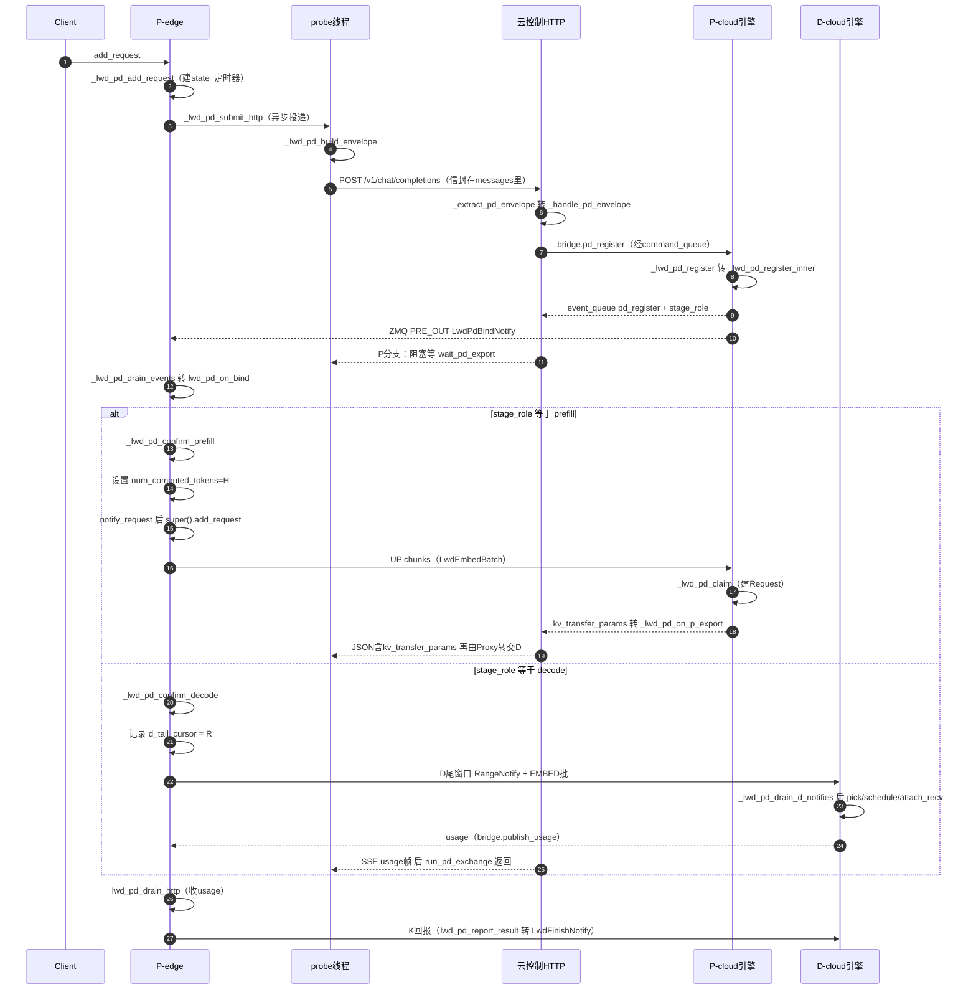

# PD 分离（第三代）· `lwd_pd_config` 全链路技术文档

> 面向开发人员的学习材料：从配置解析、进程启动，到一个用户请求在 P/D 两侧的完整生命周期。

| 项 | 值 |
|---|---|
| 代码基线 | `vllm` @ `c7d173f2fb`（branch `pds_dsv4_qwen_mm_bugfix`）<br>`vllm-ascend` @ `9a0e0e5570`（branch `pds_dsv4_qwen_mm_bugfix`） |
| 行号约定 | 行号以 **`vllm @ c7d173f2fb` / `vllm-ascend @ 9a0e0e5570`** 为准。该分支在活跃开发中，行号会漂移，**函数名/符号名是稳定锚点**，行号仅作快速定位 |
| 备注 | `lwd_edge_scheduler.py` 在临近几次提交中持续快速增长（3170 → 3335 → **3384** 行），`lwd_cloud_engine.py` 也从 2097 涨到 **2126** 行，**多数行号变动集中在这两个文件**。若发现行号对不上，按下节「自查行号」重新定位 |
| 引用约定 | 正文中的 `文件:行` 一律写**工作区根目录起算的完整相对路径**（如 `vllm/vllm/v1/lwd_control/control_edge_scheduler/lwd_edge_scheduler.py:1703`），便于 Ctrl+Click 直接跳转；**符号名永远比行号可靠** |
| 阅读前提 | 已了解 LWD `prefill_only`（第一代）的基本概念：边侧只做 embed/unembed，云侧做全部 transformer 层 |
| 文档范围 | 仅第三代 `additional_config["lwd_pd_config"]`；第一代 `prefill_only`、第二代 `dev/pd-sep-demo` 只在 §1.1 对比 |

### 自查行号

本分支代码在持续演进，本文的行号会随之漂移。任何时候都可以用下面的命令重新生成权威行号表：

```bash
cd vllm   # 或 vllm-ascend
F=vllm/v1/lwd_control/control_edge_scheduler/lwd_edge_scheduler.py
grep -n "^\s*def " "$F" | grep -i "lwd_pd\|lwd_edge"
```

其他文件同理，把 `$F` 换成目标文件、把 `grep -i` 的模式换成目标符号前缀即可。**先确认 `git rev-parse --short HEAD`，再引用行号**。

---

## 0. 速查：本文涉及的文件地图

| 文件 | 行数量级 | 职责 |
|---|---|---|
| `vllm/vllm/config/lwd_pd.py` | 114 | `LwdPdConfig` 定义与启动校验 |
| `vllm/vllm/config/vllm.py` | — | `additional_config` → `VllmConfig.lwd_pd` |
| `vllm/vllm/v1/engine/utils.py` | — | 父进程拉起云侧 HTTP 控制服务 |
| `vllm/vllm/v1/engine/core.py` | — | 引擎类选择（edge/cloud） |
| `vllm/vllm/v1/lwd_control/control_edge_scheduler/lwd_edge_scheduler.py` | 3384 | **边侧调度器**：PD 状态机、信封投递、绑定确认、D 尾窗口派发、K 回报 |
| `vllm/vllm/v1/lwd_control/control_edge_scheduler/lwd_edge_engine.py` | 1004 | 边侧 EngineCore：step 编排、ZMQ 接收、批派发/收割 |
| `vllm/vllm/v1/lwd_control/control_edge_scheduler/lwd_edge_pd.py` | 90 | `LwdPdRequestState` + 阶段常量 |
| `vllm/vllm/v1/lwd_control/control_edge_scheduler/lwd_edge_binding.py` | 96 | `LwdStageBinding` + 阶段绑定表 |
| `vllm/vllm/v1/lwd_control/control_edge_scheduler/lwd_edge_client.py` | 392 | 边→云 HTTP 客户端（`run_pd_exchange`） |
| `vllm/vllm/v1/lwd_control/control_cloud_scheduler/lwd_cloud_engine.py` | 2126 | **云侧 EngineCore**：登记、认领、导出、G/K 合成 |
| `vllm/vllm/v1/lwd_control/control_cloud_scheduler/lwd_cloud_control.py` | 794 | 云侧 FastAPI 控制面 + ZMQ↔asyncio 桥 |
| `vllm/vllm/v1/lwd_control/control_cloud_scheduler/lwd_cloud_mixed_scheduler.py` | 1153 | 云侧混排调度器：P chunk 组批 + D 窗口调度 |
| `vllm/vllm/v1/lwd_control/control_cloud_scheduler/lwd_cloud_pd.py` | 226 | 云侧 PD 数据结构 + 交接计划 |
| `vllm/vllm/v1/lwd_control/control_communication/lwd_pd_envelope.py` | 174 | 控制信封编解码 |
| `vllm/vllm/v1/lwd_control/control_communication/lwd_notify.py` | 382 | 全部控制面消息类型 |
| `vllm/vllm/v1/lwd_control/control_communication/lwd_role_registry.py` | 284 | 边云角色表（P/D 角色唯一来源） |
| `vllm_ascend/platform.py` | — | worker 类选择（`LwdEdgeWorker` / `LwdCloudWorker`） |
| `vllm_ascend/worker/lwd_cloud/lwd_cloud_model_runner.py` | — | D 节点窗口输入缓冲/注入（`recv_only`） |
| `vllm_ascend/worker/lwd_edge_worker.py` | — | 边侧 embed/unembed 执行 |

---

## 1. 三代 PD 谱系与本代定位

### 1.1 三代对比

| | **① `prefill_only`（LWD）** | **② `dev/pd-sep-demo`** | **③ `lwd_pd_config`（本文）** |
|---|---|---|---|
| 分离维度 | 层（embedding ↔ transformer） | 阶段（prefill ↔ decode） | **层 + 阶段**（边侧 embed + 云侧 P/D 分家） |
| 切分点 | 边侧只跑 embed/unembed 与 lm_head | 同一模型内按 BatchType 切首/末段 | 独立的 P 实例与 D 实例 |
| 调度器 | `LwdEdgeScheduler` / `LwdCloudMixedScheduler` | `PDSeparatedScheduler` + `PassiveScheduler` | **复用 ①** 的调度器 + PD 分支 |
| 数据面 | `lwd_comm`（HCCL UP/DOWN） | `edge_cloud_comm`（6 通道） | **复用 ①** 的 `lwd_comm` |
| KV 交接 | 无 | 进程内 | **Mooncake P2P**（`MooncakeLayerwiseConnector`） |
| 分支存在性 | 当前 HEAD 有 | 仅在 `origin/dev/pd-sep-demo` | 当前 HEAD 有 |

### 1.2 关键纠正：第三代**不**使用第二代的任何代码

这是最容易搞混的一点。第三代是在**第一代的 LWD 骨架**上长出来的：

| 组件 | 第三代是否使用 |
|---|---|
| `LwdBatch` / `LwdEmbedBatch` / `LwdUnembedBatch` | ✅ 复用（少量扩字段） |
| `lwd_comm`（HCCL 点对点，UP/DOWN 通道） | ✅ 复用 |
| `LwdEdgeWorker` / `LwdCloudWorker` | ✅ 复用 |
| `LwdEdgeScheduler` / `LwdCloudMixedScheduler` | ✅ 复用（内嵌 PD 分支） |
| `PassiveScheduler` / `PassiveEngineCoreProc` / `edge_cloud_comm` | ❌ **完全不用**（第二代独有，当前 HEAD 无此文件） |
| `pd_separated_scheduler.py` | ❌ **完全不用**（同上） |

唯一"长得像第二代"的部分，是给 `LwdEmbedBatch` 补了三个字段（`vllm/vllm/v1/core/sched/output.py:37-75`）：

```python
recv_only: bool = False          # :67  True = 纯接收任务（PD 的 D 节点）：
                                 #      本批只挂 UP 接收、不做前向计算
window_ids: list[int] = []       # :69  PD 窗口标识（与 req_ids 对齐）
binding_ids: list[str] = []      # :70  绑定的 D 侧 binding_id
```

以及 `LwdUnembedBatch` 补了 `physical_rows` / `valid_rows`（`vllm/vllm/v1/core/sched/output.py:92-95`）——因为 D 节点一批里可能夹带被丢弃的多余行。

> **一句话定位**：第三代 = ① 的三平面（`lwd_config` / `lwd_coordination` / 数据面）+ 新增「P/D 阶段角色」+ 新增「外部 HTTP 控制信封」+ 新增「窗口化 D 尾传输」+ 新增「Mooncake KV 交接」。

---

## 2. 架构总览

### 2.1 角色拓扑



### 2.2 三个平面的端口/端点数

| 通道 | 端点 | 方向 | 承载 |
|---|---|---|---|
| `PRE_OUT` | `tcp://{pre_out_host}:5558`（云 bind） | 云 → 边 | `LwdC2eNotify`（步元数据）、`LwdPdBindNotify`、`LwdPdStageDoneNotify`、`LwdPdQuotaNotify`、`LwdRangeNotify` 的反向应答等 |
| `POST_OUT` | `tcp://{master_addr}:5559`（边 bind） | 边 → 云 | `LwdHelloNotify`、`LwdRequestNotify`、`LwdRangeNotify`、`LwdAbortNotify`、`LwdGenChainNotify`、`LwdFinishNotify` |
| ZMQ 控制面（云侧复用模式） | `tcp://{cloud.addr}:{zmq_port}`（云 ROUTER bind） | 双向 | 单 socket 连 N 台云，identity 首帧寻址 |
| HTTP 控制面（云侧 P/D 节点） | `http://{coordination.listen_host}:{listen_port}/v1/chat/completions` | 边 → 云 | **PD 专用**：控制信封 |
| 数据面 UP | HCCL 点对点（无 tag，按 per-channel `seqno` 提交序配对） | 边 → 云 | embeddings + mrope aux 帧 |
| 数据面 DOWN | 同上 | 云 → 边 | hidden + `top_id_ths` |
| Mooncake P2P | `remote_host:remote_port`（由 P 在导出参数里给出） | P → D | 逐层 KV cache |

端口常量：`vllm/vllm/v1/lwd_control/control_edge_scheduler/lwd_edge_assemble.py:29-34`

```python
LWD_PRE_OUT_PORT_DEFAULT = 5558
LWD_POST_OUT_PORT_DEFAULT = LWD_PRE_OUT_PORT_DEFAULT + 1   # 5559
LWD_HELLO_TIMEOUT_S_DEFAULT = 600.0
```

### 2.3 三份配置

全部放在 `additional_config` 里，由 `VllmConfig.__post_init__` 解析（`vllm/vllm/config/vllm.py:866-890`）：

| 配置段 | 解析行 | 作用 |
|---|---|---|
| `lwd_config` | `vllm.py:871` | 主开关 + 角色（edge/cloud）+ `mode: prefill_only` |
| `lwd_coordination` | `vllm.py:875-881` | HTTP 控制面地址、租户密钥文件、`consumer_id` |
| **`lwd_pd_config`** | **`vllm.py:883-886`** | **P/D 分离参数（本文主角）** |

```python
# vllm/config/vllm.py:883
raw_pd = additional.get("lwd_pd_config") or {}
self.lwd_pd = LwdPdConfig.from_dict(raw_pd)
self.lwd_pd.validate(
    self.lwd_config, self.lwd_coordination, self.lwd_config.is_edge
)
```

### 2.4 `LwdPdConfig` 字段表（`vllm/vllm/config/lwd_pd.py:19-54`）

| 字段 | 默认 | 含义 / 调优建议 |
|---|---|---|
| `enabled` | `False` | 总开关 |
| `max_window_tokens` | `0` | 单窗 token 上限；`0` = 跟随调度 chunk 单元 |
| `max_inflight_windows` | `4` | 单绑定在途窗口上限（D 侧同尺寸成组的并发度上限） |
| `d_output_quota_rows` | `0` | D 输出额度行数；`0` = 用该请求的用户预算 `M` |
| `p_bind_timeout_s` | `30` | 等 P 绑定回执；超时 = P 节点没起来/注册表错 |
| `d_bind_timeout_s` | `30` | 等 D 绑定回执（须 `p_upload_done` 后才判定） |
| `usage_wait_timeout_s` | `600` | 等 D 最终 usage；**必须覆盖 D 等边侧 K 回报的往返** |
| `request_ttl_s` | `1800` | 请求总期限（写进信封，节点按各自时钟管理） |
| `tenant_id` | `""` | 空 = 回退 `coordination.consumer_id` |
| `notify_claim_timeout_s` | `60` | 云侧登记后等 `LwdRequestNotify` 认领 |
| `export_hold_timeout_s` | `600` | P 导出引用的保留期限（覆盖 Proxy 转接 + D 读取） |
| `result_hold_timeout_s` | `600` | D 固定 G 后等边侧 K 回报 |

### 2.5 启动期硬校验（缺一即 fail-fast）

**配置层**（`vllm/vllm/config/lwd_pd.py:56-114`）：

```
enabled=True
 ├─ lwd_config.enabled 必须 True 且 mode=='prefill_only'          (:61-65)
 ├─ max_window_tokens >= 0 / max_inflight_windows >= 1 / ...      (:66-77)
 ├─ 云节点：
 │    ├─ coordination.enabled 必须 True（HTTP 控制服务由它承载）  (:81-86)
 │    └─ lwd_config.role_registry_path 必须非空（P/D 角色唯一来源）(:87-92)
 └─ 边节点：
      ├─ coordination.control_url + tenant_key_file 必须非空      (:97-106)
      └─ lwd_config.role_registry_path 必须非空（1E1C 单云跑不了 PD）(:107-112)
```

**引擎层**（`lwd_cloud_engine.py:482-510` `_lwd_resolve_pd_stage_role`）：

```
registry.cloud_stage_role(cloud_id) ∈ {'prefill','decode'}          (:497-503)
vllm_config.kv_transfer_config 非空（Mooncake 连接器）              (:504-508)
```

**调度器层**（`lwd_cloud_engine.py:133-147`）：

```
PD 开启 → scheduler_name 不得为 'prefill_first'/'decode_first'     (:137-141)
        → speculative_config 必须为 None                           (:142-147)
```

**Ascend 平台层**（`vllm_ascend/platform.py`）：PD 节点 `enable_balance_scheduling` 被拒（`:686-693`）；P 节点 `recompute_scheduler_enable` 被降级为告警并关闭（`:699-706`）；`prefill_only` 模式豁免 PP+MTP 校验（`:431-443`）。

---

## 3. 启动执行链路

### 3.1 全景时序



### 3.2 逐级 `file:line`

| # | 阶段 | 位置 | 关键动作 |
|---|---|---|---|
| 1 | 配置解析 | `vllm/vllm/config/vllm.py:883-886` | `LwdPdConfig.from_dict(raw_pd)` → `validate(...)` |
| 2 | 字段落位 | `vllm/vllm/config/vllm.py:373` | `lwd_pd: LwdPdConfig \| None`（含 docstring） |
| 3 | headless 守卫 | `vllm/vllm/entrypoints/cli/serve.py:186-188` | `lwd_serve_guard(vllm_config)`（云侧注入 `scheduler_cls`） |
| 4 | 引擎类选择 | `vllm/vllm/v1/engine/core.py:1204-1206` | `engine_cls = lwd_resolve_engine_cls(vllm_config) or EngineCoreProc` |
| 5 | 类分流实现 | `vllm/vllm/v1/lwd_control/__init__.py:30-62` | `is_lwd_prefill_only` → edge 返 `LwdEdgeEngineCore`，cloud 返 `LwdCloudEngineCore` |
| 6 | 父进程拉起 HTTP | `vllm/vllm/v1/engine/utils.py:145-151` | 两个队列都为 `None` 时调 `start_lwd_cloud_control_server(vllm_config)` |
| 7 | HTTP 服务实现 | `lwd_cloud_control.py:703-743` | 边侧/未启用 → `return (None, None)`（`:710-714`）；否则建两个 `mp_ctx.Queue()`（`:719-720`）、`bridge.start()`（`:722`）、`create_lwd_cloud_control_app`（`:725-727`）、`uvicorn.run` 进 daemon 线程 `"lwd-cloud-ctrl"`（`:728-740`） |
| 8 | 队列透传子进程 | `vllm/vllm/v1/engine/utils.py:160-161` | `common_kwargs["cloud_control_command_queue"/"...event_queue"]` |
| 9 | 云引擎 ctor | `lwd_cloud_engine.py:121-178` | PD 守卫（`:133-147`）→ 注入 `scheduler_cls`（`:148-152`）→ **PD 状态占位（`:172-176`）→ `super().__init__`（`:177`）→ `_lwd_setup_coordination()`（`:178`）** |
| 10 | PD 状态占位 | `lwd_cloud_engine.py:172-176` | `_lwd_pd_contexts` / `_lwd_pd_out_cursors` / `_lwd_pd_quota_watermarks` / `_lwd_pd_result_lock` / `_lwd_pd_stage_role=""`（**必须在 super 之前**：PRE_OUT IO 线程会读） |
| 11 | 协调器装配 | `lwd_cloud_engine.py:180-244` | `LwdPrefixCoordinator`（`:212-216`）、`LwdCloudControlProcessor`（`:223-225`）、启动 `lwd-ctrl-wake` 线程（`:226-230`） |
| 12 | 唤醒线程 | `lwd_cloud_engine.py:245-260` | 阻塞 `command_queue.get()` → 转 `_lwd_coord_pending` → `input_queue.put_nowait(WAKEUP)`（只搬命令，块池操作仍归主循环线程） |
| 13 | ZMQ 装配 + 角色解析 | `lwd_cloud_engine.py:363-480` | 云侧复用路径 `:437-460`（`:441-443` 处解析 `stage_role`）；1E1C 路径 `:461-480`（PRE_OUT bind + POST_OUT publisher） |
| 14 | 装配调用点 | `lwd_cloud_engine.py:549` | `_lwd_pre_out_loop` 内 `self._lwd_setup_zmq()`，失败即 `EXECUTOR_FAILED`（`:550-553`） |
| 15 | 边引擎 ctor | `lwd_edge_engine.py:90-176` | **`:97` 先注入 `scheduler_cls = LwdEdgeScheduler`**（必须早于 `:98` 的 `super().__init__`）；`:103` 装 `lwd_probe_wakeup`；`:110` `lwd_c2e_meta_queue`；**`:113` `_lwd_pd_event_queue`（无界，注释："事件可丢失即破坏阶段推进"）**；`:119` `_lwd_batch_queue`；`:124` `lwd_edge_usages` |
| 16 | 边侧通道装配 | `lwd_edge_engine.py:134-176` | 云复用走 `_lwd_build_control_channel`（`:134-146`）；1E1C 走 POST_OUT bind + 阻塞等 HELLO（`:150-176`），`:162-172` 超时即 `RuntimeError` |

### 3.3 云侧"登记受理"就绪点

云引擎步循环头部 poll 命令队列（`lwd_cloud_engine.py:263-275`）：

```python
def _lwd_poll_coordination(self) -> None:
    processor = self._lwd_cloud_control_processor
    coordinator = self._lwd_prefix_coordinator
    if processor is not None and coordinator is not None:
        processor.poll(coordinator, pd_handler=self._lwd_pd_register)  # :272
        coordinator.sweep_expired(time.monotonic())
        self._lwd_pd_sweep(time.monotonic())                           # :274
```

调用点：`step_with_batch_queue`（`:1750-1756`）与 `step`（`:1759-1765`）的**步首**。

处理器分派（`lwd_cloud_control.py:325-354`）：

```
probe       → coordinator 处理
pd_register → pd_handler(command)        # 即 _lwd_pd_register  (:350-353)
```

> **为什么需要唤醒线程**：`_process_input_queue` 在 `has_work()` 为假时阻塞。仅投一个 `WAKEUP` 不足以驱动；必须由唤醒线程在收到命令时敲 `WAKEUP`，主循环才会走到 `_lwd_poll_coordination`。同理云侧 `has_work()` 覆写（`lwd_cloud_engine.py:1736-1747`）也把 `_lwd_coord_pending` 与 `lwd_pd_consumed_windows` 计入。

---

## 4. 请求执行链路（12 步）

### 4.0 边侧职责全景（12 项，含可点击代码位置）

> **本节回答两个高频疑问**：① 一个请求进来，边侧到底做了哪些工作？② 边侧是怎样把工作"分配"给 P 实例和 D 实例的？
> **结论先给**：边侧**不做任何分配**。它的 `add_request` 只做两件事——装信封、把信封投到**唯一一个** `control_url`；此后全部动作都是**被动响应**（收绑定回执、收 quota、收 hidden）。真正的 P/D 分工由 **Gateway 的首跳路由** + **云节点自己读 `stage_role`** 完成。
>
> 本节行号基线：`vllm @ c7d173f2fb` / `vllm-ascend @ 9a0e0e5570`。路径均为**工作区根目录起算**，可 Ctrl+Click 跳转。

#### 4.0.1 全链路时序（边 / Proxy / P / D 各归其位）



> **注意 Proxy 的位置**：边侧**从不直接联系 D 节点**。P 完成后，`kv_transfer_params` 是通过 **P 的 HTTP JSON 响应**交给 Proxy，再由 Proxy 发起对 D 的**全新请求**。这就是为什么边侧看不到"D 的地址"——它根本不需要知道。

#### 4.0.2 边侧 12 项职责（数据流视角）



#### 4.0.3 三项数据面流向（边侧只碰头和尾）



#### 4.0.4 "分配给 P / D"的真相



> **验证一（边侧没有 stage_role 的任何读点）**：
> `grep -rn "cloud_stage_role" vllm/vllm/v1/lwd_control/control_edge_scheduler/` → **返回空**。
> `cloud_stage_role()` 定义在 `vllm/vllm/v1/lwd_control/control_communication/lwd_role_registry.py:158`，唯一调用点是云侧 `vllm/vllm/v1/lwd_control/control_cloud_scheduler/lwd_cloud_engine.py:507`（`_lwd_resolve_pd_stage_role`）。
>
> **验证二（信封里没有目标实例字段）**：`build_envelope` 的 `semantic` 字段全集（`vllm/vllm/v1/lwd_control/control_communication/lwd_pd_envelope.py:106-117`）只有 `rid / edge_id / tenant_id / original_prompt_tokens / user_max_output_tokens / sampling / model_id / input_abi / digest`——**没有一个字节描述"发给谁"**。
>
> **验证三（边侧只认一个 URL）**：`_lwd_pd_submit_http` 取 `coord_cfg.control_url`（`vllm/vllm/v1/lwd_control/control_edge_scheduler/lwd_edge_scheduler.py:1422`），`run_pd_exchange` 只对它 `POST`（`vllm/vllm/v1/lwd_control/control_edge_scheduler/lwd_edge_client.py:191`）。没有选择逻辑、没有负载均衡、没有重试到第二台。

#### 4.0.5 12 项职责逐条展开

**职责 1 · 请求准入登记（关键：不入队）**

边侧把请求从 `add_request` 拦下来，**不调用** `super().add_request`。只建一张阶段台账 `LwdPdRequestState`（`vllm/vllm/v1/lwd_control/control_edge_scheduler/lwd_edge_pd.py:30`），装两个定时器（`p_bind` / `ttl`），然后立刻返回。

- 入口分发：`lwd_edge_add_request` — `vllm/vllm/v1/lwd_control/control_edge_scheduler/lwd_edge_scheduler.py:957`，PD 分支 `:984-988`
- PD 主体：`_lwd_pd_add_request` — `vllm/vllm/v1/lwd_control/control_edge_scheduler/lwd_edge_scheduler.py:1326`
- 同 rid 重入即抛错（防旧请求悬挂）：`:1339-1342`
- 建台账：`:1343`；写 `deadline`：`:1351`；挂 `p_bind` 定时器：`:1353`；挂 `ttl` 定时器：`:1356`

> **为什么必须不入队**：第三代 PD 的边侧**并没有本地可算的层**（embedding 也要等云侧告诉它 chunk 尺寸才能切）。入队会让本地调度器把它当普通 LWD 请求排进 batch，直接算出错误结果。

**职责 2 · 构造控制信封**

把"这个请求是什么"压缩成一个自校验 JSON：prompt 长度、用户预算 M、采样参数白名单、模型 ABI、满块哈希链 + 尾块哈希、多模态摘要、TTL。

- 外壳构造：`_lwd_pd_build_envelope` — `vllm/vllm/v1/lwd_control/control_edge_scheduler/lwd_edge_scheduler.py:1365`
- 哈希 manifest：`client.build_manifest(...)` — `vllm/vllm/v1/lwd_control/control_edge_scheduler/lwd_edge_scheduler.py:1392`
- 信封本体：`build_envelope(...)` — `vllm/vllm/v1/lwd_control/control_edge_scheduler/lwd_edge_scheduler.py:1397`；定义在 `vllm/vllm/v1/lwd_control/control_communication/lwd_pd_envelope.py:76`
- 指纹（内容寻址，同一请求重投指纹一致）：`request_fingerprint` — `vllm/vllm/v1/lwd_control/control_communication/lwd_pd_envelope.py:38`

**职责 3 · 异步 POST（单 URL，不阻塞主循环）**

把 HTTP 交互丢到 probe 线程的共享 runtime 里，主循环只从 `_lwd_pd_http_done` 队列取结果。

- 投递函数：`_lwd_pd_submit_http` — `vllm/vllm/v1/lwd_control/control_edge_scheduler/lwd_edge_scheduler.py:1422`
- 块粒度来源（HELLO 学到，未学到回退 `cache_config.block_size`）：`:1436-1443`
- 建 client：`:1444`
- 信封发出后回投 `"sent"`（携带指纹 + 链）：`:1459-1467`
- 流读 + 总超时（用 `request_ttl_s`，超期按错误收尾，防半开连接泄漏）：`:1469-1474`
- 线程死亡兜底（不直通，按失败处理）：`:1483-1496`
- HTTP 客户端实现：`build_pd_control_request` — `vllm/vllm/v1/lwd_control/control_edge_scheduler/lwd_edge_client.py:147`；`run_pd_exchange` — `:173`；`POST` — `:191`

**职责 4 · 事件循环（四路输入统一消费）**

边侧 `_lwd_edge_step` 的步首按固定顺序拉四路事件：probe 结果 → 背压滞留消息 → PD HTTP 结果 → ZMQ 事件。

- 步首编排：`_lwd_edge_step` — `vllm/vllm/v1/lwd_control/control_edge_scheduler/lwd_edge_engine.py:545`
- PD HTTP 结果优先于 ZMQ（绑定确认依赖信封指纹）：`:568-577`
- ZMQ 事件排空：`_lwd_pd_drain_events` — `vllm/vllm/v1/lwd_control/control_edge_scheduler/lwd_edge_engine.py:658`
- 收两类 PD 通知并入队：`:302`（`LwdPdBindNotify / LwdPdStageDoneNotify / LwdPdQuotaNotify`）、`:310`（`put`）
- HTTP 结果排空：`lwd_pd_drain_http` — `vllm/vllm/v1/lwd_control/control_edge_scheduler/lwd_edge_scheduler.py:1513`
- 定时器排空：`lwd_pd_drain_timers` — `vllm/vllm/v1/lwd_control/control_edge_scheduler/lwd_edge_scheduler.py:1551`

**职责 5 · P 绑定确认（此刻才入队）**

收到 `LwdPdBindNotify` 且 `stage_role == "prefill"` 时，边侧才把请求真正交给本地调度器。

- 绑定总入口：`lwd_pd_on_bind` — `vllm/vllm/v1/lwd_control/control_edge_scheduler/lwd_edge_scheduler.py:1587`
- 未知 role 直接拒绝：`:1612`
- 单绑定规则（同一 `(rid, role)` 只允许一次，重投幂等）：`:1613-1621`
- 建 `LwdStageBinding`：`:1629`（数据类定义 `vllm/vllm/v1/lwd_control/control_edge_scheduler/lwd_edge_binding.py:22`）
- P 分支：`_lwd_pd_confirm_prefill` — `vllm/vllm/v1/lwd_control/control_edge_scheduler/lwd_edge_scheduler.py:1653`
- 校验 `p_end` 与本地 N 一致：`:1662`
- 写 `request.num_computed_tokens = binding.hit_tokens`（KV 命中前缀跳过）：`:1681`
- 先通知云侧 chunk 计划：`lwd_edge_notify_request(...)` — `:1690`
- **最后才 `super().add_request(request)`**：`:1703`

> **核心不变量**：`lwd_edge_notify_request` 必须**先于** `super().add_request`。反了就会「云侧还没收到 chunk 预告，边侧已经开始上传」，数据面 numel 不匹配。

**职责 6 · D 绑定确认（只记游标，不入队）**

收到 `stage_role == "decode"` 的绑定回执时，边侧**不把请求放进本地队列**（D 侧由云节点自己 ADD），只记录"从第 R 个 token 开始补窗口"。

- D 分支：`_lwd_pd_confirm_decode` — `vllm/vllm/v1/lwd_control/control_edge_scheduler/lwd_edge_scheduler.py:1711`
- 上游必须是 P（无 P 绑定则报错）：`:1716-1724`
- `R` 边界校验 `0 <= R < N`：`:1726`
- 写尾窗口游标 `state.d_tail_cursor = binding.r_pos`：`:1731`
- 通知云侧窗口预告：`:1733`
- 刷新阶段状态机：`:1748`（`_lwd_pd_refresh_stage` — `:1804`）

**职责 7 · P 段上传调度（push 模式）**

P 阶段边侧的活最多：它要在**每步调度**里决定"这个请求这一拍上传多少 token、发给哪台云"。

- 组批选择器：`_lwd_pick_prefill_batch` — `vllm/vllm/v1/lwd_control/control_edge_scheduler/lwd_edge_scheduler.py:637`（PD 目标判定 `:710`，两处 skip 条件 `:754` / `:819`）
- 上传目标（按 `binding.cloud_id`）：`_lwd_pd_upload_target` — `:2302`
- 单云选择：`_lwd_pd_pick_target` — `:2322`
- 剩余可上传量：`_lwd_remaining_upload` — `:2343`
- 上传公告：`lwd_edge_notify` — `:2509`（`recv_quota` 扣减在 `:2596-2613`）
- 云侧回 quota：`lwd_pd_on_quota` — `:1784`

**职责 8 · D 尾窗口调度（pull 模式，第三代创新）**

D 阶段边侧改被动：云侧发 `LwdPdQuotaNotify` 说"我要 K 个窗口"，边侧才凑一批发出去。**窗口游标只在 `_lwd_publish` 成功后推进**。

- 收集：`lwd_pd_collect_d_tail` — `vllm/vllm/v1/lwd_control/control_edge_scheduler/lwd_edge_scheduler.py:1827`（按目标云分组 `:1839`）
- 计划：`_lwd_pd_plan_d_tail_group` — `:1868`（起始 `:1878`、`limit` 表达式 `:1881`、条数 `:1886`）
- 派发：`_lwd_pd_dispatch_d_tail_group` — `:1906`（`LwdRangeItem` `:1915`、`seqno` `:1926`、游标推进 `:1948`）
- 收割登记：`lwd_pd_tail_harvested` — `:1999`
- 引擎侧调用点（按队列剩余深度限量）：`vllm/vllm/v1/lwd_control/control_edge_scheduler/lwd_edge_engine.py:619-631`

**职责 9 · 真正落 NPU 的计算（只有头和尾）**

边侧 NPU 上只跑 embedding 层和 lm_head，中间全在云上。

- 统一入口：`execute_model` — `vllm-ascend/vllm_ascend/worker/lwd_edge_worker.py:263`
- 输入 H2D（含 mrope aux）：`_lwd_embed_ids_h2d` — `vllm-ascend/vllm_ascend/worker/lwd_edge_worker.py:330`
- **embed 前向**：`_execute_lwd_embed` — `vllm-ascend/vllm_ascend/worker/lwd_edge_worker.py:372`（多模态特征合流 `:383-407`；hash-MoE 排除 `:402`）
- **unembed 前向**：`_execute_lwd_unembed` — `vllm-ascend/vllm_ascend/worker/lwd_edge_worker.py:851`（DOWN 接收 `:858`、`record_stream` `:871`、`valid_rows` 过滤 `:874`、跳过采样 `:888`、`lm_head` `:894`）
- 引擎侧派发：`_lwd_dispatch_embed` — `vllm/vllm/v1/lwd_control/control_edge_scheduler/lwd_edge_engine.py:738`；`_lwd_deliver_unembed` — `:802`

**职责 10 · token 保序交付（防乱序 / 防重复）**

云侧多步并发会乱序回 token，边侧按 `binding_id + 区间` 做保序和去重。

- 交付主函数：`lwd_pd_deliver_tokens` — `vllm/vllm/v1/lwd_control/control_edge_scheduler/lwd_edge_scheduler.py:2008`
- 区间空洞检测：`:2023`
- 区间摘要校验（与云侧共用 `range_digest`）：`:2032`
- 水位线推进：`:2044`
- 引擎侧交付：`lwd_edge_deliver_tokens` — `:3227`
- 进度回灌：`lwd_edge_update_progress` — `:3159`

**职责 11 · 最终 K 回报 + usage 合成**

D 固定输出 G 后要等边侧报 K（真实 token 数）才能给前端正确 usage。边侧负责这一次闭环。

- K 回报主函数：`lwd_pd_report_result` — `vllm/vllm/v1/lwd_control/control_edge_scheduler/lwd_edge_scheduler.py:2083`
- 实际发送：`_lwd_pd_send_result` — `:2120`
- usage future 登记：`lwd_pd_request_usage` — `:2169`
- 唤醒等待方：`_lwd_pd_complete_usage_waiters` — `:2184`
- 还有活跃 PD 请求否：`lwd_pd_pending` — `:2294`

> **核心不变量**：G/K 不一致是**协议错误**，不回退到 G、也不回退到零。前端会拿到错误 usage，但比静默篡改安全。

**职责 12 · 失败收敛 / abort / 清理**

- 单请求失败：`_lwd_pd_fail` — `:2193`
- abort：`_lwd_pd_abort` — `:2217`
- 台账回收（K 与 HTTP 齐备才删）：`_lwd_pd_maybe_cleanup` — `:2240`
- 对外 abort 入口：`lwd_edge_abort` — `:2770`
- 世代链公告：`_lwd_announce_gen_chain` — `:2904`
- 队列死锁 fail-fast（PD 下 `max_num_seqs` 配太小的保护）：`lwd_edge_max_num_seqs_check` — `:2365`

#### 4.0.6 责任矩阵：谁做什么

| 工作项 | 边侧（P-edge） | Gateway / Proxy | P-cloud | D-cloud |
|---|---|---|---|---|
| 请求真正的第一跳路由 | ❌ | ✅ | ❌ | ❌ |
| 决定谁是 P、谁是 D | ❌ | ⚠️ 只按配置/规则选 P | ❌ | ❌ |
| 读 `stage_role` 判定自身角色 | ❌ **从不读** | ❌ | ✅ | ✅ |
| 建阶段台账 / 装信封 | ✅ | ❌ | ❌ | ❌ |
| 控制信封的 HTTP 受理 | ❌ | ❌ | ✅ | ✅ |
| 绑定回执（`LwdPdBindNotify`） | 收 | ❌ | 发 | 发 |
| 请求入本地调度队列 | ✅ 仅 P 阶段 | ❌ | 自己的队列 | 自己的队列 |
| 计算边界 `p_end` / `R` | ❌（只校验） | ❌ | ✅ `compute_handoff_plan` | ✅ 校验 |
| 逐层 KV 交接 | ❌ | ❌ | 写（Mooncake） | 读（Mooncake） |
| 把 `kv_transfer_params` 转交 D | ❌ | ✅ | 产出（HTTP JSON） | 消费 |
| D 尾窗口的凑批决策 | ✅ | ❌ | ❌ | 提需求（quota） |
| embed / unembed 前向 | ✅ | ❌ | ❌ | ❌ |
| transformer 全层前向 | ❌ | ❌ | ✅ | ✅ |
| token 保序 / 去重 | ✅ | ❌ | 产出 | 产出 |
| 最终 G/K 对齐与 usage | ✅ 报 K | ❌ | ❌ | ✅ 定 G |
| abort 传播 | ✅ | 可选 | ✅ | ✅ |

`compute_handoff_plan` / `validate_handoff_plan` 定义在 `vllm/vllm/v1/lwd_control/control_cloud_scheduler/lwd_cloud_pd.py:66` / `:87`；`stage_role` 判定在 `vllm/vllm/v1/lwd_control/control_cloud_scheduler/lwd_cloud_engine.py:507`。

#### 4.0.7 三条自查命令（随时验证本文结论）

```bash
# ① 边侧绝不读 stage_role —— 预期输出为空
cd vllm && grep -rn "cloud_stage_role" vllm/v1/lwd_control/control_edge_scheduler/

# ② 信封没有"目标实例"字段 —— 只看得到 9 个 semantic key
sed -n '106,117p' vllm/v1/lwd_control/control_communication/lwd_pd_envelope.py

# ③ 边侧只有一个 control_url —— 没有第二台的分支
cd .. && grep -rn "control_url" vllm/vllm/v1/lwd_control/control_edge_scheduler/ | grep -v "^\s*#"
```

---

### 4.1 全景时序



### 步骤 1 — 边侧 HTTP 入口

| 位置 | 内容 |
|---|---|
| `lwd_edge_engine.py:506-512` | `LwdEdgeEngineCore.add_request` → `self.scheduler.lwd_edge_add_request(request)` |
| `lwd_edge_scheduler.py:957-992` | **`lwd_edge_add_request`**：`_lwd_validate_request`（`:969`）→ 留档 prompt ids（`:971-973`）→ 多模态留档（`:976-978`）→ `abort_immediately` 短路（`:979-983`）→ **PD 分支（`:984-988`）** → `_lwd_probe_submit_async`（`:989-990`）→ 退化同步路径（`:992`） |

PD 分支原文（`:984-988`）：

```python
if self._lwd_pd_enabled:
    # PD:登记阶段记录并投 HTTP 信封;请求不入队,上传由 P 绑定
    # 回执驱动,HTTP 只负责最终结果
    self._lwd_pd_add_request(request)
    return
```

> **核心不变量 #1**：PD 路径下请求**不**在 `add_request` 时入调度器队列，也**不**做 probe。入队时机被推迟到 P 绑定回执到达之后。

### 步骤 2 — 建阶段记录 + 投 HTTP

`lwd_edge_scheduler.py:1326-1363` `_lwd_pd_add_request`：

```python
m_tokens = sampling.max_tokens or _LWD_PD_DEFAULT_MAX_TOKENS       # :1333-1337
if request.request_id in self._lwd_pd_states: raise ValueError(...) # :1338-1342
state = LwdPdRequestState(
    request_id=..., n_tokens=len(prompt_token_ids), m_tokens=m_tokens,
    fingerprint="", tenant_id=pd_cfg.tenant_id or coord_cfg.consumer_id or "",
    request=request)                                                # :1343-1350
state.deadline = state.created_at + pd_cfg.request_ttl_s            # :1351
self._lwd_pd_states[request_id] = state                             # :1352
self._lwd_pd_arm_timer(request_id, "p_bind", p_bind_timeout_s)      # :1353-1355
self._lwd_pd_arm_timer(request_id, "ttl", request_ttl_s)            # :1356-1358
self._lwd_pd_submit_http(request, state)                            # :1359
```

注意 `fingerprint` 此刻是空串——真正的指纹由后台线程构完信封后，经 `("sent", (fingerprint, build_bs, chain))` 回投、由 `lwd_pd_drain_http` 写回（`lwd_edge_scheduler.py:1524-1532`）。

### 步骤 3 — 后台线程：构信封并 POST

| 位置 | 内容 |
|---|---|
| `lwd_edge_scheduler.py:1422-1495` | `_lwd_pd_submit_http`：取 `build_bs`（`:1436-1443`，PD 无 probe 回执可学，未学到回退边块粒度）、建 client（`:1444`）、定义 `_job()`（`:1453`） |
| `:1456-1465` | `_job` 内：`envelope, chain, model_name = self._lwd_pd_build_envelope(...)` → 先回投 `("sent", (envelope["fingerprint"], build_bs, chain))` |
| `:1469-1474` | `usage = await asyncio.wait_for(client.run_pd_exchange(session, request_id, envelope, model=model_name), timeout=pd_cfg.request_ttl_s)` |
| `:1475-1481` | 异常 → `("error", f"{type}: {exc}")`；成功 → `("usage", usage)`；两条路径都调 `_wakeup()` |
| `:1483-1495` | 线程死亡保险：`runtime.stop()` + `("error", "pd http runtime unavailable")` |
| `lwd_edge_scheduler.py:1365-1420` | `_lwd_pd_build_envelope`：`client.build_manifest`（`:1392-1396`）→ `build_envelope(...)`（`:1397-1419`）→ 返回 `(envelope, full_block_hashes, model_name)`（`:1420`） |
| `lwd_pd_envelope.py:76-125` | `build_envelope`：`semantic = {rid, edge_id, tenant_id, original_prompt_tokens, user_max_output_tokens, sampling, model_id, input_abi, digest}`，`fingerprint = request_fingerprint(semantic)` |
| `lwd_edge_client.py:147-171` | `build_pd_control_request`：信封 JSON 化后塞进 `messages[0].content`（`:164`），外层保持**普通 OpenAI 形状**（`stream: True` + `stream_options.include_usage`）；元数据**不**放自定义头（注释：网关 DTO 转换会剥 body 非标准字段） |
| `lwd_edge_client.py:173-222` | `run_pd_exchange`：`session.post(self._control_url, ...)`（`:190-193`）；非 200 抛（`:195-199`）；读 SSE 到 `[DONE]`（`:201-205`）；**无 usage 即抛**（`:211-214`）——PD 不 fail-open |

**信封结构**（`lwd_pd_envelope.py:76-125`）：

```jsonc
{
  "type": "lwd_pd_envelope",
  "version": 1,
  "rid": "<原始请求 id>",
  "edge_id": 0,
  "tenant_id": "...",
  "original_prompt_tokens": 1234,        // N
  "user_max_output_tokens": 512,         // M
  "sampling": { /* 白名单字段：max_tokens/temperature/top_p/... */ },
  "model_id": "...",
  "input_abi": "qwen2_vl;mrope=1",       // 模型类型 + 是否 mrope
  "digest": {
    "algo": "...", "domain": "...",
    "block_size": 128,
    "chain": ["<满块 HMAC>", ...],
    "tail": "<尾块 HMAC 或 null>",
    "media": [ /* 多模态摘要 */ ]
  },
  "fingerprint": "<对 semantic 的 hash>",
  "ttl_s": 1800.0
}
```

> **隐私性质**：`digest.chain` 是租户密钥的链式 HMAC，**原始 prompt token 不出边**。云侧只有占位零值 embeddings（`_lwd_build_pd_request` 里 `prompt_token_ids=None`）。

### 步骤 4 — 云侧 HTTP 受理

| 位置 | 内容 |
|---|---|
| `lwd_cloud_control.py:552-598` | `chat_completions(request)`：头小写化（`:566`）→ 取 `edge_id`（`:568`）→ registry 成员校验（`:578-588`）→ **`envelope = _extract_pd_envelope(body)`；非 None 即 `return await _handle_pd_envelope(envelope, edge_id, body)`（`:591-593`）** |
| `lwd_cloud_control.py:375-396` | `_extract_pd_envelope`：扫 `messages[].content`，找 `parse_envelope` 能解的那条 |
| `lwd_cloud_control.py:409-547` | `_handle_pd_envelope` |
| `:412-421` | 信封 `edge_id` **必须**等于传输头 `edge_id`（否则预留键与数据面键错位） |
| `:422-427` | `kv_transfer_params` 必须是 dict |
| `:428-437` | `registered = await bridge.pd_register(envelope, kv_params, edge_id)`；`TimeoutError → 503`，其他 → `400` |
| `:438-441` | 读 `registered["request_id"]` / `["stage_role"]`（`:440-441`） |
| **`:445-488`** | **P 分支**：`kv_transfer_params = await bridge.wait_pd_export(request_id, export_hold_timeout_s)`（`:452-454`）→ 返回 JSON（`:470-488`），含 `kv_transfer_params` + 占位 usage（`prompt_tokens=N`, `completion_tokens=0`, `finish_reason:"length"`） |
| **`:490-546`** | **D 分支**：`bridge.release_pd_export(request_id)`（`:498`）→ `events()` SSE 生成器（`:506-541`）：首帧空 delta（`:508-513`）、`usage_task = asyncio.create_task(bridge.wait_usage(request_id, usage_timeout))`（`:514-515`）、心跳 `": lwd-pd-usage-pending\n\n"`（`:521`）、末帧 `usage.to_openai_dict()`（`:528-534`）、无 usage 打 fail-closed 警告（`:536-540`）、`data: [DONE]`（`:541`） |
| `lwd_cloud_control.py:166-221` | `LwdCloudControlBridge.pd_register`：`wrap_req_id(edge_id, envelope["rid"])`（`:185`）→ **同时**预注册 `_pd_register_waiters[rid]` 与 `_pd_export_waiters[rid]`（`:189-191`）→ 命令入队（`:192-197`）→ executor 内在 waiter 上等（`:200-203`）→ 返回 `{"request_id": rid, "stage_role": payload["stage_role"]}`（`:218-221`） |
| `lwd_cloud_control.py:254-313` | `_dispatch_events`：`pd_register` 会 **pop** waiter；`pd_export` **不 pop**（导出可能先于 `wait_pd_export` 调用到达） |

> **为什么 P/D 的 HTTP 语义不同**：P 节点产出的是 KV 交接参数（必须**同步**返回给 Proxy 再转交 D）；D 节点产出的是最终 usage（D 要等边侧 K 回报，天然耗时，用 SSE 保持连接 + 心跳）。

### 步骤 5 — 云引擎登记 + 发绑定回执

`lwd_cloud_engine.py:1001-1058` `_lwd_pd_register`：

```python
request_id = wrap_req_id(edge_id, envelope["rid"])                    # :1008
try:
    ctx, created = self._lwd_pd_register_inner(request_id, edge_id,
                                               envelope, kv_params)   # :1009-1012
except Exception as exc:
    self._lwd_pd_event({"type": "pd_register", "request_id": request_id,
                        "ok": False, "error": str(exc),
                        "stage_role": self._lwd_pd_stage_role})       # :1013-1026
    return
if created:
    if not self._lwd_pd_send_bind(ctx):
        self._lwd_pd_contexts.pop(request_id, None)
        self._lwd_pd_event({... "ok": False,
                            "error": "bind notify publish failed"})  # :1027-1037
        return
self._lwd_pd_event({"type": "pd_register", "request_id": request_id,
                    "ok": True, "stage_role": ctx.stage_role})        # :1038-1044
if not created:            # 重复登记：补发原结果
    if ctx.export_done: self._lwd_pd_event({"type": "pd_export", ...})# :1045-1051
    if ctx.usage_sent:  self._lwd_pd_event({"type": "usage", ...})    # :1052-1057
```

`_lwd_pd_register_inner`（`:1060-1206`）的校验表：

| 行 | 校验 / 动作 | 失败语义 |
|---|---|---|
| `:1067-1068` | 无 `stage_role` 的节点收到信封 | 拒绝 |
| `:1069-1083` | 重复登记：`fingerprint` 与 `stage_role` 必须一致、未 cancelled | 一致则 `created=False` 复用 |
| `:1084-1091` | `N < 1 or M < 1`；`N + M > max_model_len` | 拒绝 |
| `:1093-1099` | `digest.block_size % hash_block_size != 0` | 拒绝（摘要粒度过细） |
| `:1100-1107` | `input_abi` 与本地不符 | 拒绝（模型/多模态不匹配） |
| **`:1112-1127`** | **P 侧**：`compute_handoff_plan(n_tokens, need_truncate)` 定 `(p_end, i_end, r_pos)`；再 `coordinator.probe(manifest, max_hit_tokens=p_end - 1)` 得 `hit_tokens` | `coordinator is None` 拒绝 |
| **`:1128-1166`** | **D 侧**：从 `kv_params["lwd_handoff"]` 取 `p_end/i_end/r_pos` + `source_p_binding/source_export_id`；`validate_handoff_plan`；要求 `remote_engine_id/remote_request_id/remote_host/remote_port` 齐全 | 缺一拒绝 |
| `:1172-1198` | 建 `LwdPdStageContext`（`binding_id = f"{stage_role}-{cloud_id}-{uuid[:12]}"`（`:1177-1179`）、`claim_deadline = now + notify_claim_timeout_s`（`:1192`）） | — |

**交接计划**（`lwd_cloud_pd.py:66-84`）：

```python
普通 attention：    P_end = I = N,      R = N - 1     # 末位置在 D 上重算
需截断状态模型：    P_end = I = R = N - 1             # N == 1 直接 ValueError
```

- `P_end`：P 实际执行输入的逻辑上界
- `I`：D 导入状态表示的逻辑前缀上界（恒等于 `P_end`，由 `validate_handoff_plan` 强制）
- `R`：D 首次处理**真实输入**的位置

`need_truncate` 判定（`lwd_cloud_pd.py:49-64`）：`hf_config.compress_ratios` 存在，或任一 KV 组是 `MambaSpec`。

`_lwd_pd_send_bind`（`:1208-1232`）：组 `LwdPdBindNotify(request_id=raw_rid, stage_role, binding_id, cloud_id, hit_tokens, p_end, i_end, r_pos, max_window_tokens, max_inflight_windows, recv_windows, source_p_binding, source_export_id, ttl_s)`（`:1210-1226`）→ `self._lwd_pd_publish(notify, ctx.edge_id)`（`:1227`）经 ZMQ PRE_OUT 定向发边。

### 步骤 6 — 边侧收绑定并分支

| 位置 | 内容 |
|---|---|
| `lwd_edge_engine.py:217-265` | `_receive_thread`（1E1C 单云）：HELLO → retarget PRE_OUT → `LwdC2eNotify` 进 `lwd_c2e_meta_queue` |
| **`lwd_edge_engine.py:267-328`** | `_receive_thread_channel`（云侧复用）：`isinstance(notify, (LwdPdBindNotify, LwdPdStageDoneNotify, LwdPdQuotaNotify))`（`:302`）→ 补 `notify.cloud_id`（`:305`）→ `self._lwd_pd_event_queue.put(notify)`（`:310`）+ `input_queue.put_nowait(WAKEUP)`（`:311-313`） |
| `lwd_edge_engine.py:524-536` | `has_work()` 计入 `not self._lwd_pd_event_queue.empty()` 与 `scheduler.lwd_pd_pending()`（否则空闲时睡死，PD 阶段永不推进） |
| `lwd_edge_engine.py:545-649` | `_lwd_edge_step`：`:563` `lwd_edge_drain_probe_results()` → `:564` `lwd_edge_flush_pending()` → **`:568-580` PD 事件消费（失败转 `EngineCoreOutput(finish_reason=ERROR)`）** → `:582-600` 收割 `_lwd_batch_queue`（`unembed` / **`pd_tail`（`:590-593`）** / `embed`）→ `:611-620` 继续派发 EMBED → `:622-634` **D 尾窗口派发（`lwd_pd_collect_d_tail`）** → `:635` `_lwd_edge_consume_c2e()` |
| **`lwd_edge_engine.py:658-683`** | `_lwd_pd_drain_events`：**顺序 = `lwd_pd_drain_http()` → ZMQ 事件 → `lwd_pd_drain_timers()`**（docstring："HTTP 结果先于 ZMQ 事件消费——绑定确认依赖信封指纹"） |
| `lwd_edge_scheduler.py:1587-1651` | `lwd_pd_on_bind` |

`lwd_pd_on_bind` 决策树：

```
state 不存在             → 告警丢弃（云侧自己按期限收尾）            (:1596-1602)
state.cancelled / FINISHED → 拒绝新绑定认领                          (:1603-1610)
stage_role 非法          → 返回错误 → 请求失败                       (:1611-1612)
同 role 已有 binding：
    binding_id 相同      → 幂等复用，return None                     (:1615-1618)
    binding_id 不同      → 告警丢弃（每阶段只认一个有效绑定）        (:1619-1622)
notify.accepted == False → 返回错误 → 请求失败                       (:1623-1627)
否则建 LwdStageBinding(... recv_quota = notify.recv_windows or
        pd_cfg.max_inflight_windows, ...)                            (:1629-1646)
_lwd_binding.bind_stage(...)                                          (:1647-1649)
role == prefill → _lwd_pd_confirm_prefill                            (:1650)
否则             → _lwd_pd_confirm_decode                            (:1651)
```

### 步骤 7a — P 侧确认（`lwd_edge_scheduler.py:1653-1710`）

```python
p_end <= 0 or p_end > n_tokens or hit_tokens > p_end → 错误           # :1663-1667
state.p_end = p_end                                                   # :1668
# D 绑定可能先到：其 source_p_binding 必须与本回执一致
d_binding.source_p_binding != binding.binding_id → 错误               # :1670-1679
if hit_tokens > 0:
    request.num_computed_tokens = hit_tokens                          # :1681
    self._lwd_resume_hit_by_req[request_id] = hit_tokens              # :1682
self._lwd_hash_bs_by_cloud.setdefault(binding.cloud_id, ...)          # :1683-1688
self._lwd_compute_mrope_positions(request)                            # :1689
self.lwd_edge_notify_request(
    request_id, num_prompt_tokens=n_tokens, sampling_params,
    block_hashes=[], prefix_hit_tokens=hit_tokens, cloud_id,
    stage_role=STAGE_ROLE_PREFILL, binding_id,
    user_max_output_tokens=state.m_tokens,
    params_fingerprint=state.fingerprint)                             # :1690-1701
state.stage = STAGE_PREFILLING                                        # :1702
super().add_request(request)      # ← 此刻才真正入调度器              # :1703
```

> **核心不变量 #2**：`lwd_edge_notify_request`（发 `LwdRequestNotify`）**必须先于** `super().add_request`。云侧视图必须领先本地工作——云只能准备、不能提前计算（没有 chunk 预告就不会开算）。

`lwd_edge_notify_request` 定义在 `lwd_edge_scheduler.py:2668-2746`，签名：

```python
def lwd_edge_notify_request(self, request_id, num_prompt_tokens,
    sampling_params=None, block_hashes=None, prefix_hit_tokens=0,
    cloud_id=None, stage_role="", binding_id="",
    user_max_output_tokens=0, params_fingerprint="",
    output_quota_rows=0) -> None
```

背压时消息进该云的**有序滞留队列**，由步首 `lwd_edge_flush_pending()` 补投（保序在本请求的 `RangeNotify` 之前），主循环零阻塞。

### 步骤 7b — D 侧确认（`lwd_edge_scheduler.py:1711-1755`）

```python
p_binding 已存在 且 source_p_binding != p_binding.binding_id → 错误   # :1716-1724
not 0 <= r_pos < n_tokens → 错误（尾窗口必须非空）                    # :1726-1728
state.d_tail_start = state.d_tail_cursor = r_pos                      # :1730-1731
self.lwd_edge_notify_request(
    ..., stage_role=STAGE_ROLE_DECODE, prefix_hit_tokens=0,
    output_quota_rows=(pd_cfg.d_output_quota_rows or state.m_tokens)) # :1733-1746
self._lwd_pd_refresh_stage(state)                                     # :1748
```

> D 侧**不** `add_request`：D 的执行请求由**云 D 节点**自己在认领时创建（见步骤 8a）。

### 步骤 7c — 边侧阶段状态机

常量（`lwd_edge_pd.py:17-26`）：

```
STAGE_WAIT_P     = "wait_p"        # 已登记，等 P 绑定
STAGE_PREFILLING = "prefilling"    # P 已绑定，正在上传 chunk
STAGE_WAIT_D     = "wait_d"        # P 上传完成，等 D 绑定
STAGE_D_STARTING = "d_starting"    # D 已绑定，尾窗口未派完
STAGE_DECODING   = "decoding"       # 尾窗口派完
STAGE_FINALIZING = "finalizing"     # 已收到 finish，等 usage
STAGE_FINISHED   = "finished"       # 台账已摘除
```

推进逻辑 `_lwd_pd_refresh_stage`（`lwd_edge_scheduler.py:1804-1825`），终态不回退：

```
有 D 绑定 → d_tail_done ? DECODING : D_STARTING
无 P 绑定 → WAIT_P
有 P 绑定 && p_upload_done → WAIT_D
否则 → PREFILLING
```

### 步骤 8a — 云侧认领并建 Request（`lwd_cloud_engine.py:1234-1300`）

触发点：`_lwd_dispatch`（`lwd_cloud_engine.py:606`）里收到带 `stage_role` 的 `LwdRequestNotify`：

```python
if msg.stage_role:
    logger.info("[Lwd][cloud-ctrl] PD RequestNotify req=%s edge=%d role=%s binding=%s", ...)
    self._lwd_pd_claim(edge_id, msg)      # ← 不进普通门池
    return
```

> 对比非 PD 路径：普通 `LwdRequestNotify` 进 `_lwd_gate_pending` 再 `_lwd_promote`（`:840-836`）。PD 走独立受控路径。

`_lwd_pd_claim` 的受控顺序（docstring 列了六步：校验上下文 → 校验 Notify → 构建 Request → 安装参数 → 接管预约 → ADD）：

| 行 | 校验 / 动作 | 拒绝后行为 |
|---|---|---|
| `:1243-1249` | ctx 不存在 | 告警丢弃（边侧由其 TTL 收尾） |
| `:1250-1252` | `ctx.cancelled` | 拒绝 |
| `:1253-1260` | `wire.stage_role / binding_id` 与 ctx 不一致 | 冲突拒绝 |
| `:1261-1266` | `params_fingerprint` 不一致 | 拒绝 |
| `:1267-1272` | 已 `claimed` | 幂等复用原请求 |
| `:1273-1275` | 超过 `claim_deadline` | 拒绝 |
| `:1276-1284` | P 侧 `wire.prefix_hit_tokens != ctx.hit_tokens` | 拒绝 |
| `:1285-1288` | `request = self._lwd_build_pd_request(ctx, wire)` | — |
| `:1289-1291` | P：`_lwd_claim_reservation(request)` | — |
| `:1292-1303` | D：`scheduler.lwd_pd_register_d_record(...)` | — |
| `:1305-1306` | `self.input_queue.put_nowait((ADD, (request, 0)))` | — |

`_lwd_build_pd_request`（`:1302-1382`）关键点：

```python
prompt_embeds = torch.zeros(ctx.n_tokens, hidden_size, dtype=dtype)   # :1304-1308
block_hasher = self._lwd_pd_block_hasher(ctx, hash_block_size)        # :1314

# P 侧（:1318-1333）：单 token 阶段参数
SamplingParams(max_tokens=1, min_tokens=1, ignore_eos=True,
               stop_token_ids=[], temperature=wire.temperature, ...)
kv_params = {"do_remote_decode": True, "do_remote_prefill": False}

# D 侧（:1334-1356）：完整用户参数
SamplingParams(max_tokens=wire.max_tokens, ..., ignore_eos=wire.ignore_eos,
               stop_token_ids=list(wire.stop_token_ids), min_tokens=wire.min_tokens)
kv_params = dict(ctx.kv_params or {}); kv_params["do_remote_prefill"] = True

request = Request(request_id=ctx.request_id, prompt_token_ids=None,
                  prompt_embeds=prompt_embeds, sampling_params=...,
                  block_hasher=block_hasher)                          # :1357-1363
request.lwd_embeds_placeholder = True                                 # :1364
# P 侧额外：
request.lwd_resume_cap_tokens = ctx.hit_tokens                        # :1366
request.lwd_pd_suppress_user_output = True                            # :1371
request.kv_transfer_params = kv_params                                # :1376
```

> **为什么 P 侧 `max_tokens=1` 且 `lwd_pd_suppress_user_output=True`**：P 阶段的采样只是为了"驱动完成与导出"的内部动作，其结果**不进**用户输出序列。抑制标记随 `NewRequestData` 到 worker，DOWN 采集入口据此跳过该请求（`lwd_cloud_model_runner.py:104-129`）。

> **为什么 P 侧 `ignore_eos=True`、`stop_token_ids=[]`**：屏蔽内部 EOS/stop 提前结束，保证采样结果以"长度封顶"进入正常导出路径；用户真实参数留在上下文的 `m_tokens` 里给 D 用。

`_lwd_pd_block_hasher`（`:1384-1407`）：PD 请求的块哈希来自**信封摘要链**（与 probe 同链），而非本地内容哈希——因为云侧 prompt 是占位零值。

### 步骤 8b — 云 D 侧窗口接收与调度（`lwd_cloud_mixed_scheduler.py`）

| 位置 | 内容 |
|---|---|
| `:1103-1116` | `schedule()`：`out = self._schedule_impl()` → `_lwd_pd_maybe_attach_recv(out)`（`:1108`）→ `_lwd_pd_consume_output_rows(out)`（`:1109`） |
| `:811-864` | `_schedule_impl`：**首两行就是 PD**——`self._lwd_pd_drain_d_notifies()`（`:815`）、`import_ids = self._lwd_pd_collect_imports()`（`:816`）→ 中间 P 路径（`:819-857`）→ **`:860-863` D 尾窗前向**：`d_size, d_group = self._lwd_pd_pick_d_window_group()`；有组即 `return self._lwd_pd_schedule_d_windows(d_size, d_group)`（独占一步） |
| `:215-289` | `_lwd_pd_drain_d_notifies`：binding 匹配（`:239`）、offset 连续（`:248`）、window_id 递增（`:260`）、在途上限（`:266-272`）、追加 `LwdPdDWindow` 并推 `_lwd_pd_recv_pending`（`:288`） |
| `:290-347` | `_lwd_pd_collect_imports`：`lwd_kv_load_failed` → 终结；`WAITING_FOR_REMOTE_KVS` + `finished_recving_kv_req_ids` → **校验 `num_computed_tokens == record.r_pos`**（不等即 fail-fast，`:318-330`），置 `record.kv_ready = True` |
| `:348-367` | `_lwd_pd_import_capacity_ok`：按 KV 组估算 `N + M` 块数，超空闲块即拒绝（比生成中途耗尽提前暴露） |
| **`:414-444`** | `_lwd_pd_pick_d_window_group`：按 `num_tokens` 分组（同尺寸才能用阈值+预算双钳精确复现窗口边界）；放行条件 = 未取消 + `kv_ready` + `WINDOW_READY` + `num_computed_tokens == window.offset` + 末窗还需 `output_quota != 0`；取 `max(by_size)` |
| **`:446-481`** | `_lwd_pd_schedule_d_windows`：临时改 `long_prefill_token_threshold=size`、`max_num_scheduled_tokens=size*len(group)`、`need_mamba_block_aligned_split=False`、`scheduler_reserve_full_isl=False`，调 `_lwd_schedule_for_visible_reqs`，**`finally` 中全部还原**；逐 record 校验 `scheduled == window.num_tokens`（不等即 `RuntimeError`，`:474-477`）；置 `WINDOW_CONSUMING` |
| **`:483-520`** | `_lwd_pd_maybe_attach_recv`：从 `_lwd_pd_recv_pending` 取一条，构造 `LwdBatch(LWD_EMBED, seqno=notify.seqno, LwdEmbedBatch(..., token_ids=[[0]*n], ghost_req_ids, retain_mm=True, recv_only=True, window_ids, binding_ids))`（`:506-522`），并 `out.lwd_pd_recv_windows = recv_windows` |
| `:522-535` | `_lwd_pd_consume_output_rows`：prompt 之后的步每步扣 `record.output_quota` 一行（不归还；增发只能来自边侧 `LwdPdQuotaNotify`） |
| `:369-390` | `_lwd_pd_mark_recv_ready`：步完成即 `WINDOW_RECEIVING → WINDOW_READY`（已取消则直接 `CONSUMED`） |
| `:392-412` | `_lwd_pd_mark_windows_consumed`：`num_computed_tokens >= offset+num` → `WINDOW_CONSUMED`、登记 `lwd_pd_consumed_windows`；尾窗消费完置 `record.tail_done` |

**D 窗口状态机**（`lwd_cloud_pd.py:41-46`）：

```
registered → receiving → ready → consuming → consumed
                          └──── draining（已取消，只排空）
```

> **为什么 D 尾窗口要"同尺寸成组"**：`_lwd_pd_schedule_d_windows` 用「阈值 = 窗口尺寸、预算 = 组内合计」双钳制来精确复现窗口边界；尺寸不一就无法用单一阈值表达，会退化成按原生 chunk 切，破坏"边侧承诺的窗口大小 = 云侧实际计算量"这条不变量。

### 步骤 9 — 云 Worker 注入 / 纯接收（vllm-ascend）

| 位置 | 内容 |
|---|---|
| `lwd_cloud_worker.py:160-196` | `execute_model`：`recv_only = (self.enable_lwd and self.model_runner._lwd_pd_batch_is_recv_only(scheduler_output))`（`:179-182`）→ super → `if recv_only: self.model_runner._lwd_pd_harvest_recv_only()`（`:185-189`） |
| `lwd_cloud_model_runner.py:188-232` | `_prepare_inputs` → `_lwd_pd_take_window_inputs`（`:211`）→ `_lwd_pd_inject_window_embeds`（`:232`） |
| **`:585-596`** | UP 批 `recv_only` 分支：**不做调度窗口核验、不写 mrope、不注入**，只 `_lwd_pd_buffer_window_inputs(batch_seqno, meta, up_flat, mrope_flat, ghost_ids)`。注释："D 的窗口输入不参与当步计算：接收步只完成数据面搬运" |
| `:666-711` | `_lwd_pd_buffer_window_inputs`：按 `(req_id, prompt_offsets[k])` 存表；重复 key 即 `RuntimeError`（`:693-699`）；`up_flat` 整体持有引用（分配器不会把 recv buffer 交给后续 seqno 覆写） |
| `:713-752` | `_lwd_pd_take_window_inputs`：按 `(req_id, 本步窗口起点)` 精确取；取不到即 fail-fast（与 `_lwd_pd_schedule_d_windows` 的 `scheduled == num_tokens` 互为兜底） |
| `:753-812` | `_lwd_pd_inject_window_embeds`：写 embed / mrope 行，并 `pop` 已消费窗口 |
| `:823-829` | `_lwd_pd_harvest_recv_only` → `_lwd_harvest_up_batches(None)` |
| `:831-837` | `_lwd_pd_batch_is_recv_only` |
| `:104-129` | `_lwd_pd_update_suppressed_requests`：维护 `_lwd_pd_suppressed_req_ids` / `_lwd_pd_suppressed_retired_req_ids`（**完结请求先移入延后摘除集合，下次更新才移除**——异步批队列下，下一步状态更新可能先于本步 DOWN 采集执行，立即摘除会让末步内部采样漏进用户输出） |

### 步骤 10 — P 导出 → HTTP JSON 回边

| 位置 | 内容 |
|---|---|
| `lwd_cloud_engine.py:1776` | `lwd_handle_model_output` 开头 `self._lwd_pd_on_step_outputs(engine_core_outputs)`（**必须先于结算**：P 导出要抢占本步 `kv_transfer_params`；D 固定 G 后 usage 才能在本步 C2e 回边前形成） |
| `lwd_cloud_engine.py:1409-1447` | `_lwd_pd_on_step_outputs` |
| `:1420-1421` | P：`out.kv_transfer_params` 非空且未导出 → `_lwd_pd_on_p_export` |
| `:1424-1429` | P：`finish_reason` 有值但无导出 → `_lwd_pd_fail_context("prefill finished without an export")` |
| `:1434-1437` | D：先按 `len(out.new_token_ids)` 推进 `_lwd_pd_out_cursors`（**与 C2e 交付计数同源，保证 G 含终结步输出**） |
| `:1438-1439` | D：`out.finish_reason` 有值且未固定 → `_lwd_pd_fix_g(ctx, int(out.finish_reason))` |
| `:1440-1447` | D：`finished_requests` 里未固定 G 的 → `_lwd_pd_fix_g(ctx, ABORT)` |
| **`lwd_cloud_engine.py:1449-1496`** | `_lwd_pd_on_p_export`：`params["lwd_handoff"] = {version, rid, source_p_binding, export_id, n_tokens, p_end, i_end, r_pos, input_abi, hit_tokens}`（`:1452-1463`）→ 置 `export_params/export_done/finished_at`（`:1464-1466`）→ ZMQ `LwdPdStageDoneNotify(ok=True)`（`:1468-1476`）→ `_lwd_pd_event({"type":"pd_export", "kv_transfer_params": params})`（`:1477-1484`）→ `coordinator.complete_request`（`:1486`）/ `finish`（`:1487-1492`） |
| `lwd_cloud_control.py:445-488` | HTTP 侧 `wait_pd_export` 返回 → 组 P 的 JSON 响应（`:470-488`），`kv_transfer_params` 由 Proxy 转交 D 的请求体 |

**`lwd_handoff` 的内容就是 P→D 的交接契约**：

```python
{
  "version": ENVELOPE_VERSION,
  "rid": "<原始 rid>",
  "source_p_binding": "<P 的 binding_id>",     # D 侧反查源 P
  "export_id": "<导出引用 id>",
  "n_tokens": N, "p_end": P_end, "i_end": I, "r_pos": R,
  "input_abi": "...", "hit_tokens": H,
}
```

### 步骤 11 — 边侧 P 上传 / D 尾窗口

#### 11a. P 上传（复用第一代 chunk 上传，只多目标实例约束）

| 位置 | 内容 |
|---|---|
| `lwd_edge_scheduler.py:495-510` | `schedule()` → `_lwd_schedule_batch()`（`:510`） |
| `lwd_edge_scheduler.py:637-...` | `_lwd_pick_prefill_batch()` |
| **`:708-712`** | PD：`pd_target = self._lwd_pd_pick_target()`；`None` → 本步不派（"同一批只含同一 P 实例的上传请求"） |
| `:2288-2307` | `_lwd_pd_upload_target`：仅 `STAGE_PREFILLING` + 未 `p_upload_done` + `num_computed_tokens < state.p_plan_end()` + `binding.recv_quota > 0` 才返回 `binding.cloud_id` |
| `:2308-2350` | `_lwd_pd_pick_target`：取 target 集合，按 `_lwd_pd_target_cursor` 轮转（跨实例公平，实例内保持 FCFS） |
| `lwd_edge_engine.py:738-759` | `_lwd_dispatch_embed`：先 `scheduler.lwd_edge_notify(scheduler_output)`（发布 `LwdRangeNotify`，**返回 False 即弃批**）→ 打 `edge dispatch-embed` 日志 → `model_executor.execute_model(scheduler_output, non_block=True)` |
| `lwd_edge_scheduler.py:2495` | `lwd_edge_notify` — seqno 与发布成功绑定，`lwd_batch` 只在发布成功后挂上 |

> **注意 `p_plan_end()`**（`lwd_edge_pd.py:88-90`）：`return self.p_end or self.n_tokens`——"P 实际上传上界：绑定计划优先，未确认前按完整 prompt"。这意味着 P 绑定到达前不会上传（因为 `pd_target` 为 `None`），绑定后按 `p_end` 截断。

#### 11b. D 尾窗口（第三代核心创新）

| 位置 | 内容 |
|---|---|
| `lwd_edge_engine.py:622-634` | `_lwd_edge_step` 内：`for tail_output in self.scheduler.lwd_pd_collect_d_tail(tail_quota)` → `execute_model(non_block=True)` → `_lwd_batch_queue.append(("pd_tail", tail_output, ...))` |
| `lwd_edge_scheduler.py:1827-1866` | `lwd_pd_collect_d_tail`：按 `binding.cloud_id` 分组；先 `lwd_edge_flush_pending()` 清背压再继续；`_lwd_pd_plan_d_tail_group` → `_lwd_pd_dispatch_d_tail_group` |
| **`lwd_edge_scheduler.py:1868-1904`** | `_lwd_pd_plan_d_tail_group` |
| **`lwd_edge_scheduler.py:1906-1983`** | `_lwd_pd_dispatch_d_tail_group` |
| `lwd_edge_scheduler.py:1985-1992` | `lwd_pd_tail_harvested`：只留日志（游标在派发时已推进，**无"号洞"**） |

`_lwd_pd_plan_d_tail_group` 的关键逻辑（`:1877-1902`）：

```python
if binding.recv_quota <= 0: continue                                  # :1877
start = state.d_tail_cursor                                           # :1880
limit = (binding.max_window_tokens
         or self.vllm_config.lwd_pd.max_window_tokens
         or self._lwd_chunk_unit)                                     # :1881-1885
num = min(state.n_tokens - start, limit)                              # :1886
if num <= 0: state.d_tail_done = True; continue                       # :1887-1889
if request_id not in self._lwd_mrope_positions_dict:
    self._lwd_compute_mrope_positions(request)   # D 绑定可能先于 P 绑定到   # :1890-1892
positions = ...
mrope_slice = positions[:, start:start+num].t().tolist() if positions else None
plans.append((state, binding, num, token_ids[start:start+num], mrope_slice))
```

`_lwd_pd_dispatch_d_tail_group` 的关键逻辑（`:1906-1984`）：

```python
items = [LwdRangeItem(request_id, offset=d_tail_cursor, num_tokens=num,
                      has_mrope, stage_role=STAGE_ROLE_DECODE,
                      binding_id, window_id=state.window_seq)
         for ...]                                                     # :1915-1925
seqno = self._lwd_seqno.get(cloud_id, 0)                              # :1926
if not self._lwd_publish(LwdRangeNotify(..., seqno=seqno, items=items),
                         cloud_id):                                   # :1928-1944
    logger.warning("[Lwd][pd] D tail RangeNotify deferred: ...")
    return None        # 游标与额度都未推进，整组留待下一步  # :1936-1942 (warning)
self._lwd_seqno[cloud_id] = seqno + 1                                 # :1946
for state, binding, num, _, _ in plans:
    state.d_tail_cursor += num                                        # :1948
    state.window_seq += 1
    if state.d_tail_cursor >= state.n_tokens: state.d_tail_done = True # :1950-1951
    binding.recv_quota -= 1                                           # :1952
    self._lwd_pd_refresh_stage(state)
scheduler_output = SchedulerOutput.make_empty()                        # :1954
scheduler_output.num_scheduled_tokens = {...}                         # :1955-1958
scheduler_output.total_num_scheduled_tokens = sum(...)
scheduler_output.lwd_batch = LwdBatch(
    batch_type=LwdBatchType.LWD_EMBED, seqno=seqno,
    batch_meta=LwdEmbedBatch(
        req_ids=[...], token_ids=[token_slice...],
        edge_id=self._lwd_edge_id, cloud_id=cloud_id,
        prompt_offsets=[state.d_tail_cursor - num for ...],           # :1970
        has_mrope=[mrope is not None for ...],
        mrope_positions=[mrope or [] for ...],
        retain_mm=True,                                               # :1974
    ))                                                               # :1962-1976
```

> **核心不变量 #3**：`_lwd_pd_dispatch_d_tail_group` 的游标推进**只在 `_lwd_publish` 成功之后**。因为数据面无 tag、严格按 `seqno` 提交序配对，一旦发布失败还推进游标，`seqno` 就会出现"号洞"，HCCL 通道会楔死。

> **`retain_mm=True` 的作用**（`vllm/vllm/v1/core/sched/output.py:66-70`）：多模态特征与 encoder 输出缓存**不因窗口越过而摘除**——D 的尾窗口可能还要用这些行。清理由 `finished_req_ids` 兜底。

### 步骤 12 — D 输出回边 + usage + K 回报

#### 12a. 输出回边（DOWN）

| 位置 | 内容 |
|---|---|
| `lwd_cloud_engine.py:1776-1873` | `lwd_handle_model_output`：`_lwd_pd_prefill_request_ids`（`:1767-1774`）过滤 P 阶段请求——**全 P 整包抑制；混入 D 则整包丢弃**（`:1837-1855`），保边侧行序 |
| `lwd_edge_engine.py:802-894` | `_lwd_deliver_unembed`：按 `notify.req_ids` 逐行；`:853` 走 PD 专用分支 |
| **`lwd_edge_engine.py:896-952`** | `_lwd_deliver_pd_row`：`valid_ranges[index]` / `range_digests[index]` / `final_g[index]` → `scheduler.lwd_pd_deliver_tokens(...)`；`"drop"` 静默、`"error"` 转 `ERROR` + `_lwd_pd_fail` |
| **`lwd_edge_scheduler.py:1994-2067`** | `lwd_pd_deliver_tokens` |
| `lwd_ascend/worker/lwd_edge_worker.py:831-...` | `_execute_lwd_unembed`：DOWN recv → `record_stream` → view `(-1,H)` → 按 `valid_rows` / `physical_rows` index-select（`:861-869`，只恢复有效行；`:894` `index_select`）→ `model.compute_logits` → `select_token_batch(logits, top_id_ths)` |
| `vllm/vllm/v1/core/sched/output.py:92-95` | `LwdUnembedBatch.physical_rows` / `valid_rows` 就是给这条路径用的 |

`lwd_pd_deliver_tokens` 的三道校验（`:1994-2067`）：

```python
state is None or FINISHED            → "drop"                        # :2009-2010
state.cancelled or not digest_ok     → "drop"                        # :2011-2012
if valid_range is not None:
    start != state.recovered_end or end - start != len(token_ids):
        state.digest_ok = False
        logger.error("[Lwd][pd] gap in valid range ...")
        return "error"          # ← 不跨缺口接纳                      # :2016-2024
    if expected_digest:
        actual = range_digest(binding_id, start, end, token_ids)
        if actual != expected_digest:
            state.digest_ok = False
            logger.error("[Lwd][pd] range digest mismatch ...")
            return "error"                                            # :2025-2043
    state.announced_end = max(...); state.recovered_end = end         # :2044-2045
elif token_ids:
    state.recovered_end += len(token_ids)                             # :2047
if token_ids: self._lwd_finish_gen_ids[...].extend(token_ids); _lwd_announce_gen_chain(...)  # :2048-2052
if finished:
    state.final_g = final_g if final_g >= 0 else state.recovered_end  # :2054-2056
    state.stage = STAGE_FINALIZING                                    # :2057
    self._lwd_pd_arm_timer(request_id, "usage", usage_wait_timeout_s) # :2060-2062
```

> **核心不变量 #4**：`usage` 定时器**从进入 FINALIZING 起算**，不是从绑定起算。注释明确："D 要等边侧回报 K 后才形成 usage，期限须覆盖该往返，从绑定起算会误伤长生成"。

#### 12b. usage 合成（G/K 关联）

| 位置 | 内容 |
|---|---|
| `lwd_cloud_engine.py:1498-1507` | `_lwd_pd_fix_g`：`final_g = out_cursors[rid]`、记 `finish_reason`、`g_fixed=True` → `_lwd_pd_maybe_form_usage` |
| **`lwd_cloud_engine.py:1509-1553`** | `_lwd_pd_on_final_k`：binding 过期丢弃（`:1516-1518`）；`_lwd_pd_result_lock` 下幂等/冲突处理（`:1519-1534`）；**K 先到但 G 未定 → 登记 `g_wait_deadline` + 主动 ABORT 排空**（`:1540-1551`） |
| **`lwd_cloud_engine.py:1554-1592`** | `_lwd_pd_maybe_form_usage` |
| `lwd_cloud_engine.py:990-993` | `_lwd_pd_event` → `cloud_control_event_queue.put(event)` |
| `lwd_cloud_control.py:254-313` | 桥的 `_dispatch_events` 把 `usage` 事件交给 `wait_usage` 的 waiter |
| `lwd_cloud_control.py:527-534` | SSE 末帧 `usage.to_openai_dict()` |
| `lwd_edge_client.py:205-218` | `run_pd_exchange` 拿到 usage 返回 |

`_lwd_pd_maybe_form_usage` 的严格性（`:1554-1592`）：

```python
if ctx.usage_sent or not ctx.g_fixed or ctx.final_k < 0: return       # :1558-1559
if not 0 <= ctx.final_k <= ctx.final_g or (
        ctx.finish_reason in (LENGTH, STOP) and ctx.final_k != ctx.final_g):
    logger.error("[Lwd][pd] G/K mismatch req=%s G=%d K=%d reason=%d: no usage formed")
    self._lwd_pd_event({"type": "usage", "request_id": ..., "usage": None})
    return                                                            # :1561-1576
usage = LwdUsage(prompt_tokens=ctx.n_tokens,
                 completion_tokens=ctx.final_k,
                 cached_tokens=ctx.i_end)                             # :1577-1581
```

> **核心不变量 #5**：G/K 不一致是**协议错误**，既不用 `G` 替代也不用默认零——直接给 `usage: None`，由前端 fail-closed。这叫"不以 G 或默认零替代 K"（docstring 原文）。

**G 与 K 的定义**：

| 符号 | 定义 | 产生方 |
|---|---|---|
| `G` | D 侧**已执行产出的总 token 数**（`_lwd_pd_out_cursors` 累计） | 云 D 引擎 |
| `K` | 边侧**前端实际接纳的总 token 数**（含 check_stop 截断：stop/EOS/max_tokens） | 边侧前端 |
| `cached_tokens` | `I`（导入状态表示的逻辑前缀上界） | 交接计划 |

所以 `K <= G` 恒成立；`LENGTH`/`STOP` 终态时 `K == G`（云侧产出全部被前端接纳）。ABORT 终态允许 `K < G`。

#### 12c. 边侧收 usage

| 位置 | 内容 |
|---|---|
| `lwd_edge_scheduler.py:1513-1549` | `lwd_pd_drain_http`：`"sent"` → 记 `fingerprint`/`build_bs`/`chain`（`:1524-1532`）；`"usage"` → `state.usage`（`:1533-1538`）；`"error"` → `state.http_error` 并进 failures（`:1539-1544`）；统一 `_lwd_pd_complete_usage_waiters` + `_lwd_pd_maybe_cleanup`（`:1545-1548`） |
| `lwd_edge_scheduler.py:1551-1585` | `lwd_pd_drain_timers`：`p_bind` / `d_bind` / `usage` / `ttl` 四类到期判定 |
| `lwd_edge_scheduler.py:2155-2168` | `lwd_pd_request_usage`：已到达返回 dict；已失败返回 None；进行中返回 `Future` |
| `lwd_edge_engine.py:996-1000` | `lwd_edge_request_usage(request_id)` utility 入口 |
| `vllm/vllm/v1/engine/async_llm.py:690-700` | `lwd_pd_final_usage`：`await engine_core.call_utility_async("lwd_edge_request_usage", request_id)` |
| `vllm/vllm/entrypoints/openai/chat_completion/serving.py:180-212` | `_lwd_pd_final_usage`：`engine_client.lwd_pd_edge_enabled` 短路（`:186`）→ 取 usage（`:188`）→ 映射 `prompt_tokens/completion_tokens/total_tokens` + `prompt_tokens_details.cached_tokens`（`:197-212`） |
| `serving.py:913` / `:1340` | 流式 `include_usage` 块 / 非流式最终块两个调用点 |

`lwd_pd_request_usage` 的三种返回：

```python
state is None      → self._lwd_pd_usage_archive.get(request_id)   # 已清理的留存
state.usage != None → state.usage                                  # 已到达
state.http_done     → None                                         # 已失败
否则                → Future（由 HTTP 结果或清理路径完成）          # 进行中
```

#### 12d. K 回报（边 → D）

| 位置 | 内容 |
|---|---|
| `async_llm.py:70-82` | 模块级 `_lwd_pd_flush_reports(engine_core, pending_reports)` → `call_utility_async("lwd_edge_report_result", ...)`；注释："**在 ABORT 之前到达，保证 D 先存 K 再处理取消**" |
| `async_llm.py:167-178` | `self._lwd_pd_pending_reports` + 安装 `output_processor.result_reporter = _lwd_pd_report_result` |
| `async_llm.py:742-759` | `_run_output_handler`：`process_outputs` 之后**先** flush K 报告，**再** `abort_requests_async(processed_outputs.reqs_to_abort)` |
| `lwd_edge_engine.py:987-994` | `lwd_edge_report_result` → `scheduler.lwd_pd_report_result` |
| **`lwd_edge_scheduler.py:2069-2104`** | `lwd_pd_report_result`：幂等（重复回报内容不一致只告警不覆盖，`:2083-2093`）；D 绑定已存在且未发过 → `_lwd_pd_send_result`（`:2096-2098`） |
| `lwd_edge_scheduler.py:2106-2153` | `_lwd_pd_send_result`：`build_manifest(prompt_ids + gen_ids)` → `LwdFinishNotify(request_id, prompt_tokens, completion_tokens, full_block_hashes, edge_id, final_k, result_reason, result_version, binding_id)`（`:2130-2140`）→ `_lwd_publish_ordered(msg, binding.cloud_id)`（`:2141`） |
| `lwd_cloud_engine.py:1509` | 云侧收到 `LwdFinishNotify` → `_lwd_pd_on_final_k` |
| `lwd_edge_scheduler.py:2881-...` | `_lwd_announce_gen_chain`：生成段哈希链增量上报（PD 时发往当前 D 绑定，取消或 `digest_ok=False` 后停止，`:2901-2915`） |

> **为什么 K 必须先于 ABORT**：D 侧要先把 K 记进 `ctx.final_k`，再用它和 `G` 合成 usage。若 abort 先到，请求被清理，K 就永远到不了——usage 只能 fail-closed 为 `None`。

---

## 5. 数据结构与状态机

### 5.1 `LwdPdRequestState`（边侧，`lwd_edge_pd.py:30-90`）

```python
@dataclass
class LwdPdRequestState:
    request_id: str
    n_tokens: int              # N = prompt 长度
    m_tokens: int              # M = 用户输出预算
    fingerprint: str           # 信封指纹（HTTP "sent" 后回填）
    tenant_id: str
    stage: str = STAGE_WAIT_P
    created_at / deadline
    cancelled: bool
    request: Request | None    # 绑定确认前持有原始 Request
    p_end: int                 # P 实际上传上界（绑定确认后填）
    p_upload_done: bool
    p_done: bool
    p_export_id: str
    p_error: str
    window_seq: int            # D 尾窗口递增号
    d_tail_start / d_tail_cursor / d_tail_done
    announced_end / recovered_end   # 输出水位
    final_g: int               # 边侧视角的 G
    digest_ok: bool
    accepted_k: int            # K（-1 = 未回报）
    result_reason: str
    result_version: int
    k_reported: bool
    ttl_expired: bool
    usage: dict | None
    http_done: bool
    usage_waiters: list[Future]
```

`p_plan_end()`（`:88-90`）：`return self.p_end or self.n_tokens`

### 5.2 `LwdStageBinding`（边侧）

在 `lwd_pd_on_bind` 中构造（`lwd_edge_scheduler.py:1629-1646`）：

```python
stage_role, cloud_id, binding_id,
hit_tokens, p_end, i_end, r_pos,
max_window_tokens, max_inflight_windows,
recv_quota,                              # 只有持额度才允许承诺发送
source_p_binding, source_export_id
```

**每个 (request, role) 只有一个有效绑定**：首到者生效，冲突者丢弃且不回滚既有阶段。

### 5.3 `LwdPdStageContext`（云侧，`lwd_cloud_pd.py:121-186`）

```python
request_id            # 包装 id：e{edge}-{rid}
edge_id, tenant_id, stage_role, binding_id, fingerprint
n_tokens, m_tokens, p_end, i_end, r_pos, hit_tokens
digest_block_size, digest_chain, input_abi, model_id, ttl_s
claim_deadline, claimed
cancelled, error, finished_at
export_id, export_done, export_params
source_p_binding, source_export_id
remote_engine_id, remote_request_id, kv_params
g_fixed, final_g, finish_reason
final_k, k_reason, k_version, g_wait_deadline
usage_sent, usage
```

`raw_request_id()` 用 `unwrap_req_id` 剥掉包装。

### 5.4 `LwdPdDRecord` / `LwdPdDWindow`（云 D 侧，`lwd_cloud_pd.py:187-226`）

```python
@dataclass LwdPdDWindow:
    window_id, offset, num_tokens, has_mrope, seqno, state

@dataclass LwdPdDRecord:
    request_id, binding_id, n_tokens, r_pos, m_tokens,
    max_inflight_windows, output_quota,
    cancelled, import_failed, kv_ready, tail_done,
    windows: list[LwdPdDWindow], next_consume: int
    def next_window(self): return self.windows[self.next_consume]
```

### 5.5 控制面消息一览（`lwd_notify.py`）

| 消息 | 方向 | 行 | 关键字段 |
|---|---|---|---|
| `LwdPdBindNotify` | 云 → 边 | `:254-290` | `request_id, stage_role, binding_id, cloud_id, accepted, error, hit_tokens, p_end, i_end, r_pos, max_window_tokens, max_inflight_windows, recv_windows, source_p_binding, source_export_id` |
| `LwdPdStageDoneNotify` | 云 → 边 | `:292-304` | `request_id, binding_id, ok, export_id, error` |
| `LwdPdQuotaNotify` | 云 → 边 | `:305-320` | `request_id, binding_id, kind, delta, watermark, cloud_id` |
| `LwdC2eNotify`（PD 扩展） | 云 → 边 | `:184-234` | `valid_ranges, row_counts, final_g, range_digests, usages` |
| `LwdRequestNotify`（PD 扩展） | 边 → 云 | `:55-...` | `stage_role, binding_id, user_max_output_tokens, params_fingerprint, output_quota_rows` |
| `LwdFinishNotify` | 边 → 云 | — | `final_k, result_reason, result_version, full_block_hashes, binding_id` |
| `LwdRangeItem` / `LwdRangeNotify` | 边 → 云 | — | `stage_role, binding_id, window_id`（PD 新增） |
| `LwdAbortNotify` | 边 → 云 | — | `binding_id, stage_role`（PD 新增，按阶段分别通知） |

---

## 6. 超时 / 失败 / abort 面

### 6.1 超时总表

| 超时 | 默认 | 计时起点 | 触发判定 | 后果 |
|---|---|---|---|---|
| `p_bind_timeout_s` | 30s | `_lwd_pd_add_request` | `lwd_pd_drain_timers` 时仍无 P 绑定 | `"timeout waiting for P binding"` |
| `d_bind_timeout_s` | 30s | 同上（未显式布，见下注） | 无 D 绑定且 `p_upload_done` | `"timeout waiting for D binding"` |
| `usage_wait_timeout_s` | 600s | **进入 `STAGE_FINALIZING`** | `not state.http_done` | `"timeout waiting for D usage"` |
| `request_ttl_s` | 1800s | `state.created_at` | `kind == "ttl"` | `"request ttl expired"` |
| `notify_claim_timeout_s` | 60s | 云侧登记完成 | `_lwd_pd_sweep` 时 `not claimed` | 云侧 `_lwd_pd_fail_context("timeout waiting for the request notify")` |
| `export_hold_timeout_s` | 600s | `wait_pd_export` 调用 | 超时 | HTTP 504 |
| `result_hold_timeout_s` | 600s | `ctx.finished_at` | G 已定但 `final_k < 0` | `_lwd_pd_fail_context("timeout waiting for the edge final K")` |
| `hello_timeout_s` | 600s | 边引擎 ctor | 无 HELLO | 引擎启动失败 |

> **注**：`d_bind` 定时器在 `_lwd_pd_add_request` 中并未布置（只布了 `p_bind` 与 `ttl`），`lwd_pd_drain_timers` 里的 `d_bind` 分支保留了处理能力（防御性）。实际 D 绑定超时由 `usage_wait_timeout_s` + `ttl` 兜底。

### 6.2 失败收敛点

| 位置 | 作用域 | 动作 |
|---|---|---|
| `lwd_edge_scheduler.py:2179-2201` | 边侧 | `_lwd_pd_fail`：置 `cancelled`、对两个已确认绑定发 `LwdAbortNotify`、`finish_requests(FINISHED_ERROR)`、`_lwd_pd_maybe_cleanup` |
| `lwd_edge_scheduler.py:2203-2224` | 边侧 | `_lwd_pd_abort`：用户取消路径，同样通知 + `FINISHED_ABORTED` |
| `lwd_edge_scheduler.py:2226-2278` | 边侧 | `_lwd_pd_maybe_cleanup`：**终态 + K 已结清 + HTTP 已收尾**三条同时满足才摘账（`:2232-2246`）；usage 进 `_lwd_pd_usage_archive`（有界 LRU，`:2248-2254`） |
| `lwd_cloud_engine.py:1618-1660` | 云侧 | `_lwd_pd_fail_context`：P 失败发 `LwdPdStageDoneNotify(ok=False)` + `pd_export(ok=False)`；D 失败发 `usage: None` |
| `lwd_cloud_engine.py:1662-1674` | 云侧 | `_lwd_pd_cleanup_context`：摘 `_lwd_pd_contexts` / `out_cursors` / `edge_chains` / `quota_watermarks`，调 `scheduler.lwd_pd_drop_d_record` |
| `lwd_cloud_engine.py:1676-1734` | 云侧 | `_lwd_pd_sweep`（每步首）：claim 过期、G 未定超期、记录按期限清理 |

`_lwd_pd_sweep` 的四个分支（`:1683-1733`）：

```
未 claimed 且超 claim_deadline              → fail_context("timeout waiting for the request notify")
D 且 g_fixed 且 final_k < 0 且超 hold      → fail_context("timeout waiting for the edge final K")
D 且 K 已到但 G 未定且超 g_wait_deadline   → usage=None + 告警 "G never fixed after edge K"
done（cancelled/export_done/usage_sent）且超 hold → cleanup_context
```

### 6.3 abort 链路

```
前端 abort
  → async_llm._lwd_pd_flush_reports（先回传 K）              async_llm.py:70-82
  → engine_core.abort_requests
  → LwdEdgeEngineCore.abort_requests                          lwd_edge_engine.py:513-517
      → scheduler.lwd_edge_abort(request_ids)                 lwd_edge_scheduler.py:2747-...
          PD 分支：_lwd_pd_abort(state)                        :2710-2714
  → super().abort_requests(request_ids)
```

`lwd_edge_abort` 的 PD 分支（`:2754-2764`）直接走 `_lwd_pd_abort`，**不**摘 `_lwd_awaiting` 等第一代台账：

```python
pd_state = self._lwd_pd_states.get(request_id) if self._lwd_pd_enabled else None
if pd_state is not None:
    # PD:取消按阶段通知各绑定;记录保留到 K 回报与 HTTP 收尾齐全
    self._lwd_pd_abort(pd_state)
    continue
```

`_lwd_pd_abort`（`:2203-2224`）：

```python
state.cancelled = True
for role in (PREFILL, DECODE):
    binding = self._lwd_binding.stage_of(request_id, role)
    if binding: self._lwd_publish_ordered(LwdAbortNotify(request_id, edge_id,
                                        binding_id=binding.binding_id, stage_role=role),
                                        binding.cloud_id)
if request_id in self.requests:
    self.finish_requests([request_id], FINISHED_ABORTED)
self._lwd_pd_maybe_cleanup(state)
```

云侧收 `LwdAbortNotify`（`lwd_cloud_engine.py:721-760`）：

1. `_lwd_gate_pending.pop` / `_lwd_edge_chains.pop`
2. 重复 abort 早退（`_lwd_recent_finished` 命中）
3. **`_lwd_purge_prefill_notify(rid)`**（`:855-...`）：把 `prefill_notify_queue` 里该请求的条目**标记为幽灵但不摘除**——预告发布即配对一次 UP isend，张量已在路上，摘除会让云侧 recv numel 与边侧 isend 不等（**HCCL 通道楔死**）；整条丢弃则 seqno 成空洞（同样楔死）。唯一正确形态是"照收不注入"。

> **这条是 LWD/PD 排障里最高频的坑**：任何"顺手清理队列"的改动都可能楔死数据面。

---

## 7. 排障日志锚点

把日志按链路顺序排列，方便对照定位。

### 7.1 启动

| 日志 | 位置 |
|---|---|
| `[Lwd][pd] enabled: inflight_windows=... p_bind_timeout=...` | `lwd_pd.py:109-113` |
| `[Lwd] cloud control HTTP server listening on %s:%s` | `lwd_cloud_control.py:740-743` |
| `[Lwd][ctrl] coordination ready (hash_block_size=...)` | `lwd_cloud_engine.py:240-244` |
| `[Lwd] cloud engine assembled: cloud-reuse router channel bind ...` | `lwd_cloud_engine.py:453-459` |
| `[Lwd][pd] cloud%d stage role: %s` | `lwd_cloud_engine.py:507-509` |
| `[Lwd] edge engine assembled: POST_OUT bind %s, PRE_OUT discovered` | `lwd_edge_engine.py:172-176` |

### 7.2 请求（正常路径）

| 日志 | 位置 | 含义 |
|---|---|---|
| `[Lwd][pd] request registered: req=%s N=%d M=%d` | `lwd_edge_scheduler.py:1360-1363` | 边侧登记完成 |
| `[Lwd][pd] registered req=%s role=%s N=%d M=%d H=%d p_end=%d I=%d R=%d binding=%s` | `lwd_cloud_engine.py:1200-1205` | **云登记完成（关键行：一次看到全部计划参数）** |
| `[Lwd][pd] bind %s req=%s role=%s binding=%s`（`%s` = `sent`/`failed`） | `lwd_cloud_engine.py:1227-1231` | 绑定回执发布 |
| `[Lwd][pd] P bound: req=%s cloud=%d binding=%s H=%d p_end=%d` | `lwd_edge_scheduler.py:1704-1709` | 边侧 P 绑定确认（此后才 `add_request`） |
| `[Lwd][pd] D bound: req=%s cloud=%d binding=%s R=%d` | `lwd_edge_scheduler.py:1749-1753` | 边侧 D 绑定确认 |
| `[Lwd][pd] claimed req=%s role=%s binding=%s` | `lwd_cloud_engine.py:1307-1311` | 云侧建 Request 并 ADD |
| `[Lwd][pd] D tail dispatched: cloud=%d seqno=%d reqs=%d tokens=%d` | `lwd_edge_scheduler.py:1977-1982` | 尾窗口派发 |
| `[Lwd][cloud-sched] D import ready req=%s R=%d` | `lwd_cloud_mixed_scheduler.py:329-332` | **D KV 导入落地且位置正确** |
| `[Lwd][pd] P export done req=%s H=%d p_end=%d export=%s` | `lwd_cloud_engine.py:1493-1496` | P 导出成功 |
| `[Lwd][pd] D finished req=%s G=%d reason=%d` | `lwd_cloud_engine.py:1503-1506` | 云侧固定 G |
| `[Lwd][pd] D finished: req=%s G=%d` | `lwd_edge_scheduler.py:2063-2066` | 边侧固定 G |
| `[Lwd][pd] result sent to D: req=%s cloud=%d K=%d blocks=%d` | `lwd_edge_scheduler.py:2143-2148` | K 回报已发 |
| `[Lwd][pd] K reported req=%s K=%d reason=%s` | `lwd_cloud_engine.py:1536-1539` | 云侧收到 K |
| `[Lwd][pd] usage formed req=%s N=%d K=%d` | `lwd_cloud_engine.py:1583-1586` | **最终计量已定的唯一证据** |
| `[Lwd][pd] final usage req=%s completion=%s` | `lwd_edge_scheduler.py:1535-1538` | 边侧拿到最终 usage |
| `[Lwd][pd] request cleaned up: req=%s` | `lwd_edge_scheduler.py:2278` | 边侧台账摘除 |
| `[Lwd][pd] context cleaned req=%s` | `lwd_cloud_engine.py:1674` | 云侧台账摘除 |

### 7.3 异常 / 诊断

| 日志 | 位置 | 排查方向 |
|---|---|---|
| `: lwd-pd-usage-pending`（SSE 心跳） | `lwd_cloud_control.py:517-521` | D 还在等 K 回报 |
| `[Lwd][ctrl] pd usage missing req=%s (fail-closed)` | `lwd_cloud_control.py:536-540` | SSE 读到最后但无 usage |
| `[Lwd][pd] G/K mismatch req=%s G=%d K=%d reason=%d: no usage formed` | `lwd_cloud_engine.py:1566-1570` | **协议错误**，K 与 G 不自洽 |
| `[Lwd][pd] G never fixed after edge K req=%s K=%d: usage closed as none` | `lwd_cloud_engine.py:1722-1726` | 执行请求从未产出就终结 |
| `[Lwd][pd] D tail RangeNotify deferred ... (channel backpressure)` | `lwd_edge_scheduler.py:1940-1944` | 发布通道背压，游标未推进 |
| `[Lwd][pd] gap in valid range req=%s: [%d,%d) vs recovered_end=%d tokens=%d` | `lwd_edge_scheduler.py:2018-2023` | **输出缺口**，不跨缺口接纳 |
| `[Lwd][pd] range digest mismatch req=%s [%d,%d)` | `lwd_edge_scheduler.py:2039-2042` | 恢复内容与云侧已提交序列不一致 |
| `[Lwd][pd] reject conflicting bind req=%s role=%s: kept %s, dropped %s` | `lwd_edge_scheduler.py:1617-1622` | 同一阶段收到第二个回执 |
| `[Lwd][pd] claim conflict / fingerprint mismatch / claim after deadline` | `lwd_cloud_engine.py:1253-1275` | 认领被拒（多为重试/超时） |
| `[Lwd][cloud-sched] D window admission mismatch req=... window=...: scheduled=%d != %d` | `lwd_cloud_mixed_scheduler.py:474-477` | **窗口边界失守 fail-fast** |
| `[Lwd][cloud-sched] D import rejected req=%s: KV capacity cannot cover N+M` | `lwd_cloud_mixed_scheduler.py:340-345` | KV 块不足 |
| `[Lwd][cloud-sched] D import landed at %d, expected R=%d req=%s` | `lwd_cloud_mixed_scheduler.py:323-327` | 导入位置错（connector 问题） |
| `[Lwd][pd] D tail batch done: seqno=%s`（debug） | `lwd_edge_scheduler.py:1988-1990` | 尾窗口批完成 |
| `[Lwd][sched] edge dispatch-embed seqno=... ahead_unemb=...` | `lwd_edge_engine.py:748-757` | EMBED 是否被 UNEMBED 挤住（饿死分析） |
| `[Lwd][sched] cloud step=%d phase=%s seqno=%s reqs=[%s] tokens=%d pending_notify=%d` | `lwd_cloud_mixed_scheduler.py:1136-1147` | 云侧每步相位（`PREFILL`/`MIXED`/`DECODE`/`EMPTY`） |

### 7.4 典型故障 → 日志特征

| 现象 | 先看这些日志 |
|---|---|
| 请求永远不返回 | `[Lwd][pd] request registered` 之后**没有** `P bound` → P 节点没起来 / 注册表 `stage_role` 错 / `notify_claim_timeout_s` 内未认领（看云侧 `[Lwd][pd] registered`） |
| P 完成但 D 不启动 | `P export done` 有了，但边侧无 `D bound` → Proxy 未转交 `kv_transfer_params`，或 D 节点 `kv_transfer_params` 缺 `lwd_handoff` |
| D 有输出但客户端卡住 | SSE 一直是 `: lwd-pd-usage-pending` → K 没到（看边侧 `result sent to D` 是否出现），或云侧 `K reported` 后 `G/K mismatch` |
| 输出乱码/错位 | `gap in valid range` / `range digest mismatch` — 数组行序错，查 `valid_rows`/`physical_rows` 与 `ghost_req_ids` |
| KV 导入失败 | `D import rejected`（容量）、`D import landed at X, expected R=Y`（位置）、`lwd_kv_load_failed`（connector） |
| HCCL 通道楔死 | 找 `_lwd_purge_prefill_notify` 相关改动；abort 后 seqno 出现空洞 |

---

## 8. 学习路径与常见坑

### 8.1 建议阅读顺序（约 4.5 小时）

1. **概念层**（30 min）：§2 架构总览、§1.1 三代对比。先建立"三节点两通道"的心智模型。
2. **边侧职责全景**（30 min）：**§4.0 全文**。先搞清楚"边侧到底做什么、不做什么"，尤其是 §4.0.4 的"边侧不做分配"结论和 §4.0.6 的责任矩阵——这是后面所有代码的坐标系。
3. **配置层**（20 min）：`vllm/vllm/config/lwd_pd.py` 全文（114 行，一次读完）、§2.4 字段表。
4. **边侧入口**（60 min）：`lwd_edge_add_request` → `_lwd_pd_add_request` → `_lwd_pd_build_envelope` → `_lwd_pd_submit_http`。这一段是全链路的起点，长度适中。
5. **云侧受理**（60 min）：`chat_completions` → `_handle_pd_envelope` → `_lwd_pd_register` → `_lwd_pd_register_inner`。注意 P/D 两分支的差异。
6. **绑定回路**（40 min）：`_lwd_pd_send_bind`（云）→ `lwd_pd_on_bind`（边）→ `_lwd_pd_confirm_prefill` / `_lwd_pd_confirm_decode`。**这里是整个设计的中枢**。
7. **D 尾窗口**（40 min）：`lwd_pd_collect_d_tail` → `_lwd_pd_dispatch_d_tail_group`（边）→ `_lwd_pd_drain_d_notifies` → `_lwd_pd_pick_d_window_group` → `_lwd_pd_schedule_d_windows` → `_lwd_pd_maybe_attach_recv`（云）。第三代的创新都在这一段。
8. **收尾**（30 min）：`_lwd_pd_on_step_outputs` → `_lwd_pd_on_p_export` / `_lwd_pd_fix_g` + `_lwd_pd_on_final_k` → `_lwd_pd_maybe_form_usage`。
9. **异常面**（20 min）：§6 全文。

### 8.2 七个核心不变量（记住这些就不会写错）

| # | 不变量 | 违反后果 |
|---|---|---|
| 1 | **PD 请求在 `add_request` 时不入队**，入队推迟到 P 绑定回执；D 侧永不入边侧队列（由云 D 节点自己 ADD） | 请求被本地计算，云侧视图错乱 |
| 2 | **`lwd_edge_notify_request` 必须先于 `super().add_request`** | 云侧看不到 chunk 预告，边侧已开始上传 → 数据面 numel 不匹配 |
| 3 | **D 尾窗口游标只在 `_lwd_publish` 成功后推进** | 发布失败仍推进 → seqno 空洞 → HCCL 通道楔死 |
| 4 | **`usage` 定时器从进入 `FINALIZING` 起算**，不是从绑定起算 | 长生成请求被误判超时，usage 变 `None` |
| 5 | **G/K 不一致即协议错误，不回退到 G 也不回退到零** | 前端拿到错误 usage，计费/统计失真 |
| 6 | **边侧从不读 `stage_role`**（`grep -rn "cloud_stage_role" .../control_edge_scheduler/` 为空）。角色判定只有云侧 `_lwd_resolve_pd_stage_role`（`lwd_cloud_engine.py:507`）一处 | 一旦边侧开始判角色，就等于把调度权上收到边，P/D 就不再可独立扩缩容 |
| 7 | **控制信封里没有"目标实例"字段**（`lwd_pd_envelope.py:106-117` 的 9 个 semantic key 全不含地址/角色） | 信封一旦绑定目标，Proxy 的转交、D 的重投、灰度切换全部失效 |

### 8.3 七个常见坑

**坑 1：以为第三代用 `PassiveScheduler`**
第三代完全不用第二代的 `PassiveScheduler` / `edge_cloud_comm`。看到这两个名字就是第二代的文档混淆了。

**坑 2：`lwd_config.mode` 必须是 `prefill_only`**
`lwd_pd_config` 只在 `lwd_config.enabled && mode == "prefill_only"` 时生效（`vllm/vllm/config/lwd_pd.py:59-65`）。这不是 bug，是设计——PD 是在 LWD 之上叠加的。

**坑 3：P 侧 `max_tokens=1` 是故意的**
看到 P 节点的采样参数是 `max_tokens=1, min_tokens=1, ignore_eos=True` 不要以为是 bug。P 的采样只是内部动作，用于驱动阶段完成与导出；真实用户预算在 `ctx.m_tokens` 里留给 D。

**坑 4：D 节点不需要 `--enable-edge-cloud`**
P-edge 需要 `--enable-edge-cloud`（它是 LWD 边），但 D 节点是**普通 vLLM**（只是 `kv_role=kv_consumer` + `FULL_DECODE_ONLY`）。它只消费 Mooncake KV，不参与 LWD 的 embed/unembed。

**坑 5：`abort` 后不要"顺手清理"队列**
`_lwd_purge_prefill_notify` 把条目标记为幽灵而**不摘除**是刻意的。摘除会让云侧 recv numel ≠ 边侧 isend，HCCL 楔死；整条丢弃会让 seqno 成空洞，同样楔死。唯一正确形态是"照收不注入"。

**坑 6：`max_window_tokens=0` 不等于"不限"**
`0` 的语义是"跟随调度 chunk 单元"（`_lwd_pd_plan_d_tail_group` 的 `limit` 表达式，`vllm/vllm/v1/lwd_control/control_edge_scheduler/lwd_edge_scheduler.py:1881`），不是无限大。真要放开需要显式设一个很大的值。

**坑 7：以为"边侧在给 P/D 分配工作"**
这是照代码读最容易走偏的一处。边侧的 `add_request` 只做「建台账 + 装信封 + POST 到一个固定 URL」，**它不知道也不关心谁在接收**。真正的分工来自三处**边侧完全看不到**的地方：

1. Gateway / Proxy 的首跳（选一台 P）
2. 云节点自己从 `role_registry` 读 `cloud.stage_role` 判定身份（`vllm/vllm/v1/lwd_control/control_communication/lwd_role_registry.py:158`，唯一调用点 `vllm/vllm/v1/lwd_control/control_cloud_scheduler/lwd_cloud_engine.py:507`）
3. P 的 HTTP JSON 里带 `kv_transfer_params`，由 Proxy 转交 D

想验证：`grep -rn "cloud_stage_role" vllm/vllm/v1/lwd_control/control_edge_scheduler/` 必须返回空。详见 §4.0.4。

### 8.4 调试小技巧

| 想验证 | 怎么做 |
|---|---|
| 信封是否正确生成 | 在 `_lwd_pd_build_envelope` 返回前打一行 `logger.debug(envelope)` |
| 云侧是否收到信封 | 看 `[Lwd][pd] registered ...` 是否出现；没有则查 HTTP 控制面（`curl` 云节点 `/v1/chat/completions`） |
| 绑定是否双向一致 | 对比边侧 `P bound ... binding=X` 与云侧 `bind sent ... binding=X` 的 `binding_id` |
| 窗口边界 | 边侧 `D tail dispatched ... tokens=T` 应等于云侧 `D window admission mismatch` 的 `window.num_tokens`（不等即失守） |
| KV 是否真落地 | 云 D 侧 `D import ready req=... R=...` 出现后才允许窗口前向 |
| G/K 是否对齐 | 云侧 `D finished G=...` 与边侧 `result sent to D K=...` 对比；`LENGTH`/`STOP` 应等 |
| 数据面是否卡住 | 看 `harvest` 日志的 `wait=` 是否单调增长（批在队列里滞留） |
| 请求到底发给了谁 | 边侧只有 `[Lwd][pd] request registered` 与 HTTP `sent`；**要看 `binding.cloud_id`**（来自 `LwdPdBindNotify`），边侧是"被告知"的。谁选的 P 在 Proxy 日志里，不在这边 |
| P/D 角色是否配错 | 云节点启动日志 `[Lwd][pd] stage_role=...`（`_lwd_resolve_pd_stage_role`，`lwd_cloud_engine.py:507`）。**边侧日志里永远不会有这一行**——它不读角色 |

---

## 附录 A：符号速查索引

### A.1 边侧（vllm）

> 基线 `vllm @ c7d173f2fb`。完整路径前缀：`vllm/vllm/v1/lwd_control/control_edge_scheduler/`

**`lwd_edge_scheduler.py`（3384 行）**

| 符号 | 行 |
|---|---|
| `_lwd_publish` | 425 |
| `_lwd_publish_ordered` | 437 |
| `lwd_edge_flush_pending` | 458 |
| `_lwd_pick_prefill_batch` | 637 |
| `lwd_edge_add_request` | 957 |
| `_lwd_abort_immediate` | 994 |
| `_lwd_finalize_add_request` | 1011 |
| `_lwd_processor_fingerprint` | 1074 |
| `_lwd_probe_coord_cfg` | 1089 |
| `_lwd_probe_client` | 1101 |
| `_lwd_probe_submit_async` | 1125 |
| `lwd_edge_drain_probe_results` | 1221 |
| `lwd_probe_results_pending` | 1321 |
| **`_lwd_pd_add_request`** | **1326** |
| **`_lwd_pd_build_envelope`** | **1365** |
| **`_lwd_pd_submit_http`** | **1422** |
| `_lwd_pd_arm_timer` | 1497 |
| `lwd_pd_drain_http` | 1513 |
| `lwd_pd_drain_timers` | 1551 |
| **`lwd_pd_on_bind`** | **1587** |
| **`_lwd_pd_confirm_prefill`** | **1653** |
| **`_lwd_pd_confirm_decode`** | **1711** |
| `lwd_pd_on_stage_done` | 1756 |
| `lwd_pd_on_quota` | 1784 |
| `lwd_pd_state` | 1800 |
| `_lwd_pd_refresh_stage` | 1804 |
| `lwd_pd_collect_d_tail` | 1827 |
| `_lwd_pd_plan_d_tail_group` | 1868 |
| `_lwd_pd_dispatch_d_tail_group` | 1906 |
| `lwd_pd_tail_harvested` | 1999 |
| `lwd_pd_deliver_tokens` | 2008 |
| `lwd_pd_report_result` | 2083 |
| `_lwd_pd_send_result` | 2120 |
| `lwd_pd_request_usage` | 2169 |
| `_lwd_pd_complete_usage_waiters` | 2184 |
| `_lwd_pd_fail` | 2193 |
| `_lwd_pd_abort` | 2217 |
| `_lwd_pd_maybe_cleanup` | 2240 |
| `lwd_pd_pending` | 2294 |
| `_lwd_pd_upload_target` | 2302 |
| `_lwd_pd_pick_target` | 2322 |
| `_lwd_remaining_upload` | 2343 |
| `_lwd_upload_cloud_id` | 2352 |
| `lwd_edge_max_num_seqs_check` | 2365 |
| `_lwd_has_prefill_chunk_inflight` | 2396 |
| `_lwd_compute_mrope_positions` | 2462 |
| `lwd_edge_notify` | 2509 |
| `lwd_edge_notify_request` | 2691 |
| `lwd_edge_abort` | 2770 |
| `lwd_edge_finish` | 2838 |
| `_lwd_announce_gen_chain` | 2904 |
| `lwd_edge_update_progress` | 3159 |
| `lwd_edge_deliver_tokens` | 3227 |
| `_lwd_validate_request` | 3262 |

**`lwd_edge_engine.py`（1004 行）**

| 符号 | 行 |
|---|---|
| `LwdEdgeEngineCore.__init__` | 93（`:97` 注入 `scheduler_cls`，`:98` `super().__init__`） |
| `_lwd_build_control_channel` | 181 |
| `_receive_thread`（1E1C） | 217 |
| `_receive_thread_channel`（复用） | 267 |
| PD 通知入队点 | 302 / 310 |
| `add_request` / `abort_requests` | 506 / 513 |
| `has_work` | 524 |
| **`_lwd_edge_step`** | **545**（PD HTTP 优先 568；D 尾派发 619-631） |
| `_lwd_queue_mix` | 651 |
| `_lwd_pd_drain_events` | 658 |
| `_lwd_edge_consume_c2e` | 697 |
| `_lwd_dispatch_embed` | 738 |
| `_lwd_dispatch_unembed` | 761 |
| `_lwd_deliver_unembed` | 802 |
| `_lwd_deliver_pd_row` | 896 |
| `_lwd_consume_usage` | 954 |
| `lwd_edge_report_result` | 987 |
| `lwd_edge_request_usage` | 996 |

**其他边侧文件**

| 符号 | 文件:行 |
|---|---|
| `LwdPdRequestState` | `lwd_edge_pd.py:30` |
| 阶段常量 `STAGE_WAIT_P` … `STAGE_FINISHED` | `lwd_edge_pd.py:17-23` |
| 角色常量 `STAGE_ROLE_PREFILL` / `STAGE_ROLE_DECODE` | `lwd_edge_pd.py:25-26` |
| `LwdStageBinding` | `lwd_edge_binding.py:22` |
| `LwdEdgeBindingTable` | `lwd_edge_binding.py:41` |
| `bind` / `cloud_of` / `bind_stage` / `stage_of` | `lwd_edge_binding.py:48` / `52` / `71` / `81` |
| `build_pd_control_request` | `lwd_edge_client.py:147` |
| `run_pd_exchange` | `lwd_edge_client.py:173` |

### A.2 云侧（vllm）

> 基线 `vllm @ c7d173f2fb`。完整路径前缀：`vllm/vllm/v1/lwd_control/control_cloud_scheduler/`

**`lwd_cloud_engine.py`（2126 行）**

| 符号 | 行 |
|---|---|
| `LwdCloudEngineCore.__init__` | 121（PD 守卫 133-147；注入 `scheduler_cls` 148-152；PD 状态占位 172-176；`super` 177） |
| `_lwd_setup_zmq` | 388 |
| **`_lwd_resolve_pd_stage_role`** | **507**（`cloud_stage_role` 调用 517） |
| `_lwd_dispatch` | 631（stage_role 分支 ~845 转 `_lwd_pd_claim`） |
| `_lwd_purge_prefill_notify` | 883 |
| `_lwd_pd_event` | 1018 |
| `_lwd_pd_publish` | 1023 |
| **`_lwd_pd_register`** | **1029** |
| **`_lwd_pd_register_inner`** | **1088**（P 分支 / D 分支） |
| **`_lwd_pd_send_bind`** | **1236** |
| **`_lwd_pd_claim`** | **1262** |
| **`_lwd_build_pd_request`** | **1330**（P `max_tokens=1`；D 采样；kv_transfer_params） |
| `_lwd_pd_block_hasher` | 1412 |
| `_lwd_pd_on_step_outputs` | 1437 |
| `_lwd_pd_on_p_export` | 1477 |
| `_lwd_pd_fix_g` | 1526 |
| `_lwd_pd_on_final_k` | 1537 |
| `_lwd_pd_maybe_form_usage` | 1582 |
| `_lwd_pd_return_input_quota` | 1621 |
| `_lwd_pd_fail_context` | 1646 |
| `_lwd_pd_cleanup_context` | 1690 |
| `_lwd_pd_sweep` | 1704 |
| `has_work` / `step_with_batch_queue` / `step` | 1764 / 1778 / 1787 |
| `lwd_handle_model_output` | 1804 |

**`lwd_cloud_control.py`（794 行）**

| 符号 | 行 |
|---|---|
| `LwdCloudControlBridge` | 57 |
| `wait_usage` | 121 |
| `pd_register` | 177 |
| `wait_pd_export` | 222 |
| `_extract_pd_envelope` | 414 |
| **`_handle_pd_envelope`** | **448**（P 分支 / D 分支） |
| `chat_completions` | 553 |

**其他云侧文件**

| 符号 | 文件:行 |
|---|---|
| **`compute_handoff_plan`** / `validate_handoff_plan` | `lwd_cloud_pd.py:66` / `:87` |
| `envelope_to_manifest` | `lwd_cloud_pd.py:99` |
| `LwdPdStageContext` / `LwdPdDWindow` / `LwdPdDRecord` | `lwd_cloud_pd.py:121` / `187` / `199` |
| **`cloud_stage_role`** | `vllm/vllm/v1/lwd_control/control_communication/lwd_role_registry.py:158` |
| `LwdRoleRegistry` / `LwdPeerInfo` | `lwd_role_registry.py:55` / `39` |
| `LwdPdBindNotify` | `lwd_notify.py:254` |
| `LwdPdStageDoneNotify` / `LwdPdQuotaNotify` | `lwd_notify.py:292` / `305` |
| **`build_envelope`** | `vllm/vllm/v1/lwd_control/control_communication/lwd_pd_envelope.py:76`（semantic 106-117） |
| `request_fingerprint` | `lwd_pd_envelope.py:38` |
| `parse_envelope` | `lwd_pd_envelope.py:131` |
| `_lwd_pd_collect_imports` / `_lwd_pd_pick_d_window_group` / `_lwd_pd_schedule_d_windows` / `_lwd_pd_maybe_attach_recv` | `lwd_cloud_mixed_scheduler.py:290` / `414` / `446` / `483` |
| `LwdCloudMixedScheduler` | `lwd_cloud_mixed_scheduler.py:68` |
| `lwd_pd_register_d_record` / `lwd_pd_drain_consumed_windows` | `lwd_cloud_mixed_scheduler.py:164` / `209` |
| `_lwd_pd_drain_d_notifies` / `_lwd_pd_import_capacity_ok` | `lwd_cloud_mixed_scheduler.py:215` / `348` |
| `_lwd_pd_mark_recv_ready` / `_lwd_pd_mark_windows_consumed` | `lwd_cloud_mixed_scheduler.py:369` / `392` |
| `_lwd_pd_consume_output_rows` | `lwd_cloud_mixed_scheduler.py:522` |
| `_schedule_impl` / `schedule` | `lwd_cloud_mixed_scheduler.py:811` / `1103` |
| `model_needs_truncate` | `lwd_cloud_pd.py:49` |
| `range_digest` | `lwd_pd_envelope.py:158` |
| `LwdEmbedBatch` / `LwdUnembedBatch` / `LwdBatch` | `vllm/vllm/v1/core/sched/output.py:37` / `79` / `99` |
| `LwdPdConfig` / `validate` | `vllm/vllm/config/lwd_pd.py:19` / `56` |

### A.3 vllm-ascend

> 基线 `vllm-ascend @ 9a0e0e5570`。完整路径前缀：`vllm-ascend/vllm_ascend/`

| 符号 | 文件:行 |
|---|---|
| worker 类选择 | `platform.py:668` / `670` |
| `_validate_pd_pp_mtp_config`（prefill_only 豁免） | `platform.py:430` |
| `enable_balance_scheduling` PD 拒绝 | `platform.py:685-693` |
| `recompute_scheduler_enable` P 节点降级 | `platform.py:697-712` |
| `LwdCloudWorker.execute_model` | `worker/lwd_cloud/lwd_cloud_worker.py:160` |
| `recv_only` 判定 | `worker/lwd_cloud/lwd_cloud_worker.py:179-182` |
| **`_lwd_pd_update_suppressed_requests`** | `worker/lwd_cloud/lwd_cloud_model_runner.py:134` |
| recv_only 分支 | `worker/lwd_cloud/lwd_cloud_model_runner.py:585-596` |
| `_lwd_pd_buffer_window_inputs` | `worker/lwd_cloud/lwd_cloud_model_runner.py:702` |
| `_lwd_pd_take_window_inputs` | `worker/lwd_cloud/lwd_cloud_model_runner.py:758` |
| `_lwd_pd_inject_window_embeds` | `worker/lwd_cloud/lwd_cloud_model_runner.py:800` |
| `_lwd_pd_harvest_recv_only` | `worker/lwd_cloud/lwd_cloud_model_runner.py:873` |
| **`execute_model`（边侧统一入口）** | `worker/lwd_edge_worker.py:263` |
| `_lwd_embed_ids_h2d` | `worker/lwd_edge_worker.py:330` |
| **`_execute_lwd_embed`** | `worker/lwd_edge_worker.py:372`（mm 特征 383-407；hash-MoE 排除 402） |
| **`_execute_lwd_unembed`** | `worker/lwd_edge_worker.py:851`（DOWN 接收 858；`valid_rows` 874；`lm_head` 894） |

---

## 附录 B：与其他文档的关系

| 文档 | 关系 |
|---|---|
| `assets/vllm-ascend/请求全链路-调用栈.md` | 第一代 `prefill_only` 的全链路；本文是第三代 PD 的对照版 |
| `assets/vllm-ascend/模型加载全链路-边云分侧.md` | 模型加载侧；PD 节点复用同一套加载流程（P 与 D 各加载自己的分片） |
| `assets/vllm-ascend/请求abort-*.md` | 第一代 abort；本文 §6.3 给出 PD 的差异（按阶段通知 + 台账保留到 K/HTTP 齐备） |
| `assets/vllm-ascend/加扰与解扰-*.md` | 数据面载荷加扰；PD 的 UP/DOWN 复用同一机制 |
| `reports/edge_cloud_pd_batch_type_analysis.md` | **第二代** BatchType 体系；不要与本文混读（见 §1.2） |
| `reports/abort_handling_analysis_v23.0_prefill_only_chunked_prefill_mm.md` | 第一代 abort 缺陷 A1–A8；部分修复对 PD 同样适用 |
