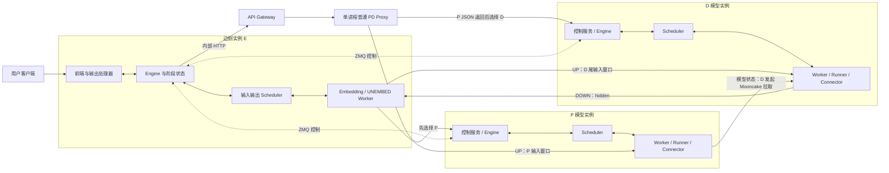
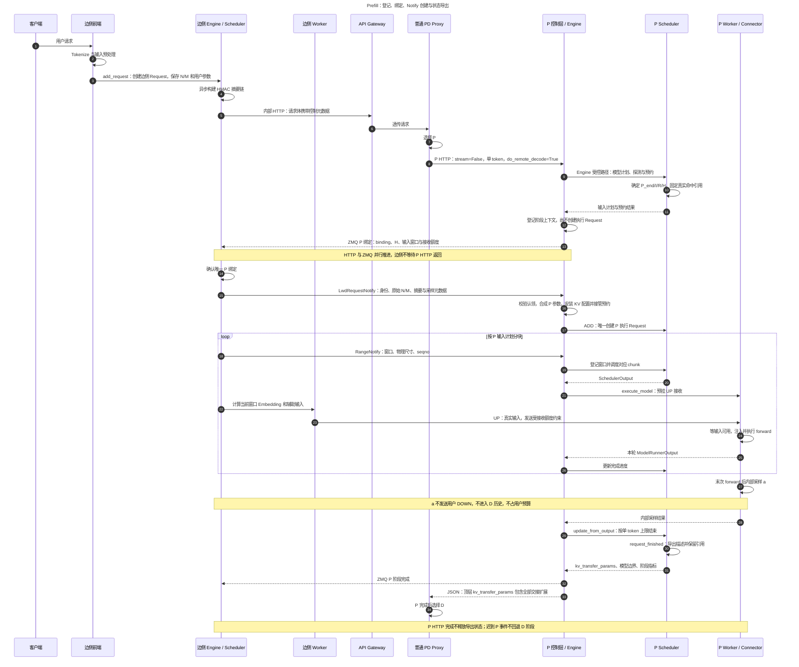
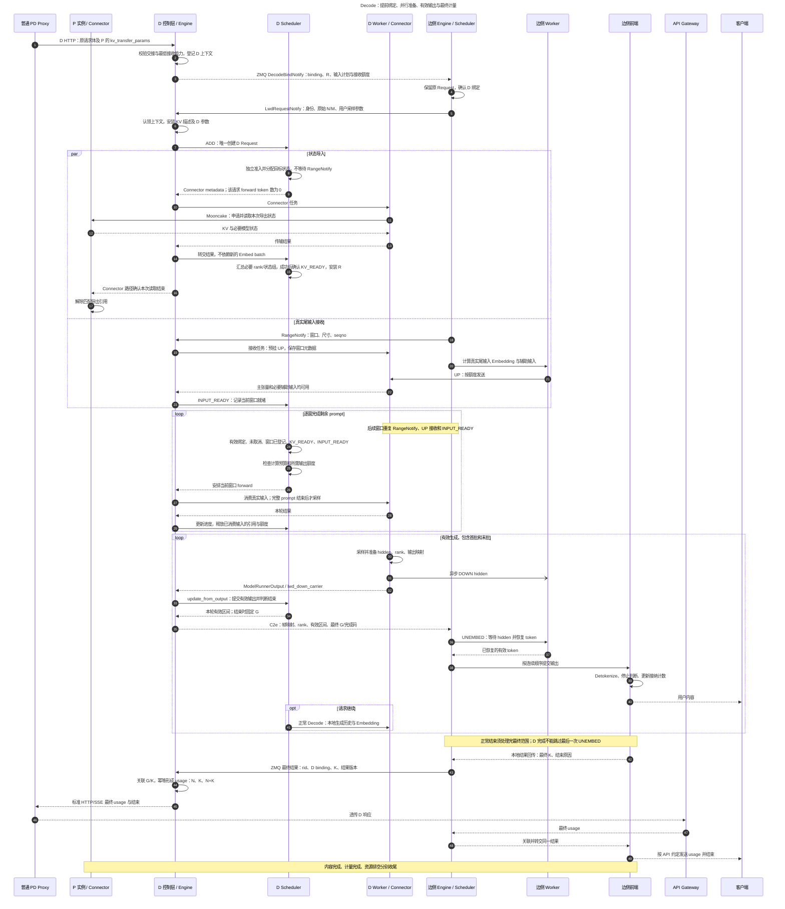

# 边云协同推理 PD 分离软件详细设计

**额外说明：本方案不支持多 DP，多 DP 场景较为复杂，存在较大的风险，需要额外讨论。**

## 1. 系统整体架构

### 1.1 设计目标与部署范围

在现有 LWD `prefill_only` 边云协同模式上，将云侧 Prefill 与 Decode 分配到独立模型实例。边侧仍负责用户输入、Embedding 和输出恢复；P 计算 prompt 状态并导出；D 导入状态、处理真实尾部输入并产生全部有效输出。

`prefill_only` 描述的是边云计算分工：边侧上传原始 prompt 的 Embedding，生成 token 的后续 Embedding 在云侧本地计算。当前实现中的一个 cloud 同时完成 Prefill 与 Decode；开启该模式本身不表示已启用 PD 分离。

部署采用固定拓扑：多个单卡边侧、一个单进程普通 PD Proxy、多个 P 实例和多个 D 实例。一个 P/D 后端地址代表一个独立调度的模型实例，可以包含多个 TP rank。服务运行期间实例持续在线，不包含动态扩缩容、执行中请求迁移、节点故障接管或 Proxy 多进程、多副本部署。

P/D 均持有执行其阶段所需的模型层，云侧保留 lm_head 和 sampler。原始文本、原始 messages、prompt token ID、文本 stop 以及租户 HMAC 密钥留在边侧。Embedding、位置和模型辅助张量通过数据面发送；Embedding 与可逆扰码不构成密码学保密保证。

### 1.2 组件与连接关系



图中 HTTP 连线表示请求方向，P JSON、D 最终 usage 沿对应 HTTP 连接返回。P/D 与边侧的绑定、执行控制及输出元数据经 ZMQ 直接传递，Proxy 不转发这些事件，也不加入 NPU world。

| 组件 | 职责 | 主要状态所有者 |
| --- | --- | --- |
| 边侧前端 | Tokenize、多模态预处理、Detokenize、文本 stop、用户连接和最终 token 接纳计数 | 用户参数、输出处理记录、最终 K |
| 边侧 Engine/Scheduler | 保持用户 Request，确认 P/D 绑定，按目标组批，协调结果回报与取消 | 阶段绑定、输入窗口、在途操作、输出连续区间、请求期限 |
| 边侧 Worker | 计算真实 Embedding，接收 hidden 并按 rank 恢复 token | 设备计算、传输 future 和缓冲引用 |
| Gateway | 内部 HTTP 认证、请求转发及标准 usage 接入 | 既有 HTTP 链路关联 |
| 普通 Proxy | 按既有策略先选 P 后选 D，转交 KV 参数并转发 D 响应 | 原有 HTTP 关联、负载计数和重试状态 |
| P 控制层/Engine | 登记阶段上下文，通知绑定，认领 Notify，返回导出 JSON | P 阶段记录、执行请求映射、幂等结果 |
| P Scheduler/Worker/Connector | 前缀探测、输入计算、内部采样、状态导出及读取管理 | 缓存引用、执行进度、导出状态及读取依赖 |
| D 控制层/Engine | 登记与绑定、创建 Request、关联 G/K 并形成最终 usage | D 阶段记录、独立结果记录、HTTP 等待者 |
| D Scheduler/Worker/Connector | 资源准入、状态导入、输入接收、联合就绪判断和有效生成 | KV/输入就绪状态、输入缓冲、生成状态和有效输出范围 |

P/D 的 HTTP 与 ZMQ 收包线程只解析消息、投递命令和等待结果。阶段认领、创建、取消及缓存操作由 Engine 受控路径协调；Scheduler 决定准入、执行资格和资源分配，Worker 回报传输及设备完成事实。

### 1.3 控制面与数据面

| 通道 | 承载内容 | 完成语义 |
| --- | --- | --- |
| E → Gateway → Proxy → P/D 的 HTTP | 可透传请求体中的身份、N/M、摘要及参数关联；D 另带 P 导出描述 | 节点登记上下文，不直接创建执行 Request |
| E ↔ P/D 的 ZMQ | 绑定、RequestNotify、RangeNotify、C2e、最终 K、取消及查询 | 改变对应阶段或操作状态；不等价于设备操作完成 |
| P → Proxy 的 HTTP JSON | 顶层 `kv_transfer_params`，包含 Connector 字段与交接扩展 | P 状态已完成且导出引用受保护；D 尚未必已读取 |
| D → Proxy → Gateway → E 的 HTTP/SSE | 最终标准 usage、结束或错误 | D 已关联最终结果；资源清理可继续 |
| E → P/D 的 UP | 窗口 Embedding、位置、M-RoPE、Hash MoE 等必要辅助输入 | 完整载荷接收可用后形成输入就绪事实 |
| P → D 的 Mooncake | KV、conv/recurrent 等已声明支持的模型状态 | 汇总全部必要 rank/状态组的成功结果后确认 KV_READY |
| D → E 的 DOWN | 输出恢复所需 hidden | 边侧仍需结合 C2e、恢复和前端处理才能确定接纳结果 |

### 1.4 请求身份与生命周期

边侧为用户请求生成全局唯一 `rid`，并保留同一个 Request 贯穿 P、D 和输出处理。P/D 执行 Request 分别创建；逻辑 `rid`、P/D engine request ID 和 Proxy 原有追踪 UUID 分开维护。

阶段关联采用 `(rid, stage_role, binding_id)`，同时记录目标 `instance_id`。binding 由节点首次有效 HTTP 登记产生，边侧对每个阶段只确认一个有效绑定。D 的阶段记录必须关联本次 P binding、导出身份及实际 P engine request ID。

| 记录 | 创建时点 | 保留到何时 |
| --- | --- | --- |
| 边侧请求及阶段记录 | 用户请求进入边侧 | 输出处理结束；未完成的结算和清理转入独立记录继续保留 |
| P/D 阶段上下文 | 节点接收并校验内部 HTTP | 认领、执行及阶段收尾完成，之后保留必要去重结果 |
| P/D 执行 Request | 匹配的 RequestNotify 认领上下文 | 本阶段执行完成，并按 Connector 依赖延迟释放相关资源 |
| P 导出记录 | P 状态完成且可导出 | 不再授权新读取，已有读取成功结束或安全排空 |
| D 最终结果记录 | D 阶段登记，创建执行请求时建立映射 | G/K 关联、usage 形成及必要重试期限结束 |
| 物理帧记录 | 收发承诺建立 | 发送、接收、计算消费或丢弃等引用全部解除 |

执行 Request 的删除不能同时删除仍被 HTTP 等待、远端读取或输出排空使用的记录。终态消息与取消按相同身份去重，迟到消息不得重新创建请求。

### 1.5 模型交接与输出计数

区间统一使用从 0 开始的左闭右开表示法。

| 符号 | 含义 |
| --- | --- |
| N / M | 原始 prompt 长度 / 用户有效输出上限 |
| P_end | P 实际执行输入的逻辑上界 |
| I | D 导入状态表示的逻辑前缀上界 |
| R | D 首次处理真实输入的位置 |
| H | P 探测后已经固定真实引用的有效命中长度 |
| G | D Scheduler 最终提交的有效生成 token 总数，范围为 `[0,G)` |
| K | 边侧前端按 API 停止与计数规则最终接纳的连续 token 前缀长度，范围为 `[0,K)` |

| 基本交接路径 | P_end | I | R | D 首次 forward |
| --- | --- | --- | --- | --- |
| 普通 attention，不需状态截断 | N | N | N−1 | 在原位置重算 `x[N−1]` |
| 需要截断的状态模型，N>1 | N−1 | N−1 | N−1 | 从 `S[N−1]` 处理 `x[N−1]` |

P 保留内部采样结果 `a` 以触发既有完成和导出接口，但 `a` 不进入用户输出或 D 历史。D 重算真实尾输入后产生有效首 token `y0`，不要求 `a=y0`。普通 attention 的末位置重算与状态模型的截断只应用一次；物理块数不能替代 I/R，`num_computed_tokens` 也不能单独证明导入完成。

正常完成要求 K=G；文本 stop、取消允许 `0≤K≤G`。K 按前端 token ID 记录计数，不按可见文本、SSE 帧数或客户端读取进度计数。P 内部 token、尾输入重算和未接纳输出均不增加用户 completion。

## 2. 请求执行流程

### 2.1 Prefill 阶段交互时序



#### 2.1.1 登记与绑定

边侧在异步任务中构建摘要并启动内部 HTTP，同时继续消费 ZMQ。Proxy 按现有逻辑覆盖 P 外层 `max_tokens=min_tokens=1`、`stream=False`，用户原始 M 与采样参数关联保存在控制信封及边侧 Request 中。

P 在真实块池探测 H 并固定引用，依据模型确认 P_end/I/R 和输入窗口后登记上下文，再通过 ZMQ 通知边侧。此时没有 P 执行 Request。边侧确认绑定后发出 Notify；P 在 ADD 前完成阶段参数、导出角色及长度安装。重复 HTTP/Notify 返回原关联结果，参数冲突或上下文失效则拒绝。

需要截断的模型必须在绑定回执之前确定 P_end。边侧按最终计划发送，不能先发送 N 行，再由 P 静默裁成 N−1 行。H 也必须满足该计划和末位置内部采样需要，不能将整段命中直接解释为无需 forward。

#### 2.1.2 输入计算与兼容采样

边侧按 P 实例组织批次，RangeNotify 与 UP 使用同一个目标、窗口布局和 seqno。P 保留现有按预告 chunk 调度的计算路径；每个 chunk 的真实主输入和辅助输入可用后才能 forward。

P 最后一次 forward 后执行一次内部采样，按阶段长度上限形成 `FINISHED_LENGTH_CAPPED`，触发 Connector 的 `request_finished()`。P 关闭会提前截断内部执行的用户 EOS/token stop，保留用户原始参数供 D 使用。内部输出不进入用户 DOWN/C2e 输出序列。

#### 2.1.3 导出与转入 D

P 仅在 worker 确认状态完成、导出描述有效、导出引用已受保护后返回 JSON。D 必需的边界、输入计划和源身份均放在顶层 `kv_transfer_params` 字典内部，复用普通 Proxy 对整个字典的转交能力。

P 的 `remote_request_id` 使用实际 P engine 请求号，`last_token_id` 保留内部采样 a。P 计算槽位可以结束，导出状态继续由 P 管理。P 完成通知与 D 绑定经不同链路到达，边侧允许先收到 D 绑定，再补记 P 完成。

### 2.2 Decode 阶段交互时序



#### 2.2.1 提前绑定与 Request 创建

D 校验模型能力、源导出身份和最低接收条件后，登记上下文并通知边侧。绑定不等于 KV 已导入，也不等于全部生成容量已分配。边侧向有效 D 发送 Notify，D 在创建 Request 前合入 HTTP 所带的 KV 描述、原始 N/M、输入计划与用户参数。

D 保留 `do_remote_prefill=True`，用户输出预算仍是 M。P 的外层单 token 配置和内部 token 不进入 D 的用户参数或生成历史。

#### 2.2.2 KV 导入与输入接收并行

第一条路径由 Scheduler 做状态导入准入，生成 Connector metadata，令 Request 进入 `WAITING_FOR_REMOTE_KVS`；本轮该请求计算量为 0。Worker 执行 Mooncake 拉取，完成事件独立返回 Engine/Scheduler。全部必要状态成功就绪后，Scheduler 确认 KV_READY，并按计划设置 R。

第二条路径由 RangeNotify 描述真实输入窗口，Worker 在不等待该请求获准 forward 的情况下接收 UP。主张量及必要辅助输入完整可用后回报 INPUT_READY，数据留在有界缓冲中等待消费。输入先到与 KV 先到都只更新各自状态。

空导入或全部由 D 本地缓存满足时，校验模型及范围后直接确认状态就绪，同时关闭 P 导出关联，确保后续不会再授权读取。不能等待不存在的网络完成事件，也不能遗漏 P 引用清理。

#### 2.2.3 尾部计算与正常 Decode

当前尾窗口的计算条件为：

```text
允许尾部 forward = 有效绑定且未取消
                 ∧ Request 元数据完整
                 ∧ 当前窗口 RangeNotify 已登记
                 ∧ 所需模型状态可用
                 ∧ 当前窗口 Embedding、位置和辅助输入可用
                 ∧ 计算资源及本步所需输出额度可用
```

Scheduler 在安排 forward 前完成上述判断，Worker 不自行将请求转为 RUNNING。完整 prompt 处理结束后才产生有效首输出；较长 suffix 逐窗处理，无需预先缓存全部 suffix。进入正常 Decode 后，D 使用自身生成 token 历史和本地 Embedding，不再等待逐 token 的边侧 RangeNotify。

#### 2.2.4 输出完成与最终计量

保留 Worker 异步 DOWN、Engine 发布 C2e、边侧等待 UNEMBED 的执行顺序。C2e 必须区分物理帧行与 Scheduler 实际提交的有效输出，并在执行结束时给出 G。边侧按请求内连续区间恢复，交前端完成停止判定后固定 K，再经 Engine 向 D 回报。

D 执行结束后保留结果记录，等待 K；等待时 HTTP 可发送标准 SSE 心跳。最终 usage 仅由 D 按 `prompt_tokens=N、completion_tokens=K、total_tokens=N+K` 形成。边侧不等待 usage 才回报 K，D 不在等待 K 前关闭 HTTP。

### 2.3 取消、错误与乱序处理

| 场景 | 处理流程 |
| --- | --- |
| HTTP 校验或准入失败 | 返回失败，不创建执行 Request；边侧不以 H=0 绕过登记 |
| HTTP 已登记但 Notify 未到 | 节点按期限原子撤销上下文和未认领预约，拒绝迟到认领 |
| P 已导出，D 尚未接续 | P 维护等待额度与总期限；到期禁止新读取，排空已有访问后释放 |
| D 仅 KV 或仅输入就绪 | 保留已就绪状态，等待另一条件；超时转入取消，禁止占位输入计算 |
| 部分 rank/状态组读取失败 | 不置 KV_READY，汇总失败及实际读取排空情况后回收 |
| 用户文本 stop、取消或断连 | 前端有序固定 K，边侧停止新工作并通知相关 P/D；在途帧继续按原尺寸接收或丢弃 |
| D 终态先于末批 hidden | 记录 G，继续等待对应 UNEMBED 和前端处理，不提前结束正常输出 |
| 重复 HTTP、Notify、结果回报 | 校验同一操作身份及内容后复用原结果；冲突拒绝，不覆盖已确认结果 |
| 取消后才收到绑定 | 边侧用取消记录拒绝认领，通知可识别节点清理；未知节点由本地期限收尾 |
| HTTP 中断或结果不明 | 通过已知绑定查询同一结果；缺失有效终态/usage 的 EOF 不视为成功，不盲目重新选点执行 |

取消先禁止新增计算、读取和发送承诺，再排空已承诺操作，最后分别释放资源。一个取消 ACK、一次 `DONE_RECVING_MSG` 或 TTL 到期都不能代替所有访问结束的证明。LWD 节点保持 KV 导入失败报错策略，不返回触发普通 Proxy 文本拼接重算的 `stop_reason="recomputed"`。

## 3. 各部分修改说明

本章按配置、控制面、数据面、边侧、P 节点和 D 节点划分改动。配置键、消息扩展字段和记录名是本文建议采用的实现形式；在编码中可以合并到现有结构，但须保留各自的身份、所有权和完成语义。普通 Proxy 直接复用，不增加 LWD 专属代码。

### 3.1 配置模型

#### 3.1.1 配置入口与角色区分

现有 [LwdConfig](vllm/vllm/config/lwd.py) 管理 `enabled`、`role=edge|cloud`、`mode` 及实例身份；[LwdCoordinationConfig](vllm/vllm/config/lwd_coordination.py) 管理边侧 HTTP 地址、HMAC 密钥引用及云侧监听地址；两者在 [VllmConfig](vllm/vllm/config/vllm.py) 中解析。

本设计保留这些配置含义，建议增加 `additional_config["lwd_pd_config"]`，解析为独立的 PD 配置对象。其关闭时保持原有单 cloud 协同路径。P/D 属于 cloud 的阶段角色，不将 `lwd_config.role` 改成 `prefill` 或 `decode`。

| 配置域 | 拟增加或调整的内容 | 使用方 |
| --- | --- | --- |
| PD 开关 | `enabled`；开启时要求 LWD 已启用且 mode 为 `prefill_only` | 所有 E/P/D 节点 |
| 实例注册 | cloud 条目的 `stage_role=prefill\|decode`、HTTP 地址、模型版本、输入/状态 ABI 和交接能力 | 启动校验、节点控制层 |
| 输入窗口 | 单窗 token/字节上限、待接收窗口数、实例接收总额度 | 边侧组批、P/D 接收 |
| 输出额度 | 单帧物理载荷上限、D 在途额度、边侧总接收及前端队列上限 | D 调度、边侧消费 |
| P 导出保留 | 等待请求数、状态字节数、总保留期限 | P 准入与 Connector |
| 阶段期限 | 等待 Notify、D 准入、输入等待、结果回报及终态保留期限 | 对应节点 Engine |
| 模型能力 | 已验证的 handoff plan、并行组合、采样与辅助输入能力 | P/D 登记与边侧校验 |

配置值按模型资源确定，不以示例常数作为容量保证。所有容量与期限必须有明确单位、合法范围和有界值；开启 PD 时缺少必要限制应在启动期报错。用户输出预算 M 来自请求，节点另设允许的最大预算并在接纳时校验。

边侧原 `control_url` 指向 Gateway/Proxy 链路，云侧 `listen_host/listen_port` 继续用于节点 HTTP 控制服务。租户 HMAC 密钥仍只在边侧加载。云侧按现有协调模式启用 prefix cache；边侧无 KV，不能为开启 PD 强行要求边侧启用 prefix cache。

#### 3.1.2 注册表与启动校验

扩展 [LwdPeerInfo / LwdRoleRegistry](vllm/vllm/v1/lwd_control/control_communication/lwd_role_registry.py)，保留 edge/cloud ID、ranks、ZMQ 地址及端点轮转能力。固定拓扑的 P/D 角色以注册表为来源，本地配置从所属条目取得角色，不维护第二份可独立变化的角色值。

```yaml
# 目标注册关系示意；省略实际地址、ABI 和容量配置。
edges:
  - {id: 0, ranks: [0]}
  - {id: 1, ranks: [1]}
clouds:
  - {id: 100, stage_role: prefill, ranks: [2, 3]}
  - {id: 101, stage_role: prefill, ranks: [4, 5]}
  - {id: 200, stage_role: decode, ranks: [6, 7]}
  - {id: 201, stage_role: decode, ranks: [8, 9]}
```

启动校验包括 rank 无重复且布局完整、本地角色/ID/地址一致、允许的 E–P/E–D 端点可确定、模型和张量 ABI 可兼容、交接能力受支持。Proxy 的 P/D 地址池通过既有部署配置保证兼容，不由 Proxy 逐请求解析 ABI。节点仍在请求接纳时校验交接描述，防止错误配置进入计算。

现有 HELLO 对 batch budget、并发数和推测参数的一致性校验先予保留。若开放不同实例预算，必须同时修改边侧组批与缓冲计算，不能只取消 HELLO 校验。新增 PD 字段使用显式协议版本，不能将旧节点缺字段静默当作支持 PD。

#### 3.1.3 并行计算组

修改 [parallel_state.py](vllm/vllm/distributed/parallel_state.py)、[lwd_parallel_init.py](vllm-ascend/vllm_ascend/distributed/lwd_comm/lwd_parallel_init.py) 和 [lwd_wire.py](vllm-ascend/vllm_ascend/distributed/lwd_wire.py) 中的注册表建组路径。

全局 world 用于启动和寻址，模型 collective 按独立实例隔离。TP、Ascend MC2 已有按实例分组基础；MoE EP 当前将所有 cloud rank 合为一组，必须改成按实例及实例内部专家分片布局建组。上述示例若各实例使用全 rank EP，应形成 `[2,3]`、`[4,5]`、`[6,7]`、`[8,9]` 四组，不能合成一组。边侧若使用相应 collective，也按自身实例隔离。

所有 rank 按确定且一致的顺序创建通信组，并校验组内 rank 与专家分片、实际 EP/MC2 通信路径一致。不能将 MC2 已隔离视为 EP 已隔离。现有 PP 虚拟二元组及 first/last 覆盖不代表真实多 stage PP；PP/CP、不同 TP 的支持必须与状态布局和 Connector 能力一起验证。

UP/DOWN 端点继续使用 `cloud_endpoint_rank(edge_id, cloud_id)`，不硬编码 TP0。跨机接收后在目标实例 TP 组内广播，不能广播到其他独立 P/D 实例。

本部分验证重点：角色错误与 ABI 不兼容在启动/接纳时拒绝；多个 MoE P/D 使用不同批次或部分实例空闲时，其余实例的 collective 可独立推进。

#### 3.1.4 模型与参数能力校验

交接能力按模型及并行组合显式声明，不能仅因底层支持 KV 搬运就开放全部模型。P/D 在 probe 前确认共同可解释的 hash 粒度和缓存命名空间；租户、模型/权重、LoRA、位置与相关输入变换参与身份校验，不将粗粒度摘要复制成多个细粒度块摘要。

| 能力 | 接纳条件 |
| --- | --- |
| 普通 attention | 明确 P_end=I=N、R=N−1，验证原位置重算及共享尾块写入 |
| Mamba/GDN 或混合状态模型 | attention、conv、recurrent 等状态共同表示声明边界；N=1 需专门的空前缀/初始化计划，未验证前拒绝 |
| MLA、SWA、压缩 KV、不同 TP | 状态组、有效窗口、压缩/对齐粒度、dtype 与分片转换均可解释且经过验证 |
| 多模态与 M-RoPE | 边侧按真实输入提供完整位置与窗口辅助张量，不从占位 token 推导 |
| Hash MoE | 原始 prompt ID 留边，路由辅助输入随对应真实窗口传输 |
| MTP/EAGLE | 单独定义 target/draft 状态、移位输入、额外 forward 与输出映射；现有本地 draft 快照不代表远端交接已支持 |
| 依赖原始 prompt 的 penalty/processor | 存在等价实现；否则在登记阶段拒绝相应非默认参数 |
| logprobs、多候选、beam、structured output、工具约束 | 具有相应状态及输出协议并完成验证后开放，不从 hidden/rank 推定可用 |

### 3.2 控制面通信

#### 3.2.1 HTTP 请求与响应适配

修改 [边侧 HTTP 客户端](vllm/vllm/v1/lwd_control/control_edge_scheduler/lwd_edge_client.py)、[Prefix 协议](vllm/vllm/v1/lwd_control/control_communication/lwd_prefix.py) 和 [云侧控制服务](vllm/vllm/v1/lwd_control/control_cloud_scheduler/lwd_cloud_control.py)。[普通 PD Proxy](vllm-ascend/examples/disaggregated_prefill_v1/load_balance_proxy_server_example.py) 的 `build_prefill_request()`、`assign_instances()` 和响应转发路径直接复用。

边侧将 LWD 控制信封编码为标准 `messages[].content` 中的 JSON 字符串。该 messages 是内部控制载体，不是原始用户 messages。信封设置独立类型标识与版本，节点在普通分词前识别；Proxy 只转发字符串。

| 信封字段组 | 内容与校验 |
| --- | --- |
| 协议标识 | `type`、`version`；仅支持明确识别的 LWD PD 版本 |
| 请求身份 | `rid`、`edge_id`、`tenant_id`、请求指纹；与可信身份和注册关系核对 |
| 原始参数 | `original_prompt_tokens=N`、`user_max_output_tokens=M`、云侧采样参数白名单及其指纹 |
| 模型输入身份 | 模型/权重版本、输入 ABI、必要的 LoRA/输入变换身份及能力要求 |
| Prefix 摘要 | hash 算法/域、粒度、摘要链、必要媒体身份摘要；字节摘要按约定编码为文本 |
| 有效期 | 请求有效期信息；本地使用单调时钟管理，重试不重置已登记期限 |

请求指纹覆盖规范化后的不可变语义字段，不包含 Proxy 会覆盖的外层 stream/max/min tokens、Proxy UUID 或节点后分配的 binding。规范化编码在边侧和节点共用一份实现。认证身份、edge ID 和 tenant ID 分别校验；请求体自报身份不能代替认证。具体凭证承载须结合 Gateway 的实际认证链落实并验证。

内部请求保留普通 OpenAI 形状，默认使用 `stream=True`、`stream_options.include_usage=True` 持续读取 D 最终结果；P 的 `stream=False` 由 Proxy 原逻辑覆盖。必需元数据不只放在自定义请求头或未知顶层字段中。Gateway 经 DTO 转换后的正文、身份关联和响应透传应做契约验证。

P 响应为完整 JSON，不输出绑定中间 SSE。交接字典采用以下分层：

| 位置 | 内容 |
| --- | --- |
| `response.kv_transfer_params` 既有字段 | 导入/导出角色、源地址、engine/request ID、各组块列表、并行布局、块大小及真实内部 `last_token_id` |
| `response.kv_transfer_params.lwd_handoff` 拟新增扩展 | 协议版本、rid、源 P binding、export 身份、N/P_end/I/R、D 输入窗口、ABI、有效状态范围及源有效性信息 |

D 所需字段不得放在 KV 字典外，因为普通 Proxy 只取该字典放入 D 请求。D 在 ADD 前验证并安装全部字段，继续使用实际 P engine request ID 访问源状态。

D 等待 G/K 关联完成后返回标准 OpenAI usage 和结束标志，等待期间可发 SSE 注释心跳。正常响应不携带需要 Proxy 聚合的阶段事件；内部控制信封与 P 内部 token 不回显为用户内容。

#### 3.2.2 ZMQ 事件扩展

扩展 [lwd_notify.py](vllm/vllm/v1/lwd_control/control_communication/lwd_notify.py) 的消息及编码，复用 [Router 通道](vllm/vllm/v1/lwd_control/control_communication/lwd_router_channel.py) 的定向投递。下表定义逻辑事件，可以扩展现有类型，不要求每行独立新增类。

| 事件 | 方向 | 必需语义字段或变化 |
| --- | --- | --- |
| P 绑定回执 | P → E | rid、P binding/实例、H、交接计划、输入窗口、初始接收额度、有效期 |
| DecodeBindNotify | D → E | rid、D binding/实例、源 P/export 关联、R、输入窗口及初始接收额度 |
| LwdRequestNotify | E → P/D | 加入 stage_role/binding、N/M、参数指纹；与 HTTP 上下文逐项校验 |
| LwdRangeNotify | E → P/D | 保留物理 seqno 和窗口；逐请求条目加入阶段关联、窗口身份及辅助载荷布局 |
| P 阶段完成 | P → E | P binding、export 身份及阶段结果；不带用户 finish_reason |
| LwdC2eNotify | D → E | 保留 DOWN seqno/rank，增加逐请求有效区间、物理行映射、最终 G/结果关联及恢复校验信息 |
| LwdGenChainNotify | E → 当前 D | 携带有效 binding 与摘要覆盖范围，拒绝旧阶段链更新 |
| LwdFinishNotify 的结果扩展 | E → D | 最终 K、结束原因、结果版本、D binding；生成摘要与结果分别校验 |
| 取消、查询及回执 | E ↔ 已知 P/D | 阶段/操作身份、已确认终态、已停止新增工作及排空进度 |
| 输入/输出额度更新 | E ↔ P/D | 所属实例、绑定或帧范围、额度身份和累计使用/归还水位，重复不多次归还 |

KV_READY 和 INPUT_READY 是 Worker 经 Engine 向 Scheduler 回报后形成的本地状态，不因新增名词而另建一条边云网络通道。KV_READY 复用 Connector 结果，INPUT_READY 随输入完成记录上报。

#### 3.2.3 阶段上下文与唯一创建

在云侧 Engine 中增加可覆盖登记、运行和终态的阶段记录。现有 `_lwd_gate_pending` 在 promote 时即移除，只保留它无法处理运行期重复 Notify 和终态重试。

| 阶段记录字段组 | 用途 |
| --- | --- |
| 身份 | rid、edge/tenant、stage_role、binding_id、instance_id、请求指纹 |
| 执行计划 | 原始 N/M、P_end/I/R/H、输入窗口、ABI、用户参数与阶段参数 |
| 来源与资源 | 预约引用、D 的 KV 参数/源 P/export、容量承诺及本地期限 |
| 执行映射 | 实际 engine request ID、是否已 ADD、运行及取消状态 |
| 重试结果 | 已返回绑定、P 导出 JSON 或 D 最终结果、终态保留期限 |

同节点 HTTP 以 `(edge_id,rid,stage_role)` 查找原上下文，再比较不可变指纹；D 另比较源 export 身份。匹配则复用绑定和结果，冲突则拒绝。不同后端的冲突绑定由边侧唯一确认规则约束，不宣称 Proxy 提供跨后端全局去重。

HTTP 和 ZMQ 线程将登记、认领、取消等命令投递到 Engine。Engine 按受控顺序执行：校验有效上下文 → 校验 Notify → 构建 Request → 安装 KV/长度/参数 → 接管预约 → ADD → 记录创建结果。创建失败回滚未转移资源；已创建时取消必须到达实际 engine 请求。预约和块池修改不留在网络线程中直接执行。

RangeNotify 早到可在有界阶段队列暂存；只有尚未承诺张量发送时才能拒绝并要求重试。操作去重键包括绑定、窗口和物理帧身份，不能只按 rid 去重。旧 binding、撤销记录及已结束操作的迟到事件不得重新激活请求。

本部分验证重点：未修改 Proxy 的真实请求体/JSON/SSE 契约；P 等输入期间不出现 HTTP 循环等待；重复与冲突 HTTP/Notify、创建/取消竞争只产生一次执行。

### 3.3 数据面通信

#### 3.3.1 复用通道与扩展元数据

复用 [LwdCommService](vllm-ascend/vllm_ascend/distributed/lwd_comm/service.py)、[LwdChannel](vllm-ascend/vllm_ascend/distributed/lwd_comm/channel.py)、[LwdCommRequest](vllm-ascend/vllm_ascend/distributed/lwd_comm/types.py) 和现有 future/device event 机制。

现有通道以 `(edge_id,cloud_id,channel,op)` 分域，UP/DOWN 已有独立 seqno、精确尺寸收发和辅助载荷配对。保留其寻址能力，在调度与帧记录中补充阶段和窗口关联；通信服务只处理明确的物理任务，不反查 Request 的当前 cloud_id。

一条物理帧记录保存目标实例、channel/seqno、主/辅助载荷尺寸与 dtype、各请求行区间、对应 binding/window、传输 future 及消费引用。一次批量 UP 可包含多个请求，但全部必须面向同一目标实例和兼容阶段；每个请求的绑定放在条目中，不能只在批头放一个 binding。

#### 3.3.2 D 输入接收与计算解耦

现有 [Cloud Worker](vllm-ascend/vllm_ascend/worker/lwd_cloud/lwd_cloud_worker.py) 的 `_lwd_up_post_recvs()` 根据本轮 `LWD_EMBED` 批挂接收；[Cloud Runner](vllm-ascend/vllm_ascend/worker/lwd_cloud/lwd_cloud_model_runner.py) 在 `_prepare_inputs()` 中收割，并要求输入行数等于本轮计算量。D 必须增加独立的接收任务与待消费窗口记录。

本设计采用窗口额度：节点在绑定时保留至少一个合法窗口的接收容量，并在回执中给出窗口上限和初始额度；边侧只有持有额度才允许承诺发送。后续窗口额度在前一窗口被计算消费或取消排空后归还。额度绑定实际保留的缓冲/接收能力，不能只给出 token 数而没有资源保证。

| 输入窗口状态 | 转换条件 | 资源行为 |
| --- | --- | --- |
| REGISTERED | 收到有效 RangeNotify | 校验范围/布局，关联已承诺额度 |
| RECEIVING | Worker 提交主/辅助接收 | 保留帧元数据、future 和缓冲引用 |
| READY | 全部必要载荷在对应计算域可用 | 回报 INPUT_READY；保留数据等待计算 |
| CONSUMING | Scheduler 联合就绪后下发 forward | 按窗口身份注入，不从当前 binding 重新推导来源 |
| CONSUMED | 设备计算不再读取输入 | 解除消费引用，满足其他依赖后归还额度 |
| DRAINING | 取消或失败且存在已承诺帧 | 继续接收或安全终止，禁止跳过物理配对 |

Worker 在无 forward 任务时也能推进接收和完成回报。端点跨机接收与 TP 广播延续现有已验证的流顺序，INPUT_READY 只有在必要 rank 可安全消费主张量及全部辅助输入后成立；不得为提前回报而破坏 HCCL 的依赖顺序。

后续 Runner 通过窗口记录取得真实输入，校验消费范围与调度范围一致。导入轮次安排 0 个 token 不消费窗口，也不触发旧的“接收行数等于计算量”断言。暂存记录有字节数、窗口数和有效期上限，不能无界积累 suffix。

#### 3.3.3 DOWN、有效区间与输出额度

D 仍可在 Scheduler 提交有效结果之前异步发送 hidden。物理帧按原尺寸接收，C2e 说明每个请求的物理行范围、有效提交行、rank 和请求内输出区间；长度上限、EOS 或推测接受导致的多余行仅排空，不进入用户历史和 K。

边侧按所有 D 汇总接收、恢复和前端待处理额度，并向各 D 分配有界份额。D 在调度可能产生输出的 forward 前取得足够额度，按物理载荷上界核算，不能只按预计接受 token 数核算。一个慢客户端造成的待处理输出占用对应额度，耗尽时阻止该请求继续产生新输出，其他有额度的请求仍可调度。

传输缓冲可用额度与前端待处理额度分别归还：hidden 不再被恢复使用才释放其设备引用，输出被前端处理或丢弃后才释放相应队列额度。每次归还按帧/操作身份幂等，控制消息不与大张量共用会被占满的处理队列。

#### 3.3.4 序号、取消和资源释放

seqno 是物理通道配对顺序，窗口 offset 与输出区间是请求语义顺序，三者分别记录。P/D 切换继续使用对应目标通道自身的序号，不重置计数；已提交给 P 的操作永远保留 P 目标。

取消后，已承诺主帧与辅助帧必须按原顺序和尺寸接收或安全终止，不能从接收队列删除条目后把下一帧错配到它的位置。现有 `skip_seqno()` 只用于双方一致确认永远不会发送的未承诺序号；不用于跳过在途帧。

缓冲释放同时检查传输完成、设备事件及后续计算/恢复消费者。`poll_completions()` 负责推进既有通信完成回收；新增暂存、计算与前端额度的所有权由上层记录维护。请求结束不销毁固定通信组，共享 communicator 失败则按实际受影响范围报错并清理。

本部分验证重点：KV 先到/输入先到、无 forward 时接收推进、辅助帧缺失、跨目标 seqno、取消排空、慢消费背压，以及缓冲地址不会在设备仍使用时复用。

### 3.4 边侧节点

#### 3.4.1 现有入口与修改范围

| 源码入口 | 修改内容 |
| --- | --- |
| [lwd_edge_client.py](vllm/vllm/v1/lwd_control/control_edge_scheduler/lwd_edge_client.py)：`build_control_request()`、`negotiate()`、流读取 | 构建正文控制信封，HTTP 持续读取最终结果；绑定驱动改为独立 ZMQ 事件 |
| [lwd_edge_binding.py](vllm/vllm/v1/lwd_control/control_edge_scheduler/lwd_edge_binding.py)：`LwdEdgeBindingTable` | 从单一 `rid→cloud_id` 扩展为 P/D 阶段关联及在途目标快照 |
| [lwd_edge_scheduler.py](vllm/vllm/v1/lwd_control/control_edge_scheduler/lwd_edge_scheduler.py)：请求准入、组批、notify、finish/abort | 同一 Request 跨阶段存活，按目标/阶段选窗口，管理额度与结果收尾 |
| [lwd_edge_engine.py](vllm/vllm/v1/lwd_control/control_edge_scheduler/lwd_edge_engine.py)：接收循环、`_lwd_deliver_unembed()` | 消费绑定/输出/终态事件，保持恢复等待，关联前端 K 与 HTTP usage |
| [lwd_edge_worker.py](vllm-ascend/vllm_ascend/worker/lwd_edge_worker.py) | 复用 Embedding 与 UNEMBED，支持有效行映射、恢复校验和取消后排空 |
| [output_processor.py](vllm/vllm/v1/engine/output_processor.py)、[async_llm.py](vllm/vllm/v1/engine/async_llm.py) | 在前端接纳和停止判定后回传最终 K，处理断连/取消竞态 |
| [Chat API serving](vllm/vllm/entrypoints/openai/chat_completion/serving.py) 及相应用户 API | 关联同一次最终 usage，协调内容结束、usage 与 SSE/非流式响应结束 |

#### 3.4.2 阶段绑定与请求推进

边侧阶段记录保留原始 N/M、不可变用户参数、P binding、D binding、输入计划、当前阶段和总请求期限。逻辑主线为：

```text
WAIT_P → PREFILLING → WAIT_D → D_STARTING → DECODING → FINALIZING → FINISHED
```

这组状态描述逻辑进展，不要求按网络消息到达顺序逐项经过。D 绑定先于 P 完成通知时允许直接进入 D_STARTING；迟到 P 完成只更新 P 子记录。用户取消后拒绝新绑定认领，保留足以处理迟到通知的记录。

原 `_lwd_probe_submit_async()` 中的 HMAC/HTTP 异步执行机制可复用，但移除 PD 路径探测失败后按 H=0 继续提交的行为。HTTP 任务负责请求发送、错误和最终 usage，ZMQ 绑定负责触发 Notify 与输入上传；不能继续以 `negotiate()` 收到 P SSE 作为唯一启动条件。

P/D 切换只更新当前阶段及后续输入路由，不重新 `add_request`。边侧可以保留原始输入并从 R 重新取 D 所需尾窗口；上传水位与用户 Request 的输出水位分离，不能清空请求来模拟第二次用户请求。

#### 3.4.3 按目标组批与单卡调度

`_lwd_pick_prefill_batch()` 在挑选候选请求时先按 `(target_instance,stage_role)` 筛选，再应用原有 chunk、预算、模型辅助输入和公平性条件。禁止先混合不同目标推进水位，再在 `lwd_edge_notify()` 中报错。每批的 Notify、SchedulerOutput 和 Worker UP 任务携带同一目标快照。

同一边侧可以依次执行发往 P1、P2 和 D1 的 Embedding 批，并异步提交各自通道。D 尾窗口使用原始位置及辅助输入；正常 Decode 不再生成边侧上传任务。生成 hash、文本 stop 和新输出事件发往当前 D；旧 P 的在途 UP、导出及取消仍关联原 P。

边侧输入计算、输出恢复共用单卡，采用有界队列和公平轮转。等待某个 D 的 KV 导入不占住边侧设备执行线程；若 DOWN 尚未可消费，先维护接收任务，不让一个未就绪 UNEMBED 长期阻塞其他实例。必须保留现有 future/device event 的依赖保证。

#### 3.4.4 输出恢复与前端 K 回传

`_lwd_deliver_unembed()` 继续等待 Worker 结果，核对 C2e 有效区间后才提交 token。边侧记录“已收到控制范围”“已恢复连续范围”“前端已接纳范围”三个水位；恢复完成只更新第二个，不能直接生成最终 K。

在 `OutputProcessor.process_outputs()` 完成本批 Detokenizer 更新与停止判定后，维护 token 接纳记录。正常终态、文本 stop、用户取消和断连均在删除前端 RequestState 前固定 K，并通过 EngineCore client 的本地控制命令回传 Edge Engine。该命令是待新增的内部接口，不重新提交模型请求。

本地结果记录包含 `rid`、边侧请求代际、K、结束原因、结果版本及是否已最终确认；Edge Engine 将其关联到仍保留的有效 D binding。前端结果与取消有序处理，不能先删除 RequestState，再从恢复数量推测 K。文本 stop 的最终结果回报可先于 D 固定 G 到达，D 先保存回报，待执行停止后校验两者。

| 前端情况 | K 的确定规则 |
| --- | --- |
| 正常长度结束 | 全部有效输出完成恢复和前端接纳后 K=G |
| EOS / token stop 被隐藏 | 已提交且被接纳的停止 token 仍计入 K |
| 文本 stop 或跨 token 匹配 | 使用触发停止时前端 token ID 记录长度；隐藏文本不扣减 token 数 |
| stop 位于本次批中 | 沿用原生“记录本批，再检查 stop”行为，本批已接纳的有效 token 全计入 K |
| 文本尚在 Detokenize 缓冲 | 已接纳 token 仍计数，不等待形成可见字符 |
| 取消 / 断连 | 以取消有序生效时已接纳的连续前缀为准，后续批只排空 |
| 恢复缺口或失败 | 不跨缺口接纳；能确认的截止按错误结果回报，不能确认则保留未确认状态 |

例如前端已接纳 6 个 token，下一批接纳 2 个后检测到文本 stop，则 K=8。即使 stop 文本被隐藏也不减计数；后到批次仅排空。具体计数与 [Detokenizer](vllm/vllm/v1/engine/detokenizer.py) 保持一致。

#### 3.4.5 完成、usage 与清理

边侧收到 D 最终 G 后，正常路径等待对应恢复和前端处理完成，再回报 K。原 `lwd_edge_finish()` 不能在收到 P 阶段完成或 D 执行完成时立即清除全部绑定、请求和摘要状态；进入 FINALIZING 后继续完成前端回报、HTTP 结果关联及排空。

最终 K 经 ZMQ 重试发送给同一个 D binding，重复使用相同结果版本。HTTP 收到的 usage 关联同一请求结果，C2e 若也携带 usage 则去重。用户流可以先结束内容并发送 finish，随后按 API 约定发送 usage；非流式响应在结果完整后返回。需要在 API 请求仍存活时把内部 HTTP usage 从 Edge Engine/控制结果通道送回前端，不能只在后台排空后丢弃。

用户断连后仍可继续回报 K 和清理，不依赖客户端继续读取。若 D 未创建，边侧直接保存并返回原失败原因，不等待不存在的 D 结果。资源全部排空后删除相应操作记录，结果和取消记录按去重期限保留。

本部分验证重点：一个用户请求只创建一次边侧 Request；跨目标组批和阶段乱序正确；末批恢复等待保留；批中 stop、隐藏 EOS、断连及并发取消的 K 与前端记录一致。

### 3.5 云侧 P 节点

#### 3.5.1 控制服务与 Engine

P 的 HTTP 服务复用 `create_lwd_cloud_control_app()` 的入口和桥接方式，将当前“probe 后立即输出 SSE，再等待 usage”改为“登记、ZMQ 绑定、等待本阶段导出、返回 JSON”。绑定结果由 Engine 通过已注册边侧通道发送，HTTP handler 等待同一个阶段结果。

在 [LwdCloudEngineCore](vllm/vllm/v1/lwd_control/control_cloud_scheduler/lwd_cloud_engine.py) 中，`_lwd_dispatch()` 将 RequestNotify/取消投递为受控阶段命令；`_lwd_promote()` 按第 3.2.3 节认领一次上下文；`_lwd_build_request()` 接收已确认的阶段参数和执行长度，不能再仅按 wire 原样构建完整生成请求。

P Request 的 prompt 长度表达 P_end，原始 N 独立保存在上下文。保留 `prompt_token_ids=None` 和占位 embeddings 的形状语义，真实数据只从 UP 注入。`kv_transfer_params.do_remote_decode=True` 在 ADD 前安装，后到 Notify 不能覆盖或清空。

P 阶段完成只返回导出结果，不调用普通用户完成路径结束边侧请求。现有 `_lwd_publish_finished_usage()` 在 PD P 角色上不形成用户 usage；P 工作量单独记录为阶段指标。

#### 3.5.2 模型计划、前缀预约与容量

在 [LwdPrefixCoordinator](vllm/vllm/v1/lwd_control/control_cloud_scheduler/lwd_prefix_coordinator.py) 的 probe/claim/complete/sweep 入口接入阶段身份及期限。probe 返回 H 前必须固定真实块引用；重复登记复用原预约，不覆盖正在使用的记录。

模型计划在 probe 与绑定之前确定，至少包含 P_end/I/R、P/D 输入窗口、状态组布局和合法检查点。普通 attention 保留末位置采样需要；状态模型先确认截断边界再生成窗口。已有 `_truncate_request_for_prefill()` 可以复用，但必须和计划对齐且只执行一次，不能与创建阶段的裁剪重复。

P 开始计算前，除了计算及新增状态空间，还要承诺完成后等待 D 的导出保留额度。账目按物理块/状态字节核算共享前缀引用，满足“已使用 + 已承诺未分配 ≤ 可用”。预约由上下文转给 Request 时转移所有权，不再扣一次相同容量。

已完成真实状态、可信摘要覆盖和模型合法边界共同限制缓存发布范围。调度水位不代表 worker 完成水位；P 内部 a 不作为用户生成段继续发布。claim 后到导出引用接管之间不得出现无所有者的引用空档。

#### 3.5.3 P 调度与 Worker 输出

P 可继续使用 [MixedScheduler](vllm/vllm/v1/lwd_control/control_cloud_scheduler/lwd_cloud_mixed_scheduler.py) 的 RangeNotify 驱动路径，按 P 输入计划调度完整 chunk，保留正常输入预告量与实际消费量一致的校验。已有 [PhaseScheduler](vllm/vllm/v1/lwd_control/control_cloud_scheduler/lwd_cloud_phase_scheduler.py) 若作为可选路径保留，也须遵守相同阶段语义；不强制新增独立 P scheduler 类。

P 使用单 token 阶段参数，设置内部 `max_tokens=min_tokens=1`，屏蔽内部 EOS/token stop 提前结束，确保实际采样结果以 `FINISHED_LENGTH_CAPPED` 进入正常导出路径。用户参数以独立副本保存，D 使用完整原始预算。依赖原始 prompt ID 而无法等价实现的处理器在接纳前拒绝。

在 Cloud Runner 的 DOWN 采集入口及 Cloud Worker 的发送入口按 P 角色抑制用户输出：保留 sampler 返回值给原生 `ModelRunnerOutput` 和 Scheduler，不生成用户 `lwd_down_carrier`，不分配或消耗用户 DOWN seqno。Engine 不为内部 a 发布用户 token/finish 的 C2e，只发送 P 阶段完成事件。

P forward-only 不作为本次实现要求。推测解码不能仅因预算为 1 就视为普通单步；若开放，必须验证 target/draft 额外 forward、状态边界和采样完成行为。

#### 3.5.4 Connector 导出与源状态寿命

修改 [Mooncake Connector](vllm-ascend/vllm_ascend/distributed/kv_transfer/kv_p2p/mooncake_connector.py) 的 `request_finished()`：保留导出角色和长度上限完成条件，用 P_end 及实际状态布局选择导出块，移除对缺失 `prompt_token_ids` 直接取长度的依赖。不能为兼容长度而伪造 token ID。

继续输出真实 `last_token_id=request.output_token_ids[-1]`，同时组装 `lwd_handoff`。导出记录关联 P binding、实际 engine 请求号、export 代际、有效范围、引用、读取记录和不可被重试重置的总期限。recurrent/conv 状态在远端读取期间保持稳定，必要时保留独立快照。

P 导出保留期限从状态就绪开始，覆盖 Proxy 转接、D 等待 Notify、准入和实际读取。新读取需验证源状态有效性及授权，读取确认匹配实际操作身份；旧请求号或旧确认不能释放新导出。

`DONE_RECVING_MSG` 可能出现在失败清理中，P 据实际读取结束情况解除引用，D 据成功结果确认就绪，两者分开。现有延迟释放超时不能在仍有远端访问时强制回收内存：到期先撤销新读取，再等待在途读取安全结束。Proxy 的 `release_prefill_kv` 仅影响负载计数，不参与该判断。

本部分验证重点：截断只执行一次；内部 EOS 不跳过导出；P 无用户输出；JSON 字典扩展可经原 Proxy 到达 D；导出引用在等待、重试、部分失败和超时排空期间持续有效。

### 3.6 云侧 D 节点

#### 3.6.1 登记、提前绑定与参数合并

D 使用与 P 共用的 HTTP/Engine 适配层，通过本地 stage_role 分支处理。HTTP 登记时校验原始 N/M、请求指纹、P binding/export、源有效性、ABI 和输入窗口，并取得最低接收容量，再发送 DecodeBindNotify。

收到匹配 Notify 后，合并不可变请求元数据与 P 导出参数，构建唯一 Request。D 的 prompt 长度保留原始 N，I/R 分别保存；用户生成预算为 M。通过 [Request](vllm/vllm/v1/request.py) 的 KV 参数入口或等价显式安装路径，在 ADD 前设置 `do_remote_prefill=True`、实际源请求号及交接信息。

当前 `_lwd_build_request()` 没有合入 HTTP 的 KV 参数，必须将认领后的上下文作为构建输入。`prefix_hit_tokens`/`lwd_resume_cap_tokens` 表达原有本地命中约束，不得直接复用为同时表示远端 I 和续算 R 的字段。

#### 3.6.2 独立导入调度

原生 [Scheduler](vllm/vllm/v1/core/sched/scheduler.py) 已具备异步导入分配、`WAITING_FOR_REMOTE_KVS`、`KVConnectorOutput.finished_recving` 及完成后恢复待调度的路径；[Ascend Runner](vllm-ascend/vllm_ascend/worker/model_runner_v1.py) 已有 `kv_connector_no_forward()`。D 复用这些机制。

修改 MixedScheduler 及 [LwdBaseScheduler](vllm/vllm/v1/lwd_control/control_scheduler/lwd_base_scheduler.py) 的可见请求选择逻辑，将导入准入、传输结果处理与 forward 候选分开：

1. 已创建且交接参数完整的 D Request，即使尚无 RangeNotify，也可进入导入准入集合。
2. 导入时分配目标状态和所需容量，生成 Connector metadata，本请求计算 token 数为 0。
3. Engine 的工作判定和完成事件路径覆盖在途 Connector/输入任务，不能只在新 Embed batch 到来时驱动它们。
4. 消费完成回报并区分成功/失败；必要 rank、状态组均成功后记录 KV_READY，由 Scheduler 完成状态转换。
5. 导入完成的请求仍先检查 INPUT_READY 和窗口登记，再进入原生 forward 选择，不能因转回 WAITING 就直接计算占位 embeddings。

已创建请求的导入可独立推进，但 D 首次 forward 仍必须依赖 RangeNotify。`_lwd_verify_full_admission()` 的旧等式仅适用于实际计算消费的输入批，不能用来要求导入轮次计算已预告的窗口。

#### 3.6.3 导入长度与续算位置

Mooncake 的 `get_num_new_matched_tokens()` 在 PD embeddings 请求上按 I 和本地已满足的合法范围计算外部导入量，不再从 `prompt_token_ids or []` 得到零长度。物理块、SWA 窗口、状态检查点及多组布局继续交由 Connector 的现有能力处理，并校验它们确实表示所声明的逻辑状态。

本地命中与远端导入需要共同得到可从 R 续算的状态；若本地状态检查点不兼容，则不采用该命中，不能只对两个长度做减法。必要的共享块末位置写入遵守写时复制规则，不修改其他请求依赖的缓存内容。

普通 attention 导入到 N，续算从 N−1；可以复用原生 `_update_waiting_for_remote_kv()` 的全命中回退，也可以显式安装 R，但二者只能生效一个。状态模型已导入到 N−1 时不再次减一。所有边界与实际 prompt 长度、窗口范围一起校验，避免计数正确而状态内容错误。

#### 3.6.4 输入就绪与计算放行

Engine 将 RangeNotify 转为接收任务，Worker 按第 3.3 节独立接收并回报窗口结果。Scheduler 按 `(rid,binding,window)` 记录预告、接收完成和消费进度，不因收到通知即置 INPUT_READY，不因导入轮次结束即消费窗口。

| KV_READY | 当前窗口 INPUT_READY | 调度行为 |
| --- | --- | --- |
| 否 | 否 | 推进导入与接收，不执行该窗口 forward |
| 是 | 否 | 等待真实输入，不使用占位 embeddings |
| 否 | 是 | 保留输入缓冲，等待状态，不占住计算线程 |
| 是 | 是 | 再校验绑定、取消、预告、参数和资源，满足后计算 |

Runner 按窗口身份取出输入，保留 positions、M-RoPE、Hash MoE 等必要辅助输入。完整 prompt 结束前不采样用户 token，完成 bootstrap 后使用本地生成 token Embedding 继续 Decode。不得仅以 `num_computed_tokens>=num_prompt_tokens` 判定启动安全。

#### 3.6.5 输出提交与 rank 恢复契约

Worker 保留异步 DOWN 提交；Scheduler 在 `update_from_output()` 中确认有效提交范围，Engine 再将范围映射到 `lwd_down_carrier` 的物理帧。每请求维护连续输出游标，终态 G 以已提交 token 为准，不能用发送行数、候选数或最后一个 down_seqno 代替。

云侧采样后，基于与边侧恢复一致的原始 logits 定义唯一 rank：

```text
rank(t) = count(logit[j] > logit[t])
        + count(logit[j] == logit[t] AND j < t)
```

修正 Cloud Runner 当前仅计算“严格大于数量”的实现，边侧继续按一致的稳定排序取 token，避免并列 logits 的多个 token 共用一个 rank。边云还须匹配 hidden、lm_head、词表、dtype 和排序前变换，并针对所支持设备/TP 组合做数值验证。

C2e 为有效区间附带输出内容一致性校验，例如对 binding、区间和云侧已提交 token 序列计算摘要；边侧恢复后核对，失败则停止交付和生成 hash 发布。算法、字节编码与批量成本须在协议实现时统一，不能把 rank 规则一致视为数值一致性的充分证明。

#### 3.6.6 G/K 关联与 HTTP 最终结果

D 结果记录独立于执行 Request，保存 rid、D binding、原始 N、最终 G、边侧 K、结束原因、结果版本、usage 及已返回状态。现有基于 `_free_request()` 快照立即生成 usage 的路径改为先固定执行结果，并经 C2e 提前通知 G。

| 收到的结果 | 处理 |
| --- | --- |
| 只有最终 G | 保存执行终态，等待边侧 K，HTTP 可继续心跳 |
| K 先到但 D 尚未结束 | 保存边侧截止及停止原因，停止后续生成并排空，待 G 固定后校验 |
| G/K 均到且身份一致 | 校验 `0≤K≤G`；正常完成还须 K=G，形成一次最终 usage |
| 重复同一结果 | 复用已有结果，不再次结算 |
| 同一结果身份下 K 或绑定冲突 | 拒绝覆盖，记录协议错误，不猜测最终计量 |
| 等待超时或结果无法确认 | 返回/记录失败或未确认，不以 G 或默认零替代 K |

最终 usage 只计 N 和 K；P 内部采样、D 尾部重算、未接受候选及 `[K,G)` 的多算量留在运行指标。prefix 命中按逻辑请求统计，不能把 P 命中与 D 对同一状态的导入相加。

HTTP handler 等待上述结果，使用标准响应形状返回，Proxy/Gateway 原样转发。控制查询返回同一结果记录，不创建执行 Request。已完成执行请求不因 HTTP 重试或最终 K 重发再次 ADD、导入或结算。

#### 3.6.7 容量保证与失败清理

D 在导入准入时保证目标状态、bootstrap 和允许生成预算所需的容量。可采用按 N+M 的保守预留，但实际账目包含 KV groups、状态槽、lookahead、推测分支、对齐、共享块写时复制及临时缓冲。复用已有导入容量预留机制时，须检查其保证是否覆盖完整生成预算。

保留 LwdBaseScheduler 禁止占位输入抢占重算的保护。导入失败采用 `kv_load_failure_policy="fail"`，不返回 `recomputed`，不使用原始控制信封作为 prompt 重算。

取消与失败时分别维护：不再新增计算/读取、在途 KV 读取排空、UP 主/辅助帧排空、设备计算完成、DOWN 消费或丢弃、结果记录收尾。某个依赖完成只释放对应资源；D 导入失败不等于 P 仍有读取，也不等于 P 已可释放，必须按实际读取记录判断。

本部分验证重点：无 RangeNotify 可导入但不可 forward；输入/KV 任意到达顺序；原生回退不重复；部分状态失败不置就绪；最后输出与 K 延迟不丢失；重复结果只形成一次 usage。模型边界与数值对照、真实 NPU/HCCL/Mooncake 多实例验证仍按主设计文档第 16 节执行，普通 Connector 生命周期单测不能替代这些验证。
