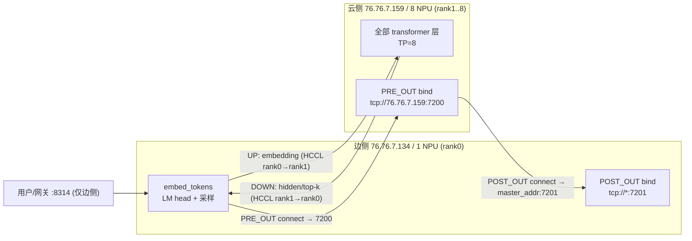

# LWD 边云双侧启动脚本逐项解读（环境变量 + `vllm serve` 参数）

> 分析对象：本工作区内的 `vllm` 仓与 `vllm-ascend` 仓（LWD = Layerwise Disaggregated，边云分层推理）。
> 分析对象脚本：边侧（`--node-rank 0`，1 卡）与云侧（`--node-rank 1`，8 卡）两段 `vllm serve` 启动脚本。
> 结论全部给出代码落点（`文件:行号`），可逐条复核；复核命令见附录 B。

---

## 0. 摘要（先看这 10 条）

| # | 结论 |
| --- | --- |
| 1 | 这套脚本对应的是 **`prefill_only_chunked_prefill_mm` 分支**（老 LWD 基线）的运行形态：`--edge-npu-count/--cloud-npu-count`、`lwd_config.{enabled,role,mode,edge_head_tail_layers}`、`VLLM_ASCEND_LWD_*` 端口变量只在这条线上存在。当前 `main` / `scramble_yaml` 已换成 **拓扑 YAML（`lwd_config.path/role/instance_id`）**，脚本直接跑会**启动失败**。见 §2。 |
| 2 | LWD 下 `world_size` 由 `edge_npu_count + cloud_npu_count` 决定 = **1 + 8 = 9**；`pipeline_parallel_size` 被**强制改写成 2**、`tensor_parallel_size` 被改写成边 1 / 云 8。因此脚本里的 `-pp 2`（云）与 `--tensor-parallel-size 8` 是"写对了但不起作用"，`--pipeline-parallel-size 1`（边）同理。见 §4.2、§6 第 3 条。 |
| 3 | 边侧不设 `--speculative-config` 是**故意**的：边侧会从云侧 HELLO 里**采纳** `num_speculative_tokens`（否则边拿不到合法来源）。但 `max_num_batched_tokens` / `max_num_seqs` 必须两侧**严格同值**，否则边侧构造期直接 `RuntimeError`。脚本两侧都是 `8192 / 196`，✅。见 §4.5、§6 第 5/6 条。 |
| 4 | 云侧 `--master-addr 76.76.7.135` 与边侧 `--master-addr 76.76.7.134` **不一致**，而云端 POST_OUT 正是连 `master_addr:7201` 打回边侧。除非 `.135` 是能路由到边侧的 VIP，否则这是**必挂**项。见 §7-R1。 |
| 5 | 6 个环境变量在本仓**任何代码里都没有读取点**，属纯装饰：`VLLM_ASCEND_ENABLE_PREFETCH_MLP`、`VLLM_ASCEND_ENABLE_DENSE_OPTIMIZE`、`VLLM_ASCEND_GDN_FAST_PATH`、`VLLM_ASCEND_GDN_MAX_PADDING_RATIO`、`VLLM_ASCEND_GDN_MAX_H_OVERALLOC_RATIO`、`VLLM_HIDE_EDGE_CLOUD_LOGS`。见 §3.7。 |
| 6 | `additional_config` 里的 `"enable_weight_nz_layout":true` 是**已删除的旧开关**（上游用 `weight_nz_mode` 取代）。老分支静默忽略；当前 main 因 `extra="forbid"` 会**直接报错**。见 §3.5.3。 |
| 7 | `VLLM_ASCEND_ENABLE_NZ=1` 与 `VLLM_ASCEND_ENABLE_FUSED_MC2=1` 在 mm 分支**有效**（`vllm_ascend/envs.py:110/120`），语义分别是"NZ 布局只对量化权重生效"和"启用 `dispatch_ffn_combine` 融合"。但 Qwen3.6-27B 是**dense** 模型，`FUSED_MC2` 只作用于 MoE 层，**对这个模型是空转**。见 §3.5.3 / §3.5.4。 |
| 8 | `TORCH_DISTRIBUTED_DETAIL` 不是 PyTorch 认识的变量（正名是 `TORCH_DISTRIBUTED_DEBUG`），而且它也**不能**"增大分布式超时"。要加超时请用 `--distributed-timeout-seconds` / `HCCL_EXEC_TIMEOUT`。见 §3.3。 |
| 9 | 云侧 `cudagraph_capture_sizes` 上限 720，而 `max-num-seqs 196` 配 MTP-3 后每步 token 上限是 `196 × (3+1) = 784`：**180 条序列以上会掉出 graph 走 eager**。见 §7-R5。 |
| 10 | 边侧等云端 HELLO 的超时默认 **600s**（【mm】`lwd_edge_assemble.py:34`），而云侧要拉起 8 卡、捕 180 张图，很可能不够；新架构已把该默认提到 **1800s**（【当前】`vllm/config/lwd/topology.py:89`）。建议显式设 `VLLM_ASCEND_LWD_HELLO_TIMEOUT_S`。见 §7-R11。 |

### 0.1 引用约定（很重要）

本工作区的 `vllm` / `vllm-ascend` 当前检出分支都是 `scramble_yaml`（新架构），而脚本对应的是 `prefill_only_chunked_prefill_mm`（老基线）。两者文件路径不同，所以报告里的 `文件:行号` 分两种：

| 标记 | 含义 | 怎么查 |
| --- | --- | --- |
| **【当前】**（不标记时默认） | 工作区里能直接打开的文件 | 直接 `read` |
| **【mm】** | 只在 `prefill_only_chunked_prefill_mm` 分支上存在的文件/行号 | `git -C vllm show prefill_only_chunked_prefill_mm:<path>`（或 `git -C vllm-ascend show ...`） |

例：`vllm/vllm/config/lwd.py:74-78` **【mm】** 在当前工作区不存在（当前是 `vllm/vllm/config/lwd/` 包），必须用 `git show` 查。

**正文中未逐个加标记、但一律属于【mm】的文件**（它们的行号只对 `prefill_only_chunked_prefill_mm` 有效）：

```text
vllm/vllm/config/lwd.py                     （老 LwdConfig：role/mode/edge_head_tail_layers）
vllm/vllm/config/vllm.py                    （LWD 总开关/并行度覆写）
vllm/vllm/config/parallel.py                （LwdParallelConfig / world_size / local_world_size）
vllm/vllm/engine/arg_utils.py               （--edge-npu-count / --cloud-npu-count）
vllm/vllm/v1/executor/multiproc_executor.py （边/云侧 leader rank）
vllm/vllm/v1/lwd_control/**                 （PRE_OUT/POST_OUT、HELLO、边云调度器）
vllm_ascend/vllm_ascend/ascend_config.py 的 162/173-177/249-251 行（enable_cpu_binding 等）
vllm_ascend/vllm_ascend/envs.py 的 41-51/110/120 行（NZ、FUSED_MC2、LWD 诊断）
```

**正文中属于【当前】的文件**（可直接在工作区打开）：

```text
vllm/vllm/config/lwd/topology.py, lwd/entry.py, lwd/api.py
vllm/vllm/config/{compilation,multimodal,scheduler,cache}.py, parallel.py:328-337
vllm/vllm/v1/cudagraph_dispatcher.py, vllm/vllm/utils/network_utils.py, vllm/vllm/envs.py
vllm/vllm/tool_parsers/__init__.py, vllm/vllm/reasoning/qwen3_engine_reasoning_parser.py
vllm-ascend/vllm_ascend/ascend_config.py:563+ , vllm-ascend/vllm_ascend/ops/gdn_attn_builder.py
vllm-ascend/vllm_ascend/device/hardware_profile.py, vllm-ascend/docs/** , vllm/docs/design/**
```

---

## 1. 阅读前提：名词与角色

LWD 把**一个模型按层切开**，边（edge）与云（cloud）是**两个独立的 EngineCore 进程**，各自 `vllm serve`：

- **边侧**：只做 `embed_tokens`（把 token_ids 变成 hidden）+ 输出层与采样（`lm_head` + rank-replay）。它**不跑 transformer 层**（`edge_head_tail_layers=[0,0]`）。
- **云侧**：跑**全部** transformer 层（`[0, N)` 全给它），算完把最终 hidden 发回边侧。
- **控制面**：`PRE_OUT`（边→云，送调度元数据：请求、chunk 范围、abort）与 `POST_OUT`（云→边，送 HELLO 发现 + 每步 token 排名/接受数）。设计背景见 `vllm/docs/design/lwd_control_plane.md:7-12`。
- **数据面**：HCCL P2P 上的 `UP`（边→云，prompt embedding）与 `DOWN`（云→边，final hidden + top-k + accepted）。见 `vllm/docs/design/lwd_data_plane.md:16-51,68-79`。

一次请求的完整链路（端口取自本脚本）：



| 端口 | 谁 bind | 谁 connect | 用途 |
| --- | --- | --- | --- |
| `29600` | 边侧（rank0，torch/CANN rendezvous） | 云侧 | `--master-port`，两侧 must-equal |
| `7200` | 云侧（`VLLM_ASCEND_LWD_PRE_OUT_PORT`） | 边侧（从云 HELLO 学到 `pre_out_host:port`） | 控制面 边→云 |
| `7201` | 边侧（`VLLM_ASCEND_LWD_POST_OUT_PORT`） | 云侧（连 `master_addr:7201`） | 控制面 云→边 |
| `8314` | 边侧（`--host 0.0.0.0 --port 8314`） | 用户/压测 | OpenAI 兼容 HTTP |

> ⚠️ 表里 `7200/7201` 的默认值本来是 **5558/5559**（`vllm/v1/lwd_control/control_edge_scheduler/lwd_edge_assemble.py:29-30`），那两个固定端口在多 DP 时还会 `EADDRINUSE`（`lwd_control_plane.md:10`）。脚本改成 7200/7201 是正确的做法。

---

## 2. 关键前提：脚本 ↔ 分支对位（决定"生效/无效"）

两边脚本混用了**三条不同技术线**的开关。同一个名字在不同分支上，语义和是否生效完全不同，必须先对位，否则后面的解释会误导。

| 开关 | `prefill_only_chunked_prefill_mm`（老 LWD 基线） | `main` / `scramble_yaml`（当前） | 其他分支 |
| --- | --- | --- | --- |
| `--nnodes / --node-rank / --master-addr / --master-port` | ✅ | ✅ 仍存在（【当前】`vllm/vllm/engine/arg_utils.py:1064-1067`） | — |
| `--edge-npu-count / --cloud-npu-count` | ✅【mm】`vllm/engine/arg_utils.py:1084-1091` | ❌ **已无**（grep 为空） | — |
| `additional_config.lwd_config{enabled,role,mode,edge_head_tail_layers}` | ✅【mm】`vllm/config/lwd.py:43-101` | ❌ 换成 `{path, role, instance_id}`（【当前】`vllm/vllm/config/lwd/entry.py:16-46`），`extra="forbid"` | — |
| `VLLM_ASCEND_LWD_PRE_OUT_PORT / POST_OUT_PORT / PRE_OUT_HOST` | ✅【mm】前缀拼装 `vllm/v1/lwd_control/control_edge_scheduler/lwd_edge_assemble.py:39,112-133` | ❌ 端口进拓扑 YAML 的 `ctrl_port`（【当前】`vllm/vllm/config/lwd/topology.py:126,220-230`） | — |
| `VLLM_ASCEND_EDGE_CLOUD_MERGE_PAYLOAD` | ❌ 无读取点 | ❌ 无读取点 | ✅【v0.23-lwd】`origin/v0.23.0_lwd_local_0824_br: vllm_ascend/envs.py:121` |
| `VLLM_ASCEND_ENABLE_NZ / _FUSED_MC2` | ✅【mm】`vllm_ascend/envs.py:110,120` | ⚠️ 已迁到 `additional_config.weight_nz_mode / enable_fused_mc2`（【当前】`vllm-ascend/docs/source/user_guide/configuration/additional_config.md:73-74`）；`scramble_yaml` 的 `envs.py` 只余 5 个变量 | `main` 仍留旧 env 兼容（`main: vllm_ascend/envs.py:91,103`） |
| `VLLM_ASCEND_ENABLE_PREFETCH_MLP` | ❌ 无读取点 | ❌ 无读取点 | 上游曾有→已删（`8e0ebb470a [Misc] Drop Prefetch MLP Env (#7357)`） |
| `VLLM_ASCEND_ENABLE_DENSE_OPTIMIZE` | ❌ 无读取点 | ❌ 无读取点 | 上游已删（`2ae0bad96d Remove ... (#5272)`） |
| `VLLM_ASCEND_GDN_*` | ❌ 无读取点 | ❌ 无读取点 | 仅 CI yaml 引用 |
| `additional_config.enable_weight_nz_layout` | ⚠️ 静默忽略（【mm】`AscendConfig` 非 strict） | ❌ `extra="forbid"` 报错（【当前】`vllm_ascend/vllm_ascend/ascend_config.py:563`） | 已被 `weight_nz_mode` 取代（`6fd6ea161b`） |

**怎么判断"有无读取点"**：`git grep -n <NAME>` 在整树无命中，且 `git log --all -S <NAME> -- 'vllm_ascend/'` 只命中 docs/tests 提交，则判定为"dead config"（附录 B 给了命令）。

**迁移到当前 main 的最小改法**（供参考，不在本报告范围内展开）：

1. 删掉 `--edge-npu-count/--cloud-npu-count`，改为写一份拓扑 YAML，用 `--additional-config '{"lwd_config":{"path":"...yaml","role":"edge","instance_id":0}}'`；
2. `VLLM_ASCEND_LWD_PRE_OUT_PORT/POST_OUT_PORT/PRE_OUT_HOST` 改为 YAML 里每个云 DP 的 `ctrl_port` 与实例 `addr`；
3. `enable_weight_nz_layout:true` → `weight_nz_mode:1`；
4. `VLLM_ASCEND_ENABLE_FUSED_MC2` → `enable_fused_mc2:1`；
5. 删掉 §3.7 列出的无效变量。

---

## 3. 环境变量详解

分组约定：**生效层**指"这个变量被谁读"——
`vLLM`（本仓 Python）/ `vllm-ascend`（本仓 Python）/ `CANN-HCCL`（华为集合通信库）/ `torch` / `torch_npu` / `OS`。

### 3.1 网络与设备发现

| 变量 | 脚本取值（边 / 云） | 生效层 | 含义与作用 |
| --- | --- | --- | --- |
| `VLLM_HOST_IP` | `76.76.7.134` / `76.76.7.159` | vLLM | 本进程对外宣称的 IP。`vllm/utils/network_utils.py:34-45` 的 `get_ip()` **优先**返回它；未设时用 UDP 探测默认路由网卡 IP。它决定 engine-core 的 ZMQ 端点、DP RPC 等"vLLM 内部网络身份"。**必须写本机真实可路由 IP**，写错会表现为 ZMQ 连接超时而不是报 IP 错误。 |
| `GLOO_SOCKET_IFNAME` | `enp125s0f1` / `enp189s0f0` | torch(Gloo) | 指定 Gloo（CPU 集合通信）走哪块网卡。LWD 的 torch 进程组 bootstrap 走 Gloo，多网卡机器上不指定会挑到管理网/`docker0`，导致 rendezvous 卡住。 |
| `HCCL_SOCKET_IFNAME` | 同上 | CANN-HCCL | 指定 HCCL（NPU 间通信，本脚本里是数据面 UP/DOWN 的载体）走哪块网卡。LWD 的 UP/DOWN 是跨机 P2P，**这块网卡必须是真正跑 RoCE 的那块**。 |
| `TP_SOCKET_IFNAME` | 同上 | —— | 本仓代码**无读取点**（两仓 `git grep` 均空，只有 docs/examples 里出现）。它是 vllm-ascend 教程里的"三件套"惯例写法，实际不产生效果；真正起作用的是 `GLOO_SOCKET_IFNAME` 与 `HCCL_SOCKET_IFNAME`。保留无害，别指望它生效。 |
| `MASTER_ADDR` | `76.76.7.134` / `76.76.7.135` | torch | torch 分布式 rendezvous 的 master 地址。LWD 里 **rank0 永远是边侧**（`multiproc_executor.py:342-348`：边侧侧 leader 是 rank0，云侧 leader 是 rank `edge_npu_count`），所以**两侧都应填边侧 IP**。⚠️ 云侧填了 `.135`，与边侧 `.134` 不符 → 见 §7-R1。 |
| `HCCL_WHITELIST_DISABLE` | `0` / `0` | CANN-HCCL | `0` = **启用** HCCL 安全白名单校验。默认（不设）是关闭。 |
| `HCCL_WHITELIST_FILE` | 边/云各自家目录 JSON | CANN-HCCL | 白名单文件，列出允许与本端建链的对端。两侧文件必须**互相包含对方**，且文件可读；否则表现为建链被拒/超时。注意两侧路径属不同用户（`w123456789` / `l87654321`），换机器时最易漏。 |
| `RANK_TABLE_FILE` | `rank_table_134_1_158_embedding_only.json` / `rank_table.json` | CANN-HCCL | HCCL 的 rank table（JSON，描述参与通信的 server/device 列表与 device IP）。给出后 HCCL 按表建链，而不是按 env 推断。⚠️ 文件名里的 `embedding_only` 是**历史模式名**（该模式已不支持，见 `vllm/AGENTS.md`），内容必须覆盖本次 **9 卡世界（边 1 + 云 8）**，否则建链直接失败。新架构（拓扑 YAML）已不需要此文件。 |
| `HCCL_IF_BASE_PORT` | `16657` / **未设** | CANN-HCCL | HCCL 在 host 网卡上建链使用的**起始端口**。作用只有一个：**避开端口冲突**。只在边侧设置意味着"边侧自己挪开"，云侧用默认值。同机多实例、或同一台机器上跑多组 LWD 时，两侧都应各自错开。注意它和 `7200/7201/29600` 是**不同层次**的端口，不要混。 |

补充说明（容易踩的坑）：

- **谁决定 IP，谁决定网卡**：`VLLM_HOST_IP` / `MASTER_ADDR` 决定"我叫什么"，`GLOO_SOCKET_IFNAME` / `HCCL_SOCKET_IFNAME` 决定"我从哪块网卡出去"。两者不一致（IP 属于 A 网卡、IFNAME 写 B 网卡）会得到"能 ping 通但连不上"的经典故障。
- **云侧 `MASTER_ADDR` 的语义容易被误读**：它不是"云的地址"，而是"rank0（边）的地址"。脚本注释写 `# Node 0 的实际 IP` 是正确的，但值与边侧不一致，见 §7-R1。

### 3.2 运行时 / 内存 / 下发队列

| 变量 | 脚本取值 | 生效层 | 含义与作用 |
| --- | --- | --- | --- |
| `PYTORCH_NPU_ALLOC_CONF` | `expandable_segments:True` | torch_npu | NPU 缓存分配器配置。`expandable_segments:True` 启用虚拟内存式分段，缓解"频繁变长申请"造成的显存碎片（官方 FAQ：`vllm-ascend/docs/source/faqs.md:149`；调优文档：`.../optimization_and_tuning.md:116-119`）。代价是内存统计/峰值行为与固定分段不同。 |
| `HCCL_OP_EXPANSION_MODE` | `AIV` | CANN-HCCL | 通信算子下发方式。`AIV` = 由 **AI Vector Core 直接调度 RoCE**，绕过 AI CPU 下发，减少小包/高频通信的 CPU 开销（本仓文档明确描述：`optimization_and_tuning.md:137-141`）。LWD 的 UP/DOWN 是每步都发的 P2P，收益明显。 |
| `HCCL_BUFFSIZE` | `1024` | CANN-HCCL | HCCL 通信域内收发共享缓冲区大小（单位 MB，默认约 200MB）。含义是"一次能塞进通信缓冲的数据量"（`optimization_and_tuning.md:148`）。LWD 每步要搬 `num_tokens × hidden_size` 的 hidden（Qwen3.6-27B hidden 不小、batch 又大），所以从默认值抬到 1024 是必要的；抬太高会挤占模型可用显存。 |
| `OMP_PROC_BIND` | `false` | OS/OpenMP | 是否把 OpenMP 线程绑核。`false` 表示不绑，避免与 vLLM 自己的 CPU 绑核/亲和性策略打架。注意取值是字符串 `true/false`（大小写不敏感），不是 `0/1`。 |
| `OMP_NUM_THREADS` | `1` | OS/OpenMP | 每进程 OpenMP 线程数。服务端进程多、每进程又不需要并行算，设 1 可避免 N 个进程 × M 线程把 CPU 打爆（线程超订会显著拖慢 Python 侧调度）。 |
| `LD_PRELOAD` | `libjemalloc.so.2:$LD_PRELOAD` | OS | 用 jemalloc 替换 glibc malloc，降低长期运行的内存碎片与分配抖动。写法把 jemalloc **放在最前**，优先级最高。前提：该 `aarch64` 路径真实存在，否则**进程起不来**（`ERROR: ld.so: object ... cannot be preloaded`）。 |
| `TASK_QUEUE_ENABLE` | `1` | torch_npu | 开启 torch_npu 的算子下发任务队列（异步下发）。`1` = 开启（常用档），`2` = 更激进的下发优化（`optimization_and_tuning.md:123-125`），`0` = 关闭。开启后单步 CPU 开销下降，但**内存峰值会上升**（下发队列本身占内存），显存紧张时要回调。 |
| `ASCEND_RT_VISIBLE_DEVICES` | `0` / `0,1,2,3,4,5,6,7` | torch_npu | 可见 NPU 列表，等价于 CUDA 的 `CUDA_VISIBLE_DEVICES`。必须与 `--edge-npu-count 1` / `--cloud-npu-count 8` **数量一致**，否则 worker 数与可见卡数不匹配会在建组阶段失败。边侧只暴露 0 号卡是刻意的：边侧只做 embed/unembed，1 卡足够。 |

### 3.3 vLLM 进程与日志

| 变量 | 脚本取值 | 生效层 | 含义与作用 |
| --- | --- | --- | --- |
| `VLLM_WORKER_MULTIPROC_METHOD` | `spawn` | vLLM | worker 子进程启动方式（【当前】`vllm/vllm/envs.py:69,934`；默认 `fork`）。`fork` 在"父进程已加载 CANN/torch_npu/大页/线程池"时容易继承脏状态（死锁、device 句柄重复），`spawn` 重新 exec 一遍更干净。代价是启动更慢、且**子进程会重新执行模块导入**，所以 `PYTHONPATH`/`LD_PRELOAD` 必须在父进程环境里就设好（本脚本正是这么做的）。 |
| `VLLM_LOGGING_LEVEL` | `INFO` | vLLM | vLLM 日志级别（【当前】`vllm/vllm/envs.py:41,835`），可选 `DEBUG/INFO/WARNING/ERROR`。排障时可临时 `DEBUG`，但 LWD 每步都有日志，`DEBUG` 会显著影响吞吐。 |
| `TORCH_DISTRIBUTED_DETAIL` | `DEBUG` | ——（无效） | ⚠️ **不是 PyTorch 认识的变量**，正名是 `TORCH_DISTRIBUTED_DEBUG`（取值 `OFF/INFO/DETAIL`）。而且脚本注释"增大分布式超时"与它无关：真要加超时用 `--distributed-timeout-seconds`（`vllm/config/parallel.py:328-332`，透传给 `init_process_group`）和 CANN 的 `HCCL_EXEC_TIMEOUT`。见 §7-R4。 |
| `VLLM_HIDE_EDGE_CLOUD_LOGS` | 注释掉（`#export ... =0`） | ——（不存在） | 两仓全部历史中**查无此变量**（`git log --all -S` 无命中）。注释掉正好，无需处理。若想降日志量，用 `VLLM_LOGGING_LEVEL=WARNING`。 |

### 3.4 代码路径

| 变量 | 脚本取值 | 生效层 | 含义与作用 |
| --- | --- | --- | --- |
| `CODEBASE_DIR` | `/vllm-workspace` | OS（自定义） | 纯自定义中间变量，只被下一行的 `PYTHONPATH` 使用。两仓以**可编辑安装**方式放在同一目录时便于切换。 |
| `PYTHONPATH` | `${CODEBASE_DIR}/vllm-ascend:${CODEBASE_DIR}/vllm:${PYTHONPATH}` | Python | 让 `import vllm` / `import vllm_ascend` 命中源码树而不是 site-packages。注意顺序：`vllm-ascend` 在前。配合 `spawn` 时，子进程会继承同一份 `PYTHONPATH`，因此源码改动无需重装即生效（反之也意味着**改错源码会直接带崩启动**）。 |

### 3.5 Ascend 算子特性开关（本节是"无效开关"的重灾区）

#### 3.5.1 `VLLM_ASCEND_ENABLE_PREFETCH_MLP=1` —— ❌ 本仓无读取点

历史上用于 Qwen 稠密模型 MLP 权重预取（上游 PR #2816），后来被 `Drop Prefetch MLP Env (#7357)` 删除，预取改由 `weight_prefetch_config` 配置承载（`vllm_ascend/ascend_config.py:693-709` 的 `WeightPrefetchConfig`）。在本仓设置它**不会打开任何东西**。

#### 3.5.2 `VLLM_ASCEND_ENABLE_DENSE_OPTIMIZE=1` —— ❌ 已删除

上游 `Remove VLLM_ASCEND_ENABLE_DENSE_OPTIMIZE (#5272)`，release notes 原文："**VLLM_ASCEND_ENABLE_DENSE_OPTIMIZE** is removed and `VLLM_ASCEND_ENABLE_PREFETCH_MLP` is recommended to replace as they were always enabled together."（`vllm-ascend/docs/source/user_guide/release_notes.md:1304`）。也就是说这个和 3.5.1 是一对"同生同死"的开关，现在**两个都没了**。

> 脚本里同时写了 3.5.1 与 3.5.2，属于从旧部署脚本继承下来的"化石行"，删掉更干净。

#### 3.5.3 `VLLM_ASCEND_ENABLE_NZ=1` —— ✅ 有效（但要看模型）

源码定义（【mm】`vllm_ascend/envs.py:110`，含上方注释）：

```text
# Whether to enable weight cast format to FRACTAL_NZ.
# 0: close nz;
# 1: only quant case enable nz;
# 2: enable nz as long as possible.
```

- 含义：权重是否转成 **FRACTAL_NZ** 私有格式（NPU 上常见的分形布局，利于 Cube 单元连续取数）。
- `1` = **只对量化权重**启用；`2` = 只要硬件/算子支持就启用（BF16/FP16 也开）。
- 当前 `main` 已把它收进 `additional_config.weight_nz_mode`，并且**对 float 权重默认关闭**（release notes：`VLLM_ASCEND_ENABLE_NZ is disabled for float weight case`，必要时才设 2）——见 `vllm-ascend/docs/source/user_guide/configuration/additional_config.md:73`。
- 与此相关的还有脚本里的 `additional_config.enable_weight_nz_layout`：**该键已删除**，语义等同 `weight_nz_mode:1`（取代关系见 `6fd6ea161b` 的 commit message）。老分支静默忽略，当前 main 会因 `extra="forbid"` 报错。

#### 3.5.4 `VLLM_ASCEND_ENABLE_FUSED_MC2=1` —— ✅ 有效，但对 dense 模型空转

源码定义（【mm】`vllm_ascend/envs.py:120`，含上方注释）：

```text
# 0, or not set: default ALLTOALL and MC2 will be used.
# 1: ALLTOALL and MC2 might be replaced by `dispatch_ffn_combine` operator.
#    (only for moe layer with W8A8, EP<=32, non-mtp, non-dynamic-eplb)
# 2: MC2 might be replaced by `dispatch_gmm_combine_decode` operator.
#    (only for **decode node** moe layer with W8A8; MTP layer must be W8A8)
```

- 关键约束：**只作用于 MoE 层**，且 W8A8、EP≤32、非 MTP（`1` 档还要 non-dynamic-eplb）。
- Qwen3.6-27B 是 **dense**（`vllm-ascend/docs/source/tutorials/models/Qwen3.5-27B-Qwen3.6-27B.md:5`：dense hybrid Mamba-Transformer，GDN + full attention），**没有 MoE 层**，所以这个开关在本部署里**不产生任何效果**。云侧还开了 MTP（`--speculative-config`），即使有 MoE，`1` 档也会因"MTP 层"约束被拒。
- 脚本里写它无害（默认 0，这里置 1），但不要指望它带来收益；真要加速 dense 模型，方向是 NZ、图捕获、异步调度。

#### 3.5.5 `VLLM_ASCEND_GDN_FAST_PATH` / `..._GDN_MAX_PADDING_RATIO` / `..._GDN_MAX_H_OVERALLOC_RATIO` —— ❌ 本仓无读取点

- 从命名看，它们面向 **GDN（Gated DeltaNet，线性注意力）** 的快速路径与 padding/overalloc 上限——Qwen3.6-27B 确实含 GDN 层，所以脚本作者想调它是合理的。
- 但两仓 `git grep` 全树无命中，`git log --all -S 'GDN_FAST_PATH' -- 'vllm_ascend/'` 也**没有任何代码提交**（只有 CI yaml 引用，例如 `vllm-ascend/tests/e2e/weekly/single_node/configs/Qwen3.6-35B-A3B-w4a8-A3.yaml:72-74`）。
- 本仓 GDN 的实际策略由**常量与能力位**决定：`vllm_ascend/ops/gdn_attn_builder.py:42-48`（chunk 大小等）与 `vllm_ascend/device/hardware_profile.py:88,97`（`FLA_GDN_PREFILL`、`GDN_COMPATIBILITY`）。
- 结论：**这三行是死配置**，要么删，要么去对应分支确认是否真的实现了。

### 3.6 LWD 边云通信变量（mm 分支核心）

全部通过前缀拼装读取：`_LWD_ENV_PREFIX = "VLLM_ASCEND_LWD_"`（【mm】`vllm/v1/lwd_control/control_edge_scheduler/lwd_edge_assemble.py:39`），解析入口 `LwdConfig.from_env_and_config`（同文件 `:64-133`）。**坏值只告警、保留默认，不抛异常**（`:136-157`）——这点很关键：端口写错不会报错，只会静默用默认值。

| 变量 | 脚本取值（边 / 云） | 默认值 | 含义与作用 |
| --- | --- | --- | --- |
| `VLLM_ASCEND_LWD_PRE_OUT_PORT` | `7200` / `7200` | `5558` | `PRE_OUT` 的**云侧 bind 端口**（云在此等边连入）。边侧从云 HELLO 里拿到 `pre_out_host:port` 后去连（【mm】`lwd_cloud_engine.py:97-113`、`lwd_edge_engine.py:164`）。两侧填同一个值是正确做法。 |
| `VLLM_ASCEND_LWD_POST_OUT_PORT` | `7201` / `7201` | `5559` | `POST_OUT` 的**边侧 bind 端口**。云侧连 `master_addr:post_out_port`（【mm】`lwd_cloud_engine.py:103-105`）→ 所以**云的 `master_addr` 必须是边侧 IP**（见 §7-R1）。 |
| `VLLM_ASCEND_LWD_PRE_OUT_HOST` | 未设 / `76.76.7.159` | `127.0.0.1` | 云侧**通告**给边的可达 IP（云 bind + 告诉边"来连我这儿"）。云侧设成本机真实 IP 正确；**边侧设了也没用**（边只连不 bind）。⚠️ 云侧若留 `0.0.0.0`，`_lwd_cloud_deploy_guard` 会直接抛错（【mm】`vllm/v1/lwd_control/__init__.py:83-87`）。 |
| （未设）`..._POST_OUT_BIND` | — | `*` | 边侧 POST_OUT 的 bind 地址，`*` = 所有网卡。一般不用动。 |
| （未设）`..._HELLO_TIMEOUT_S` | — | `600.0` | 边侧等云首拍 HELLO 的预算（【mm】`lwd_edge_assemble.py:31-34`）。HELLO 在**云引擎全量初始化（权重/KV/图捕获）完成后**才发（【mm】`lwd_edge_engine.py:1-20`），云慢就会超时 fail-fast。建议显式加大，见 §7-R11。 |
| （未设）`..._DEBUG` | — | 关 | 打 LWD 调试日志。 |
| `VLLM_ASCEND_EDGE_CLOUD_MERGE_PAYLOAD` | 边注释掉 / 云 `1` | `1`（在支持它的分支上） | 把 `hidden_states + residual` **合并成一次 isend/irecv**，每方向每步省一次 HCCL P2P RTT（定义与解释：【v0.23-lwd】`vllm_ascend/envs.py:117-122`、`vllm_ascend/distributed/parallel_state.py:314-322`）。**要求两侧同值**，否则会出现"一边发合并包、一边按单张量收"的尺寸错配。 |
| （诊断，未设）`VLLM_ASCEND_LWD_EDGE_SKIP_SAMPLE` | — | `0` | 边侧跳过 `lm_head` + rank-replay 采样，直接用云端捎带的 token id。**仅用于定位 ITL 归因，生产禁用**（【mm】`vllm_ascend/envs.py:41-42`）。 |
| （诊断，未设）`VLLM_ASCEND_LWD_DISABLE_DOWN` | — | `0` | 云侧完全跳过 DOWN 收集与发送，只回 token id。**仅用于测"整条 DOWN 路径消失"的性能上限**（【mm】`vllm_ascend/envs.py:50-51`）。 |

> 关于 `MERGE_PAYLOAD` 的现状：在 `prefill_only_chunked_prefill_mm` 分支上**没有**这个变量（数据面还没迁回），只在 v0.23.0-lwd 线上有。所以这条脚本在本仓任何一条分支上都不是"全绿"的——见 §2。

### 3.7 无效 / 存疑变量清单（可直接删）

| 变量 | 判定 | 依据 |
| --- | --- | --- |
| `TP_SOCKET_IFNAME` | 无读取点 | 两仓 `git grep` 仅 docs/examples 命中 |
| `TORCH_DISTRIBUTED_DETAIL` | 名字错误 | torch 正名 `TORCH_DISTRIBUTED_DEBUG`；且无法加超时 |
| `VLLM_HIDE_EDGE_CLOUD_LOGS` | 不存在 | `git log --all -S` 无命中（脚本已注释，无需处理） |
| `VLLM_ASCEND_ENABLE_PREFETCH_MLP` | 已删除 | `8e0ebb470a (#7357)` |
| `VLLM_ASCEND_ENABLE_DENSE_OPTIMIZE` | 已删除 | `2ae0bad96d (#5272)` |
| `VLLM_ASCEND_GDN_FAST_PATH` | 无读取点 | 全树 grep 仅 CI yaml |
| `VLLM_ASCEND_GDN_MAX_PADDING_RATIO` | 无读取点 | 同上 |
| `VLLM_ASCEND_GDN_MAX_H_OVERALLOC_RATIO` | 无读取点 | 同上 |
| `additional_config.enable_weight_nz_layout` | 已删除 | 被 `weight_nz_mode` 取代（`6fd6ea161b`） |
| `additional_config.enable_cpu_binding` | ✅ 有效但**冗余** | `vllm_ascend/ascend_config.py:162` 默认就是 `True`（当前 `:566`） |
| `--mm_processor_cache_type shm` + `--mm-processor-cache-gb 0` | ✅ 有效但**互相抵消** | `gb=0` 表示"完全关缓存"（`vllm/config/multimodal.py:142-156`），此时 `type=shm` 无意义 |

---

## 4. `vllm serve` 参数详解

### 4.1 模型与入口

| 参数 | 边 | 云 | 含义 |
| --- | --- | --- | --- |
| 位置参数 `模型路径` | `/home/weight/Qwen3.6-27B` | 同 | 权重目录（含 `config.json`）。两侧**必须是同一份权重/同一 revision**，否则层切分错位、精度直接崩。 |
| `--served-model-name` | `qwen3.6-27B` | 同 | 对外模型名（请求体 `model` 字段）。带点号是合法的，但要与客户端一致。 |
| `--trust-remote-code` | ✅ | ✅ | 允许执行模型目录里的自定义 Python（Qwen3.6 的建模代码依赖它）。安全上是"信任该目录"，内网可控环境才开。 |
| `--host` / `--port` | `0.0.0.0` / `8314` | **未设** | OpenAI 兼容 HTTP 监听。只有边侧该对外；云端未设端口 → 默认 `8000` 仍会监听（见 §7-R6）。 |
| `--chat-template` | `/home/qwen3.6-27b/.../chat_template.jinja` | `/home/weight/.../chat_template.jinja` | 指定 chat 模板文件。⚠️ 边侧路径与模型路径**不同源**（`/home/qwen3.6-27b` vs `/home/weight`），且云端也传了但云端不接 chat 请求。见 §7-R2。 |
| `--default-chat-template-kwargs` | `{"enable_thinking": false}` | 同 | 模板默认参数：**默认关闭 thinking（思考链）**，即普通对话模式；需要推理时由客户端在 `chat_template_kwargs` 里覆盖。 |
| `--reasoning-parser` | `qwen3` | 同 | 从输出里解析 `reasoning_content`（Qwen3 系列思考段）。注册实现见 `vllm/vllm/reasoning/qwen3_engine_reasoning_parser.py`（`Qwen3ParserReasoningAdapter`）。与 `enable_thinking=false` 搭配时基本不触发。 |
| `--enable-auto-tool-choice` | ✅ | ✅ | 允许模型**自动决定**调用工具（由 `--tool-call-parser` 解出调用计划），而不是仅由客户端 `tool_choice` 强制。 |
| `--tool-call-parser` | `qwen3_coder` | 同 | 工具调用解析器，注册于 `vllm/vllm/tool_parsers/__init__.py:185`。Qwen3-Coder 格式（XML 风格 function call）。 |

### 4.2 边云拓扑与并行（**本脚本最容易误读的一节**）

| 参数 | 边 | 云 | 真实语义 |
| --- | --- | --- | --- |
| `--master-addr` | `76.76.7.134` | `76.76.7.135` | 分布式 rendezvous 地址（`vllm/config/parallel.py:281-286`）。LWD 下应是**边侧 IP**（rank0=边，`multiproc_executor.py:342-348`）。同时云端还拿它当 **POST_OUT 连接目标**（`lwd_cloud_engine.py:103-105`）。⚠️ 两侧值不一致 = 云端连错地址。 |
| `--master-port` | `29600` | `29600` | rendezvous 端口，默认 `29501`。两侧同值 ✅。 |
| `--nnodes` | `2` | `2` | 参与 rendezvous 的节点数（`parallel.py:290-292`）。LWD 下两节点 = 一边一云。 |
| `--node-rank` | `0` | `1` | 本节点序号。**LWD 的角色不是由它决定的**（角色来自 `lwd_config.role`），它只影响 rendezvous 分片与 DP rank 推断（`arg_utils.py:1839-1877`）；LWD 时走 `elif lwd_enabled:` 分支，直接令 `data_parallel_size_local = data_parallel_size`。 |
| `--edge-npu-count` | `1` | `1` | 边侧 NPU 总数（跨所有 DP）。**这是 LWD 的真开关之一**：`ParallelConfig.__post_init__` 用它和 cloud 数一起算出 `world_size`（`parallel.py:839-845`）。 |
| `--cloud-npu-count` | `8` | `8` | 云侧 NPU 总数。两侧都要写全（不是"只写自己的"），因为 world 要靠两边相加。 |
| `--pipeline-parallel-size` / `-pp` | `1` | `2` | ⚠️ **会被覆盖成 2**（`vllm/config/vllm.py:882-893`）。老 LWD 借 `[边0, 云0]` 两段 PP 表达边云，`pp=2` 是内部实现细节；脚本里写 1 或 2 都不影响结果，但 `vllm.py:882-889` 会因为你写了"非 1"而打一行 warning。 |
| `--tensor-parallel-size` | `1` | `8` | ⚠️ **会被覆盖**：边 → `edge_npu_count`（1），云 → `cloud_npu_count`（8）（`vllm.py:894-898`）。所以云侧写 8 恰好等于真值（无感），边侧写 1 也恰好等于真值。换句话说这两行是"文档"，不是"配置"。 |

**派生结果**：`world_size = 1 + 8 = 9`；边侧 `local_world_size = 1`，云侧 `= 8`（`parallel.py:709-720`）；HCCL 世界 9 个 rank，UP/DOWN 通道建立在 `rank0 ↔ rank1`（首个边 rank ↔ `cloud_leader_rank`，`docs/design/lwd_data_plane.md:22,44-49`）。

### 4.3 显存与批调度

| 参数 | 边 | 云 | 含义与作用 |
| --- | --- | --- | --- |
| `--max-model-len` | `262144` | `262144` | 单请求最大上下文（输入+输出）。Qwen3.6-27B 上限就是 262144（`Qwen3.5-27B-Qwen3.6-27B.md:304`）。直接决定 KV 显存上限与位置编码范围；两侧同值。 |
| `--gpu-memory-utilization` | `0.9` | `0.9` | 允许 vLLM 使用单卡显存的百分比（默认 `0.92`，`vllm/config/cache.py:103`）。剩余部分留给 CANN 运行时、通信缓冲（`HCCL_BUFFSIZE=1024`）、图捕获。**这是最容易 OOM 的旋钮**：调低换稳定，调高换 KV 容量。边侧其实用不满（不跑层），但保留同值可复用脚本。 |
| `--max-num-seqs` | `196` | `196` | 单步最多并发序列数（默认 `128`，`vllm/config/scheduler.py:44,63`）。在 LWD 里它还是**边云互校三元组之一**：两侧不同值 → 边侧构造期直接 `RuntimeError`（`lwd_edge_engine.py:249-258`）。 |
| `--max-num-batched-tokens` | `8192` | `8192` | 单步 token 预算（默认 `2048`，`scheduler.py:42,49`）。LWD 里同样是互校三元组之一。**注意它同时是"边侧 chunk 上限"的同源输入**：`spec_factor = 1 + num_speculative_tokens`，decode 每请求每步吃 `1+k` 个 token，prefill chunk 的可用预算 = `8192 - spec_factor`（`lwd_edge_scheduler.py:123-135`）。注释里那句"真机实录：边 factor=1 云 factor=4 时 chunk 8191 + decode 4 > 预算 8192，prefill 积压 280 步"就是这个坑。 |
| `--async-scheduling` | ✅ | ✅ | 启用 `AsyncScheduler`（`vllm/config/scheduler.py:190-220`），把调度与模型执行重叠，填补 GPU 空泡、降 TPOT。代价是取消/abort 路径更复杂，且**自定义 scheduler 类会与它冲突**（云端 `scheduler_cls` 被 `lwd_serve_guard` 注入成 `LwdCloudMixedScheduler`，`vllm/v1/lwd_control/__init__.py:62-65`，此时 `scheduler.py:224-230` 会打"custom scheduler class"的 warning，属预期）。 |
| `--mm_processor_cache_type` | `shm` | 未设 | 多模态预处理器缓存类型：`shm` = 共享内存 FIFO 缓存（`vllm/config/multimodal.py:154-156`）。 |
| `--mm-processor-cache-gb` | `0` | 未设 | 缓存容量 GB，`0` = **完全关闭**（`multimodal.py:142-153`）。与 `shm` 组合等于"选了 shm 但配额 0"，实际效果是关闭缓存。纯文本负载无影响；若上多模态且重复图片多，会反复预处理。 |

### 4.4 图捕获（`--compilation-config`）

两边策略**故意不同**：

| 侧 | 配置 | 为什么 |
| --- | --- | --- |
| 边 | `{"cudagraph_mode":"NONE"}` | 边只跑 embed/unembed，算子少、形状随 batch 变，捕图收益低、反而增加启动时间与显存。`NONE` = 纯 eager（Ascend 侧映射见 `vllm-ascend/docs/source/user_guide/feature_guide/graph_mode.md:38-45`）。 |
| 云 | `FULL_DECODE_ONLY` + 180 个 capture sizes（4,8,…,720） | 云跑全部层、decode 是稳态热点，值得整图捕获；prefill/mixed 不捕（省显存，正好符合 P/D 载荷特征，见 `vllm/config/compilation.py:632-635` 的官方描述）。在 Ascend 上 `FULL_DECODE_ONLY` 还会启用 `npugraph_ex` 做 FX 图优化（`graph_mode.md:36,134`）。 |

`cudagraph_capture_sizes` 的语义与坑：

- 列表里的值是**每步 token 数**，运行时按"最接近且不小于实际"的桶去命中；超过最大值就**退回 eager**（`vllm/v1/cudagraph_dispatcher.py:276-324`：无匹配 key 且允许 NONE 时返回 NONE）。
- 开了 MTP-3（`num_speculative_tokens=3`）后，每个序列每步产生 `1+3=4` 个 token，所以尺寸必须按 4 递增 —— 脚本从 4 到 720、步长 4，**这个递增方式是对的**。
- 但上限 720 只覆盖 `720/4 = 180` 条序列，而 `--max-num-seqs 196` 允许 196 条（= 784 token）。**第 181~196 条序列的 decode 步会掉出图**（§7-R5）。
- 另外本仓文档提醒：TP 场景下受硬件 event-id 限制，capture sizes 数量可能需要收敛（`Qwen3.5-27B-Qwen3.6-27B.md:391`），180 个桶是否都捕得下来要在真机看启动日志。

### 4.5 投机解码（仅云侧）

| 字段 | 值 | 含义 |
| --- | --- | --- |
| `method` | `qwen3_5_mtp` | 用模型自带的 **MTP（Multi-Token Prediction）头**做投机解码。Qwen3.5-27B 与 Qwen3.6-27B **共用同一套 MTP 头设计**，所以方法名统一（`Qwen3.5-27B-Qwen3.6-27B.md:223,313`）。Ascend 侧实现/补丁在 `vllm_ascend/patch/worker/patch_qwen3_5.py`（含 `Qwen3_5MultiTokenPredictor.forward` 的 NPU 改写，`:151-202`）。 |
| `num_speculative_tokens` | `3` | 每步最多猜 3 个 draft token（接受 0~3 个）。这是 **LWD 调度系数的来源**：`spec_factor = 1 + 3 = 4`。边侧不配它，而是从云 HELLO **采纳**该值（`lwd_edge_engine.py:236-260`，日志会出现 `[Lwd] adopt cloud spec_factor=4 over edge local 0` 之类的 warning，**正常现象**）。 |
| `enforce_eager` | `true` | 让 **draft/proposer 路径不捕图**：`extract_hidden_states.py:248-255` 据此把 proposer 的 cudagraph mode 设为 `NONE`；`gpu_model_runner.py:6213` 也据此关掉本轮 graph。效果 = **目标模型 decode 用图，MTP 草稿走 eager**。 |

> 设计上只有云侧配 spec 是正确的：边侧若也配，会真的拉起一套 draft 机制（`lwd_edge_engine.py:255-258` 注释明确说"边实例带 spec 配置会拖起 draft 机制"）。

### 4.6 `--additional-config`

脚本值（两侧仅 `role`/`mode` 的取值不同）：

```json
{
  "enable_cpu_binding": true,
  "enable_weight_nz_layout": true,
  "lwd_config": {
    "enabled": true,
    "role": "edge" | "cloud",
    "mode": "prefill_only",
    "edge_head_tail_layers": [0, 0]
  }
}
```

| 键 | 语义 | 状态 |
| --- | --- | --- |
| `enable_cpu_binding` | 打开 Ascend worker 的 CPU 亲和性绑定（`vllm_ascend/ascend_config.py:162`，`worker/worker.py:940`）。 | ✅ 有效，但**默认就是 true**，写出来只是显式化。 |
| `enable_weight_nz_layout` | 旧名：权重 NZ 布局。等价 `weight_nz_mode: 1`。 | ❌ 已删除：老分支忽略；当前 main `extra="forbid"` 报错（§3.5.3）。 |
| `lwd_config.enabled` | LWD 总开关。它同时会被镜像到 `ParallelConfig.lwd_config.enable_lwd`（`vllm/config/vllm.py:862-867`）。 | ✅ mm 分支有效；当前 main 需要 `path/role/instance_id`。 |
| `lwd_config.role` | `edge` / `cloud`，决定本进程跑哪套 EngineCore 与调度器（`lwd/__init__.py:7-36`、`:39-70`）。**这是唯一决定角色的地方**，与 `--node-rank` 无关。 | ✅ |
| `lwd_config.mode` | `head_tail` / `embedding_only` / `prefill_only`（`vllm/config/lwd.py:27,48-50`）。本脚本用 `prefill_only`。 | ✅ 但 `head_tail`/`embedding_only` 已不再支持（`vllm/AGENTS.md` 顶部注记）。 |
| `lwd_config.edge_head_tail_layers` | 边侧持有的头/尾层数 `[head_k, tail_k]`。`prefill_only` 模式**强制要求 `[0,0]`**，否则启动报错（`lwd.py:74-78`）。 | ✅ `[0,0]` 正确。 |

### 4.7 其他

- `--max-num-seqs` / `--max-num-batched-tokens` / `--max-model-len` 三者共同决定"每步能塞多少"，也共同决定 KV 峰值。`262144 × 196` 是理论上限，实际由 `--gpu-memory-utilization 0.9` 与 KV 块数反压，长上下文请求会被截断/排队，属正常。
- 边侧 `--host 0.0.0.0` 意味着**任何能连到该机器的人都能调模型**，内网也建议加 `--api-key` 或前置网关。

---

## 5. 两侧差异对照（同 vs 不同）

| 项目 | 边侧 | 云侧 | 为什么必须/可以不同 |
| --- | --- | --- | --- |
| `role` | `edge` | `cloud` | 角色 |
| NPU 数 | 1（`0`） | 8（`0-7`） | 边只做 embed/unembed |
| `VLLM_HOST_IP` | 本机 `.134` | 本机 `.159` | 各自声明自己 |
| `PRE_OUT_HOST` | 不设 | `.159` | 只有云需要"通告自己" |
| 图捕获 | `NONE` | `FULL_DECODE_ONLY` + 180 桶 | 边不值得捕、云必须捕 |
| 投机解码 | 不配 | `qwen3_5_mtp`，k=3 | 边不得拉起 draft；只采纳云的因子 |
| HTTP 端口 | `8314`（对外） | 未设（默认 8000） | 用户流量只进边 |
| `chat_template` 路径 | `/home/qwen3.6-27b/...` | `/home/weight/...` | ⚠️ 两边路径不同源，见 R2 |
| `enable_cpu_binding` 等 | 相同 | 相同 | 无差别 |
| `max_num_batched_tokens` / `max_num_seqs` | `8192` / `196` | `8192` / `196` | **必须完全一致**（fail-fast 互校） |
| `master-port` / `edge-npu-count` / `cloud-npu-count` | 相同 | 相同 | 拓扑信息两侧都要写全 |

---

## 6. LWD 侧的硬约束与 fail-fast 清单（排障顺序建议照此走）

1. **`prefill_only` 必须 `edge_head_tail_layers=[0,0]`** —— 否则 `ValueError`（`vllm/config/lwd.py:74-78`）。
2. **边进程 `--edge-npu-count` 必须 > 0** —— 否则 `ValueError: --edge-npu-count must be positive on the LWD edge process`（`vllm/config/vllm.py:868-869`）。
3. **`world_size = edge + cloud`，`pp` 强制 2，`tp` 被覆盖** —— 想改并行度只能改 NPU 计数，改 `--tp/--pp` 无效（`vllm.py:890-898`）。
4. **云侧 `--master-addr` 必填，且 `PRE_OUT_HOST` 不能是 `0.0.0.0`** —— `_lwd_cloud_deploy_guard`（`vllm/v1/lwd_control/__init__.py:73-95`）。
5. **边云 `(max_num_batched_tokens, max_num_seqs)` 必须同值** —— 不同值直接 `RuntimeError` 并 shutdown（`lwd_edge_engine.py:249-258`）。
6. **`num_speculative_tokens` 不一致 → 采纳云端值 + 告警**（不 fail-fast，`lwd_edge_engine.py:255-262`）。
7. **wire/message 版本要一致**：mrope 模型下旧云（`wire_version < LWD_WIRE_VERSION`）会让边侧 fail-fast（`lwd_edge_engine.py:221-236`）。两侧必须同版本部署。
8. **边侧等云 HELLO 有超时**（默认 600s），云启动慢就超时；超时只清通信面、引擎体随进程退出兜底（`lwd_edge_engine.py:1-20`）。
9. **控制面端口坏值不报错**：`_lwd_read_env_int` 解析失败只 warning 并回默认 5558/5559（`lwd_edge_assemble.py:136-145`）——端口写错时表现为"连不上默认端口"，而不是"配置错误"，排查时先确认实际生效端口。

---

## 7. 风险清单与修改建议

> 按严重度排序。R1/R2 是"会直接挂"的，R3 起是"能跑但白配/掉性能"的。

### R1（阻断）云侧 `master_addr` 与边侧不一致 `.135` vs `.134`

- 证据：云端 `LwdControlPublisher(f"tcp://{master_addr}:{config.post_out_port}")`（`vllm/v1/lwd_control/control_cloud_scheduler/lwd_cloud_engine.py:103-105`），即云侧**主动连边侧的 `master_addr:7201`**；而边侧自报是 `.134`。
- 影响：控制面 POST_OUT 建不起来 → 边侧等 HELLO 一直到超时 → 整套起不来（或边侧卡 600s）。
- 建议：两侧 `--master-addr` / `MASTER_ADDR` 统一填**边侧 IP**（`76.76.7.134`），除非 `.135` 是明确配置过的 VIP/NAT 且已验证可从云侧路由到边的 7201。
- 顺带核对：边侧 `RANK_TABLE_FILE` 名字里出现 `_158_`，云侧 `VLLM_HOST_IP` 是 `.159` —— 三个地址（134/135/158/159）在同一套脚本里混用，建议统一出一张"地址表"再启动。

### R2（阻断）`--chat-template` 路径不一致且可能不存在

- 边侧模型路径 `/home/weight/Qwen3.6-27B`，模板却指向 `/home/qwen3.6-27b/Qwen3.6-27B/chat_template.jinja`；云端模板在 `/home/weight/...`。
- 影响：文件不存在 → 启动失败；两侧模板不一致 → 同一请求在两侧渲染出不同 prompt（虽然云端不接请求，但配置不一致本身是隐患）。
- 建议：统一用 `${模型目录}/chat_template.jinja`；云端不需要 chat 模板，可整段删除。

### R3（无效）6 个环境变量无读取点

`VLLM_ASCEND_ENABLE_PREFETCH_MLP`、`VLLM_ASCEND_ENABLE_DENSE_OPTIMIZE`、`VLLM_ASCEND_GDN_*`（3 个）、`VLLM_HIDE_EDGE_CLOUD_LOGS`。见 §3.7。
建议：删除，避免后人以为"性能靠这几行"。

### R4（无效/误导）`TORCH_DISTRIBUTED_DETAIL=DEBUG`

正名 `TORCH_DISTRIBUTED_DEBUG`；且"增大分布式超时"应改：
`--distributed-timeout-seconds 1800`（传 `init_process_group` 的 timeout，`vllm/config/parallel.py:328-332`）、`--cpu-distributed-timeout-seconds 1800`（Gloo 侧）、`HCCL_EXEC_TIMEOUT`（CANN 侧执行超时）。

### R5（性能）`cudagraph_capture_sizes` 上限 720 覆盖不到 `max-num-seqs 196`

`196 × (3+1) = 784 > 720`。第 181~196 条并发序列的 decode 掉出 graph（`cudagraph_dispatcher.py:276-324`）。
建议二选一：把列表补到 `784`（即 `..., 724, 728, ..., 784`），或把 `--max-num-seqs` 降到 `180` 让两者自洽。另外注意 180 个捕获桶的启动耗时与 event-id 限制（`Qwen3.5-27B-Qwen3.6-27B.md:391`）。

### R6（安全/可用性）云侧未指定 `--port`，默认监听 `8000`

LWD 下云端只应由边侧驱动，不应接受外部 HTTP 请求。
建议：显式 `--host 127.0.0.1 --port <隔离端口>`，或在网关/Docker 层隔离。

### R7（兼容）`enable_weight_nz_layout` 已删除

老分支静默忽略、当前 main 因 `extra="forbid"` 报错（`vllm_ascend/ascend_config.py:563`）。
建议：改 `"weight_nz_mode": 1`（等价语义，见 §3.5.3）。

### R8（部署）`HCCL_IF_BASE_PORT` 只在一侧设置

只有边侧 `16657`，云侧走默认。若两侧落在同一台宿主机（或未来同机多实例），端口会撞。
建议：两侧都显式设置且错开（例如边 16657 / 云 16677）。

### R9（部署）`RANK_TABLE_FILE` 内容与命名

- 命名带 `embedding_only`（历史模式名，已不支持）；
- 内容必须与 **9 卡世界**（边 1 + 云 8，rank0 边、rank1-8 云）一致；
- 新架构（拓扑 YAML）已不需要该文件。
建议：核对内容 rank 序，或在迁移新架构时直接删掉。

### R10（部署）`HCCL_WHITELIST_FILE`

两侧白名单必须**互相包含**对方 IP，且路径可读（两侧是不同用户的家目录）。文件缺失/权限不足会表现为建链超时，不是明确报错。
建议：把白名单放到两侧一致的公共路径（如 `/etc/hccl/white_list.json`），并纳入部署检查。

### R11（可用性）边侧 HELLO 超时 600s 可能不够

云侧要加载权重 + 建 KV + 捕 180 张图；`LWD_HELLO_TIMEOUT_S_DEFAULT = 600.0`（`lwd_edge_assemble.py:34`），新架构已把默认抬到 `1800s`（`vllm/config/lwd/topology.py:89`）。
建议：显式 `export VLLM_ASCEND_LWD_HELLO_TIMEOUT_S=1800`，先跑通再按实测收紧。

### R12（无害但误导）`-pp 2` / `--tensor-parallel-size 8`

都会被覆盖（§4.2），且云侧写非 1 的 `pp` 会触发 `vllm.py:882-889` 的 warning。
建议：删掉这两行，避免后人误以为"改 tp 就能改并行度"。

### R13（资源）`LD_PRELOAD` jemalloc + `spawn`

`spawn` 会把 `LD_PRELOAD` 继承到所有 worker，jemalloc 全局生效。好处是碎片少；风险是 CANN 运行时的内存统计与 jemalloc 不完全对账（`npu-smi` 与 vLLM 自报可能不一致），且 jemalloc 需与 aarch64 平台匹配。
建议：保留，但在显存核算时以 `npu-smi info` 为准；出现 `cannot be preloaded` 就说明路径不对，会直接起不来。

### R14（一致）`--mm_processor_cache_type shm` + `--mm-processor-cache-gb 0`

两者组合等于关闭 MM 预处理缓存。纯文本（本部署）无影响，但**看起来像"开了 shm 缓存"**，容易误判。
建议：纯文本部署直接删掉这两行。

---

## 8. 注释版脚本

> 说明：以下两段脚本**参数顺序与取值与原始脚本完全一致**（注释掉的行也按原样保留），只在行尾/行前加了中文注释；
> 为排版紧凑，个别原本分成多行的连续参数（如 `--trust-remote-code --nnodes ... --cloud-npu-count 8`）合并在了一行，语义不变。
> 注释里用 `【无效】`/`【会被覆盖】`/`【必须】` 标注了 §3、§4、§7 的结论。
>
> ⚠️ **这两段是为了"读懂"而不是"直接执行"**：`vllm serve` 那段用了续行符 `\`，而 `\` 必须是行尾最后一个字符，
> 行尾注释会破坏续行。要直接跑，请把行尾注释删掉或移到上一行（即还原成原脚本）。
> 环境变量段（`export ...`）的行尾注释是合法的，可以直接用。

### 8.1 边侧（`--node-rank 0`，1 NPU）

```sh
#!/bin/sh
# ============================================================================
# LWD 边侧启动脚本：只做 embed_tokens + 输出层/采样，transformer 层全部在云端。
# 对应分支：prefill_only_chunked_prefill_mm（老 LWD 基线）。
#   角色由 --additional-config 里的 lwd_config.role="edge" 决定，
#   与 --node-rank 无关（--node-rank 只影响 rendezvous 分片）。
# ============================================================================

# ---- 1. 网络身份 -----------------------------------------------------------
# 本机对外宣称的 IP（本机真实可路由地址）。vllm 的 get_ip() 优先返回它，
# 决定 engine-core ZMQ / DP RPC 等内部端点。写错的表现是"连接超时"而非报错。
export VLLM_HOST_IP=76.76.7.134

# Gloo（torch CPU 集合通信）走哪块网卡；多网卡机器不指定会挑到管理网。
export GLOO_SOCKET_IFNAME=enp125s0f1
# 【无效】本仓无读取点（仅 docs/examples 出现）；真正生效的是下面两行。
export TP_SOCKET_IFNAME=enp125s0f1
# HCCL（NPU 间通信，承载数据面 UP/DOWN）走哪块网卡，必须是跑 RoCE 的那块。
export HCCL_SOCKET_IFNAME=enp125s0f1

# ---- 2. 显存与通信调优 -----------------------------------------------------
# torch_npu 缓存分配器启用分段扩展，缓解变长申请造成的显存碎片。
export PYTORCH_NPU_ALLOC_CONF="expandable_segments:True"
# 通信算子由 AI Vector Core 直接调度 RoCE（绕过 AI CPU 下发），降小包开销。
export HCCL_OP_EXPANSION_MODE="AIV"

# ---- 3. 分布式 rendezvous --------------------------------------------------
# torch 分布式的 master 地址。LWD 下 rank0 永远是边侧，所以两侧都应填"边侧 IP"。
export MASTER_ADDR=76.76.7.134  # Node 0 的实际 IP

# ---- 4. HCCL 安全白名单 ----------------------------------------------------
# 0 = 启用白名单校验（默认不设=关闭）。两侧文件必须互相包含对方，且可读。
export HCCL_WHITELIST_DISABLE="0"
export HCCL_WHITELIST_FILE="/home/w123456789/ytj/white_list.json"

# HCCL rank table（JSON，描述参与通信的 server/device 与 device IP）。
# 【注意】文件名里的 embedding_only 是已废弃的模式名；内容必须覆盖 9 卡世界
#         （边 1 + 云 8，rank0=边、rank1..8=云）。
export RANK_TABLE_FILE='/home/w123456789/ytj/ranktable/rank_table_134_1_158_embedding_only.json'

# HCCL 在 host 网卡上建链的起始端口，只为避开端口冲突（与 7200/7201/29600 不同层）。
# 【注意】只在边侧设、云侧不设；同机多实例时应两侧都设且错开。
export HCCL_IF_BASE_PORT=16657

# ---- 5. 分布式超时 / 进程模型 ---------------------------------------------
# 增大分布式超时
# 【无效】torch 正名是 TORCH_DISTRIBUTED_DEBUG（OFF/INFO/DETAIL），此名不存在；
#         且它也无法"增大超时"。要加超时请用：
#         --distributed-timeout-seconds / --cpu-distributed-timeout-seconds / HCCL_EXEC_TIMEOUT
export TORCH_DISTRIBUTED_DETAIL=DEBUG
# worker 子进程用 spawn（默认 fork）。避免 fork 继承 CANN/torch_npu 的脏状态；
# 代价是启动更慢，且依赖父进程的 PYTHONPATH / LD_PRELOAD 已就绪（本脚本满足）。
export VLLM_WORKER_MULTIPROC_METHOD=spawn
# HCCL 收发共享缓冲区大小（MB，默认约 200）。LWD 每步搬 num_tokens×hidden，
# 必须抬高；抬太高会挤占模型显存。
export HCCL_BUFFSIZE=1024
# OpenMP：不绑核 + 单线程。避免 N 个进程 × M 线程把 CPU 打爆。
export OMP_PROC_BIND=false
export OMP_NUM_THREADS=1
# 用 jemalloc 替换 glibc malloc，降内存碎片；放最前保证优先级最高。
# 【前提】aarch64 上该 so 必须存在，否则进程直接起不来（cannot be preloaded）。
export LD_PRELOAD=/usr/lib/aarch64-linux-gnu/libjemalloc.so.2:$LD_PRELOAD
# torch_npu 算子异步下发队列（1=开启；2=更激进；0=关闭）。开启降 CPU 开销、升内存峰值。
export TASK_QUEUE_ENABLE=1

# ---- 6. 代码路径 -----------------------------------------------------------
# 纯自定义中间变量，只供下一行使用：让 import 命中源码树而非 site-packages。
export CODEBASE_DIR="/vllm-workspace"
export PYTHONPATH="${CODEBASE_DIR}/vllm-ascend:${CODEBASE_DIR}/vllm:${PYTHONPATH}"

# ---- 7. Ascend 算子特性开关 -----------------------------------------------
# 【无效】已在上游被删除（见 release notes / commit "Drop Prefetch MLP Env #7357"），
#         现由 additional_config.weight_prefetch_config 承载。
export VLLM_ASCEND_ENABLE_PREFETCH_MLP=1
# 【无效】已在上游被删除（"Remove VLLM_ASCEND_ENABLE_DENSE_OPTIMIZE #5272"）。
export VLLM_ASCEND_ENABLE_DENSE_OPTIMIZE=1
# 有效：权重转 FRACTAL_NZ 布局。0=关；1=只对量化权重；2=能开就开（含 BF16/FP16）。
# 当前 main 已改为 additional_config.weight_nz_mode。
export VLLM_ASCEND_ENABLE_NZ=1

# 有效：融合 MC2。1=用 dispatch_ffn_combine，2=用 dispatch_gmm_combine_decode。
# 【注意】只作用于 MoE 层；Qwen3.6-27B 是 dense 模型 → 本行空转。
export VLLM_ASCEND_ENABLE_FUSED_MC2=1
# 【无效】以下 3 个 GDN 变量在本仓无任何读取点（只出现在 CI yaml 里）。
#         本仓 GDN 策略由 ops/gdn_attn_builder.py 的常量与 hardware_profile 能力位决定。
export VLLM_ASCEND_GDN_FAST_PATH=1
export VLLM_ASCEND_GDN_MAX_PADDING_RATIO=2.0
export VLLM_ASCEND_GDN_MAX_H_OVERALLOC_RATIO=2.0
# 【仅 v0.23.0-lwd 分支有效】把 hidden+residual 合并成一次 isend/irecv，省一次 P2P RTT。
# 本分支无读取点；若启用，两侧必须同值。
#export VLLM_ASCEND_EDGE_CLOUD_MERGE_PAYLOAD=1

# ---- 8. 设备可见性 ---------------------------------------------------------
# 边侧只暴露 0 号卡，必须与 --edge-npu-count 1 的数量一致。
export ASCEND_RT_VISIBLE_DEVICES=0

# ---- 9. LWD 控制面端口 -----------------------------------------------------
# 前缀 VLLM_ASCEND_LWD_；默认 5558/5559，这里改 7200/7201（避开默认端口冲突）。
# PRE_OUT：云侧 bind 7200，边侧去连；POST_OUT：边侧 bind 7201，云侧来连。
# 【注意】坏值只告警并回退默认值，不会报错 —— 端口填错时表现为"连不上"。
export VLLM_ASCEND_LWD_PRE_OUT_PORT=7200
export VLLM_ASCEND_LWD_POST_OUT_PORT=7201
# 日志级别（DEBUG/INFO/WARNING/ERROR）。DEBUG 会显著影响吞吐。
export VLLM_LOGGING_LEVEL=INFO
# 【无效】两仓历史中查无此变量（脚本已注释，无需处理）。想降噪用 VLLM_LOGGING_LEVEL=WARNING。
#export VLLM_HIDE_EDGE_CLOUD_LOGS=0

# ---- 10. 启动 --------------------------------------------------------------
vllm serve /home/weight/Qwen3.6-27B \                # 权重目录；两侧必须同一份
    --host 0.0.0.0 \                                 # HTTP 监听地址（仅边侧对外）
    --port 8314 \                                    # HTTP 端口，用户/网关入口
    --master-addr 76.76.7.134 \                      # rendezvous 地址 = 边侧自己（rank0）；须与云端一致
    --master-port 29600 \                            # rendezvous 端口，两侧同值
    --max-model-len 262144 \                         # 单请求最大上下文（Qwen3.6-27B 上限）
    --served-model-name "qwen3.6-27B" \              # 对外模型名
    --pipeline-parallel-size 1 \                     # 【会被覆盖】LWD 内部强制 pp=2；写 1 只为不触发 warning
    --tensor-parallel-size 1 \                       # 【会被覆盖】边侧 tp = edge_npu_count = 1
    --trust-remote-code --nnodes 2 --node-rank 0 --edge-npu-count 1 --cloud-npu-count 8 \
                                                     # --nnodes/--node-rank: rendezvous 分片；
                                                     # --edge/cloud-npu-count: LWD 真开关，决定 world_size=1+8=9
    --additional-config '{"enable_cpu_binding":true, "enable_weight_nz_layout":true, "lwd_config":{"enabled":true,"role":"edge","mode":"prefill_only","edge_head_tail_layers":[0,0]}}' \
                                                     # enable_cpu_binding: CPU 亲和（默认已 true）
                                                     # enable_weight_nz_layout: 【已删除】应改 weight_nz_mode:1
                                                     # lwd_config.role: 角色唯一来源
                                                     # mode=prefill_only 时 edge_head_tail_layers 必须 [0,0]
    --compilation-config '{"cudagraph_mode":"NONE"}' \
                                                     # 边侧不捕图：算子少、形状随 batch 变，捕图不划算
    --max-num-seqs 196 \                             # 单步最大并发序列；【必须】与云端同值，否则构造期报错
    --max-num-batched-tokens 8192 \                  # 单步 token 预算；【必须】同值；LWD 下还要扣 spec_factor
    --async-scheduling \                             # 调度与执行重叠，降 TPOT
    --gpu-memory-utilization 0.9 \                   # 单卡显存占比（默认 0.92），余量给通信缓冲/图
    --mm_processor_cache_type shm \                  # MM 预处理缓存类型；纯文本部署无意义
    --mm-processor-cache-gb 0 \                      # 0 = 完全关闭缓存（与 shm 组合互相抵消）
    --chat-template /home/qwen3.6-27b/Qwen3.6-27B/chat_template.jinja \
                                                     # 【注意】与模型路径不同源，文件须存在
    --default-chat-template-kwargs '{"enable_thinking": false}' \
                                                     # 默认关闭思考链（普通对话模式）
    --reasoning-parser qwen3 \                       # 解析 reasoning_content（Qwen3 系列）
    --enable-auto-tool-choice \                      # 允许模型自动决定调用工具
    --tool-call-parser qwen3_coder                   # Qwen3-Coder 风格工具调用解析
```

### 8.2 云侧（`--node-rank 1`，8 NPU）

```sh
# 云侧启动脚本：承载全部 transformer 层（TP=8）+ MTP 投机解码，算完把 hidden 发回边侧。
# 注意：云端同样是一个完整的 vllm serve 进程，但业务请求只应打到边侧。

# ---- 1. 网络身份 -----------------------------------------------------------
export VLLM_HOST_IP=76.76.7.159       # 本机（云）对外宣称 IP
export GLOO_SOCKET_IFNAME=enp189s0f0  # Gloo 走这块网卡
export TP_SOCKET_IFNAME=enp189s0f0    # 【无效】本仓无读取点
export HCCL_SOCKET_IFNAME=enp189s0f0  # HCCL 走这块网卡（承载 UP/DOWN）

# ---- 2. 显存与通信调优 -----------------------------------------------------
export PYTORCH_NPU_ALLOC_CONF="expandable_segments:True"  # 降显存碎片
export HCCL_OP_EXPANSION_MODE="AIV"                       # 由 AIV 直接调度 RoCE

# ---- 3. 分布式 rendezvous --------------------------------------------------
# 【必须】这里应填"边侧 IP"，因为云端要连 master_addr:7201 打回边侧（POST_OUT）！
# 脚本当前填 .135 与边侧的 .134 不一致，除非 .135 是能路由到边的 VIP，否则必挂。
export MASTER_ADDR=76.76.7.135  # Node 0 的实际 IP

# ---- 4. HCCL 安全白名单 ----------------------------------------------------
export HCCL_WHITELIST_DISABLE="0"                                  # 0 = 启用白名单校验
export HCCL_WHITELIST_FILE="/home/l87654321/vllm/ranktable/white_list.json"  # 须包含边侧 IP

# HCCL rank table；内容须覆盖 9 卡世界（rank0=边，rank1..8=云）
export RANK_TABLE_FILE='/home/l87654321/vllm/ranktable/rank_table.json'
# 【注意】云侧未设 HCCL_IF_BASE_PORT，走默认基端口；同机部署时需与边侧错开。

# ---- 5. 分布式超时 / 进程模型 ---------------------------------------------
# 增大分布式超时
# 【无效】同边侧：TORCH_DISTRIBUTED_DETAIL 不是 torch 变量，也不能加超时。
export TORCH_DISTRIBUTED_DETAIL=DEBUG
export VLLM_WORKER_MULTIPROC_METHOD=spawn  # worker 用 spawn 启动，避免 fork 继承脏状态
export HCCL_BUFFSIZE=1024                  # HCCL 收发缓冲区（MB）
export OMP_PROC_BIND=false                 # 不绑 OpenMP 线程
export OMP_NUM_THREADS=1                   # 每进程 1 个 OpenMP 线程
export LD_PRELOAD=/usr/lib/aarch64-linux-gnu/libjemalloc.so.2:$LD_PRELOAD  # jemalloc
export TASK_QUEUE_ENABLE=1                 # torch_npu 异步下发队列

# ---- 6. 代码路径 -----------------------------------------------------------
export CODEBASE_DIR="/vllm-workspace"
export PYTHONPATH="${CODEBASE_DIR}/vllm-ascend:${CODEBASE_DIR}/vllm:${PYTHONPATH}"

# ---- 7. Ascend 算子特性开关 -----------------------------------------------
# 【无效】已删除（#7357）
export VLLM_ASCEND_ENABLE_PREFETCH_MLP=1
# 【无效】已删除（#5272）
export VLLM_ASCEND_ENABLE_DENSE_OPTIMIZE=1
# 有效：NZ 布局，1=只对量化权重
export VLLM_ASCEND_ENABLE_NZ=1

# 有效：融合 MC2（1=dispatch_ffn_combine）。但对 dense 模型无 MoE 层 → 空转；
# 且本例开了 MTP，1 档本身也要求 non-mtp。
export VLLM_ASCEND_ENABLE_FUSED_MC2=1
# 【无效】3 个 GDN 变量在本仓无读取点
export VLLM_ASCEND_GDN_FAST_PATH=1
export VLLM_ASCEND_GDN_MAX_PADDING_RATIO=2.0
export VLLM_ASCEND_GDN_MAX_H_OVERALLOC_RATIO=2.0
# 【仅 v0.23.0-lwd 分支有效】合并 hidden+residual 成一次 isend/irecv，省一次 P2P RTT；
# 本分支无读取点；启用时两侧必须同值（默认 1，与边侧注释掉的效果一致）。
export VLLM_ASCEND_EDGE_CLOUD_MERGE_PAYLOAD=1
export VLLM_LOGGING_LEVEL=INFO

# ---- 8. 设备可见性 ---------------------------------------------------------
# 8 张卡全给云侧，必须与 --cloud-npu-count 8 一致
export ASCEND_RT_VISIBLE_DEVICES=0,1,2,3,4,5,6,7

# ---- 9. LWD 控制面端口 -----------------------------------------------------
export VLLM_ASCEND_LWD_PRE_OUT_PORT=7200      # 云侧 bind，等边连入
export VLLM_ASCEND_LWD_POST_OUT_PORT=7201     # 云端连 边侧:7201（配合 master_addr）
export VLLM_ASCEND_LWD_PRE_OUT_HOST=76.76.7.159    #云的ip  # 通告给边的可达 IP（不能是 0.0.0.0）
# 【无效】查无此变量（已注释）
#export VLLM_HIDE_EDGE_CLOUD_LOGS=0

# ---- 10. 启动 --------------------------------------------------------------
vllm serve /home/weight/Qwen3.6-27B \            # 权重目录（与边侧同一份）
    --master-addr 76.76.7.135 \                  # 【必须】应为边侧 IP；当前 .135 与边侧 .134 不一致
    --master-port 29600 \                        # rendezvous 端口，两侧同值
    --max-model-len 262144 \                     # 与边侧同值
    --served-model-name "qwen3.6-27B" \          # 与边侧同值
    -pp 2 \                                      # 【会被覆盖】LWD 内部就是 pp=2；写 2 会触发一行 warning
    --tensor-parallel-size 8 \                   # 【会被覆盖】云 tp = cloud_npu_count = 8（恰好一致）
    --trust-remote-code --nnodes 2 --node-rank 1  --edge-npu-count 1 --cloud-npu-count 8 \
                                                 # 拓扑信息两侧都要写全；world_size=9
    --additional-config '{"enable_cpu_binding":true, "enable_weight_nz_layout":true, "lwd_config":{"enabled":true,"role":"cloud","mode":"prefill_only","edge_head_tail_layers":[0,0]}}' \
                                                 # role=cloud 决定跑 LwdCloudEngineCore + 混合调度器
                                                 # enable_weight_nz_layout 已删除，应改 weight_nz_mode:1
    --compilation-config '{"cudagraph_mode":"FULL_DECODE_ONLY","cudagraph_capture_sizes":[4,8,12,16,20, 24, 28, 32, 36, 40, 44, 48, 52, 56, 60, 64, 68, 72, 76, 80, 84, 88, 92, 96, 100, 104, 108, 112, 116, 120, 124, 128, 132, 136, 140, 144, 148, 152, 156, 160, 164, 168, 172, 176, 180, 184, 188, 192, 196, 200, 204, 208, 212, 216, 220, 224, 228, 232, 236, 240, 244, 248, 252, 256, 260, 264, 268, 272, 276, 280, 284, 288, 292, 296, 300, 304, 308, 312, 316, 320, 324, 328, 332, 336, 340, 344, 348, 352, 356, 360, 364, 368, 372, 376, 380, 384, 388, 392, 396, 400, 404, 408, 412, 416, 420, 424, 428, 432, 436, 440, 444, 448, 452, 456, 460, 464, 468, 472, 476, 480, 484, 488, 492, 496, 500, 504, 508, 512, 516, 520, 524, 528, 532, 536, 540, 544, 548, 552, 556, 560, 564, 568, 572, 576, 580, 584, 588, 592, 596, 600, 604, 608, 612, 616, 620, 624, 628, 632, 636, 640, 644, 648, 652, 656, 660, 664, 668, 672, 676, 680, 684, 688, 692, 696, 700, 704, 708, 712, 716, 720]}' \
                                                 # FULL_DECODE_ONLY：只对 decode 批整图捕获（prefill/mixed 走 eager）
                                                 # 步长 4 = 1+num_speculative_tokens(3)，每个序列每步产 4 token
                                                 # 【坑】上限 720 只覆盖 180 序列，而 max-num-seqs=196（需 784）
    --max-num-seqs 196 \                         # 【必须】与边侧同值（HELLO 互校，不同值直接报错）
    --max-num-batched-tokens 8192 \              # 【必须】与边侧同值；LWD 下扣 spec_factor=4
    --async-scheduling \                         # 异步调度（云端 scheduler_cls 由 lwd_serve_guard 注入）
    --gpu-memory-utilization 0.9 \               # 单卡显存占比
    --speculative-config '{"num_speculative_tokens": 3, "method":"qwen3_5_mtp", "enforce_eager": true}' \
                                                 # MTP 投机：k=3 → spec_factor=4；enforce_eager 让 draft 不捕图
                                                 # 边侧不配此参数，会从 HELLO 采纳云端的 k（日志有 warning，正常）
    --chat-template /home/weight/Qwen3.6-27B/chat_template.jinja \
                                                 # 云端不接 chat 请求，此参数可删
    --default-chat-template-kwargs '{"enable_thinking": false}' \  # 默认关思考链
    --reasoning-parser qwen3 \                   # 解析 reasoning_content
    --enable-auto-tool-choice \                  # 允许自动工具调用
    --tool-call-parser qwen3_coder               # Qwen3-Coder 工具调用解析
```

---

## 附录 A：证据索引（按主题）

| 主题 | 分支 | 代码落点（相对工作区根） |
| --- | --- | --- |
| LWD 配置结构（老） | 【mm】 | `vllm/vllm/config/lwd.py:26-27,43-101`（`prefill_only` 强制 `[0,0]` 在 `:74-78`） |
| LWD 配置结构（新，拓扑 YAML） | 【当前】 | `vllm/vllm/config/lwd/topology.py:55-74,80-91,126,130,220-230`；`vllm/vllm/config/lwd/entry.py:16-46` |
| world/pp/tp 覆写 | 【mm】 | `vllm/vllm/config/vllm.py:862-898`（边 npu 校验 `:868-869`；warning `:882-889`；pp=2/tp `:890-898`） |
| `LwdParallelConfig`、`local_world_size`、`world_size` | 【mm】 | `vllm/vllm/config/parallel.py:108-141,709-720,825-845` |
| LWD CLI 参数 | 【mm】 | `vllm/vllm/engine/arg_utils.py:1084-1091,1839-1877,2004` |
| 边/云侧 leader rank | 【mm】 | `vllm/vllm/v1/executor/multiproc_executor.py:173-181,342-348` |
| LWD 环境变量前缀/默认端口/env 覆盖 | 【mm】 | `vllm/vllm/v1/lwd_control/control_edge_scheduler/lwd_edge_assemble.py:29-39,64-87,112-133,136-157` |
| 云端 PRE_OUT bind / POST_OUT connect | 【mm】 | `vllm/vllm/v1/lwd_control/control_cloud_scheduler/lwd_cloud_engine.py:97-113` |
| 云端部署校验（master_addr/0.0.0.0） | 【mm】 | `vllm/vllm/v1/lwd_control/__init__.py:73-95` |
| HELLO 三元组互校 / fail-fast | 【mm】 | `vllm/vllm/v1/lwd_control/control_communication/lwd_notify.py:96-120`；`.../control_edge_scheduler/lwd_edge_engine.py:200-262` |
| spec_factor 与 chunk 预算 | 【mm】 | `vllm/vllm/v1/lwd_control/control_edge_scheduler/lwd_edge_scheduler.py:105,123-135` |
| 控制面设计（PRE_OUT/POST_OUT 由来） | 【当前】 | `vllm/docs/design/lwd_control_plane.md:7-12,32-34` |
| 数据面 UP/DOWN 与通道 | 【当前】 | `vllm/docs/design/lwd_data_plane.md:16-51,68-79` |
| Ascend 环境变量定义（NZ / FUSED_MC2 / LWD 诊断） | 【mm】 | `vllm-ascend/vllm_ascend/envs.py:41-42,50-51,110,120` |
| `enable_cpu_binding` / `enable_fused_mc2` / `weight_nz_mode`（老分支赋值处） | 【mm】 | `vllm-ascend/vllm_ascend/ascend_config.py:162,173-177,249-251` |
| 同上（当前分支字段/默认值，含 `extra="forbid"`） | 【当前】 | `vllm-ascend/vllm_ascend/ascend_config.py:563,566,599,609` |
| GDN 策略实际落点（常量/能力位） | 【当前】 | `vllm-ascend/vllm_ascend/ops/gdn_attn_builder.py:42-48`；`vllm-ascend/vllm_ascend/device/hardware_profile.py:88,97` |
| CANN/torch_npu 变量官方描述 | 【当前】 | `vllm-ascend/docs/source/developer_guide/performance_and_debug/optimization_and_tuning.md:109-148`；`vllm-ascend/docs/source/faqs.md:149` |
| 图模式（NONE/FULL_DECODE_ONLY → ACLGraph/npugraph_ex） | 【当前】 | `vllm-ascend/docs/source/user_guide/feature_guide/graph_mode.md:33-45,72-98,134` |
| cudagraph 模式与 capture sizes 语义 | 【当前】 | `vllm/vllm/config/compilation.py:614-649,655-710`；`vllm/vllm/v1/cudagraph_dispatcher.py:235-324` |
| MM 缓存参数 | 【当前】 | `vllm/vllm/config/multimodal.py:142-160` |
| 调度参数默认值 | 【当前】 | `vllm/vllm/config/scheduler.py:42-63,190-220,224-230` |
| `gpu_memory_utilization` 默认 0.92 | 【当前】 | `vllm/vllm/config/cache.py:103` |
| `distributed_timeout_seconds` | 【当前】 | `vllm/vllm/config/parallel.py:328-337` |
| `VLLM_HOST_IP`/`get_ip()` | 【当前】 | `vllm/vllm/utils/network_utils.py:34-73`；`vllm/vllm/envs.py:15,706` |
| `VLLM_WORKER_MULTIPROC_METHOD` | 【当前】 | `vllm/vllm/envs.py:69,934` |
| `VLLM_LOGGING_LEVEL` | 【当前】 | `vllm/vllm/envs.py:41,835` |
| 工具调用/推理解析器注册 | 【当前】 | `vllm/vllm/tool_parsers/__init__.py:185`；`vllm/vllm/reasoning/qwen3_engine_reasoning_parser.py:4` |
| MTP（qwen3_5_mtp）NPU 适配 | 【当前】 | `vllm-ascend/vllm_ascend/patch/worker/patch_qwen3_5.py:29,151-202` |
| Qwen3.6-27B 模型特性与推荐参数 | 【当前】 | `vllm-ascend/docs/source/tutorials/models/Qwen3.5-27B-Qwen3.6-27B.md:5,223,291-313,391,444` |
| 旧开关删除的 commit | — | `2ae0bad96d (#5272)`、`8e0ebb470a (#7357)`、`6fd6ea161b`（`enable_weight_nz_layout` → `weight_nz_mode`） |

## 附录 B：复核命令

```bash
# 1) 某个名字有没有读取点（在对应仓根目录执行）
git grep -n "VLLM_ASCEND_GDN_FAST_PATH"
git grep -n "VLLM_ASCEND_ENABLE_PREFETCH_MLP"

# 2) 历史上是否曾有代码实现（只搜代码路径，排除 docs/tests）
git log --all --oneline -S "VLLM_ASCEND_ENABLE_PREFETCH_MLP" -- 'vllm_ascend/'
git log --all --oneline -S "VLLM_ASCEND_ENABLE_DENSE_OPTIMIZE" -- 'vllm_ascend/'

# 3) 某个分支上是否有某个开关
git -C vllm grep -n -e '--edge-npu-count' prefill_only_chunked_prefill_mm -- vllm
git -C vllm grep -n -e '--edge-npu-count' main -- vllm          # 空 = 已删除

# 4) 确认 LWD 环境变量前缀与默认值
git -C vllm show prefill_only_chunked_prefill_mm:vllm/v1/lwd_control/control_edge_scheduler/lwd_edge_assemble.py | sed -n '29,40p;112,135p'

# 5) 看本机实际生效的 LWD 端口/超时（启动日志里搜 [Lwd]）
grep -n "\[Lwd\]" vllm_edge.log | head -50
```

---

*报告基于当前工作区两个仓的代码（`prefill_only_chunked_prefill_mm` 为脚本对应基线，`main`/`scramble_yaml` 为新架构）静态分析得出；端口/地址相关结论建议在真机启动日志中二次确认。*
