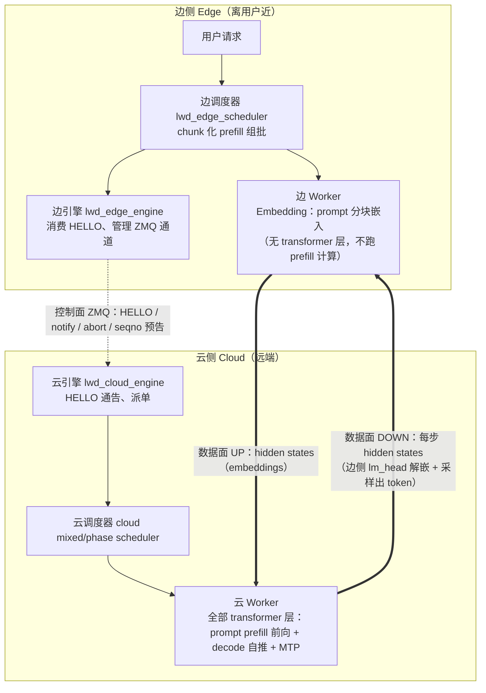
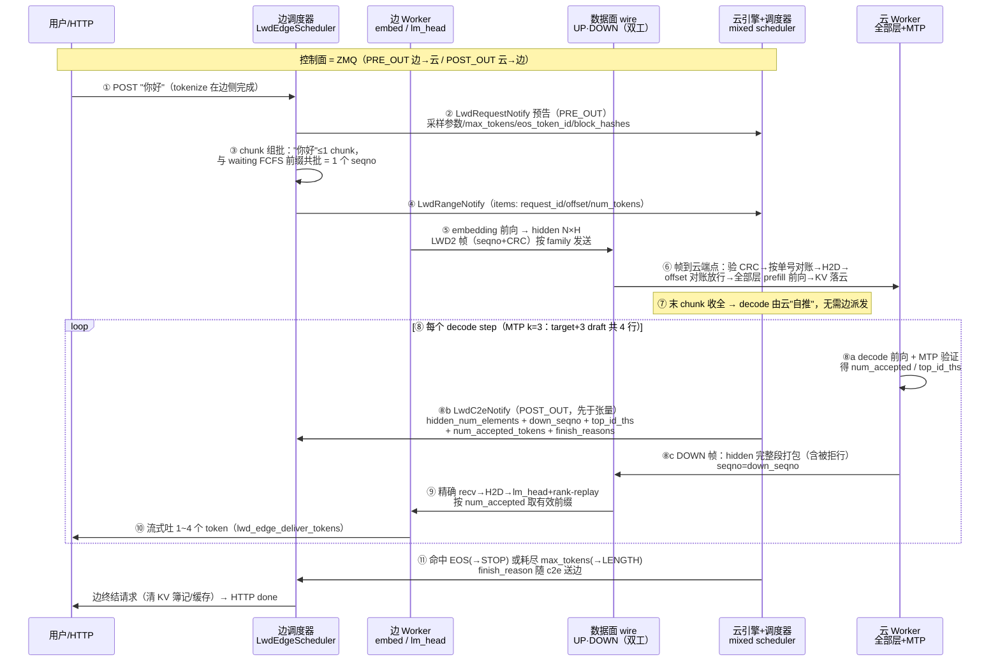
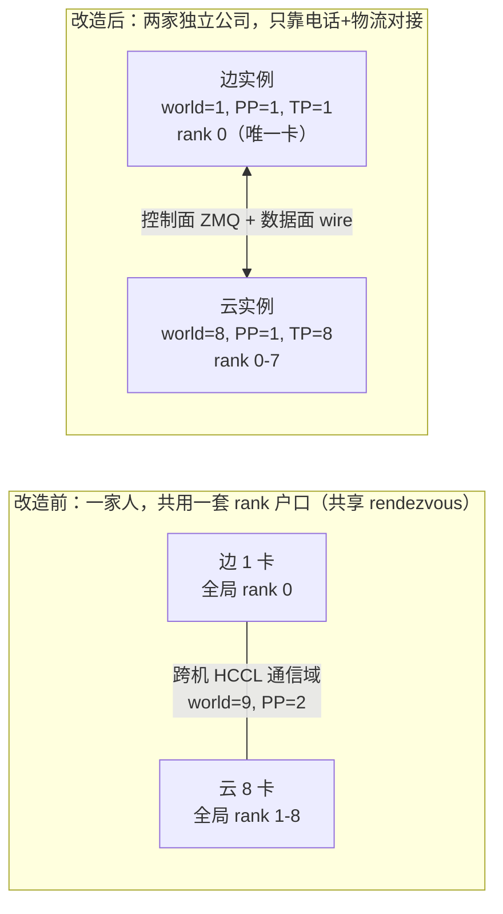
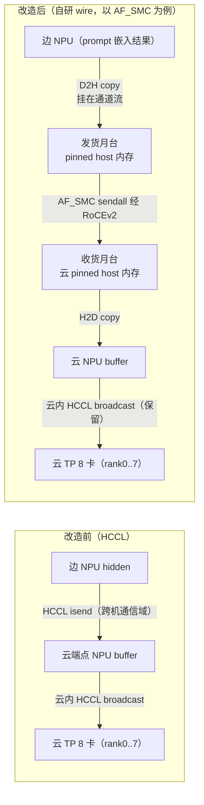
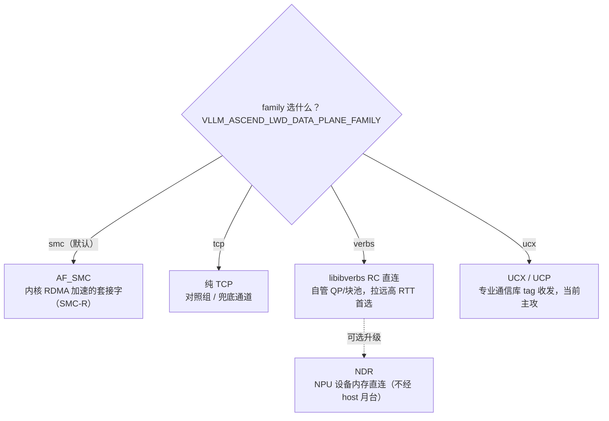
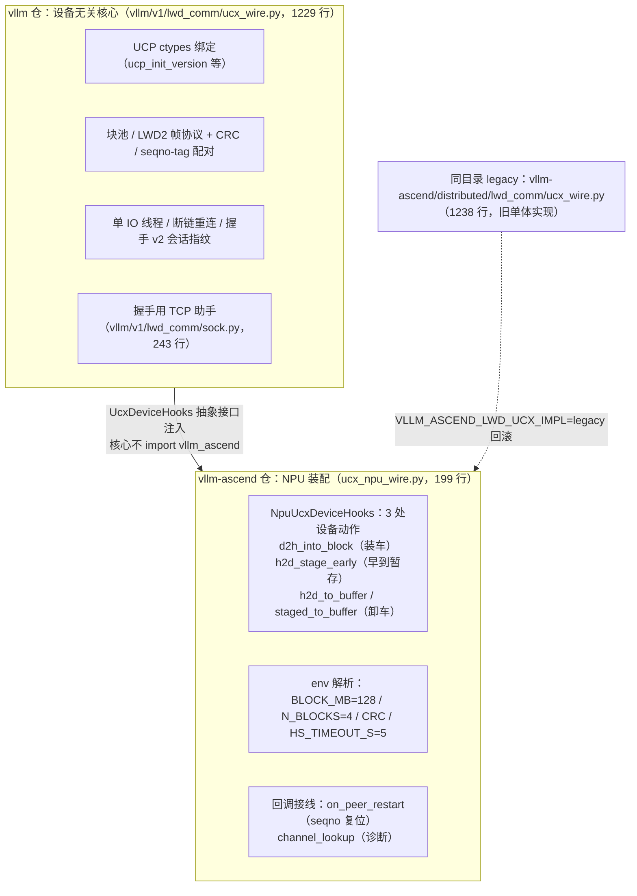
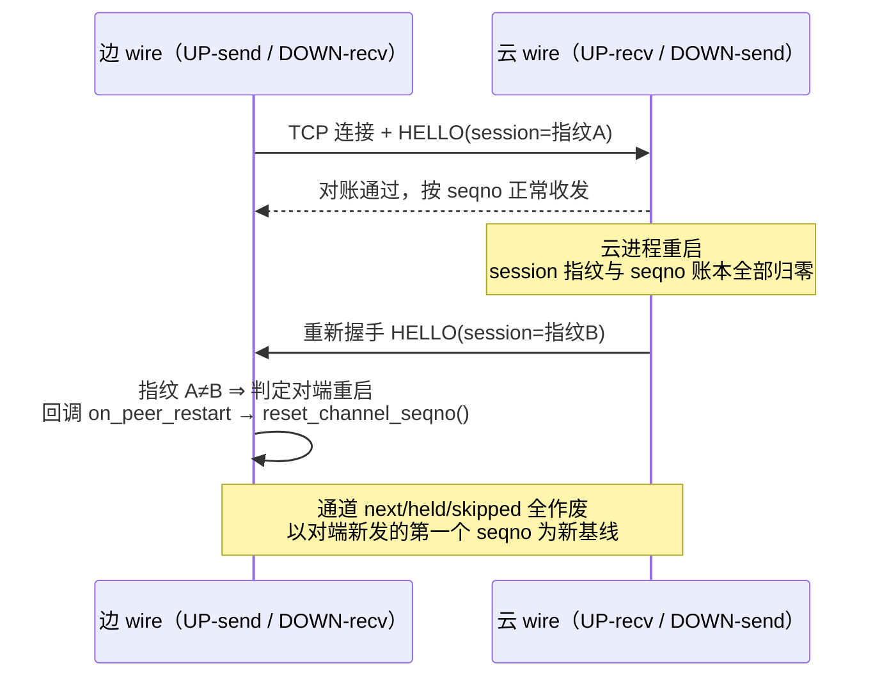

# smc_prefill_only_chunked_prefill_mm_1017_ucx 分支功能全解析

> 本文档解析在研特性分支 `smc_prefill_only_chunked_prefill_mm_1017_ucx`（下称 **smc/ucx 分支**）的
> 功能、架构与设计动机，并将其与基线分支 `prefill_only_chunked_prefill_mm` 做对照。
> 所有事实均来自两个仓库的 git 提交历史与源码交叉核实，关键处标注了提交号与文件位置，可直接复查。

**适用仓库与基线**（均在 `C:\Users\Huawei_Test1\workspace\projects\vllm_ec` 下）：

| 仓库 | 分支 | 分叉点（merge-base） | 分支头部 | 独有提交数 | 建章规模 |
|---|---|---|---|---|---|
| `vllm` | smc/ucx 分支 | `0005d05d86`（2026-09-28） | `11642bf07d`（2026-10-26） | 74 | 25 文件，+5730/−143 |
| `vllm` | 基线分支 | 同上 | `b8d794374d`（2026-10-23） | 66 | 36 文件，+4932/−749 |
| `vllm-ascend` | smc/ucx 分支 | `6e0446a134`（2026-09-28） | `9e12123439`（2026-10-26） | 89 | 14 文件，+5134/−351 |
| `vllm-ascend` | 基线分支 | 同上 | `cba86a2a58`（2026-10-23） | 58 | 25 文件，+4320/−668 |

两个分支从同一提交分叉后**互相不包含对方的新提交**——这是一条纯"传输层改造线"，基线则是"调度/模型/权重线"。

---

## 1. 结论速览

smc/ucx 分支做了一件具体的事：

> 把 LWD 边云模式下**跨机段的张量传输从 HCCL 换成了自研、可插拔的数据面传输层**，
> 并配套做了"拆世界"组织架构改造与一整套传输可靠性/性能/诊断机制。

分支名即是密码：`smc`（起点是 AF_SMC）＋ `1017`（10 月 17 日拉起）＋ `ucx`（当前主攻 UCX 传输）。

功能清单总览：

| # | 特性组 | 一句话说明 |
|---|---|---|
| 1 | **拆世界（split-world）** | 边、云从共享的跨机 HCCL 世界拆成两个独立分布式实例，跨机只剩控制面 ZMQ + 数据面 wire |
| 2 | **可插拔传输族** | `data_plane_family = smc / tcp / verbs / ucx` 四种跨机传输实现，env 一键切换 |
| 3 | **UCX 双层实现** | UCX 核心（设备无关）进 vllm 主仓，NPU 特化经 `UcxDeviceHooks` 装配在 vllm-ascend |
| 4 | **统一 LWD2 帧协议 + CRC** | 所有传输族共用同款帧头与帧级 CRC，启动期做帧预算预检 |
| 5 | **华为定制 verbs ABI 适配** | 运行期探测定制/标准 libibverbs 结构体差异，修复未导出符号、GID 选择等问题 |
| 6 | **对端重启自愈** | 握手 v2 会话指纹 + seqno 惰性基线，云/边任意侧重启后通道自动复位 |
| 7 | **控制面心跳与发现** | 发布端周期哨兵 + HELLO 静默检测，新对端拉起即可被重新发现 |
| 8 | **性能与观测** | 大 socket buffer/聚集发送/pinned 接收池、MTP 接受率指标、分段性能探针 |
| 9 | **演示工具 af_smc_demo** | 不依赖 NPU/整套系统的双机压测与 ABI 探测工具链 + 三份迁移设计文档 |

---

## 2. 背景：LWD 边云 prefill_only 是什么

### 2.1 先厘清一个望文生义的坑：prefill_only 里"边"到底算什么

LWD = **Layerwise Disaggregated**（按层分离部署，见 `vllm/config/lwd.py` 的模块注释）。
`mode=prefill_only` 强制 `edge_head_tail_layers=[0,0]`，即**边不持有任何 transformer 层**
（`local_layer_indices()` 对边返回空集，全部层归云）。

因此"边侧进行 prefill"的准确含义是——**边是一个 prefill-only 的调度与入口角色**，
而不是"prefill 的矩阵计算在边"。真正的分工（依据：`lwd_edge_scheduler.py` 模块注释、
`vllm_ascend/distributed/lwd_comm/types.py`、`vllm_ascend/envs.py` 的 SKIP 阶梯注释）：

| 环节 | 谁做 |
|---|---|
| 接收请求、chunk 组批、范围预告（notify/seqno） | 边（调度器） |
| Embedding：prompt 按 chunk 逐块嵌入成 hidden | 边（执行层只有 embed） |
| **全部 transformer 层前向——包括对 prompt 的 prefill 计算** | 云 |
| Decode 自推（收齐末 chunk 后自推进）+ MTP 投机解码 | 云 |
| KV 缓存 | 云（层全在云） |
| lm_head 解嵌 + 采样、对外输出 token | 边（正常路径） |

边侧请求的生命周期（`lwd_edge_scheduler.py` 头注原文）：入队 → EMBEDDING（切 chunk、
逐块 embed、逐批发 UP）→ 嵌入完结当步即把请求从边侧调度器清出 → AWAITING（纯等云结果）→
云结果终结。原注释原话：**"边侧只做 embedding（执行层无 decode）"、"边侧请求从不产生
输出 token（num_tokens_with_spec 恒等于 num_prompt_tokens）……原生 RUNNING 段每步只会
调度剩余 prefill，decode 分支不可达"**。

所以"chunked prefill"也一并澄清：不是"边算一部分 prefill、云算一部分 prefill"，而是
边把 prompt 按 `c = min(剩余, chunk 单元 C)` 切块，**每块 embedding 后作为一次 UP 发送
（一个 seqno）发云**；云按批内最大条目复现 chunk 边界、逐块执行真正的 prefill 前向，
收齐末 chunk 后自行推进 decode（云侧"delta 自推"）。

一句话总结：这个 LWD 版本按**模块**拆分（embed 在边 / 全部层在云 / unembed 在边），
与标准 PD 分离（prefill 机 + decode 机）那种按**阶段**拆分不是同一种切法；
`prefill_only` 说的是**边侧这台机器的调度角色只走 prefill 路径、永不进 decode**，
而不是"prefill 的计算放在边"。

### 2.2 控制面与数据面：整个系统只有两条线

拆到两台机器后，边云之间只有两类东西在流动，对应两个"面"：

| 平面 | 传什么 | 技术载体 | 在本分支中的角色 |
|---|---|---|---|
| **控制面** | 调度元数据：HELLO 发现通告、派单通知（notify）、取消（abort）、单号（seqno）预告 | ZMQ 消息 | 保持不动，仅追加少量字段 |
| **数据面** | 大块张量：UP = 边→云的 prompt 嵌入（hidden）；DOWN = 云→边 的每步 hidden（c2e 包，边侧 lm_head 解嵌/采样） | **本分支的改造对象** | HCCL 换自研传输层 |



> 术语提醒：不要把"控制面/数据面"与"样本面"混用——前者是**流量类型**的划分；"样本面"是并行**切分维度**的术语（样本面并行 = 数据并行 DP）。
> 二者正交：DP 多实例时，每对边云实例各自拥有一组控制面 + 数据面通道。

### 2.3 改造前的数据面：HCCL，以及它的三个痛点

改造前（即基线分支的形态），跨机张量传输直接使用 **HCCL**（华为集合通信库）：

- 用 `dist.new_group` 把「边卡 + 云卡」组成一个跨机通信域；
- UP 通道用 `dist.isend/irecv` 把 hidden states 从边发到云端点，再由云端点在云内 TP 组做 HCCL broadcast；
- 迁移方案文档 `vllm/af_smc_demo/HCCL_TO_AF_SMC_MIGRATION.md` 里把这一现状原样记录。

这种方案有三个痛点（本分支的诞生动机，均可从提交注释/真机实录字样找到）：

1. **绑定太死**：为了发一个张量必须组建跨机 HCCL 通信域，建域要 warmup、要求全量集合通信参与，链路与 HCCL 实现深度耦合，**没有更换传输方案的接口**；
2. **共享"户口"导致的单点故障**：边云共用一个 rendezvous（相当于共用一套 rank 编号 0~15），任意一侧重启，另一侧会在 `init_process_group` 的 store barrier 处卡死（真机实录见拆世界章节）；
3. **拉远场景性能受限**：真实边云可能跨 500 公里、RTT 数毫秒，HCCL 不是为这类链路设计的，需要按链路特性选传输方式的自由度。

### 2.4 一次请求的完整旅程：用户输入"你好"

下面的时序以用户向**边侧** HTTP 发一条 `chat/completions`（"你好"，tokenize 后仅 2~4 个
token，落在单个 chunk 内）为例，逐步标注每一步发生了什么、由哪一侧执行、踩过本分支
的哪块机制。方括号里的交叉引用指向后文章节。

**第 0 步（服务就绪，先于任何请求）**：两侧按拆世界各自拉起实例（§3）。云侧 bind
PRE_OUT:7200、向边的 POST_OUT:7201 发出首拍 HELLO 并随后周期补发（心跳即发现，
§7.2）；HELLO 携带三样东西：`pre_out_host:port`（边连云的唯一事实源）、调度三元组
（`max_num_batched_tokens`/`max_num_seqs`/`num_speculative_tokens`，边侧据此互校与
preflight）、数据面端点（`data_plane_host`/`data_plane_port_base`）。边收到 HELLO 后
建立数据面 UP/DOWN 双工通道（握手 v2 交换会话指纹，§7.1）。注意边侧**不设**
`--speculative-config`——它的 `num_speculative_tokens` 从云侧 HELLO **采纳**。



**逐步展开**（关键处标注代码依据）：

1. **请求入边**：边侧 HTTP/engine-core 收下"你好"，tokenize（含 `eos_token_id` 解析——云侧拿不到原始 token，必须随预告透传）。
2. **请求预告（PRE_OUT, 控制面）**：`LwdRequestNotify` 只带云侧调度决策所需的字段：采样参数（temperature/top_p/各种惩罚、EOS 策略、min_tokens）、`max_tokens`、`block_hashes`（边侧算好的 prompt 满块链，供云侧前缀缓存命中，缺省回退本地哈希）。ADD 发布失败按 5 次递增间隔重试（约 3s），耗尽即请求级报错。
3. **边侧 chunk 组批**（纯 prefill 调度语义，§2.1）："你好"短 prompt 一个 chunk 装完（长 prompt 才切多块：`c = min(剩余, chunk 单元 C)`，且受两重闸门——批内 Σc ≤ cap（云侧预算 − 在途数 × spec 系数，用 HELLO 三元组同源计算），未消费 chunk 数 ≥3 即停止新开 prefill）。一个批 = 一条批量 `LwdRangeNotify` = 一个 **seqno** = 一次 UP 发送。
4. **范围预告**：`LwdRangeNotify.items` 逐请求带 `(request_id, offset, num_tokens)`，云侧按 `offset == num_computed` 幂等登记对账——这就是 chunked prefill 双方"同步进度"的唯一依据。
5. **边侧执行 embedding**：边模型只有 embed + lm_head（transformer 层是占位符），对批内 token 算出 hidden（N×H）后提交 UP 通道：D2H 拷入 pinned 块池 → 组 LWD2 帧（magic+seqno+长度+CRC，§4.4）→ 按 `data_plane_family` 发送（smc 内核 RDMA / verbs RC / ucx UCP tag，§4.2）。
6. **云侧消费 chunk = 真正的 prefill**（工作量全在云，§2.1）：帧到云端点 → 验 CRC、按 seqno 对账 → H2D 进 NPU → 云 mixed scheduler 按 RangeNotify 放行（offset 对账失败即 fail-fast）→ 与同一 step 内其他在途请求的 decode 步**交错同批**（chunked prefill）→ 云上全部 transformer 层跑这段 prompt 位置的 forward、**KV 缓存写入云端块表**。
7. **转入 decode**：云判定"该请求 prompt 已收全"（末 chunk），此后 decode 由云侧自行推进（代码注释原话："delta 云侧收齐末 chunk 后自推"）——decode 阶段不需要边再派任何单。
8. **一个 decode 步（循环至结束）**：
   - 云 mixed 调度把各请求的 decode 步组批；开 MTP（k=3）时每请求展开为 target + 3 个 draft 共 4 行；
   - 云跑 decode 前向 + MTP 验证，得出每请求的接受数 `num_accepted` 与 top-k 索引 `top_id_ths`；
   - **元数据先行**：云经 POST_OUT 发 `LwdC2eNotify`，携带 `hidden_num_elements`（边据此**预挂精确尺寸 recv**）、`down_seqno`（本步 DOWN 帧单号）、`top_id_ths`、`num_accepted_tokens`、`finish_reasons`；
   - **张量后到**：云把本步 hidden 按"完整段"打包（**含被拒 draft 行**，边侧按 `num_accepted` 取有效前缀；DOWN 帧元素数公式 `32 + R×(H+3K)`，见 `types.py`），以 `seqno=down_seqno` 的 LWD2 帧经 DOWN 通道发回。
9. **边侧还原 token**：c2e 元数据先到、DOWN 帧按单号配对到达后，H2D 到 NPU，边跑 **lm_head + rank-replay**——用云给的 `top_id_ths` 在本侧 logits 上恢复出对应行的 token id（正常路径默认如此；`VLLM_ASCEND_LWD_EDGE_SKIP_SAMPLE=1` 诊断模式才跳过 lm_head、直接交付云侧捎带的 `token_ids`）。
10. **流式吐 token**：边引擎 `lwd_edge_deliver_tokens` 把本步接受的 1~4 个 token 原样流式写给 HTTP 客户端；迟到的重复结果幂等丢弃。
11. **终结**：云侧判定 STOP（命中 EOS）或 LENGTH（耗尽 max_tokens），`finish_reason` 随 c2e 步元数据送边并原样透传给客户端（LENGTH 不再伪装成 STOP）；边侧 finish 清出请求（KV 簿记、worker 缓存），HTTP 流结束。
12. **异常与韧性支线**（用户中断/对端重启时走这里，全部是 §7 的机制）：
    - **用户 cancel**：边发 `LwdAbortNotify`（PRE_OUT）→ 云清理请求登记；在途帧对应的 seqno 被标记 skip，接收端**帧到达时物理丢帧**（连 H2D 拷贝都省掉）。
    - **云重启**：边侧 HELLO 静默超时（默认 1200s）判云失联、preflight 停止派发新 prefill（请求在边排队）；云重启后新 HELLO 到达（`cloud_boot_id` 变化），数据面重新握手、会话指纹变化 → 边侧 `reset_peer_restart` + seqno 惰性基线（以对端重启后的第一个 seqno 为新基线）→ 自动恢复服务。
    - **边重启**：边内存里的请求状态随进程丢失（客户端需重试）；云侧残留请求由 abort/seqno 对账回收，云进程本身不受牵连（§3 拆世界的核心收益）。

**长 prompt 的差异**：步骤 3~6 会循环多次（每 chunk 一个 seqno 一次 UP），云侧逐块做
prefill、按 offset 推进 `num_computed`；边侧收到全部 chunk 的"嵌入完结"即把请求从
边调度器清出、转入纯等待态（AWAITING），decode 全程在云。

---

## 3. 特性一：拆世界（split-world）——边、云分家单干

> **拓扑约定**：本章起所有示例统一采用你当前拉起测试的真实形态——**边 1 卡、云 8 卡**
> （`--edge-npu-count 1 --cloud-npu-count 8`；`ASCEND_RT_VISIBLE_DEVICES` 边侧 `0`、
> 云侧 `0,1,2,3,4,5,6,7`）。

### 3.1 改了什么

| | 改造前（共享世界） | 改造后（拆世界） |
|---|---|---|
| world_size | 边卡数 **+** 云卡数 = **1+8 = 9**（边=全局 rank0，云=rank1..8） | **只看本侧**（边=1，云=8） |
| tensor_parallel_size | 边 1 / 云 8（由 LWD 覆写决定） | 边 **1** / 云 **8**（= 本侧卡数，仍由 `--edge/cloud-npu-count` 推导） |
| pipeline_parallel_size | **2**：边 rank0 与云 rank0 成跨机两段流水线，云 rank 2..8 单例 | **1**（取消跨机流水段） |
| 跨机内容 | 跨机 HCCL 通信域 + 跨机集合通信 | **只剩控制面 ZMQ + 数据面 wire** |
| 单侧重启 | 另一侧卡死在初始化 barrier | 各自独立重启、自行恢复 |



关键改动点：

- `vllm/config/parallel.py`、`vllm/config/vllm.py`：删除 LWD 模式下
  `world_size = edge + cloud`、`PP = 2` 的推导，改为 **world = 本侧卡数（边 1 / 云 8）、
  TP = 本侧卡数（边 1 / 云 8）、PP = 1**；同时 fail-fast：边侧 `--edge-npu-count` 必须
  > 0（原有校验），云侧 `--cloud-npu-count` 必须 > 0（本分支新增校验）；
- `vllm-ascend/vllm_ascend/distributed/lwd_comm/lwd_parallel_init.py`：Ascend 侧通信组
  （MC2 等）不再按非对称「边段 + 云段」布局建组，而是**在各自实例内按本侧卡数**建组：

  ```text
  world_size == data_parallel_size × 本侧卡数
  MC2 组 = [[dp_idx × 本侧卡数 + r for r in range(本侧卡数)] for dp_idx in range(dp)]
  ```

  落到 1+8 拓扑：云实例内一个 **8 卡 MC2 组**（rank 0..7 全体）、边实例一个单卡组；
  同时显式拒绝尚未适配拆世界的特性（finegrained tp / flashcomm2 / layer_sharding），
  避免组缺导致的运行期事故。

**替换的边界**：拆掉的是**跨机段**——云实例内部的多卡 TP 扩散仍然是 HCCL：UP 帧到达
云 rank0 后，在云实例内 broadcast 给 8 张 TP 卡；DOWN 由云 rank0 负责发送（TP 输出在
各 rank all-reduce 后复制一致）。改动不涉及云内/边内机器内部通信。

### 3.2 配套机制一：本地 rendezvous 重定向

`vllm/distributed/parallel_state.py` 新增 `_rewrite_rendezvous_to_local()`：

- 问题：边云部署里 `master_addr` 同时承载**控制面 ZMQ 寻址**语义（云端 POST_OUT 连的
  就是 `tcp://master_addr:post_out_port`，必须填边 IP），不能乱改；但 torch.distributed
  的 store rendezvous 是"一次性全员参与"语义——两端共用同一 store 时，单侧重启后对侧
  **永远不会重新参与**，重启侧先天卡死在 `init_process_group` 的 store barrier
  （提交注释里的真机实录）。
- 解法：`init_distributed_environment` 在初始化前，把指向**非本机地址**的
  `tcp://` init_method 改写为 `tcp://本机IP:派生端口`，让每个实例的 rendezvous
  闭包在本机内——单侧重启可以自行重新建组。落到 1+8：云侧 8 卡实例改写后是
  "nnodes=2 建模、实例 rank 全在本机、ws=8"的形态（真机实录同款），边侧 1 卡实例
  改写后就是本机 1 进程。
- 控制开关：

| 环境变量 | 默认 | 说明 |
|---|---|---|
| `VLLM_RDZV_FORCE_LOCAL` | 自动判定（非本机 host 即改写） | `1` 强制启用；`0` 关闭（标准多节点部署、非 rank0 需跨机 rendezvous 时必须置 0） |
| `VLLM_LOCAL_RDZV_PORT` | 原端口 + 1000 | 改写后的本机端口（同机双实例部署必须用 env 分开） |

### 3.3 配套机制二：拆世界防呆校验

`vllm-ascend/vllm_ascend/distributed/lwd_wire.py` 的
`validate_split_world_rendezvous()`：若 init_method 的 host 不是本机地址则**启动即报错**。
原因：两个实例共享同一 master 会污染 store 键空间（两个"rank 0"同键），后续
new_group 的 gloo 握手会拿到对侧实例地址——表现为"启动期卡死在 gloo
broadcast/barrier，数秒后 Connection reset by peer"。与其让运维面对灵异卡死，
不如把部署错误在启动第一秒变成一条带指引的报错。

### 3.4 配套机制三：数据面端点角色解析

拆世界后边、云不再共享 rank 编号空间，端点判定从"全局 rank"改为**角色镜像**：

- 端点角色来自 `LwdConfig.is_edge_node`（由 `additional_config["lwd_config"].role`
  在 `VllmConfig.__post_init__` 回填），不再从全局 rank 推导；
- 角色接线规则（`lwd_wire.py` 的 `init_lwd_duplex_channels`），落到 1+8 拓扑：
  - **边实例（world=1）**：rank 0 就是唯一一张卡——既是计算卡又是数据面端点；
    UP = connect 云侧 `port_base`（send），DOWN = connect 云侧 `port_base+1`（recv）；
  - **云实例（world=8）**：**rank 0（TP 组首卡）是数据面端点**，listen 两个端口并
    attach 到 UP-recv / DOWN-send；UP 帧在 rank0 完成 H2D 后经实例内 HCCL broadcast
    分发给 rank1..7；
  - 云侧其余 7 张 interior 卡不建任何 socket，只参与实例内 TP 广播与收尾 barrier。

---

## 4. 特性二：自研可插拔数据面——四种"快递方式"

### 4.1 数据面工作模型：月台、司机、集装箱

以 UP（边→云）为例（1+8 拓扑：边 1 卡的 rank0 发出、云 8 卡的 rank0 收进，云内 8 卡
扩散仍走 HCCL）。对比改造前后的传输路径：



四个关键装置（全部有代码实体的比喻）：

- **IO 线程（专职司机）**：每个（通道, 方向）一条独立线程——UP-send / UP-recv /
  DOWN-send / DOWN-recv（verbs/ucx 另有握手 acceptor）。落到 1+8 拓扑：数据面物理链路
  只有边 rank0 ↔ 云 rank0 两个端点——边侧跑 UP-send / DOWN-recv 两条线程，云侧只有
  rank0 跑 UP-recv / DOWN-send 两条线程，云 rank1..7 无数据面 socket（§3.4）。字节流
  **天然保序**，因此 `channel.py` 里为 HCCL 时代的乱序防御而设的 `_held` 重排缓冲退化
  为"永远不触发的直通"（代码保留并注释说明）。
- **块池（集装箱）**：预注册内存块循环复用。verbs 默认 64MB × 4 个块；UCX 默认
  128MB × 4 个块，全部 env 可调。
- **NPU 流（装卸调度线）**：D2H/H2D 拷贝与完成事件（npu Event）都挂在本通道的
  专用 NPU stream 上——这保证了"recv future 完成 ⇒ 数据已落在 NPU buffer"的语义不变
  （迁移文档 §1.3 明确把它列为**红线不变量**）。
- **帧（快递单）**：每件货一张标准快递单，见 4.4。

### 4.2 四种传输族逐一点评

工厂入口：`vllm-ascend/vllm_ascend/distributed/lwd_wire.py::init_lwd_duplex_channels()`，
由 `VLLM_ASCEND_LWD_DATA_PLANE_FAMILY`（env 覆盖）或 `lwd_config` 装配段的
`data_plane_family` 字段选择。



| family | 本质 | 实现文件 | 适合场景 |
|---|---|---|---|
| `smc` | Linux 内核 AF_SMC 套接字：**让 TCP 语义的程序自动走 RoCE RDMA**（SMC-R 协议），全量 ctypes 化、绕过 Python 层 bind/connect（SMC 协议号创建修复） | `vllm-ascend/vllm_ascend/distributed/lwd_comm/smc_wire.py`（997 行） | 默认选择，同城/低 RTT |
| `tcp` | 普通 TCP，与 SMC 同一实现文件里的对照分支 | 同上 | 排障对照、SMC 协商失败兜底 |
| `verbs` | 直接调 `libibverbs` 的 **RC SEND 双边收发**，握手走小 TCP；自管 QP、块池、WQE | `vllm-ascend/vllm_ascend/distributed/lwd_comm/verbs_wire.py`（2061 行） | **拉远高 RTT**：SMC-R 受 RMBE 逐块确认窗口限制，实测 500km/5ms 上限 ~0.8Gbps；verbs 同链路 ib_send_bw ~9.4Gbps |
| `ucx` | 调 UCX 库 **UCP tag 收发**；seqno 编码进 tag（wildcard 预挂接收，帧头 seqno 互验）；大帧自动走 UCX rendezvous（线上 READ/WRITE，由 `UCX_RNDV_SCHEME/PROTO_ENABLE` 控制） | vllm 仓核心 `vllm/v1/lwd_comm/ucx_wire.py`（1229 行）+ NPU 装配 `vllm-ascend/vllm_ascend/distributed/lwd_comm/ucx_npu_wire.py`（199 行） | 当前主攻；部署前置：两端 `LD_LIBRARY_PATH` 指向 UCX 1.22；边侧（hns）`UCX_TLS=rc_verbs,tcp,self`，云侧（mlx5）`UCX_TLS=rc_mlx5,tcp,self` 或 `rc_verbs,tcp,self` |

**NDR（NPU Direct RDMA）**：verbs 族下的升级形态——NPU 设备内存直连，绕开 host 月台
（"车间直达车间"）。NPU 内存注册 MR 的失败历史（`ibv_reg_mr` EFAULT 等）通过
**改用 ACL 运行时直分配块池**修复（两仓均有对应提交）。UCX 形态下 NDR 不支持：
`VLLM_ASCEND_LWD_UCX_NDR=1` 会在启动时直接报错并提示改用 verbs 路径。

### 4.3 端口布局与寻址双轨

| family | UP 数据面 | DOWN 数据面 | 握手 TCP |
|---|---|---|---|
| smc / tcp | `port_base`（边 connect 云 listen） | `port_base + 1` | 无（TCP 三握即握手） |
| verbs / ucx | `port_base + 2` | `port_base + 3` | 小 TCP 交换地址/QP 信息 |

寻址沿用控制面 `pre_out` 的双轨模式：

- **静态轨**（建连依据）：`lwd_config` 段的 `data_plane_host / data_plane_port_base /
  data_plane_family`，云 worker bind、边 worker connect 都读它（缺省 host 随
  `pre_out_host`，即同一个 RoCE 网段）；
- **动态轨**（校验用）：HELLO 通告追加字段 `data_plane_host / data_plane_port_base`，
  边引擎收到后与本地配置比对，不一致告警不拦截。

边侧建连在 IO 线程后台重试；HELLO 未到达前边调度器不派发 LWD batch，数据面队列零积压。
建连过程（TCP 握手 + SMC CLC 协商 + RDMA 链路建立）本身承担了原 HCCL warmup 的目的，
init 不再阻塞交换探针——这是提交 `ea57112306`「控制面拉起 AF_SMC 数据面」的核心时序设计。

### 4.4 统一帧协议 LWD2 + CRC："世界语快递单"

所有传输族共用**逐字节一致**的帧头（`vllm/v1/lwd_comm/ucx_wire.py` 中的
`_FRAME = struct.Struct("!4sQQQI4x")`）：

```text
┌─────────┬────────┬─────────────┬─────────┬────────┬──────┐
│ magic   │ seqno  │ payload_len │ aux_len │ crc    │ pad  │
│ "LWD2"  │ uint64 │ uint64      │ uint64  │ uint32 │ 4B   │
│ 4B      │ 8B     │ 8B          │ 8B      │ 4B     │      │
└─────────┴────────┴─────────────┴─────────┴────────┴──────┘
帧头合计 36 字节（v2 在早期 LWD1 28 字节头的基础上增加了 CRC 字段）
```

语义（全部有代码/文档出处）：

- **magic**：`b"LWD2"`；版本不符直接 fail-fast，而不是错解析；
- **seqno**：由控制面统一发号——UP 帧 seqno = 边侧 dispatch seqno（
  `LwdRangeNotify.seqno` 同源同值），DOWN 帧 seqno = 云侧
  `LwdC2eNotify.down_seqno`。接收端 IO 线程据此对账；无 seqno 请求的哨兵为
  `0xFFFFFFFFFFFFFFFF`；
- **payload**：bfloat16 元素（UP 含 DeepSeek-V4 场景的 Hash 专家 ID 追加段）；
- **aux**：仅 UP 通道，mrope 位置张量 `int64 [n,3]`（`has_mrope` 请求的行，与边侧
  组帧同源同序）——注意基线分支后来把 mrope 迁移到控制面（wire_version=2），
  **本分支保留数据面 aux 帧形态**；
- **crc**：zlib 帧级校验，另设 `_RECV_CRC` 帧级复核口径（诊断用）。配合
  H2D 阶段 CRC 校验，可以把"边云两端数值不一致"定位到"发送前 / 线上 / 接收后"
  具体阶段。

**跳过帧（skip）的物理丢帧**：请求 abort 会在 seqno 序列留下空洞。
`channel.py` 在标记 `skip_seqno` 时会同步调用 wire 的 `add_skipped(seqno)`，
接收端**帧到达时校验单号直接丢弃，连 H2D 拷贝都省掉**——字节流传输相对 HCCL
（只能事后发现乱序）更强，这是迁移文档明确列出的增益。

### 4.5 启动期帧预算预检

真机实录：压测大 prompt 时 5013-token 的 chunk 帧有 72MB，超出 64MB 的块，发送线程
broken、对端 60s unbound 才暴露。为此 `init_lwd_duplex_channels` 在启动期按

```text
帧上界 = max_num_batched_tokens × (hidden_size × 2 + 512 + 24) + 28
```

推导最大 UP 帧尺寸并对照块大小，装不下**启动即报错**，报错文案同时给出
"调大 `*_BLOCK_MB` 还是调小 `--max-num-batched-tokens`"两个选项。

---

## 5. 特性三：UCX 的双层实现——物流总公司 + 车企装配厂

这是本分支架构分层最精巧的一处（`ucx_npu_wire.py` 顶部注释自述）：



三个设计要点：

1. **设备无关核心上移 vllm 主仓**：链路的绑定、重连判定、帧协议、块池、顺序保证与
   算力卡无关，放进主仓意味着**边侧换成 GPU/CPU 也可以复用同一套核心**（各插件仓
   按 `UcxDeviceHooks` 同构接口实现即可）；
2. **NPU 特性收敛为 3 个拷贝/事件点**：`d2h_into_block` / `h2d_stage_early` /
   `h2d_to_buffer` / `staged_to_buffer` 四方法（三处动作），由 hooks 注入核心，
   核心不反向依赖 vllm_ascend；重连时的 seqno 复位与诊断通道查找也改为构造注入
   回调（`on_peer_restart` / `channel_lookup`）；
3. **core/legacy 双实现可切换**：`VLLM_ASCEND_LWD_UCX_IMPL=core`（默认，本分层）/
   `legacy`（旧单体），demo 阶段保留一键回滚通道。环境变量口径与 legacy 逐一一致
   （`VLLM_ASCEND_LWD_UCX_*`），运维零变化。

---

## 6. 特性四：华为定制 libibverbs 的"非标公路"适配

verbs / NDR 能跑通的前提约 30 个提交的大工程，源于一个现实：华为定制版
`libibverbs`（及 openEuler 上的版本）与标准版头文件/动态库存在多处差异：

| 差异点（提交号可查） | 处理方式 |
|---|---|
| 定制版 QP 属性、qp_num 偏移与标准头文件不符（`7b51d11c8d`、`cbc743aa78`、`c05d34780a5`） | 运行期**探测 + 校准** ctypes 结构体定义；`VERBS_ABI=std` 强制按标准 ABI（配套工具 `af_smc_demo/verbs_probe.c` 探测两类头文件） |
| `ibv_post_send / ibv_post_recv` 未导出（`a7c4a57567`） | 改用库导出的等价接口 |
| `ibv_poll_cq` 未导出（`4f4febddd1`） | 替换为 provider 命令层导出的轮询 API |
| RoCEv2 下错误选中 IPv4-mapped GID（`3f790d1883`） | GID 选择逻辑修复 |
| 多网卡场景选错设备/GID（`2f886c066c`） | **按路由源 IP** 选择 RDMA 设备与 GID，`VERBS_DEV` 可显式指定 |
| 拉远丢包 / 流量类配置（`02a98cae41`、`4a853b8219`） | GRH、流量类（TC）、跳数限制环境变量化；QP 超时值 env 可调 |
| CRC 性能疑难（`1fde00ade2`） | `VERBS_NOCRC` 诊断开关 |
| 性能调优链路（`a5a8806547`） | `VERBS_TRACE`（链路打点）、`VERBS_PRELOAD`（加载诊断）两个开关 |

核心价值：**同一份 wire 代码同时适配标准 RoCE 网卡（mlx5）与华为定制网卡（hns），
由运行期探测定夺结构体布局**，不用为现场网卡重建分支。

---

## 7. 特性五：可靠性机制全家桶

### 7.1 对端重启自愈：握手 v2 会话指纹

数据面握手协议升级到 v2（提交 `c48f8d9624`）：每条 TCP 握手交换
`magic("LWU2") + addr_len + max_frame + session`，其中 **session 是 8 字节的进程内
随机指纹**。链路重建时对端指纹变化，即判定"对端服务重启过"：



配套的两处代码（缺一不可）：

- **seqno 惰性基线**（`vllm-ascend/distributed/lwd_comm/channel.py`）：把"计数器恒从 0
  起"的契约改为"以实际第一个提交的 seqno 为基线"。原契约在对端重启场景会反噬——重启方
  从 0 重新发号，而存活方还在等它从第 47 号继续，首请求被判乱序扣住（held），
  runner 等 deferred future 直到 unbound 超时（真机实录：云重启后首请求云 rank0
  unbound、帧滞留 wire early）。
- **`reset_peer_restart()`**：对端重启时清空 next/held/skipped 三本账，接上面的
  惰性基线，通道瞬间恢复可用。
- 提交 `5d7448b653` 修复进一步的边界：对端重启后通信**通道序号基线**错误导致
  请求超时的问题。

### 7.2 控制面心跳与发现（提交 `3f8ec875a3`）

数据面有指纹，控制面有心跳：

- **发布端周期哨兵**：`vllm/v1/lwd_control/control_communication/lwd_control_publisher.py`
  新增 `periodic_msg / periodic_interval_s`——发送线程在"队列空闲超时"或"持续满载超龄"
  时会自动补发一条发现通告（HELLO）。满载补发是点睛之笔：**新拉起的对端只认
  发现通告，真实流量不能替代发现语义**；
- **边侧静默检测**：边引擎长时间收不到 HELLO 会打 "[Lwd] cloud silent" 告警
  （HELLO 超时默认 **1200s**，`LWD_HELLO_TIMEOUT_S_DEFAULT`，提交 `2f2b80bd8b` 调整）；
- HELLO 重新出现即"云已恢复"，引导边侧重新对接。

### 7.3 优雅关闭（提交 `e5751beffb` + 后续修复）

`lwd_wire.py` 的 `shutdown_lwd_duplex_channels(timeout=2.0)`：所有 wire/acceptor
统一关停（幂等）、IO 线程有界 join（卡死线程留 daemon 兜底）、listener 以关闭 fd
打断阻塞中的 accept、`atexit` 注册兜底覆盖正常退出/异常传播/Ctrl+C 三条路。
修复的问题包括：通道退出资源泄漏与无限阻塞（`3d0752a195`）、IO 线程重复启动
死锁（`5968ebb337`）、启动竞态（`1e439bad7b`）。

### 7.4 数据面时序与纠错（真机 bug 修复清单）

| 问题（提交号） | 修复 |
|---|---|
| H2D 完成后块被冻结（`cea4041e18`） | 重构接收路径块回收逻辑，H2D 完成与块回收解耦 |
| 不可靠 event 同步（`f809398a72`） | meta 组包改**阻塞 D2H**，弃用 event 同步 |
| `HostDoneEvent` 缺 wait 方法（`dee96619bb`） | 补齐 `wait()`，消除 AttributeError |
| 接收方向 FIFO 门控憋死通道（`1545868555`） | 解除 recv 方向 FIFO 门控；早到帧（货比提货单先到）进 host 暂存区等待配对 |
| 接收 WQE 未重挂 → RNR 重试超时（`0b950c58e3`） | 接收后自动重挂 WQE |
| bw_recv 下 QP 进 ERROR 态（`b9d4737050`） | 修复 QP 状态机处理 |
| 块索引误读死锁（`47360fab34`） | 修复接收缓冲区块索引判断 |
| 异步拷贝未同步读到旧数据（`406356e4db`） | 加同步 |
| Ascend 集群发送块 CRC 不匹配（`652c98a59b`） | 修复 + 增加 CRC 校验环（`a1d48b5a0e`）诊断 |
| 云模型运行器 future 超时未捕获（`b5fc544ec1`） | 补异常处理 |

### 7.5 诊断三级阶梯（接收路径成本归因）

`vllm_ascend/envs.py` 新增 `VLLM_ASCEND_LWD_EDGE_SKIP_DOWN_RECV`（默认 0，注释明确
"生产永不开"），与既有两个开关组成三级阶梯，用于把 DOWN 链路成本归因到
"边收 vs 云发"：

```text
SKIP_SAMPLE      : 边保留 H2D，仅跳过 lm_head
SKIP_DOWN_RECV   : 边连 H2D/接收一起跳过（云仍然发）
DISABLE_DOWN     : 云连 collect/send 都跳过
```

---

## 8. 特性六：性能与观测

**传输性能**

| 手段（提交号可见） | 说明 |
|---|---|
| 大 socket 缓冲区 + 截断检查（`fbdb5c0fc7`、`5d9f647f29`） | 统一设置大收发 buffer，设置后被内核 clamp 会告警 |
| `sendmsg` 优化 + `MSG_NOSIGNAL` | 对端断开返回 EPIPE 而非 SIGPIPE 杀进程 |
| 聚集发送 + pinned 接收缓冲池（`045fa61051`） | 减少 syscall、避免动态 pinning |
| socket 建连/寻址绕过 Python（`3b781a44dc`） | AF_SMC 的 bind/connect 走 libc |
| 异步拷贝接口 + 多版本 torchnpu 流适配（`886a4c1787`、`960c785c8d`） | 符号缺失自动兼容 |
| 接收路径 hostcopy 形态 env 切换（`51137c6cd5`） | 按部署形态选拷贝路径 |

**观测体系**

- **MTP 接受率指标**（提交 `843a0bdf4c` → `8abcb227b1` → `d18df781d4`）：
  云引擎统计多 token 预测的接受率（含计量方式重构）；
- **分段/步骤性能统计**：边引擎分段统计（`bad843cfb6`）、云引擎步骤内埋点
  （`1c90ed9881`）、边云 worker 分段聚合（`5a6c56ebfb`、`239c5f817c`）；
- **预填/解码拆分耗时**（`eb2c278eb2`）：把云侧前向推理耗时按预填段/解码段分别统计，
  演示时可直接看出哪一段在吃时间；
- 帧级 CRC 校验 + 深度复核模式（`187b84686c`）：数值错位定位到具体阶段。

---

## 9. 特性七：演示工具链 af_smc_demo

`vllm/af_smc_demo/` 是"先在大马路上练车再上路"的思路：不依赖 NPU、不依赖整套
vllm 系统的双机验证工具（正式 wire 的参考实现）：

| 组件 | 规模 | 作用 |
|---|---|---|
| `smc_client.py` / `smc_server.py` | 120 / 103 行 | 双机模拟 hidden states（bf16 [512,4096] = 4MiB/帧）验证 SMC-R；`--family tcp` 一键对照组；结束时查 `/proc/net/smc` 确认**未静默降级 TCP** |
| `smc_common.py` | 295 行 | 帧协议 + SMC/TCP 公共逻辑（demo 帧协议即正式 wire 的参考实现） |
| `verbs_demo.py` | 1223 行 | libibverbs RC SEND 验证（与正式 `verbs_wire.py` 同款模型：握手/块池/RC SEND） |
| `ndr_probe.py` | 676 行 | NDR 可行性与竞态探针（控制面走第二条 TCP） |
| `verbs_probe.c` | 206 行 | 探测定制/标准 verbs 头文件的 QP 属性偏移 |
| `README.md` | 148 行 | 含 SMC-R 吞吐调优手册：rmem/wmem_max、autocorking（64KB 攒块确认模型是高 RTT 吞吐崩盘主因）、RTT 校准、fallback 排查 |
| 三份迁移文档 | 595 / 379 / 86 行 | `HCCL_TO_AF_SMC_MIGRATION.md`、`AF_SMC_TO_VERBS_MIGRATION.md`、三个仓 libibverbs 实现对比分析 |

README 中的实测数据（demo 结论，非承诺值）：200G RoCE 参考 goodput 12.8Gbps；
10G 链路下 ib_write_bw 9.4-9.7Gbps，SMC 3.3Gbps（低 RTT）/ 0.67Gbps（高 RTT）；
SMC-R 500km/5ms 场景协议上限 ~0.8Gbps vs ib_send_bw ~9.4Gbps——这正是
"拉远场景选 verbs"的决策依据。

---

## 10. 运维开关面板（环境变量总表）

| 环境变量 | 默认 | 含义 |
|---|---|---|
| `VLLM_ASCEND_LWD_DATA_PLANE_FAMILY` | `smc` | 传输族：smc / tcp / verbs / ucx |
| `VLLM_ASCEND_LWD_DATA_PLANE_HOST / _PORT` | 随 pre_out_host / 默认端口 | 数据面寻址 env 覆盖 |
| `VLLM_ASCEND_LWD_UCX_IMPL` | `core` | UCX 核心装配版 / legacy 旧版回滚 |
| `VLLM_ASCEND_LWD_UCX_BLOCK_MB / _N_BLOCKS` | 128 / 4 | UCX 块池尺寸与块数 |
| `VLLM_ASCEND_LWD_UCX_CRC / _HS_TIMEOUT_S / _STAGE_MAX` | 1 / 5 / 0 | CRC 开关 / 握手超时 / 早到暂存上限 |
| `VLLM_ASCEND_LWD_UCX_NDR` | 0 | UCX 下 NDR（启动即拒并提示换 verbs） |
| `VLLM_ASCEND_LWD_VERBS_BLOCK_MB / _N_BLOCKS` | 64 / 4 | verbs 块池 |
| `VERBS_DEV / VERBS_GID_INDEX / VERBS_ABI` | 自动 / 自动 / 自动 | 网卡 / GID / ABI（std 强制标准） |
| `VERBS_NOCRC / VERBS_TRACE / VERBS_PRELOAD` | 0 | verbs 三个诊断开关 |
| `VLLM_RDZV_FORCE_LOCAL` / `VLLM_LOCAL_RDZV_PORT` | 非本机即改 / 原端口+1000 | 拆世界 rendezvous 改写 |
| `VLLM_ASCEND_LWD_EDGE_SKIP_DOWN_RECV` | 0 | 三级诊断阶梯第 2 级（生产禁用） |
| `LWD_HELLO_TIMEOUT_S_DEFAULT` | 1200s（代码常量，非 env） | 云静默判定阈值 |

---

## 11. 与基线分支的边界：本分支没有的东西

smc/ucx 分支是**单向分叉**：它自己的特性基线全都没有；反过来基线近期合并的
特性本分支也**没有**（二者互不包含）。在研阶段如需对照或后续演进，注意以下差距：

- **多 DP 适配线**：GLM 多 DP 适配（两仓 glm_dp2 合并）、边调度闸门 per-engine 分账；
- **调度演进线**：arrival-driven 云调度（按到达行数调度，`03a6a7881e`）、
  per-request prompt_lens 台账（`ec3dbea3a2`）、KV 记账回归原生调度器
  （`4dbd8e6ed6`）、pending_chunks 最多 2 个（`97eb867db7`）；
- **权重与部署线**：checkpoint 拆分器（Python 脚本 + Java jar，`0336599ba8`、
  `f5d2379f5b`）、按角色加载参数（`lwd_weight_filter.py`，`2fdd04ac81`）、
  cpu_offload 合并；
- **数据面另一方向**：数据面 per-engine 通道扇出（`c5fd48fc9f`）、MC2 组跨全部
  云 rank 建组（`b2eff2488e`）、加扰/解扰（`11326f5a53`）、统一并列 logits 排名
  （`14a525998b`）、mrope 走控制面（wire_version=2）。

反过来这也说明：smc/ucx 分支的传输层新文件（`smc_wire.py` / `verbs_wire.py` /
`ucx_wire.py` / `ucx_npu_wire.py` / `sock.py`）全是新增文件，基线未动，冲突面小；
但两条线都改过 `lwd_cloud_engine / lwd_edge_engine / parallel_state / config` 等，
若要合流冲突会集中在这些文件。

---

## 12. 术语小词典

| 术语 | 一句话 |
|---|---|
| LWD | Layerwise Disaggregated，按层分离部署（本仓边云 prefill_only 模式的统称） |
| 控制面 | 调度元数据链路（ZMQ）：HELLO / notify / abort / seqno 预告 |
| 数据面 | 张量链路：UP（边→云 prompt 嵌入）/ DOWN（云→边 每步 hidden，边侧解嵌出 token） |
| 样本面 | 并行切分维度术语 = 数据并行 DP，与上面两个平面正交 |
| 拆世界 | 边、云从共享分布式世界拆成两个独立实例（world/PP/rendezvous 各自独立） |
| wire | 数据面里"连接 + 帧协议 + IO 线程"的完整实现单元 |
| seqno | 帧的单号，控制面发号、数据面对账 |
| 会话指纹 | 进程随机 8 字节 session 标识，用于对端重启检测 |

---

## 附录：关键文件索引

**vllm 主仓（当前分支）**

| 文件 | 角色 |
|---|---|
| `vllm/config/vllm.py`、`vllm/config/parallel.py` | 拆世界后的 world/TP/PP 推导与 LwdConfig 字段 |
| `vllm/distributed/parallel_state.py` | `_rewrite_rendezvous_to_local` 本地 rendezvous 改写 |
| `vllm/v1/lwd_comm/ucx_wire.py` | UCX wire 设备无关核心（1229 行） |
| `vllm/v1/lwd_comm/sock.py` | 设备无关 TCP 握手助手（243 行） |
| `vllm/v1/lwd_control/control_communication/lwd_control_publisher.py` | 周期心跳哨兵 |
| `vllm/v1/lwd_control/control_communication/lwd_notify.py` | 通告协议含数据面端点/会话字段 |
| `vllm/v1/lwd_control/control_cloud_scheduler/lwd_cloud_engine.py` | HELLO 通告填充 + MTP 接受率等 |
| `vllm/v1/lwd_control/control_edge_scheduler/lwd_edge_engine.py` | 静默检测 + 数据面端点校验 |
| `vllm/af_smc_demo/` | 演示工具链与迁移文档 |

**vllm-ascend 仓（当前分支）**

| 文件 | 角色 |
|---|---|
| `vllm_ascend/distributed/lwd_wire.py` | 数据面工厂 + 端点角色接线 + 优雅关闭 + 帧预算预检 |
| `vllm_ascend/distributed/lwd_comm/smc_wire.py` | AF_SMC/TCP wire（997 行） |
| `vllm_ascend/distributed/lwd_comm/verbs_wire.py` | libibverbs RC wire + NDR（2061 行） |
| `vllm_ascend/distributed/lwd_comm/ucx_npu_wire.py` | UCX 的 NPU 装配层（199 行） |
| `vllm_ascend/distributed/lwd_comm/ucx_wire.py` | legacy UCX 实现（回滚通道） |
| `vllm_ascend/distributed/lwd_comm/channel.py` | seqno 惰性基线 / reset_peer_restart / 提交路由到 IO 线程 |
| `vllm_ascend/distributed/lwd_comm/lwd_parallel_init.py` | 拆世界后的实例内 MC2 组建 |
| `vllm_ascend/envs.py` | LWD 全部环境变量定义 |

---

*文档生成方法：基于 `vllm` / `vllm-ascend` 两仓库的 merge-base 三点 diff、独有提交清单、
关键提交逐条核查与源码走读交叉验证；引用的提交号与文件行均可在 2026-10-26 的
分支头部上复现。*