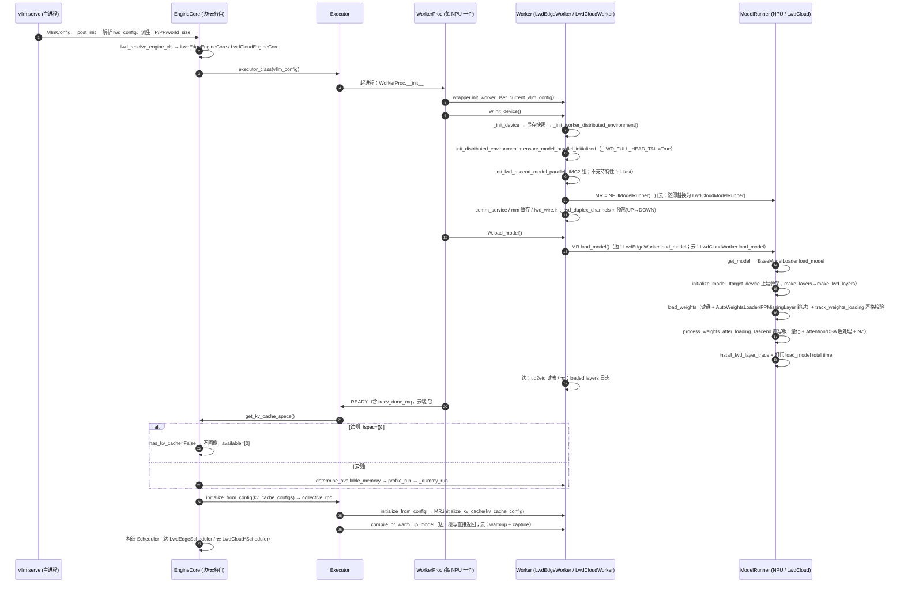

# 模型加载全链路 · 边云分侧（LWD prefill_only）

> 目标部署（`private_home/lauch.sh`）：`Qwen3.6-27B`，`--edge-npu-count 1 --cloud-npu-count 4`，
> `lwd_config = {"enabled": true, "role": "edge|cloud", "mode": "prefill_only", "edge_head_tail_layers": [0,0]}`。
>
> 本文逐函数、逐文件行梳理**边侧**与**云侧**从进程诞生到「模型装好、KV/画像/预热结束」的完整加载链路，
> 并标出两侧在每一步的分叉与理由。所有位置均为当前工作区代码实测行号（`vllm/` 与 `vllm-ascend/` 两仓）。

---

## 0. 阅读约定

| 记号 | 含义 |
|---|---|
| `vllm/…` | vllm 仓（本工作区的 fork，含 LWD 控制面） |
| `ascend/…` | vllm-ascend 仓（`vllm-ascend/vllm_ascend/…`） |
| E / C | 边（edge，1 NPU） / 云（cloud，4 NPU） |
| 局部世界 | 一个 `vllm serve` 进程内的本地 worker 集合：E=1 个、C=4 个 |
| 全局世界 | `edge_npu_count + cloud_npu_count = 5`，跨 2 节点（`--nnodes 2`），全局 rank 0=边、1..4=云 |

**一个必须先建立的认知**：边、云是**两个独立的 `vllm serve` 进程**，各自有自己的 EngineCore、自己的 Executor、自己的本地 worker 集合；
但它们**属于同一个分布式世界**（同一 `--master-addr/--master-port`），并行组是**跨全部 5 个 rank 集合创建**的。
所以"分别启动"= 两个进程加入同一个 world，任何一侧落后都会卡在建组/预热握手处，不存在"单边独立就绪"。

---

## 1. 总览：五个阶段

| 阶段 | 做什么 | 谁在跑 | 关键落点 |
|---|---|---|---|
| **A 配置** | 解析 `lwd_config`、派生 TP/PP/world_size、选定 worker 类 | 主进程 | `vllm/config/vllm.py:852-898`、`vllm/config/lwd.py:43-101`、`ascend/platform.py:661-677` |
| **B 进程启动** | EngineCore → Executor → 起 WorkerProc → `init_device` → `load_model` | 引擎进程 + 每个 NPU 一个 worker 进程 | `vllm/v1/engine/core.py:122`、`vllm/v1/executor/multiproc_executor.py:726-797` |
| **C init_device** | 分布式环境、LWD 并行组、ascend MC2 组、model_runner 实例、双工通道 | 每个 worker | `ascend/worker/worker.py:509-528`、`ascend/worker/lwd_edge_worker.py:99-154`、`ascend/worker/lwd_cloud/lwd_cloud_worker.py:54-126` |
| **D load_model** | 建模型骨架 → 装载权重 → 后处理；边侧再加 tid2eid | 每个 worker | `ascend/worker/model_runner_v1.py:3719-3832` |
| **E 画像/预热/KV** | 边：跳过画像、跳过预热、0 KV；云：画像 + 预热 + KV/mamba | 引擎 + worker | `vllm/v1/engine/core.py:237-301`、`ascend/worker/worker.py:531-600,702-728,903-914` |

```
                 ┌──────────────── 边进程 (rank 0) ────────────────┐   ┌────────── 云进程 (rank 1..4) ──────────┐
 A 配置          │ LwdConfig(role=edge) → worker_cls=LwdEdgeWorker   │   │ LwdConfig(role=cloud) → LwdCloudWorker │
 B 进程          │ WorkerProc: init_worker → init_device → load_model│   │ 同序                                    │
 C init_device   │ dist init + LWD 并行组 + NPUModelRunner           │   │ dist init + LWD 并行组 + LwdCloudModelRunner│
 D load_model    │ 骨架:embed/norm/lm_head(+visual),层全PPMissing     │   │ 骨架:embed/全部层/norm/lm_head/visual    │
                 │ 权重:只装 embed/norm/lm_head(+visual) + tid2eid    │   │ 权重:装全部（+MTP drafter）              │
 E 画像/预热/KV  │ KV spec={} → 不画像；warmup 被覆写跳过；0 KV       │   │ determine_available_memory→profile_run   │
                 │                                                    │   │ warmup + KV/mamba 初始化                 │
                 └────────────────────────────────────────────────────┘   └──────────────────────────────────────────┘
```

---

## 2. 阶段 A：配置与 worker 类选择

### A.1 `lwd_config` 的解析（vllm 仓）

| 步骤 | 位置 | 内容 |
|---|---|---|
| A1-1 | `vllm/config/lwd.py:43-101` | `LwdConfig` 定义：`enabled / role / mode / edge_head_tail_layers`；`_VALID_LWD_MODES = ("head_tail","embedding_only","prefill_only")`（`:27`） |
| A1-2 | `vllm/config/lwd.py:53-62` | `from_dict()`：从 `additional_config["lwd_config"]` 取值并 `validate()` |
| A1-3 | `vllm/config/lwd.py:68-78` | `validate()`：`prefill_only` 强制要求 `edge_head_tail_layers == (0,0)`；`head_tail` 要求至少一个边层 |
| A1-4 | `vllm/config/lwd.py:88-96` | `local_layer_indices(N)`：**边侧 `(0,0)` → 返回 `set()`**；云侧 → `range(head_k, N-tail_k)`（即 `range(0,N)`）。这是"边侧不建 transformer 层"的唯一真源 |
| A1-5 | `vllm/config/lwd.py:64-66` | `is_edge`（`role == "edge"`） |

### A.2 `VllmConfig.__post_init__`：把 LWD 铺进并行配置

| 步骤 | 位置 | 内容 |
|---|---|---|
| A2-1 | `vllm/config/vllm.py:862-863` | `self.lwd_config = LwdConfig.from_dict(additional.get("lwd_config"))` |
| A2-2 | `vllm/config/vllm.py:864-869` | 回填 `parallel_config.lwd_config`：`enable_lwd=True`、`is_edge_node=`角色；边侧若 `--edge-npu-count<=0` 直接抛错 |
| A2-3 | `vllm/config/vllm.py:870-877` | **TP 由拓扑推导**：边 `TP=edge_npu_count`、云 `TP=cloud_npu_count`（注释说明：让头数/KV spec/MoE 切分等派生量与运行时组态对齐） |
| A2-4 | `vllm/config/vllm.py:882-898` | CLI 指定的 tp/pp 被忽略并告警；`world_size = edge+cloud`，`pipeline_parallel_size = 2`（边 rank0 与云 rank0 成两段，其余云 rank 单例），再按角色覆写 TP |
| A2-5 | `vllm/config/parallel.py:108-141` | `LwdParallelConfig`：`enable_lwd / is_edge_node / edge_npu_count / cloud_npu_count`（+ `*_per_dp()`、`is_shared_model_edge()`） |

### A.3 worker 类选择（ascend 仓）

| 步骤 | 位置 | 内容 |
|---|---|---|
| A3-1 | `ascend/platform.py:661` | 仅当 `parallel_config.worker_cls == "auto"` 时进入 |
| A3-2 | `ascend/platform.py:665-670` | `lwd_config.enabled` → 边：`LwdEdgeWorker`；云：`LwdCloudWorker`（**这就是两侧走不同加载路径的总开关**） |
| A3-3 | `ascend/platform.py:671-677` | 非 LWD 的兜底分支（310P / Xlite / 原生 `NPUWorker`） |

> 边侧的 `LwdEdgeWorker` 与云侧的 `LwdCloudWorker` 都继承 `NPUWorker`（`ascend/worker/worker.py:89`），
> 因此**公共加载链路完全一致**，差异只在少数几个覆写方法上——这是后文"分叉点"清单的基础。

---

## 3. 阶段 B：worker 进程的诞生与启动序

### B.1 引擎侧：创建 Executor 与本地 worker

| 步骤 | 位置 | 内容 |
|---|---|---|
| B1-1 | `vllm/v1/engine/core.py:98` → `:122` | `EngineCore.__init__` → `self.model_executor = executor_class(vllm_config)`（构造即起 worker 进程并等待握手） |
| B1-2 | `vllm/v1/engine/core.py:1206-1208` | LWD 引擎类分流：`lwd_resolve_engine_cls(vllm_config) or EngineCoreProc` → 边 `LwdEdgeEngineCore`、云 `LwdCloudEngineCore`（`vllm/v1/lwd_control/__init__.py:7-36`） |
| B1-3 | `vllm/v1/engine/core.py:132` | `kv_cache_config = self._initialize_kv_caches(vllm_config)`（阶段 E 的入口，在 worker `load_model` 之后） |
| B1-4 | `vllm/v1/lwd_control/__init__.py:73-95` | 云端部署守卫：必须有 `--master-addr`（POST_OUT 连边）；`pre_out_host` 不能是 `0.0.0.0` |

### B.2 worker 进程内部：`WorkerProc.__init__`（**顺序即真理**）

`vllm/v1/executor/multiproc_executor.py:726-797`，逐条：

| # | 位置 | 动作 | 说明 |
|---|---|---|---|
| B2-1 | `:731-738` | 记 `self.rank`（全局）/`self.local_rank`（节点内）；`_reply_by_local_rank = lwd_config.enable_lwd` | 云侧全局 rank 从 `edge_npu_count` 起偏移，**全局 rank 不能当节点内 key**，LWD 下 RPC 回包按 local rank 归属 |
| B2-2 | `:739` | `wrapper = WorkerWrapperBase(rpc_rank=local_rank, global_rank=rank)` | 包装层同时持有两套坐标 |
| B2-3 | `:744-755` | 组装 `all_kwargs`（按 `local_world_size`，只填本 rank 一份）→ `wrapper.init_worker(all_kwargs)` | 注释点名：LWD 非对称拓扑下用全局 `world_size` 会与 local_rank 脱钩（world_size=1 而 local_rank=3 就越界） |
| B2-4 | `vllm/v1/worker/worker_base.py:230` → `:311-313` | `init_worker` → `with set_current_vllm_config(...)`: `self.worker = worker_class(**kwargs)` | **worker 对象在此诞生**；`set_current_vllm_config` 是后续 `make_layers` 能看到 `lwd_config` 的前提 |
| B2-5 | `multiproc_executor.py:763` | `self.worker.init_device()` | → 阶段 C |
| B2-6 | `:768-771` | `self.worker.load_model()`（或 elastic-EP 变体） | → 阶段 D。**注意：就在同一函数体内，没有任何"等引擎指令"的间隙**——load_model 是 worker 自启动的一部分 |
| B2-7 | `:775-782` | async scheduling 时启动输出拷贝线程 | 与加载无关 |
| B2-8 | `:785` | `current_platform.update_block_size_for_backend(vllm_config)` | 按注意力后端定块大小 |
| B2-9 | `:789` | `self._init_message_queues(input_shm_handle, vllm_config)` | 注释：多机场景必须等分布式组建好（即 init_device 之后） |
| B2-10 | `:791-793` | `self.irecv_done_mq = getattr(self.worker, "irecv_done_mq", None)` | **LWD 提前收握手**：云端点 worker 在 `init_device` 里建好完成上报 MQ（writer），此处取出并随 READY 回传引擎，引擎据此挂 reader（`ascend/worker/lwd_cloud/lwd_cloud_worker.py:283-287`、`:329`） |

> 关键含义：**`init_device` 与 `load_model` 都发生在 worker 进程的构造里，先于引擎的 `get_kv_cache_specs / determine_available_memory / initialize_from_config`**。
> 也就是说：等到引擎开始问"你要多少 KV"时，两侧的权重**已经**全部装完了。

### B.3 引擎↔worker 的队列/READY 握手（LWD 专属规则）

这一段解释了"为什么必须两侧一起起"以及"LWD 下所有按 rank 索引的地方都换成了 local/rpc rank"：

| # | 位置 | 内容 |
|---|---|---|
| B3-1 | `multiproc_executor.py:117-124` | `_get_parallel_sizes()`；**LWD 跳过 `world_size == tp*pp*pcp` 断言**（非对称拓扑天然不满足） |
| B3-2 | `:136-142,158-164` | 两侧**各自**建广播 MQ，读写计数取 `local_world_size`（注释：用 world 尺寸会永远等不到对侧的订阅者） |
| B3-3 | `:165-166` → `:298-322` | **在起 worker 之前** `_lwd_init_early_recv_mq()`（**仅云侧**，`:314`）：建下行提示 MQ，handle **走环境变量** `VLLM_ASCEND_LWD_RECV_HINT_HANDLE`（`ascend/distributed/lwd_comm/pre_recv.py:68,122,129`）；注释说明刻意**不复用** `rpc_broadcast_mq`（worker_busy_loop 单线程，提示排在后面要等当前步跑完） |
| B3-4 | `:173-182,192-207` | spawn 循环按 `local_rank`；`global_rank = global_start_rank + local_rank`，其中**边 `global_start_rank=0`、云 `=edge_npu_count`**（连续 edge-first） |
| B3-5 | `:217` | `WorkerProc.wait_for_ready(...)`：引擎阻塞等待**本地**每个 worker 完成 `init_device + load_model` |
| B3-6 | `:223-244` | 只收集本地 worker 的 response MQ；对侧 rank 的 response MQ 分支在 LWD 下被禁用（注释：跨侧输出走 lwd 双工通道） |
| B3-7 | `:256-259` → `:324-339` | `_lwd_attach_irecv_done_mq()`：取**第一个非空** `worker.irecv_done_mq`（只有云端点 rank 会建 writer）。**不** `wait_until_ready`，因为 writer 在 worker `init_device` 之后才开始上报 |
| B3-8 | `:605-609` | `_get_output_rank()` 在 LWD 下**硬返回 0**：只有边侧 head rank（global rank 0）经 response MQ 产出 `ModelRunnerOutput` |
| B3-9 | `:1018-1033` | worker 侧发 **READY**：`{status, handle, peer_response_handles, irecv_done_handle}`（LWD 字段 `irecv_done_handle` 在 `:1026-1031`） |
| B3-10 | `:905-914` | READY **槽位按 `local_rank` 放置**（注释：用 `rank % len` 会读错 worker 的 response 队列） |
| B3-11 | `:1159-1167,1214` | `_owns_rpc_reply` 增加 **local-rank 兜底**（注释：没有这个兜底，云侧 worker 永远认领不到回包，引擎会一直阻塞在 `future.result()`） |
| B3-12 | `:341-349` | `is_driver_worker = (rank == 0)` 边 / `(rank == edge_npu_count)` 云 |
| B3-13 | `:688-695` | LWD 下 MQ 走**单节点路径**：`create_from_handle(input_shm_handle, self.local_rank)`；跨侧流量只走 lwd 通道/ZMQ |
| B3-14 | `vllm/v1/worker/worker_base.py:315-328` | `initialize_from_config` 的 LWD 分支：**按 `rpc_rank`(=local_rank) 取自己的 kv_cache_config**，而不是 `global_rank` |
| B3-15 | `vllm/v1/worker/worker_base.py:235,250-253,311-313` | `all_kwargs[self.rpc_rank]` → `worker_class = resolve_obj_by_qualname(parallel_config.worker_cls)` → 在 `set_current_vllm_config` 下实例化 |
| B3-16 | `vllm/v1/worker/gpu_worker.py:349-356` | 原生 `Worker.load_model` → `model_runner.load_model()`（ascend 在 `worker.py:677` 处同样转交；LWD 两子类再各自包一层） |
| B3-17 | `vllm/v1/worker/gpu_worker.py:563-578` | 原生 `initialize_from_config` → `model_runner.initialize_kv_cache(kv_cache_config)`（`:578`）。**v1 里没有名为 `initialize_kv_cache`/`initialize_cache` 的 RPC**，引擎侧只发 `initialize_from_config` |

---

## 4. 阶段 C：`init_device` —— 分布式环境、LWD 并行组、model_runner

### C.1 公共骨架（ascend 仓）

| 步骤 | 位置 | 内容 |
|---|---|---|
| C1-1 | `ascend/worker/worker.py:509-513` | `NPUWorker.init_device` → `self.device = self._init_device()` |
| C1-2 | `ascend/worker/worker.py:400-507` | `_init_device()`：选设备 → `torch.npu.set_device`（`:451`）→ `gc.collect()/empty_cache()`（`:462-463`）→ **取初始显存快照** `self.init_snapshot`、算 `self.requested_memory`（`:468-484`） |
| C1-3 | `ascend/worker/worker.py:501` | `self._init_worker_distributed_environment()` ← **两侧在此分叉**（C.2/C.3） |
| C1-4 | `ascend/worker/worker.py:503-505` | `set_random_seed`、`init_device_properties_triton()` |
| C1-5 | `ascend/worker/worker.py:516` | `init_workspace_manager(self.device, 1)` |
| C1-6 | `ascend/worker/worker.py:518-524` | `self.model_runner = NPUModelRunner(self.vllm_config, self.device)`（云侧随后被替换，见 C.6） |

### C.2 边侧覆写：`LwdEdgeWorker._init_worker_distributed_environment`

`ascend/worker/lwd_edge_worker.py:99-122`，五步：

| # | 位置 | 调用 | 说明 |
|---|---|---|---|
| C2-1 | `:107` | `init_batch_invariance()` | 批不变性开关（会覆写部分 ascend 配置，如 `weight_nz_mode`，见 `ascend/batch_invariant.py:80`） |
| C2-2 | `:108-114` | `init_distributed_environment(world_size, rank, init_method, local_rank, "hccl")` | 建 world（HCCL） |
| C2-3 | `:115-120` | `ensure_model_parallel_initialized(tp, pp, pcp, dcp)` | → vllm 侧 `initialize_model_parallel` **LWD 分支**（C.4）。**`_LWD_FULL_HEAD_TAIL=True` 在这一步被置位** |
| C2-4 | `:121` | `init_lwd_ascend_model_parallel(self.parallel_config)` | → ascend 侧 MC2 等组（C.5）。注释说明原生 `init_ascend_model_parallel` 按均匀网格切分、表达不了非对称边云拓扑，故替代之 |
| C2-5 | `:122` | `ensure_ec_transfer_initialized(self.vllm_config)` | 与原生 worker 保持一致 |
| — | `:100-106` | 文档字符串 | 明确"以 `init_lwd_ascend_model_parallel` 替代原生、其余步骤与 `worker.py` 一致" |

### C.3 云侧覆写：`LwdCloudWorker._init_worker_distributed_environment`

`ascend/worker/lwd_cloud/lwd_cloud_worker.py:54-77`：与 C2-**逐条等价**（`init_batch_invariance` → `init_distributed_environment` → `ensure_model_parallel_initialized` → `init_lwd_ascend_model_parallel` → `ensure_ec_transfer_initialized`）。

> 两侧的差别不在"建哪些组"（都是同一套集合创建），而在**组内成员划分**与**角色判据**。

### C.4 vllm 侧：LWD 并行组布局与 head/tail 中性化

`vllm/distributed/parallel_state.py:1758-1809`（`initialize_model_parallel` 的 LWD 分支）：

| 组 | 位置 | 布局（以 1E+4C、dp=1 为例） |
|---|---|---|
| TP | `:1776-1789` | 每 dp 实例内**边一组、云一组**：`[[0], [1,2,3,4]]` |
| PP | `:1791-1805` | `[[0,1], [2], [3], [4]]`：边 rank0 与云 rank0 成两段流水线，其余云 rank 单例 |
| DCP/PCP | `:1811-1827` | 全单例 |
| DP | `:1829-1837` | 各 dp 实例同位置 rank 一组 |
| EP | `:1839+` | 边一组、云一组 |
| **`_LWD_FULL_HEAD_TAIL`** | `:1806-1809` | **置 True**：注释"prefill_only 下 PP 切分在运行期中性化（两侧皆 first/last rank），建组时直接置位" |
| 判据实现 | `:354-368`（`_is_lwd_full_head_tail`）、`:559-569`（`is_first_rank`）、`:571-581`（`is_last_rank`） | 当 LWD 开启且问的是 PP 组时，两侧**都返回 True** |

**后果（这正是"两侧都建 embed_tokens / norm / lm_head"的原因）**：
模型类里的 `if get_pp_group().is_first_rank: self.embed_tokens = …` 与 `if …is_last_rank: self.norm/lm_head = …`
在**两侧都成立**，于是 head/tail 模块在边、云各建一份（`vllm/model_executor/models/qwen3_5.py:243-246,473-484`）。
层则不受影响——层只由 `lwd_config.local_layer_indices()` 决定。

### C.5 ascend 侧：MC2 等组与不支持特性 fail-fast

`ascend/distributed/lwd_comm/lwd_parallel_init.py:28-108`：

| 步骤 | 位置 | 内容 |
|---|---|---|
| C5-1 | `:34-35` | 已初始化则直接返回（幂等） |
| C5-2 | `:37-45` | 校验 `world_size == dp * (edge+cloud)` |
| C5-3 | `:48-60` | 按 PP 段语义建 **MC2 组**：段0=边 rank、段1=该实例云 rank，并注入 `ascend_parallel_state._MC2` |
| C5-4 | `:62-76` | 若开 `dynamic_eplb` / `multistream_overlap_gate`，同分组再建 `_DYNAMIC_EPLB` / `_FC3_QUANT_X` |
| C5-5 | `:78-102` | **显式 fail-fast**：`finegrained_tp`（oproj/lmhead/embedding/mlp）、`flashcomm2`、`layer_sharding` 在 LWD 下不支持，开启即 `NotImplementedError`（避免缺组拖到运行期） |
| C5-6 | `:104-108` | 打 `Lwd ascend model parallel initialized: world_size=…, MC2 groups=…` |

### C.6 model_runner 的实例化（两侧差异点 #1）

| 侧 | 位置 | 内容 |
|---|---|---|
| 边 | `ascend/worker/worker.py:524` | 直接用 `NPUModelRunner(self.vllm_config, self.device)`（`LwdEdgeWorker` 不替换 runner） |
| 云 | `ascend/worker/lwd_cloud/lwd_cloud_worker.py:80` → `:106-108` | **先**执行 `super().init_device()`（于是 `worker.py:524` 建了一个 `NPUModelRunner`）→ **随后被丢弃**，替换为 `LwdCloudModelRunner(self.vllm_config, self.device, worker=self)` |

> 事实记录：云侧 `NPUModelRunner.__init__` 实际跑了**两次**（第一次的实例被覆盖）。
> `LwdCloudModelRunner.__init__`（`ascend/worker/lwd_cloud/lwd_cloud_model_runner.py:40-80`）第一句就是 `super().__init__(vllm_config, device)`，
> 之后再补 LWD 专属状态（DOWN payload 槽 `:43`、draft 缓存 `:44-49`、prompt 长度缓冲 `:51-56`、hash 路由缓冲 `:57-80`）。
> 注释（`lwd_cloud_worker.py:101-104`）说明替换必须发生在**任何模型加载/使用之前**。

### C.7 边侧 `init_device` 尾巴

`ascend/worker/lwd_edge_worker.py:136-154`：

| # | 位置 | 内容 |
|---|---|---|
| C7-1 | `:136` | `super().init_device()`（即 C.1 全流程） |
| C7-2 | `:137` | `self.comm_service = get_lwd_comm_service()`（通信服务单例） |
| C7-3 | `:145-146` | 多模态缓存：`_lwd_mm_features_dict`（按请求）、`_lwd_mm_hash_embeds`（按内容哈希共享，FIFO 淘汰） |
| C7-4 | `:148-149` | `lwd_wire.init_lwd_duplex_channels()`（C.9） |
| C7-5 | `:150-154` | 日志 `[lwd-edge] worker ready: duplex channels (UP/DOWN) initialized on global rank=%d` |
| C7-6 | `:125-135` | 注释：双工通道**必须**在这里建、不能在 `__init__`——它要 world/PP 组已就绪，且预热要求两侧同序到达 |

### C.8 云侧 `init_device` 尾巴

`ascend/worker/lwd_cloud/lwd_cloud_worker.py:79-126`：

| # | 位置 | 内容 |
|---|---|---|
| C8-1 | `:80` | `super().init_device()` |
| C8-2 | `:82-84` | `_lwd_down_next_seqno=0`、`_lwd_up_recv_futures={}`（UP recv future 登记表） |
| C8-3 | `:85-90` | 提前收状态：`_lwd_up_hidden_size`、`_lwd_early_recv_endpoint`、`_init_lwd_early_recv_state()` |
| C8-4 | `:91-100` | `if not enable_lwd: return`；V2 runner 不支持 → fail-fast（**:93-100**） |
| C8-5 | `:105` | **`self.model_config.enable_prompt_embeds = True`**：云侧输入是边侧算好的 embeds（无 token id），必须打开原生 prompt-embeds 通道 |
| C8-6 | `:106-108` | 替换 model runner（C.6） |
| C8-7 | `:109-111` | `lwd_wire.init_lwd_duplex_channels()` |
| C8-8 | `:115-118` | 端点判定：`rank == edge_npu_count`（唯一持跨机 P2P 的云 rank），记 `_lwd_up_hidden_size = model_config.get_hidden_size()` |
| C8-9 | `:120-125` | 打 `[Lwd][pre-recv] worker rank=%d endpoint=%s hidden=%d`；端点 rank 起提前收通信线程 |
| C8-10 | `:126` | `_register_lwd_prompt_embeds_provider()`（`:635-658`）：给 MTP 提案器注册"从 `input_batch.req_prompt_embeds` 取 prompt embeds"的 provider |
| C8-11 | `:255-339` | 提前收状态机：在飞上限 3、pending 队列、consumed/reported 集合、hint/done MQ |
| C8-12 | `:341-375` | 通信线程主体：`dequeue hint → submit_recv → 轮询 future → enqueue done`（注释强调从不 `wait()`，避免与主线程争 HCCL） |

### C.9 双工通道建立与预热（两侧共同执行）

`ascend/distributed/lwd_wire.py`：

| 步骤 | 位置 | 内容 |
|---|---|---|
| C9-1 | `:72-74` | 幂等：已初始化直接返回 |
| C9-2 | `:77-91` | 端点解析：优先 `lwd_config.edge_npu_count`（连续 edge-first 布局：边 `[0,E)`、云 `[E,E+C)`，端点 `(0,E)`）；否则回退 PP 组必须正好是 2 rank 的边云对 |
| C9-3 | `:95-110` | 对 `UP`/`DOWN` 各建一个 `dist.new_group([edge_rank, cloud_rank])` + 一个专属 `torch.npu.Stream()`；非端点 rank `peer=-1` |
| C9-4 | `:112-116` | 注释：embeds 组内广播不再自建通信域（自建在 torch_npu 下实测零交付），改用框架 TP device_group |
| C9-5 | `:124` | 立刻调 `warmup_lwd_duplex_channels()` |
| C9-6 | `:127-167` | 预热：按固定全局序 `UP → DOWN` 各交换一个 8 元素 bf16 小载荷（`:151-164`），非端点 rank 只参与 `new_group`/barrier（`:149-150`），最后 world barrier（`:166`） |

> 这一段的工程含义：**首个真实消息之前，两侧已经完成一次 P2P 会合**，把 HCCL 首次建链成本挪到启动期；
> 代价是**两侧必须按同一顺序走到这里**——这也是"单边不可能独立就绪"的直接原因。

---

## 5. 阶段 D：`load_model` —— 两侧调用栈与内核链路

### D.1 边侧调用栈（自上而下）

```
WorkerProc.__init__                     vllm/v1/executor/multiproc_executor.py:771
└─ LwdEdgeWorker.load_model             ascend/worker/lwd_edge_worker.py:69-97
   ├─ super().load_model()              → NPUWorker.load_model
   │  └─ NPUWorker.load_model           ascend/worker/worker.py:677-700
   │     └─ with set_current_vllm_config(vllm_config)          :687
   │        └─ NPUModelRunner.load_model                       ascend/worker/model_runner_v1.py:3719-3832
   │           └─ get_model(vllm_config)                       vllm/model_executor/model_loader/__init__.py:133
   │              └─ BaseModelLoader.load_model                vllm/model_executor/model_loader/base_loader.py:43-82
   │                 ├─ initialize_model                       vllm/model_executor/model_loader/utils.py:40-96
   │                 │  └─ model_class(vllm_config=…, prefix=…)[+ make_layers → make_lwd_layers]
   │                 ├─ self.load_weights(model, model_config) default_loader.py:382-412
   │                 │  └─ track_weights_loading               default_loader.py:414-437（严格校验）
   │                 └─ process_weights_after_loading          utils.py:99-127 / ascend patch:24-65
   └─ DeepSeek-V4 专属：读 tid2eid 表            ascend/worker/lwd_edge_worker.py:72-97
```

### D.2 云侧调用栈

```
WorkerProc.__init__                     vllm/v1/executor/multiproc_executor.py:771
└─ LwdCloudWorker.load_model            ascend/worker/lwd_cloud/lwd_cloud_worker.py:128-149
   ├─ super().load_model()              → NPUWorker.load_model（与边侧同一实现）
   │  └─ …（同上：NPUModelRunner.load_model → get_model → BaseModelLoader.load_model）
   └─ 层数/首末层日志（`:131-149`）：裁决"是否只加载了半个模型/是否从 layer 0 起"
```

> **两侧 load_model 的唯一实现差异：边侧多一步 tid2eid 读表，云侧多一步层数日志。**
> 权重差异**不来自 load_model 的代码分支**，而来自模型构造期（`LwdConfig` 决定建哪些模块）与加载期（跳过语义）。

### D.3 `NPUModelRunner.load_model` 逐步（两侧共用）

`ascend/worker/model_runner_v1.py:3719-3832`：

| # | 位置 | 动作 | 备注 |
|---|---|---|---|
| D3-1 | `:3720-3721` | 计时起点 + `Starting to load model %s...` | |
| D3-2 | `:3723-3729` | `ascend_config.mix_placement` 时 mock 两个 rocm_aiter 开关 | 兼容性打桩 |
| D3-3 | `:3731` | `with DeviceMemoryProfiler() as m:` | **从这里开始计入权重显存** |
| D3-4 | `:3737` | **`self.model = get_model(vllm_config=self.vllm_config)`** | 建骨架 + 装权重全在这一行之内（见 D.4~D.10） |
| D3-5 | `:3738-3744` | 扫 `named_parameters()` 找 `"sink"` → `_has_sinks` | 注意力 sink 探测 |
| D3-6 | `:3745-3750` | `if self.drafter:` → `drafter.load_model(self.model)`（必要时先 `patch_load_quarot`，`:3748`；`with get_tp_context(self.drafter)`，`:3749`） | **云侧 MTP 走这里**；边侧 launch 未配 `--speculative-config`，此处不触发 |
| D3-7 | `:3752-3793` | EAGLE3 aux hidden states 配置（`set_aux_hidden_state_layers`、PP 下的传播 patch） | 非 eagle3 不触发 |
| D3-8 | `:3794-3795` | LoRA：`self.model = self.load_lora_model(...)` | 未开 LoRA 不触发 |
| D3-9 | `:3796-3797` | `self.model_memory_usage = m.consumed_memory` + `Loading model weights took %.4f GB` | **权重显存读数** |
| D3-10 | `:3799-3800` | `get_offloader().post_init()` | 权重卸载器（若开） |
| D3-11 | `:3802-3807` | 多模态剪枝判定 `is_multimodal_pruning_enabled` | |
| D3-12 | `:3809-3818` | `has_full_cudagraphs()` 时套 `ACLGraphWrapper` | 本部署 `cudagraph_mode=NONE`，不触发 |
| D3-13 | `:3820-3821` | `_start_dump_data()` | 调试 |
| D3-14 | `:3823-3826` | **`install_lwd_layer_trace(self.model)`** | LWD 逐层对拍插桩（env 门控，`VLLM_ASCEND_LWD_LAYER_TRACE=1`；实现 `ascend/worker/lwd_layer_trace.py:109-120`） |
| D3-15 | `:3828-3832` | `Model runner load_model total time: %.2f seconds` | 启动耗时锚点 |

### D.4 共用内核（1）：loader 选择

| 步骤 | 位置 | 内容 |
|---|---|---|
| D4-1 | `vllm/model_executor/model_loader/__init__.py:125-130` | `get_model_loader`：按 `load_config.load_format` 查 `_LOAD_FORMAT_TO_MODEL_LOADER`；未知格式抛 `ValueError`（`:128-129`） |
| D4-2 | `__init__.py:52-66` | 注册表：`auto` / `hf` / `safetensors` / `pt` / `npcache` / `mistral` / `fastsafetensors` / `instanttensor` **全部映射到 `DefaultModelLoader`** |
| D4-3 | `vllm/config/load.py:29`（+校验器 `:136-138`） | `LoadConfig.load_format` 默认 **`"auto"`** → 默认路径确实就是 `DefaultModelLoader` |
| D4-4 | `__init__.py:72,102-122` | `register_model_loader` 装饰器：校验必须是 `BaseModelLoader` 子类（`:110-113`）、同格式覆盖会告警（`:103-114`）、写回同一张表（`:114`） |
| D4-5 | `vllm/plugins/__init__.py:69`（组 `vllm.general_plugins`，`:14,79-82`） + `vllm-ascend/setup.py:547` | 插件入口 → `vllm_ascend:register_model_loader` |
| D4-6 | `ascend/__init__.py:54-61` | ascend 由此外加注册 `netloader` / `rfork`（`ascend/model_loader/netloader/netloader.py:45`、`ascend/model_loader/rfork/rfork_loader.py:127`）；**只有显式指定 `--load-format` 才会替换**，否则仍是 `DefaultModelLoader` |
| D4-7 | `__init__.py:133-150` | `get_model`：取 loader → 打 `#####========> Model loader \`X\` with load format \`Y\`` → `loader.load_model(...)` |

> 注意：ascend 的 `NPUModelRunner.load_model` 是**直接调 `get_model(...)`**（`ascend/worker/model_runner_v1.py:3737`），不是 `get_model_loader + loader.load_model`；
> 上游 `GPUModelRunner.load_model`（`vllm/v1/worker/gpu_model_runner.py:5282-5303`）走的是后者。两者最终落到同一个 `BaseModelLoader.load_model`。

### D.5 共用内核（2）：`BaseModelLoader.load_model` 的上下文与顺序

`vllm/model_executor/model_loader/base_loader.py:43-82`：

| # | 位置 | 内容 |
|---|---|---|
| D5-1 | `:47-52` | 解析 `load_device` / `target_device` |
| D5-2 | `:53` | `with set_default_torch_dtype(model_config.dtype)`（实现在 `vllm/utils/torch_utils.py:146`）——**只设默认 dtype，不设设备** |
| D5-3 | **`:54`** | **`with target_device:`** —— `torch.device` 作为上下文管理器会设置**默认设备**；模型里所有不带 `device=` 的分配（如 `vllm/model_executor/layers/linear.py:198`、`vocab_parallel_embedding.py:49-57`）因此**直接落在 NPU 上** ← 显存在此刻被占，与后面是否真的装载权重无关 |
| D5-4 | `:55` | `initialize_model(vllm_config, model_config, prefix)`（细节见 D.6） |
| D5-5 | `:61` | `log_model_inspection(model)`（`VLLM_LOG_MODEL_INSPECTION=1` 时打印结构） |
| D5-6 | `:64` | `self.load_weights(model, model_config)` |
| D5-7 | `:68-73` | 记录装载后峰值显存（`current_platform.is_cuda_alike()` 时；NPU 平台是否命中未在源码层面确认） |
| D5-8 | `:77-78` | `_has_online_quant(model)`（定义 `:95-99`：存在 `quant_method.uses_meta_device` 的模块）→ `finalize_layerwise_processing`（`vllm/model_executor/model_loader/reload/layerwise.py:217`）：解开延迟加载器、处理未处理层、**把 meta 上的在线量化层materialize到真实设备** |
| D5-9 | `:80` | `process_weights_after_loading(model, model_config, target_device)` |
| D5-10 | `:82` | `return model.eval()` |

### D.6 共用内核（3）：模型构造 → LWD 层裁剪

| 步骤 | 位置 | 内容 |
|---|---|---|
| D6-0a | `vllm/model_executor/model_loader/utils.py:51` | `model_class, _ = get_model_architecture(model_config)`（定义 `:214`，内部 `_get_model_architecture` `:179-207`） |
| D6-0b | `utils.py:182-187` | 取 `hf_config.architectures` → `model_config.registry.resolve_model_cls(architectures, ...)`（`vllm/model_executor/models/registry.py:1212-1251`） |
| D6-0c | `registry.py:1064-1110` | **trust-remote-code 路径**：读 `hf_config.auto_map`，`try_get_class_from_dynamic_module(..., trust_remote_code=...)`（`:1087-1094` 预载 AutoConfig，`:1101-1108` AutoModel）。`lauch.sh` 带了 `--trust-remote-code`，**若模型类来自模型目录自带文件，它是否走 `make_layers` 必须逐一确认**（见 §10） |
| D6-0d | `utils.py:53-54` | `configure_quant_config(...)`（helper `:270`） |
| D6-1 | `vllm/model_executor/model_loader/utils.py:40-51` | `initialize_model`：`get_model_architecture` → `model_class` |
| D6-2 | `:56-57` | 反射 `model_class.__init__` 签名（要求同时接受 `vllm_config` 与 `prefix`，`:58`；否则走 old-style 兜底 `:65-96`） |
| D6-3 | **`:60-61`** | **`with set_current_vllm_config(vllm_config, check_compile=True, prefix=prefix):` → `model = model_class(vllm_config=…, prefix=…)`** ← **`make_layers` 能读到 `lwd_config` 的唯一来源**（`make_layers` 用 `get_current_vllm_config_or_none()`，见 `vllm/model_executor/models/utils.py:690-698`）；`set_current_vllm_config` 实现在 `vllm/config/vllm.py:2209`，`check_compile` 断言在 `:2237-2255` |
| D6-3b | `utils.py:62` | `record_metadata_for_reloading(model)`（`reload/layerwise.py:70`）：记录每层参数/缓冲元数据与 restore device，供后续分层重载 |
| D6-4 | `vllm/model_executor/models/qwen3_5.py:554-588` | VL 外层（若为该架构）：`with self._mark_tower_model(vllm_config, {"image","video"}): self.visual = Qwen3_VisionTransformer(...)`（`:577-583`）→ `with self._mark_language_model(...): self.language_model = Qwen3_5ForCausalLM(...)`（`:585-588`） |
| D6-5 | `qwen3_5.py:452-484` | CausalLM 外层：`self.model = Qwen3_5Model(...)`（`:469-471`）；`if is_last_rank:` → `tie_word_embeddings` 时 `self.lm_head = self.model.embed_tokens`，否则 `ParallelLMHead`（`:473-484`） |
| D6-6 | `qwen3_5.py:224-248` | `Qwen3_5Model`：`self.embed_tokens = VocabParallelEmbedding(...)`（**无条件建，不判 PP rank**，`:224-227`）；`self.start_layer, self.end_layer, self.layers = make_layers(...)`（`:236-238`）；`if is_last_rank: self.norm = …`（`:243-246`） |
| D6-7 | `vllm/model_executor/models/utils.py:674-712` | `make_layers`：若 `vllm_config.lwd_config.enabled` → **转 `make_lwd_layers`**（`:695-698`） |
| D6-8 | `utils.py:632-671` | `make_lwd_layers`：取 `lwd_config.local_layer_indices(N)`（`:658`），只在本地索引处建真层，其余位置放 `PPMissingLayer()`（`:663-668`）；返回 `(start_layer, end_layer, ModuleList)` |
| D6-9 | `vllm/config/lwd.py:88-96` | **边侧 `(0,0)` → `set()` → 全部 `PPMissingLayer`（零参数、零显存）**；云侧 `range(0,N)` → 全部真层 |
| D6-10 | `utils.py:619-629` | `PPMissingLayer` = `nn.Identity`（`forward` 返回首个实参），**不含任何参数** |

### D.7 共用内核（4）：权重迭代（读盘）

`vllm/model_executor/model_loader/default_loader.py` + `weight_utils.py`：

| 步骤 | 位置 | 内容 |
|---|---|---|
| D7-1 | `default_loader.py:382-394` | `load_weights`：必要时设定 torchao 策略（`:383-390`）→ `_init_ep_weight_filter(model_config)`（`:392`）→ **`model.load_weights(self.get_all_weights(model_config, model))`**（`:394`） |
| D7-2 | `:288-307` | `get_all_weights`：主权重源 + `model.secondary_weights`（多模态/投机模型的额外源） |
| D7-3 | `:211-286` | `_get_weights_iterator`：按 `load_format` 选迭代器（safetensors / fastsafetensors / instanttensor / pt / npcache …），`safetensors` 时把 `local_expert_ids` 传下去（`:254-265`）；最后加 `source.prefix`（`:286`） |
| D7-4 | `:97-209` | `_prepare_weights`：解析本地/远端路径与 revision（`:108-132`）、收集 shard 文件、`filter_duplicate_safetensors_files` 与 `filter_files_not_needed_for_inference`（`:198-202`）、返回 `(hf_folder, hf_weights_files, use_safetensors)` |
| D7-4b | **`:204-207`** | **最早的硬失败点**：没有任何匹配的权重文件 → `RuntimeError("Cannot find any model weights with \`{model_name_or_path}\`")`（检查点目录/路径错误首先炸在这里，而不是 `load_weights` 内部） |
| D7-5 | `weight_utils.py:1022-1026` | safetensors 迭代器：`for name in f.keys(): if should_skip_weight(name, local_expert_ids): continue; param = f.get_tensor(name); yield name, param` ← **只有放在 `get_tensor` 之前的过滤才省磁盘 I/O** |
| D7-6 | `:318-380` | `_init_ep_weight_filter`：EP 场景预先算出本 rank 的 expert id 集合（EPLB 时主动放弃过滤，`:337-340`） |

### D.8 共用内核（5）：模型类 `load_weights` 与"跳过"语义

| 步骤 | 位置 | 内容 |
|---|---|---|
| D8-1 | `qwen3_5.py:670-675`（VL）/`:521-526`（CausalLM） | `AutoWeightsLoader(self, skip_prefixes=["mtp."])`（VL 还 `mapper=self.hf_to_vllm_mapper`） |
| D8-2 | `utils.py:341-369` | `AutoWeightsLoader.load_weights`：可选 mapper → **先按 `_can_skip(name)` 过滤整条权重流**（`:363-366`）→ `self._load_module("", self.module, weights)` → 返回已加载集合 |
| D8-3 | `utils.py:188-191` | `_can_skip`：`skip_prefixes` 前缀命中 或 `skip_substrs` 子串命中（后者默认含 `rotary_emb.inv_freq` 等，`:134-139,157-158`） |
| D8-4 | **`utils.py:260-267`** | `_load_module`：**遇到 `StageMissingLayer`/`PPMissingLayer` 直接 `return`** ← 边侧所有层的权重在此被丢弃（不写入） |
| D8-5 | `utils.py:292-319` | 逐前缀分发：命中子模块则递归（`:295-303`）；命中参数则 `_load_param`（`:304-312`）；两边都不命中才报"checkpoint 里有、模型里没有"（`:313-338`，这是**反向**校验） |
| D8-6 | `utils.py:198-228` | `_load_param`：`weight_loader(param, weight_data)` 真正落到参数 |
| D8-7 | 模型自带 `load_weights`（如 DeepSeek-V4） | `ascend/models/deepseek_v4.py:1312-1543`：自建 `params_dict` 后逐权重映射，并在多处用 **`is_pp_missing_parameter(name, self)`** 二次跳过（`:1433-1434`、`:1496-1497`、`:1534-1535`）；判据实现 `utils.py:737-745` + `get_pp_missing_layer_names`（`:719-734`） |
| D8-8 | `default_loader.py:403-412,414-437` | **严格校验**：非量化模型默认开启 `track_weights_loading`；`weights_to_load = {name for name, _ in model.named_parameters()}`，`weights_not_loaded = weights_to_load - loaded_weights`，非空 → `raise ValueError("Following weights were not initialized from checkpoint: …")`（`:432-436`）。开关：`model_loader_extra_config["enable_weights_track"]`（`:93-94`） |
| D8-9 | `default_loader.py:403-405` | **两个"校验失效"口子**：① 量化模型（`quantization is not None`）默认**关闭**校验；② `model.load_weights` 返回 `None` 时（部分量化方法/未走 `AutoWeightsLoader` 的模型）也**静默跳过**。这两条命中的结果是"缺权重不报错、参数停在 `torch.empty` 的未初始化值" |

> **重要推论**：边侧"只装 embed/norm/lm_head"之所以成立，是 **D6-9（层不建）+ D8-4（层权重不装）** 两条共同作用；
> 而"磁盘上少放权重"若不同时做 D6-9，会被 D8-8 直接拒绝启动（非量化），或（量化模型默认关校验）静默留下未初始化参数。

### D.9 共用内核（6）：装载后处理

| 步骤 | 位置 | 内容 |
|---|---|---|
| D9-1 | `vllm/model_executor/model_loader/utils.py:99-127` | 原生 `process_weights_after_loading`：① 遍历所有模块，对 `QuantizeMethodBase.quant_method` 调 `quant_method.process_weights_after_loading(module)`（`:102-111`，套 `device_loading_context`）；② 再对 `Attention/MLAAttention/MMEncoderAttention` 调模块自己的 `process_weights_after_loading(dtype)`（`:115-122`）；③ torchao 特例（`:126-127`） |
| D9-2 | **`ascend/patch/worker/patch_process_weights_after_loading.py:24-52`** | ascend 覆写版：逻辑同源，**额外支持 DSAAttention**（`_is_dsa_attention`，`:19-21`；判定 `module.__module__ == "vllm_ascend.models.layer.attention.layer"`） |
| D9-3 | `:55-56` | 把覆写函数**同时**绑到 `vllm...model_loader.utils` 与 `base_loader` 模块属性上（因为 `base_loader.py:80` 是通过模块名调用的） |
| D9-4 | `:58-65` | 顺带替换 ascend 自己的两个 loader 模块内的同名函数 |
| D9-5 | `ascend/utils.py:260-287` | NZ 判定 `should_convert_nz`：**`weight.is_meta` → 不转 NZ**（`:266-268`）；310P 恒转；`weight_nz_mode=0` 关；bf16/fp16 仅 `mode==2` 转 |
| D9-6 | `ascend/ascend_config.py:247-254` | `weight_nz_mode` 真源：`additional_config["weight_nz_mode"]` → env `VLLM_ASCEND_ENABLE_NZ`（0 关 / 1 仅量化 / 2 含 bf16） |
| D9-7 | `ascend/batch_invariant.py:80` | 开批不变性时会强制 `weight_nz_mode = 0`（`init_batch_invariance` 在 C2-1/C3 被调用，故它**早于**本轮后处理生效） |

> 备注（事实核查）：`lauch.sh` 里的 `"enable_weight_nz_layout": true` 在 vllm / vllm-ascend 两仓**均无对应读取点**（全仓 grep 无命中），
> 真正生效的开关是 `weight_nz_mode` / `VLLM_ASCEND_ENABLE_NZ`。这一点排障时容易误判。

### D.10 边侧 `load_model` 的附加步骤（差异点 #2）

`ascend/worker/lwd_edge_worker.py:69-97`：

| # | 位置 | 内容 |
|---|---|---|
| D10-1 | `:71` | `super().load_model()`（= D.1 全链路） |
| D10-2 | `:72` | `self.tid2eid_tables = []`；取 `model_type` |
| D10-3 | `:74-75` | 非 `deepseek_v4` → **直接返回**（Qwen3.6 部署走这里，本节其余步骤不执行） |
| D10-4 | `:76-81` | `num_hash_layers` 边界校验；为 0 → log 后返回 |
| D10-5 | `:84-91` | **复用 `DefaultModelLoader._prepare_weights`** 重新解析权重清单（revision/缓存/shard 过滤一致） |
| D10-6 | `:92-93` | 非 safetensors → 抛错（要求 safetensors） |
| D10-7 | `:94-97` | `load_tid2eid_tables(weight_files, num_hash_layers, vocab, experts_per_tok, n_routed_experts)` |
| D10-8 | `ascend/worker/lwd_hash/lwd_hash_tables.py:14-73` | 实现：逐 shard `safe_open`，**只对正则命中的 `layers.N.(ffn|mlp).gate.tid2eid` 调 `get_tensor`**（`:30-42`），校验 shape/dtype/取值域后拷到 CPU int32 表（`:43-51`），缺层即抛错（`:64-66`） |

### D.11 云侧 `load_model` 的附加步骤（差异点 #3）

`ascend/worker/lwd_cloud/lwd_cloud_worker.py:128-149`：

| # | 位置 | 内容 |
|---|---|---|
| D11-1 | `:131` | `super().load_model()` |
| D11-2 | `:132-136` | 取 `model`、`backbone`、`layers`（`layers` 或 `decoder_layers`） |
| D11-3 | `:138-141` | 用 `named_modules()` 找形如 `…layers.<digit>` 的名字，取首/末 |
| D11-4 | `:142-149` | 打 `[Lwd][cloud-model] loaded layers=%s first=%s last=%s (config pp=%d tp=%d, my rank=%d) — 全量应覆盖 layer 0 起的全部层` ← **这是启动期判断"是否只装了半个模型 / PP 切错"的探针** |

---

## 6. 阶段 E：KV 画像与预热（**两侧分叉最大的一段**）

### E.1 引擎侧总序

`vllm/v1/engine/core.py:236-301`（`_initialize_kv_caches`，由 `:132` 调用）：

| # | 位置 | 内容 |
|---|---|---|
| E1-1 | `:241` | `register_all_kvcache_specs(vllm_config)` |
| E1-2 | `:244` | `kv_cache_specs = self.model_executor.get_kv_cache_specs()` → `collective_rpc("get_kv_cache_spec")`（`vllm/v1/executor/abstract.py:149-150`） |
| E1-3 | **`:246`** | `has_kv_cache = any(kv_cache_spec for kv_cache_spec in kv_cache_specs)` |
| E1-4 | `:247-259` | 有 KV → `available_gpu_memory = self.model_executor.determine_available_memory()`（`abstract.py:146-147` → `collective_rpc("determine_available_memory")`） |
| E1-5 | **`:260-262`** | **无 KV → `available_gpu_memory = [0] * len(...)`，完全不调用 `determine_available_memory`** |
| E1-6 | `:269-271` | `get_kv_cache_configs(vllm_config, kv_cache_specs, available_gpu_memory)` |
| E1-7 | `:280-288` | 生成调度器视角配置、回写 `num_gpu_blocks`、`validate_block_size()` |
| E1-8 | `:291` | `self.model_executor.initialize_from_config(kv_cache_configs)` → `abstract.py:118-137`：`collective_rpc("initialize_from_config")` **随后** `collective_rpc("compile_or_warm_up_model")` |

### E.2 边侧：0 KV ⇒ **不画像**

| # | 位置 | 内容 |
|---|---|---|
| E2-1 | `ascend/worker/lwd_edge_worker.py:165-167` | `get_kv_cache_spec()` **恒返回 `{}`** |
| E2-2 | `vllm/v1/engine/core.py:246` | 边进程的 executor 只有 1 个本地 worker，`kv_cache_specs == [{}]` → `any(...) == False` |
| E2-3 | `vllm/v1/engine/core.py:260-262` | 于是 **`determine_available_memory()` 不会被调用** → `ascend/worker/worker.py:531-600`（含 `profile_run`）与 `ascend/worker/model_runner_v1.py:3685-3698`（`_dummy_run`）**在边侧不执行** |
| E2-4 | `vllm/v1/engine/core.py:138-143` | 0 KV 组的**原生副作用**：`len(kv_cache_config.kv_cache_groups) == 0` → 关闭 `enable_chunked_prefill` 并告警 "Disabling chunked prefill for model without KVCache" |
| E2-5 | `vllm/v1/lwd_control/control_edge_scheduler/lwd_edge_scheduler.py:99-108` | 边侧调度器**故意把它重新打开**（`:108`），注释解释：原生关它的理由是"encoder 模型无 KV 不能分块前向"，对边侧不成立（边侧 forward 被劫持，chunk 纯调度记账）；同时 `:99` 关掉 KV manager 级缓存命中（边侧不落 KV） |
| E2-6 | `ascend/worker/lwd_edge_worker.py:156-163` | **`compile_or_warm_up_model` 被覆写为直接返回** `CompilationTimes(0,0)`，日志 `[lwd-edge] skip model warmup/capture (forward is hijacked by LWD)`；注释点明：0 层拓扑下 full-forward 会在 **final norm 解包**处失败 |
| E2-7 | `vllm/model_executor/models/qwen3_next.py:541` | 上述"解包失败"的机制来源：`hidden_states, _ = self.norm(hidden_states, residual)` —— 用 `PPMissingLayer`（Identity，返回单值）替换 `norm` 会 `TypeError` |

> **对早期分析的一处订正**：边侧**不会**执行显存画像前向（E2-3），
> 因此"边侧存在一次 0 层 dummy forward"的说法不成立；边侧唯一会跑模型 forward 的启动路径是 `compile_or_warm_up_model`，而它已被覆写跳过（E2-6）。

### E.3 云侧：正常画像 + 预热

| # | 位置 | 内容 |
|---|---|---|
| E3-1 | `ascend/worker/worker.py:531-600` | `determine_available_memory`：`with memory_profiling(...) as profile_result: self.model_runner.profile_run()`（`:561-565`）→ 取画像内 torch peak（`:567-575`）→ `non_kv_cache_memory` 合成（`:576-578`）→ `available_kv_cache_memory_bytes = requested - non_kv`（`:594`）→ 打印 `Available KV cache memory: %.2f GiB`（`:597-599`） |
| E3-2 | `ascend/worker/model_runner_v1.py:3685-3698` | `profile_run`：先 `eplb_warmup()`（`:3686`，`:3700-3706`）→ MC2 容量够时先跑一次 `_dummy_run(mc2_tokens_capacity, with_prefill=True, is_profile=True)`（`:3688-3691`）→ `super().profile_run()`（`:3697`） |
| E3-3 | `ascend/worker/lwd_cloud/lwd_cloud_model_runner.py:317-321` | 云侧覆写 `_dummy_run`：**先把 `_lwd_hash_step_tokens` 置 None**，用空值标记"非真实批次"，避免 dummy 前向复用上批的 Hash 路由（DeepSeek-V4 专用） |
| E3-4 | `ascend/worker/worker.py:702-728` | `compile_or_warm_up_model`：按 `warmup_sizes` 逐个 `_dummy_run`，再 `capture_model()` 建图（本部署 `cudagraph_mode=NONE`，图捕获空转） |
| E3-5 | `ascend/worker/worker.py:903-914` | `initialize_from_config`：`ensure_kv_transfer_initialized` → `model_runner.initialize_kv_cache(kv_cache_config)`（`:914`） |
| E3-6 | `ascend/worker/model_runner_v1.py:3849-3893` | `initialize_kv_cache`：deepcopy 配置（`:3856`）→ `may_add_encoder_only_layers…`（`:3860`）→ `maybe_add_kv_sharing_layers…`（`:3861`）→ `initialize_attn_backend`（`:3863`，注释强调必须在用 `attn_groups` 之前）→ 判定 hybrid blocks / `need_accepted_tokens`（`:3864-3868`）→ `may_reinitialize_input_batch`（`:3870`）→ `initialize_kv_cache_tensors`（`:3871`）→ drafter 的 attn backend 初始化（`:3873-3887`）→ KV transfer 注册（`:3889-3890`） |
| E3-7 | `ascend/worker/lwd_cloud/lwd_cloud_model_runner.py:130-141` | `_get_drafter`：prefill_only + `mtp` + 非 step3p5 时返回 **`LwdMTPProposer`**（`:140`），否则回落原生。该 drafter 的**权重在 D3-6 就已加载** |

### E.4 边侧的 KV 初始化（0 组）

边侧仍会收到 `initialize_from_config`（E1-8 的第一次 RPC），走到 `ascend/worker/worker.py:914` → `initialize_kv_cache(空配置)`：
`initialize_attn_backend` 在 0 组下不建注意力组，`initialize_kv_cache_tensors` 分配 0 张量；
随后 `compile_or_warm_up_model` 因覆写（E2-6）立即返回。

---

## 7. 结果对照：两侧最终"装了什么、谁在用"

以 `Qwen3.6-27B`（`Qwen3.5` 系，`[0,0]`，TP 边1/云4，非 tie）为例：

| 模块 | 边侧（1 NPU） | 云侧（4 NPU，每卡） | 边侧是否使用 | 云侧是否使用 |
|---|---|---|---|---|
| `model.embed_tokens` | ✅ 全量 | ✅ 1/4（TP 切词表） | ✅ prefill 嵌入（+多模态 merge） | ✅ **decode 行本地嵌入**（`vllm/v1/worker/gpu_model_runner.py:3632-3662`） |
| `model.layers.*` | ❌ 全 `PPMissingLayer`（不建不装） | ✅ 全部真层 | ❌ | ✅ |
| `model.norm` | ✅（小） | ✅ | ❌（下行 hidden 已 post-norm） | ✅ |
| `lm_head` | ✅ 全量 | ✅ 1/4 | ✅ rank-replay 还原 token | ✅ 采样/算秩 |
| `visual.*`（VL 架构） | ✅ 全量 | ✅（TP 分片） | ✅ 图像/视频编码 | ❌ **永不调用** |
| MTP drafter | ❌（launch 未配 `--speculative-config`） | ✅（若开 spec） | ❌ | ✅ |
| KV / mamba cache | ❌（0 组） | ✅ | ❌ | ✅ |
| KVCacheSpec | `{}` | 完整 | — | — |

调用栈层面的"两侧差异点"合计只有 5 处：
1. `worker_cls` 选择（`ascend/platform.py:665-670`）
2. `_init_worker_distributed_environment` 覆写（同一个函数名，两侧各一份）
3. model runner 类（边 `NPUModelRunner` / 云 `LwdCloudModelRunner`，`ascend/worker/lwd_cloud/lwd_cloud_worker.py:106-108`）
4. `load_model` 的附加步骤（边 tid2eid / 云层数日志）
5. 画像与预热的取舍（`get_kv_cache_spec` / `compile_or_warm_up_model` 覆写）

---

## 8. 启动时序（一张图看全）



---

## 9. 日志锚点与排障对照

| 日志 | 出处 | 含义 / 用途 |
|---|---|---|
| `#####========> Model loader \`X\` with load format \`Y\`` | `vllm/model_executor/model_loader/__init__.py:143-147` | 确认两侧用的是哪个 loader（LWD 下应为 `DefaultModelLoader` + `auto`） |
| `Starting to load model %s...` | `ascend/worker/model_runner_v1.py:3721` | load_model 开始 |
| `Loading model weights took %.4f GB` | `:3796-3797` | **权重显存读数**（边/云各一行，对照 §7 表格） |
| `Model runner load_model total time: %.2f seconds` | `:3828-3832` | 加载总耗时（含读盘 + 后处理） |
| `Following weights were not initialized from checkpoint: …` | `default_loader.py:432-436` | **缺权重 fail-fast**（磁盘拆分/模块未建时的直接症状）；量化模型与 `load_weights` 返回 `None` 时该校验会被跳过 |
| `Cannot find any model weights with \`…\`` | `default_loader.py:204-207` | 检查点目录/路径错误的**最早**失败点 |
| `[Lwd][cloud-model] loaded layers=%s first=%s last=%s …` | `ascend/worker/lwd_cloud/lwd_cloud_worker.py:142-149` | 云侧层覆盖裁决：应覆盖 layer 0 起的全部层 |
| `[lwd-edge] tid2eid loading …` / `tid2eid loading skipped: num_hash_layers=0` | `ascend/worker/lwd_edge_worker.py:80-82` | 边侧 hash 表路径（Qwen3.6 应打印 skipped） |
| `Lwd ascend model parallel initialized: world_size=…, MC2 groups=…` | `ascend/distributed/lwd_comm/lwd_parallel_init.py:104-108` | ascend 侧组布局落定 |
| `[lwd-wire] duplex channels created over ranks=…` / `[lwd-wire] duplex channels warmed up (UP + DOWN)` | `ascend/distributed/lwd_wire.py:117-120,167` | 双工通道建成 + 两侧 P2P 会合成功（**卡在这里 = 对端没起来**） |
| `[lwd-warmup] SEND/RECV post channel=…` / `DONE channel=…` | `:152-165` | 逐通道预热进度 |
| `[lwd-edge] worker ready: duplex channels (UP/DOWN) initialized on global rank=%d` | `ascend/worker/lwd_edge_worker.py:150-154` | 边侧 init_device 收尾 |
| `[Lwd][pre-recv] worker rank=%d endpoint=%s hidden=%d` | `ascend/worker/lwd_cloud/lwd_cloud_worker.py:120-123` | 云侧端点判定（只有 `rank == edge_npu_count` 才是 True） |
| `Available KV cache memory: %.2f GiB` | `ascend/worker/worker.py:597-599` | **只有云侧会出现**；边侧因为 0 KV 不走画像 |
| `[lwd-edge] skip model warmup/capture (forward is hijacked by LWD)` | `ascend/worker/lwd_edge_worker.py:162` | 边侧跳过预热/图捕获 |
| `Disabling chunked prefill for model without KVCache` | `vllm/v1/engine/core.py:142` | 0 KV 组的原生副作用；边侧调度器随后会重新打开（`lwd_edge_scheduler.py:108`） |

---

## 10. 常见误解订正

| 误解 | 事实 | 依据 |
|---|---|---|
| "边侧也把 transformer 层权重装进了显存" | **没有**。边侧层位置全是 `PPMissingLayer`（不建），其权重在 `AutoWeightsLoader._load_module` 处被直接丢弃（不装） | `vllm/config/lwd.py:88-96`、`utils.py:632-671`、`utils.py:260-267` |
| "边侧启动时会跑一次画像前向 / dummy forward" | **不会**。边侧 `get_kv_cache_spec()={}` → `has_kv_cache=False` → 引擎不调 `determine_available_memory` | `ascend/worker/lwd_edge_worker.py:165-167`、`vllm/v1/engine/core.py:246,260-262` |
| "边侧跳过 warmup 是为了省时间" | 不只是省时间：0 层拓扑下 full-forward 会在 `hidden_states, _ = self.norm(...)` 处**解包失败**，不跳过会直接崩 | `ascend/worker/lwd_edge_worker.py:156-163`、`vllm/model_executor/models/qwen3_next.py:541` |
| "两侧加载代码是两套不同实现" | 只有 5 处差异（worker_cls、dist 覆写、runner 类、load_model 附加步骤、画像/预热取舍），**主链路完全共用** | 见 §7 末尾 |
| "加载器跳过的权重就不会读盘了" | 只对**放在 `f.get_tensor` 之前**的过滤成立（如 EP filter）；`PPMissingLayer` 的跳过发生在更下游，tensor 仍会被读出来再丢弃 | `weight_utils.py:1022-1026`、`utils.py:260-267`、`ep_weight_filter.py:1-9` |
| "磁盘上少放一半权重、两侧照样能起来" | 非量化模型会 **fail-fast**（`track_weights_loading`）；量化模型默认关校验 → 静默留下 `torch.empty` 垃圾参数。必须同时做构造期裁模块 | `default_loader.py:403-412,414-437` |
| "模型类一定走 LWD 层裁剪" | **不一定**。层裁剪只在模型类调用 `make_layers` 时生效（`lwd_config` 还必须在 `set_current_vllm_config` 上下文里可见）；`resolve_model_cls` 的 trust-remote-code 分支会带回模型目录自带的实现，那种实现若自建 `ModuleList` 就完全绕过裁剪 | `vllm/model_executor/models/utils.py:695-698`、`model_loader/utils.py:60-61`、`models/registry.py:1064-1110` |
| "`enable_weight_nz_layout` 控制 NZ 转换" | 该键在两仓均无读取点；真正生效的是 `weight_nz_mode` / `VLLM_ASCEND_ENABLE_NZ`，且开批不变性会被强制置 0 | 全仓 grep 无命中；`ascend/ascend_config.py:247-254`、`ascend/batch_invariance.py:80` |
| "云侧和边侧必须有一侧先起来" | 必须**同时**起来：并行组是集合创建，双工通道预热要求两侧同序会合 | `vllm/distributed/parallel_state.py:1758-1809`、`ascend/distributed/lwd_wire.py:95-167` |
