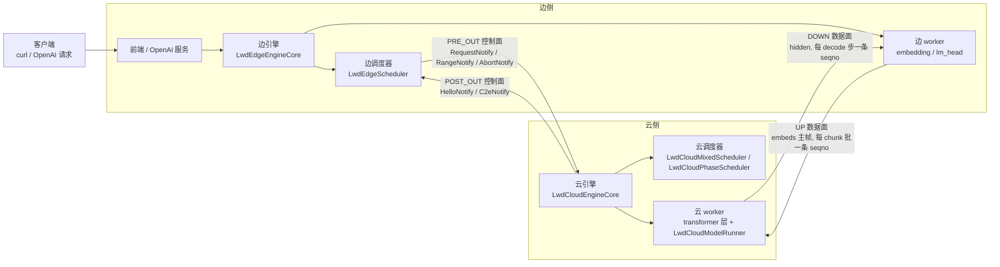
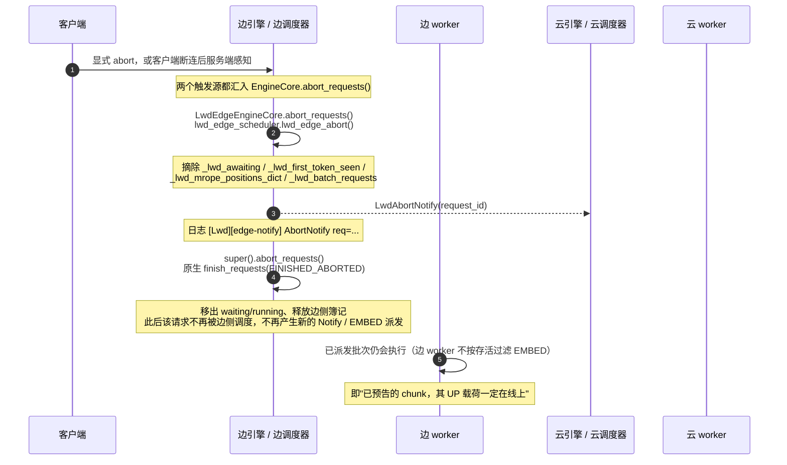
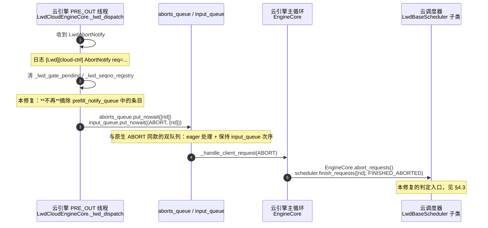
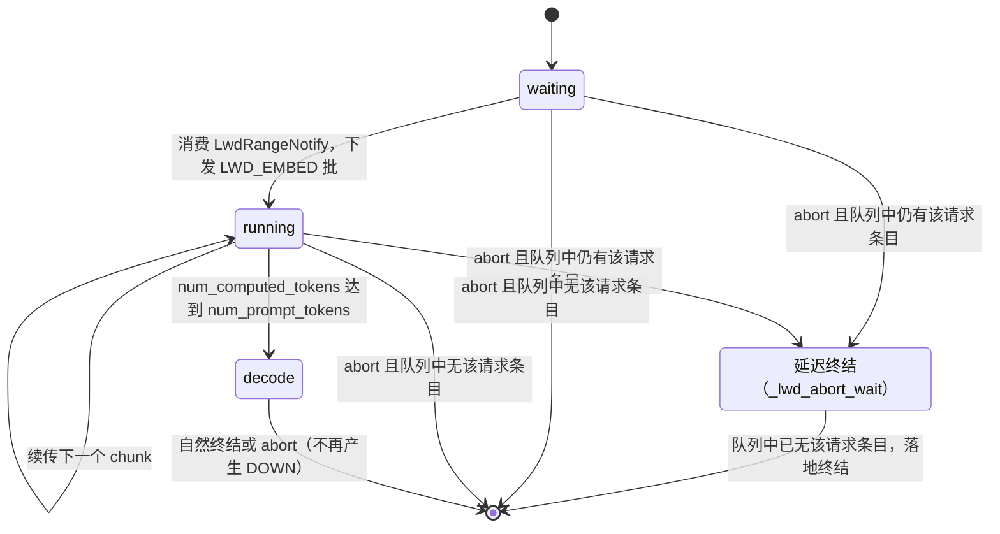
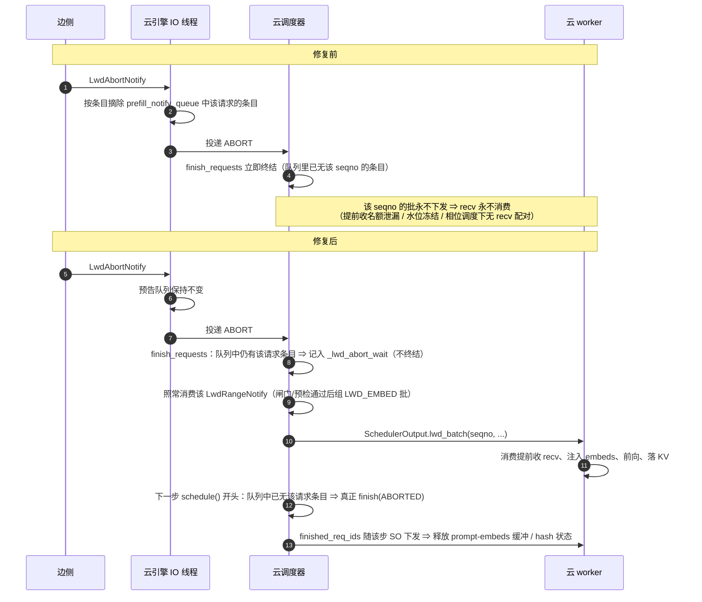
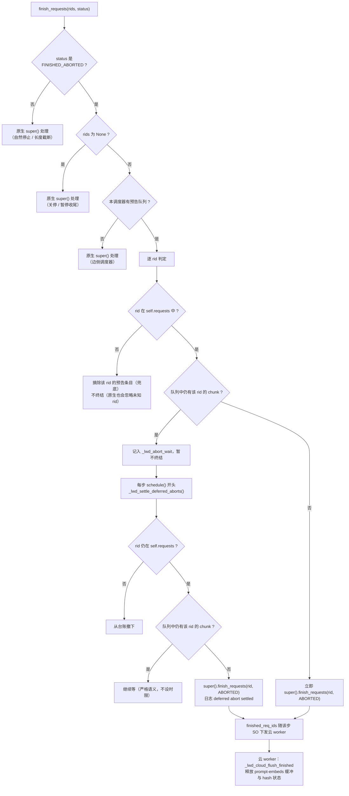
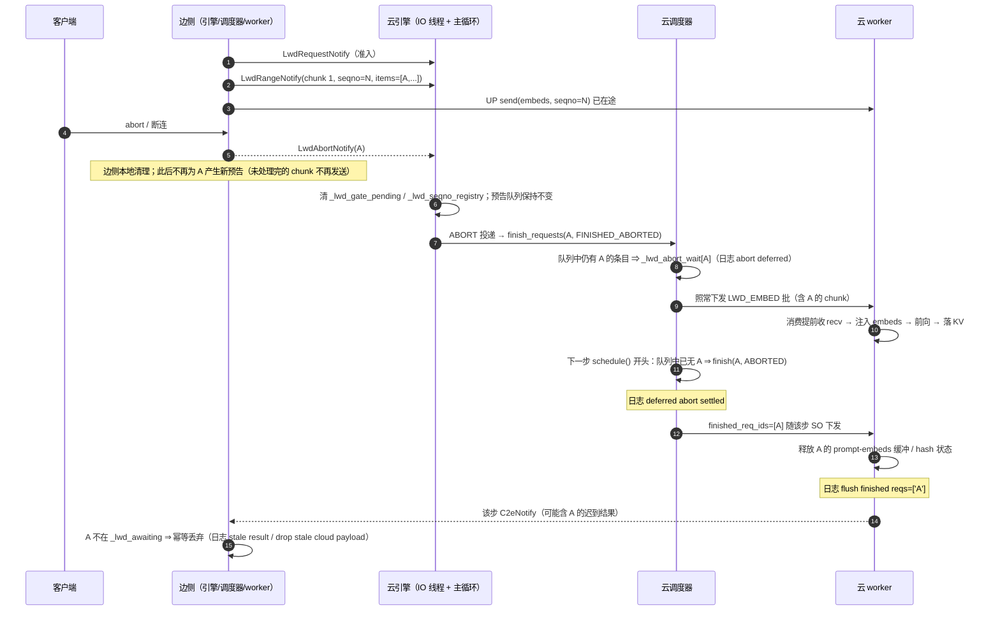

# 请求abort · 修复报告（prefill_only_chunked_prefill_mm 分支）

> 本报告自包含：所有前提、术语与结论均直接来自本分支代码（vLLM 仓 `abort_fix_mm_1009`，提交 `0e004a5ac`），不依赖 `assets` 目录下的任何其他文档。

**阅读指引**：只看结论 → §0.3 与 §4.2；看 abort 整体流程 → §2；看问题成因 → §3；看修复逻辑与判定 → §4；看为什么安全 → §5；看怎么验证与怎么判日志 → §6、§7；看边界与未做项 → §8 与附录 A/D。

---

## 0. 范围与结论摘要

### 0.1 对象

| 项 | 值 |
|---|---|
| vLLM 仓 | `vllm_v23.0_prefill_only` |
| vLLM-Ascend 仓 | `vllm-ascend_v23.0_prefill_only` |
| 分支（两仓同名） | `abort_fix_mm_1009`，基于 `prefill_only_chunked_prefill_mm` |
| 分支基线提交 | vLLM `80be10564`；vLLM-Ascend `49b087d7e` |
| 本次修复提交 | vLLM `0e004a5ac`（4 文件，+136/−37） |
| vLLM-Ascend 改动 | **无**（与基线一致） |

### 0.2 需求原文（本次实现的依据）

> 一个 request 对应的 Abort 发生后，未处理完的 chunk 在边侧正常进入 abort 流程，**不发送给云侧**，如果没问题不需要修改。云侧接收到 abort 后，对于没有处理完成的 chunk，**需要先处理这些 chunk 后才能 abort**。

逐条落到实现：

| 需求条款 | 实现落点 | 是否改动 |
|---|---|---|
| 未处理完的 chunk 在边侧正常进入 abort 流程 | 边侧 `lwd_edge_abort` + 原生 `finish_requests` 原样保留 | 不改 |
| 未处理完的 chunk 不发送给云侧 | 边侧 abort 后请求已移出调度器，不再产生新的 `LwdRangeNotify` / `LWD_EMBED` 派发 ⇒ 不再有新的 UP seqno 被分配与发送 | 不改（现状已满足） |
| 云侧对没有处理完成的 chunk 先处理，再 abort 整个请求 | 云调度器 `LwdBaseScheduler.finish_requests` 延迟终结 + 每步 `schedule()` 开头的落地判定 | **本次新增** |

### 0.3 结论摘要

| 编号 | 修复前 | 修复后 |
|---|---|---|
| 后果一 | 云侧按条目摘除预告，多请求混批被削短后仍下发 ⇒ 云 worker 按被削短的 `req_ids` 切行 ⇒ **embeds 行序错配** | 预告不再被摘除，批按原样下发，行序与边侧发送顺序一致 |
| 后果二 | 被摘除预告对应的 seqno 永不被消费 ⇒ 提前收（early recv）在飞名额永不归还；累计 3 条后水位冻结、闸门恒不放行 ⇒ **后续 prefill 永久停摆** | 该批走正常路径被消费 ⇒ `get_or_post_early_recv` 归还名额、水位继续前进 |
| 后果三 | 相位调度器把"请求已不在 `self.requests`"的预告直接丢弃、什么也不产生 ⇒ 边侧 `isend` 无配对 `irecv` ⇒ **UP 通道队头阻塞（洞）** | 延迟终结期间请求一直在 `self.requests`，不会命中"陈旧"判定，批被正常下发与消费 |

---

## 1. 术语与本分支的前提事实

### 1.1 术语（全部取自本分支代码）

| 术语 | 含义 | 代码落点 |
|---|---|---|
| 边侧 / 云侧 | 边侧跑 embedding 与 unembed（lm_head），云侧跑 transformer 层 | `LwdEdgeEngineCore` / `LwdCloudEngineCore` |
| UP 通道 | 边 → 云，载荷为 prompt embeddings 主帧 | `LwdChannelType.UP` |
| DOWN 通道 | 云 → 边，载荷为本步 hidden | `LwdChannelType.DOWN` |
| seqno | 每通道从 0 起、每次传输递增 1 的配对号；HCCL P2P 无 tag，收发完全依赖顺序配对 | `channel.py` |
| 预告（Notify） | 控制面通知：`LwdRequestNotify`（请求元数据）、`LwdRangeNotify`（范围预告）、`LwdAbortNotify`（终止信号）、`LwdC2eNotify`（步元数据） | `lwd_notify.py` |
| 预告队列 | 云侧 `prefill_notify_queue`，`LwdRangeNotify` 逐条入队，混排调度每步消费队首一条 | `lwd_cloud_mixed_scheduler.py` |
| 提前收（early recv） | 云 worker 在 `LwdRangeNotify` 到达时即预挂 UP `irecv`，不等该批被下发 | `pre_recv.py`、`lwd_cloud_worker.py` |
| 水位（watermark） | 每通道"已确认收完"的最大 seqno；只用它就绪判据 | `pre_recv.py:208` |
| 闸门 | 混排调度放行某 prefill 批的前置判据：该批 seqno 已收完（`is_irecv_complete`） | `lwd_cloud_mixed_scheduler.py:201` |
| 名额（在飞上限） | 提前收的接收缓冲数量上限 `_early_recv_max_inflight = 3` | `lwd_cloud_worker.py:271` |
| pending chunk 闸门 | 边侧未消费 chunk 数上限 `_LWD_MAX_PENDING_CHUNKS = 3` | `lwd_edge_scheduler.py:73` |
| 洞 | 通道上某 seqno 缺失，导致其后 seqno 在重排缓冲（`_held`）中被永久扣留 | `channel.py` 的 `_submit_sequenced` / `_held` |
| 落地 / 终结 | 请求真正被 `finish_requests` 释放（移出队列、释放 KV、`finished_req_ids` 下发） | `scheduler.py:1830` |

### 1.2 本分支的前提事实（全部来自本分支代码）

1. **边侧可分块**。边侧是 0 层拓扑（`LwdEdgeWorker.get_kv_cache_spec()` 返回 `{}`），原生初始化会因 KV 组为空而强制关闭 chunked prefill；本分支的边调度器把它显式重新打开（`lwd_edge_scheduler.py:108`），因为边侧 forward 被 LWD 接管、chunk 只是调度记账。因此一个请求的 prompt 会按 chunk 单元 `C = long_prefill_token_threshold`（未配置时退化为 `max_num_scheduled_tokens`）切成多块，**一个请求可占多个 UP seqno**。
2. **预告是批级的**。混排模式下边侧把一批（续传 + FCFS 前缀）装进一条 `LwdRangeNotify.items[]`，**多个请求共享同一个 seqno**；多模态请求的 `mrope_positions` 随条目走控制面（`wire_version >= 2`，数据面 aux 帧已退役）。
3. **提前收 + 水位 + 闸门**。云 worker 在 `LwdRangeNotify` 到达时即预挂 UP `irecv`（在飞上限 3），每收完一条上报 `(channel, seqno)`，引擎据此维护水位（前缀语义）；混排调度只在"该批 seqno 已收完"时放行该 prefill 批，避免把等待塞进 worker 前向。
4. **预告与派发同步**。`lwd_edge_notify` 发布成功才分配 seqno 并挂 `lwd_batch`，随后 `_lwd_dispatch_embed` 立即派发 ⇒ **已预告 ⇒ 载荷必然上线**；abort 后边侧不再为该请求派发 ⇒ **不会有新 seqno 被分配**。
5. **数据面按批配对**。一条 seqno = 云 worker 的一条整批大小 `irecv` = 边侧一条整批扁平载荷（行序 = `batch_meta.req_ids` 顺序）。

> 这五条决定了本分支在 abort 上的正确动作：**已经预告的批次必须被消费**（否则批级 `irecv` 无人配对），**未预告的批次不存在**（因为不再分配号）。因此修复只能落在"把请求终结延后到这些批次被消费之后"，不需要任何数据面补偿动作。

---

## 2. abort 的整体流程

### 2.1 系统总览



要点：

- 控制面两个方向都是 ZMQ（PRE_OUT 边→云、POST_OUT 云→边），有界队列，`publish` 队满返回 False。
- 数据面两条通道方向独立，各自独立 seqno 计数器、独立 NPU stream，HCCL P2P 无 tag。
- 云侧**没有前端**：请求由 `LwdRequestNotify` 过门构建（`_lwd_build_request`），prompt 用零值 `prompt_embeds` 占位，真实 embeds 由 UP 数据面注入。

### 2.2 abort 的触发源与边侧流程



关键事实（后文所有推理的基础）：

1. **边侧"发布 `LwdRangeNotify`"与"挂 `lwd_batch` 派发"在同一个方法内同步完成**（`lwd_edge_scheduler.lwd_edge_notify`：发布成功才 `self._lwd_seqno = seqno + 1` 并挂 `LwdEmbedBatch`，随后 `_lwd_dispatch_embed` 立即 `execute_model(non_block=True)`）。
   ⇒ **凡是被预告过的 seqno，其 UP 数据一定已经/正在上线，不可撤回。**
2. abort 在边引擎主循环的步边界被处理；处理时先发 `LwdAbortNotify` 再做本地清理；abort 之后该请求不再进入调度器。
   ⇒ **请求未处理完的 chunk 不会再产生新的预告，也就不会再分配新的 seqno**（满足"不发送给云侧"）。
3. 边 worker 的 EMBED 执行路径不按请求存活过滤（`lwd_edge_worker.execute_model` 只用 `finished_req_ids` 释放多模态缓存），已派发的批次照常发送。

### 2.3 云侧接收与原生 abort



补充事实：

- `_process_aborts_queue()` 也在 `step()` / `step_with_batch_queue()` 内（模型输出回收之后）被调用，因此同一条 abort 可能触发两次 `finish_requests`，原生 `finish_requests` 幂等（已终结的请求会被跳过）。
- abort 的生效点在**步边界**：要么在下一步开始前（`input_queue`），要么在当前步模型输出回收之后（`aborts_queue`）。两种情况下"上一步的批"都已完成，释放 KV 是安全的。

### 2.4 云侧请求状态迁移与 abort 的插入点



> 说明：图中的"延迟终结"即代码里的 `_lwd_abort_wait` 台账（`request_id -> 终结状态`）；它不是新状态机语义，而是"abort 已收到、但按需求需要先把已预告的 chunk 算完"的中间态。

### 2.5 为什么"已预告的 chunk 必须在云侧算完"

三条互相独立的理由，缺一不可：

1. **数据面批级契约**：一条 `LwdRangeNotify`（一个 seqno）对应云 worker 上**一条整批大小的 `irecv`**与边侧**一条整批扁平载荷**。云侧不下发该批 ⇒ 这条 recv 永远不会被消费。
2. **提前收名额与水位**：提前收的条目只有在"既已上报又已被消费"时才释放（`get_or_post_early_recv` 是唯一的消费点，它只在"该批真的进入 `SchedulerOutput.lwd_batch`"时被调用）。名额上限 3，累计 3 条未消费 ⇒ 不再挂新 recv ⇒ 水位停住 ⇒ 闸门对任何更大 seqno 恒不放行 ⇒ **后续所有请求的 prefill 永久停摆**（decode 继续）。
3. **UP 通道无 tag**：已预告 ⇒ 边侧 send 已在途；云侧若不 recv，`_next_seqno` 停在该号，其后所有 seqno 在 `_held` 中被扣留 ⇒ **队头阻塞（洞）**。

反过来，"未预告"的 chunk 不需要任何处理：边侧 abort 后不再派发，也不会分配新 seqno。

### 2.6 修复前后对照



---

## 3. 问题分析（修复前的行为）

### 3.1 修复前的实现

云引擎 IO 线程在收到 `LwdAbortNotify` 时调用 `_lwd_purge_prefill_notify(request_id)`：遍历 `prefill_notify_queue`，把该请求的条目从每条 `LwdRangeNotify.items` 里摘掉；条目被摘空则整条移除，并整体替换 deque。

### 3.2 后果一：多请求混批被削短 ⇒ embeds 行序错配

- 混排模式下一条 `LwdRangeNotify` 可含多个请求（`items[]`），数据面也按该批的请求顺序**扁平化**发送。
- 云侧组批用的是它自己那份 `items`：`LwdEmbedBatch(req_ids=[item.request_id ...], token_ids=[[0] * item.num_tokens ...])`。
- 云 worker 注入时按 `meta.req_ids` 顺序**累加行偏移**切分整批扁平缓冲：

```python
row = 0
for meta_idx, (req_id, token_ids) in enumerate(zip(meta.req_ids, meta.token_ids)):
    n = len(token_ids)
    ...
    embeds[row : row + n]        # 行偏移完全依赖 meta 的顺序与长度
    row += n
```

- 摘除条目后 `meta` 变短，但线上缓冲仍是原始整批 ⇒ **被摘除项之后的请求读到前一个请求的行**。
- 两道既有防线（`n != scheduled`、`offset != computed`）都基于同一份被削短的 `meta`，自洽通过，拦不住。
- 非 V4 模型（如本分支主目标的 Qwen3-VL 多模态）走 `up_flat.view(num_tokens, hidden_size)`，**没有总长度断言** ⇒ 静默错读；V4 因 `unpack_hash_payload` 有尺寸断言而响亮失败。

### 3.3 后果二：提前收名额永不归还 ⇒ 水位冻结 ⇒ 后续 prefill 停摆

- 提前收条目释放条件是"既已上报又已被消费"；消费点唯一（`get_or_post_early_recv`，只在批下发时调用）。
- 预告被摘除 ⇒ 该批永不下发 ⇒ 条目、future 与接收缓冲永久占用一个在飞名额（上限 3）。
- 3 条被占满 ⇒ `_early_recv_pump` 不再挂任何 recv ⇒ worker 不再上报 DONE ⇒ `watermark(UP)` 冻结 ⇒ 闸门 `is_irecv_complete` 对更大 seqno 恒为 False ⇒ 混排调度每步走 defer 出口 ⇒ **新 prefill 永久停摆**（decode 继续，表现为新请求 TTFT 无限）。
- 该状态在代码里已有专门的自诊断日志（`queue stuck` 告警、`gate seqno=.. watermark=.. ready=False` 每步打印），但根因是 abort 摘除预告，不是 worker 或通信问题。

### 3.4 后果三：相位调度丢弃陈旧预告 ⇒ 洞

相位调度器 `_schedule_pure_prefill` 对"队首预告的请求已不在 `self.requests`"的处理是 `notify = None`（丢弃，什么都不产生），于是该 seqno 既没有 `lwd_batch`、也不会 post recv；而边侧该 seqno 的 send 已在途 ⇒ UP 通道队头阻塞。混排调度器虽把该情形归入 `unknown` 并"留队首等 ADD 落地"，但它的兜底同样依赖"abort 清扫摘条目"，即同一个动作的两面。

### 3.5 共同根因

**把"请求生命周期"和"数据面批（seqno）"这两件事按同一个粒度处理了**：abort 是请求级事件，而 seqno 是批级对象；请求级地摘除条目，等价于单方面作废一条已在线的批，于是价格是"行序错配 + 名额泄漏 + 洞"三选一（取决于命中哪条路径）。

---

## 4. 修复方案

### 4.1 语义落地

需求要求的是**顺序**：先处理完"已经预告、数据已在线上"的 chunk，再 abort 整个请求。因此修复的基本动作是**把终结动作延后一条判定**，而不是去动数据面。

### 4.2 改动总览

| 文件 | 改动量 | 改动内容 |
|---|---|---|
| `vllm/v1/lwd_control/control_scheduler/lwd_base_scheduler.py` | +133 / −1 | 全部新逻辑：`_lwd_abort_wait` 延迟终结台账、`finish_requests` 覆写、每步 `_lwd_settle_deferred_aborts`；辅助方法 `_lwd_notify_queue` / `_lwd_has_queued_chunk` / `_lwd_drop_queued_chunks` |
| `vllm/v1/lwd_control/control_cloud_scheduler/lwd_cloud_mixed_scheduler.py` | +1 | `schedule()` 开头调用 `self._lwd_settle_deferred_aborts()`（行 460） |
| `vllm/v1/lwd_control/control_cloud_scheduler/lwd_cloud_phase_scheduler.py` | +1 | 同上（行 174） |
| `vllm/v1/lwd_control/control_cloud_scheduler/lwd_cloud_engine.py` | +4 / −38 | abort 分支不再摘除预告条目；删除 `_lwd_purge_prefill_notify` 与连带未使用的 `deque` 导入 |
| `vllm-ascend` 仓 | 0 | 边侧与云端 worker 均不改 |

### 4.3 云调度器基类（核心逻辑）

> 下列代码块为**要点摘要**（省去日志、`isinstance(request_ids, str)` 归一化等细节），逐字实现见附录 A 的文件与行号。

```python
def finish_requests(self, request_ids, finished_status):
    # 只有 abort 且存在预告队列时才延迟；其余原生路径/边侧调度器完全不变
    if (finished_status is not RequestStatus.FINISHED_ABORTED
            or request_ids is None                      # 关停收尾：不延迟
            or self._lwd_notify_queue() is None):        # 边侧：无预告队列
        return super().finish_requests(request_ids, finished_status)
    for request_id in request_ids:
        if request_id not in self.requests:
            self._lwd_drop_queued_chunks(request_id)     # 兜底：无从消费，摘除残留条目
            continue
        if self._lwd_has_queued_chunk(request_id):
            self._lwd_abort_wait.setdefault(request_id, finished_status)   # 延迟
            continue
        immediate.append(request_id)
    return super().finish_requests(immediate, finished_status) if immediate else []
```

```python
def _lwd_settle_deferred_aborts(self):
    # 每步 schedule() 开头调用：此刻上一步的批已回收，释放 KV 安全
    for request_id in list(self._lwd_abort_wait):
        if request_id not in self.requests:
            del self._lwd_abort_wait[request_id]         # 已被别的路径终结
            continue
        if self._lwd_has_queued_chunk(request_id):
            continue                                     # 还有预告没算完，继续等
        status = self._lwd_abort_wait.pop(request_id)
        super().finish_requests(request_id, status)      # 真正落地
```

判定流程图：



### 4.4 云引擎：不再摘除预告

```python
if isinstance(msg, LwdAbortNotify):
    logger.info("[Lwd][cloud-ctrl] AbortNotify req=%s", msg.request_id)
    self._lwd_gate_pending.pop(msg.request_id, None)
    self._lwd_seqno_registry.pop(msg.request_id, None)
    # 预告队列不改：该请求已预告的 chunk 数据已在线上，必须由调度器先算完再终结
    self.aborts_queue.put_nowait([msg.request_id])
    self.input_queue.put_nowait((EngineCoreRequestType.ABORT, [msg.request_id]))
    return
```

"请求已不存在"时的条目清理改到调度器主线程（`_lwd_drop_queued_chunks`），一方面避免 IO 线程与调度线程并发修改同一条 `LwdRangeNotify.items`，另一方面避免下面这个时序问题：IO 线程处理 `LwdAbortNotify` 时，同一请求的 `ADD` 可能还在 `input_queue` 里未被主循环处理，此时"请求不在 `self.requests`"并不代表请求已死。

### 4.5 落地调用点

两个云调度器在 `schedule()` 最开头（取可见集之前）调用一次 `_lwd_settle_deferred_aborts()`。位置的两个必要性：

1. **KV 释放安全**：`schedule()` 开头即"上一步已回收"的时刻；若放在批下发之后，可能在批执行中释放该请求的 KV 块。
2. **不能放进 `_lwd_schedule_for_visible_reqs()`**：该函数开头会 `picked = {self.requests[req_id] for req_id in req_ids}`；若此时才终结请求，而该 rid 已在 `req_ids` 里（解码集可能包含它），会直接 KeyError。更关键的是相位调度器**先 `popleft()` 再调度**，若把判定放在该函数内，队列此刻已空，会把"刚要下发的 chunk"误判为已消费而提前终结 ⇒ 该批永不下发 ⇒ 正是要消除的后果二/三。

### 4.6 边侧为什么零改动

- abort 后边侧不再产生新的 `LwdRangeNotify` / EMBED 派发 ⇒ "未处理完的 chunk 不发送给云侧"这条需求由现有代码天然满足。
- 边侧调度器没有 `prefill_notify_queue`（`_lwd_notify_queue()` 返回 `None`）⇒ `finish_requests` 覆写对边侧直接短路透传，行为与基线逐字节一致；`_lwd_abort_wait` 在边侧恒为空。

### 4.7 修复后的完整时序



---

## 5. 正确性论证

### 5.1 不变量

| # | 不变量 | 由谁保证 |
|---|---|---|
| 1 | 已预告的 seqno，其 UP 载荷必然已在线上 | 边侧"发布 Notify 成功才分配 seqno、同一方法内挂 `lwd_batch` 并派发" |
| 2 | abort 后不再有该请求的新 seqno 被分配 | 边侧 abort 先发 `LwdAbortNotify`、随后原生 `finish_requests` 把请求移出调度器 |
| 3 | 云侧不会遗留"永不消费"的已预告 seqno | 延迟终结期间预告条目保留，调度器按正常路径消费它 |
| 4 | 延迟终结不会在批执行中释放 KV | 落地只在 `schedule()` 开头执行，即上一步已回收之后 |
| 5 | 非 abort 的原生终结路径与边侧语义不变 | `finish_requests` 覆写的三个前置条件（状态、`None`、有无预告队列） |
| 6 | 请求级事件不改变批级数据 | 修复后不再按请求摘除 `items`，`lwd_batch` 的 `req_ids`/`token_ids` 与边侧发送顺序一致 |

### 5.2 情形矩阵

| abort 命中时云侧状态 | 队列中是否有该请求的 chunk | 云侧行为 | 数据面结果 |
|---|---|---|---|
| 已 ADD，尚未消费任何预告 | 有（首 chunk） | 延迟 → 算完该 chunk → 终结 | recv 被正常消费，号序连续 |
| 已 ADD，尚无任何预告 | 无 | 立即终结 | 无该请求的 seqno |
| prefill 半途（部分 chunk 已算完） | 有（续传 chunk） | 延迟 → 算完 → 终结 | 同上 |
| 所有已预告 chunk 都已算完 | 无 | 立即终结 | 同上 |
| 已进入 decode | 无 | 立即终结 | 不再产生 DOWN 载荷 |
| 请求对象不存在（关停期 ADD 未落地 / 重复 abort / 已终结） | 可能有残留条目 | 摘除条目（兜底），不终结 | 该 seqno 若已提前挂出 recv 可能成为未消费项（见 §8.3） |
| 关停 / 暂停收尾 `finish_requests(None, ...)` | 任意 | 不延迟，透传原生 | 保证收尾不被未消费 chunk 拖住 |

### 5.3 为什么数据面不需要任何补偿动作

| 情形 | 本修复下的行为 | 是否需要补偿 |
|---|---|---|
| 已预告、数据在线的 chunk | 不摘除条目，按正常路径算完再终结 ⇒ `irecv` 由 `get_or_post_early_recv` 正常消费，提前收名额归还、水位前进 | 不需要 |
| 未预告的 chunk | 边侧 abort 后不再派发，也不会分配 seqno ⇒ 通道上不存在该号 | 不需要 |
| `skip_seqno`（把某 seqno 标记为"永不投递"） | 本修复不依赖它：abort 不产生"已分配但不会发送"的号 | 不调用 |
| 请求对象已不存在（兜底） | 无可消费对象，摘除残留条目 | 见 §8.3 残余 2 |

一句话：**本修复把 abort 的作用点从"数据面（作废一条已在线的批）"移到了"请求生命周期（延后终结）"**，因此数据面零改动：不改控制面消息、不改 `SchedulerOutput` 字段、不改通道层、不改 worker。
（硬约束仍然满足：每个已分配的 seqno 在两侧都有配对动作——已预告的走正常收发路径配对，未预告的根本不分配号。）

### 5.4 本修复的适用边界

| 维度 | 取值 |
|---|---|
| 触发窗口敏感性 | 不敏感：abort 先于预告消费（走延迟）与晚于消费（队列已空，立即终结）由同一条判定覆盖 |
| 对预告队列的读写 | 判定只读（`_lwd_has_queued_chunk`）；仅在"请求对象已不存在"时摘除条目（`_lwd_drop_queued_chunks`） |
| 数据面新增 | 无 |
| 判定粒度 | 判定按请求，等待对象是批：只要该请求在预告队列里还有条目就继续等 |
| 与提前收的关系 | 协同：批被正常消费 ⇒ 提前收名额与水位不会被 abort 卡住 |
| 代价 | 云侧为该请求多算已预告的 chunk（见 §8.2） |
| 前提 | 云侧关闭 async scheduling（见 §8.1） |

---

## 6. 观测与判定：怎么确认请求被正确 abort

### 6.1 三个锚点

| 序 | 日志（原样） | 位置 | 含义 |
|---|---|---|---|
| ① | `[Lwd][edge-notify] AbortNotify req=<id>` | 边侧 `lwd_edge_scheduler.py:692` | 边侧本地清理已完成，且已把 abort 发往云侧。**没有它 = 云侧永远不会知道** |
| ①' | `[Lwd] drop abort signal for <id>: publish queue full` | 边侧 `lwd_edge_scheduler.py:688` | abort 被静默丢弃（控制面队满）⇒ 云侧会把它当正常请求跑到自然结束；出现即事故 |
| ② | `[Lwd][cloud-ctrl] AbortNotify req=<id>` | 云引擎 IO 线程 `lwd_cloud_engine.py:271` | 云侧**收到** abort（仅代表到达） |
| ③ | `[Lwd][cloud-worker] flush finished reqs=['<id>', ...]` | 云 worker `lwd_cloud_worker.py:626` | **最强的正面证据**：引擎真的终结了该请求，`finished_req_ids` 随 `SchedulerOutput` 下发到 worker（释放 prompt-embeds 缓冲 / hash 状态） |

本修复新增的两条（云侧）：

| 序 | 日志（原样） | 位置 | 含义 |
|---|---|---|---|
| ④ | `[Lwd][sched] abort deferred req=<id>: waiting for queued chunk(s) to be computed` | `lwd_base_scheduler.py:151` | 收到 abort，但队列中仍有该请求的 chunk ⇒ 按需求先算完 |
| ⑤ | `[Lwd][sched] deferred abort settled req=<id> (queued chunk(s) consumed)` | `lwd_base_scheduler.py:178` | 该请求真正被终结的时刻 |
| ⑥ | `[Lwd][sched] abort req=<id> gone; dropped N stale notify item(s)` | `lwd_base_scheduler.py:142` | 请求在云侧已不存在，条目走兜底摘除 |

### 6.2 预期序列与判定表

- **无未处理 chunk（立即 abort）**：① → ② → ③（云侧没有"已终结"专门日志，靠 ③ + 该 id 从后续 step 日志消失确认）。
- **有未处理 chunk（本次需求覆盖的路径）**：① → ② → ④ →（真算：`[Lwd][cloud-sched] mixed notify seqno=... reqs=[<id>...]`、`[Lwd][sched] cloud step=... reqs=[<id>]`）→ ⑤ → ③。
- 期间边侧可能出现 1~2 条 `[Lwd][edge-deliver] stale result for req=<id> (not awaiting)`（`lwd_edge_scheduler.py:742`）或 `[Lwd] drop stale cloud payload for <id> (not awaiting)`（`lwd_edge_engine.py:517`）——这是"云侧为已 abort 请求补算出的迟到结果被幂等丢弃"，属**预期现象**。

| 观测 | 结论 |
|---|---|
| ① + ② + ③ | abort 生效，云侧状态已释放 |
| ① + ② + ④ + ⑤ + ③ | 按"先算完已预告的 chunk 再 abort"生效 |
| 没有 ① | 边侧根本没发 abort（前端未检测到断连，典型是非流式 curl）——与 LWD 无关 |
| 有 ①' | abort 丢失（控制面队满），云侧会跑完 |
| 有 ①、无 ② | 控制面没送到云侧 |
| 有 ②、无 ④/⑤/③，且该 id 仍在 step 日志中 | 云侧把它当正常请求在跑（abort 未进 `finish_requests`，或运行的不是本提交） |
| 有 ② + ④、长期无 ⑤ | 该 chunk 一直未被消费：查同期 `[Lwd][pre-recv] gate seqno=.. watermark=.. ready=False`、`[Lwd][cloud-sched] preflight hold: ...`、`queue stuck` |
| 出现 ⑥ | 云侧已无该请求对象，条目兜底摘除（重复 abort / 关停期 ADD 未落地） |

**最简等价判据**：③ 出现过，且该 `request_id` 此后不再出现在任何 `[Lwd][sched] cloud step=... reqs=[...]` 与 `[Lwd][cloud-ctrl] publish C2eNotify reqs=[...]` 中。

### 6.3 grep 命令

```bash
# 边侧
grep -nE "AbortNotify req=|drop abort signal for|stale result for|drop stale cloud payload for" edge.log
# 云侧（引擎与 worker 可能是两份日志）
grep -nE "AbortNotify req=|abort deferred req=|deferred abort settled req=|abort req=.*gone|flush finished reqs=" cloud*.log
```

### 6.4 一次实测现象的分析：abort 后两侧日志连续刷新约 30 秒

**现象**：单请求 curl，0.1 s 后 Ctrl-C 中止；边侧与云侧日志持续刷新约 30 秒后自行停止。

**已核实的事实**：

- LWD 层没有任何 30 秒级超时（只有 PRE_OUT 接收轮询 5 s、UP 注入 `future.wait(timeout=60.0)`）；因此"30 秒后自行停止"更像**该请求自然跑完**。
- 边侧对未指定 `max_tokens` 的请求会回退为 16（`lwd_edge_notify_request`）；16 个 decode token 在被日志拖慢（每步十余行 INFO，写盘/终端输出可把单步拉到秒级）时正好约 30 秒。
- 该现象与"边侧 abort 已生效、云侧未生效"完全吻合：云侧继续解码，每步产生 `LwdC2eNotify`，边侧每步收到并丢弃（`stale result`），两侧都在按步打日志。

**三种可能机理与判别**：

| 机理 | 判别证据 |
|---|---|
| A. abort 未发出（前端未检测到断连，非流式 curl 常见） | 边侧**没有** ①；此时请求两侧都在正常推理，属正常路径而非 abort |
| B. abort 发出但控制面丢失 | 有 ①、**没有** ②（或出现 ①'） |
| C. abort 到达云侧但未生效 | 有 ①②，且云侧 step 日志持续出现该 id（`phase=DECODE`），没有 ④/⑤ |

**本次修复后的预期**：若为 C 且运行的是本提交，则应看到 ④ → ⑤ 的确定收敛（毫秒到步级）；只出现 ④、长期无 ⑤ 说明该 chunk 未被消费，用 6.2 最后一行的关联日志定位。若为 A（未发出 abort），修复不改变现象——需要用流式请求（`curl -N`）复现，让服务端能感知断连。

> 说明：该次实测发生在本次修复提交之前、且当时线上运行的构建未经确认，因此**没有把 30 秒刷新归因于某一处代码**；上表给出的是可判别的三选一，后续复现按 6.2/6.3 的判据定位即可。

---

## 7. 测试与验证

### 7.1 本次已做

| 项 | 结果 |
|---|---|
| `py_compile` 四个改动文件 | 通过 |
| 辅助方法逻辑校验（AST 抽取 `_lwd_has_queued_chunk` / `_lwd_drop_queued_chunks`，临时脚本、未入库） | 8 条断言通过：批量 items / 旧版顶层字段 / 无关请求 / 空队列 / 边侧无队列 / 部分摘除保留其余成员 / 全摘除删条目 / 摘除不影响无关请求 |
| 未新增 UT | 按"改动最小"取舍；如需可后补（见 §7.2） |

### 7.2 建议补充的 UT（可选，各 1~2 例）

1. `finish_requests(ABORTED)` 且队列中仍有该请求条目 ⇒ 仅登记 `_lwd_abort_wait`，不调用原生终结；
2. 上一条之后清空该请求条目 ⇒ `_lwd_settle_deferred_aborts()` 调用原生终结一次且仅一次；
3. `finish_requests(非 ABORTED)` / `finish_requests(None)` / 边侧调度器（无预告队列）⇒ 三条透传路径均不登记台账；
4. 请求已不在 `self.requests` 且队列中有残留条目 ⇒ 走兜底摘除，且摘除后其余成员条目保持原样。

### 7.3 e2e 场景与断言

| 场景 | 触发 | 断言 |
|---|---|---|
| A：abort 命中"已预告未算完" | 请求发出后、云侧消费前 abort。若要确定性复现，可在云引擎 PRE_OUT 线程的 `LwdCloudEngineCore._lwd_dispatch` 的 `LwdRangeNotify` 分支**入队之前**临时插入 `time.sleep(...)` 把窗口拉开（该线程只负责投递，主循环在此期间仍可处理 abort；**不要**把 sleep 放进调度器，否则会先堵住主循环、abort 永远迟到）；验证完务必删除插桩 | 出现 ①②④⑤③；该请求不再出现在后续 step/c2e 日志；同服务其他请求正常完成 |
| B：多请求混批中取消其中一个 | 两个以上请求共享一条 `LwdRangeNotify` 时取消其中一个 | 无 `chunk offset mismatch` / `INJECT window mismatch` / V4 `payload size mismatch`；其余请求输出与不取消基线逐 token 一致 |
| C：无未处理 chunk 时 abort | 所有已预告 chunk 都算完后 abort | 直接 ①②③，无 ④ |
| D：客户端断连 | 流式请求中断开 | 与 A/C 同断言 |
| E：无 abort 回归 | 正常跑完 | 无 ④⑤；输出与基线一致 |

### 7.4 对账锚点

沿用既有埋点：`[Lwd][DUMP]` 张量摘要、`[Lwd][cloud-tokens]`、`[lwd-debug]`；健康请求的 hidden / token 与单机基线逐值一致，确认本修复不影响任何健康请求的数据路径。

---

## 8. 已知前提、残余风险与明确不做

### 8.1 前提

1. **云侧关闭 async scheduling**（`max_concurrent_batches == 1`，逐步串行）。这是代码中既有的前提（混排调度器的 `offset` 对账注释即基于"async 关闭前提下调度时刻即真实水位"）。在该前提下，`schedule()` 开头必然是"上一步已回收"，落地释放 KV 安全。若开启 async scheduling，落地可能晚一步（最坏退化到该请求自然终结），但不会提前释放 KV。
2. 控制面消息不丢（abort 才能到达云侧）。本次未加固这一点。

### 8.2 代价

云侧会为该请求多算"已预告但客户端已放弃"的 chunk（白算这部分 prefill、短暂多占 KV 与并发名额），换来确定性的顺序满足与数据面一致性。这是需求明确选择的方向。

### 8.3 残余风险

| # | 残余 | 触发条件 | 影响 |
|---|---|---|---|
| 1 | 严格不设时限 | 该 chunk 因 KV / 预检长期无法调度 | abort 一直等；观测点为只出现 ④ 不出现 ⑤ |
| 2 | 兜底路径的名额残留 | 请求对象已不存在（关停期 ADD 未落地 / ADD 预处理失败 / 重复 abort），且该 seqno 已提前挂出 recv | 该提前收名额可能残留（与修复前的后果二同类，但仅限这类错误路径） |
| 3 | 控制面 abort 丢失 | 边侧 publisher 队满（上限 1000） | 云侧永不 abort，请求跑到自然结束（见 ①'） |
| 4 | `_lwd_seqno_registry` 正常完结不回收 | 长跑 | 该字典单调增长（与 abort 无关，本次未动） |
| 5 | 相位调度器"丢弃陈旧预告"分支仍在 | 请求已不存在的兜底情形 | 该分支对 abort 已不可达（延迟期间请求一直在 `self.requests`），仅作兜底保留 |

### 8.4 明确不做

1. 不改边侧任何逻辑（含 pending chunk 名额的回收判据）；本次需求下边侧行为正确。
2. 不改数据面：不新增任何收发补偿动作（不改通道层、不改 worker、不调用通道层的 `skip_seqno`）。
3. 不改控制面协议：不新增消息、不改 `LwdAbortNotify` 字段、不给 `SchedulerOutput` 加字段。
4. 不动正常 finish（自然停止 / 长度截断）与关停收尾的语义。
5. 不处理 §8.3 的 1/3/4/5 项。

---

## 附录 A：改动与行号索引（提交 `0e004a5ac`）

| 文件 | 关键位置 | 内容 |
|---|---|---|
| `vllm/v1/lwd_control/control_scheduler/lwd_base_scheduler.py` | 29–33 | `__init__` 中的 `_lwd_abort_wait` 台账 |
| | 76–78 | `_lwd_notify_queue()`：云侧取 `prefill_notify_queue`，边侧为 `None` |
| | 80–86 | `_lwd_has_queued_chunk()`：该请求是否还有未消费的 chunk |
| | 88–116 | `_lwd_drop_queued_chunks()`：兜底摘除条目 |
| | 118–160 | `finish_requests()` 覆写（延迟判定） |
| | 162–183 | `_lwd_settle_deferred_aborts()`（落地判定） |
| `.../lwd_cloud_mixed_scheduler.py` | 460 | `schedule()` 开头调用落地判定 |
| `.../lwd_cloud_phase_scheduler.py` | 174 | 同上 |
| `.../lwd_cloud_engine.py` | 270–281 | abort 分支：不再摘除预告条目 |
| | —（删除） | 原 `_lwd_purge_prefill_notify`（29 行）与 `from collections import deque` |

## 附录 B：提交信息

```
fix(lwd): 云侧 abort 先算完已预告的 chunk 再终结请求

需求:边侧 abort 后不再把未处理完的 chunk 发给云侧(现状即如此,边侧不改);
云侧收到 abort 后,对已经预告(数据已在线上)而尚未处理完的 chunk,必须先算完,
再 abort 整个请求。

改动(仅云侧 4 文件,+136/-37):见正文 §4.2。

Assisted-by: DeepSeek Harness AI agent
Signed-off-by: xiefei_cn <ao_Uto92RXeWJ1uQ.xiefei_cn@noreply.gitcode.com>
```

## 附录 C：本报告中的 mermaid 图清单

| 图 | 位置 | 用途 |
|---|---|---|
| `flowchart LR` | §2.1 | 边云总体结构与控制面/数据面方向 |
| `sequenceDiagram` | §2.2 | 触发源与边侧 abort 流程 |
| `sequenceDiagram` | §2.3 | 云侧接收与原生 abort 投递 |
| `stateDiagram-v2` | §2.4 | 云侧请求状态迁移与 abort 插入点 |
| `sequenceDiagram` | §2.6 | 修复前后对照 |
| `flowchart TD` | §4.3 | `finish_requests` / `_lwd_settle_deferred_aborts` 判定流程 |
| `sequenceDiagram` | §4.7 | 修复后的完整时序 |

## 附录 D：本次修复的覆盖范围

**已覆盖（本次修复）**

| 问题 | 本报告位置 | 修复方式 |
|---|---|---|
| 按条目摘除预告 ⇒ 多请求混批被削短 ⇒ embeds 行序错配 | §3.2 | 不再按请求摘除预告条目 |
| 被摘除预告对应的提前收名额永不归还 ⇒ 水位冻结 ⇒ 后续 prefill 停摆 | §3.3 | 该批按正常路径被消费（名额归还、水位前进） |
| 相位调度丢弃陈旧预告 ⇒ 边侧 `isend` 无配对 `irecv` ⇒ UP 通道队头阻塞 | §3.4 | 延迟终结期间请求始终在 `self.requests` 中，不会命中"陈旧"判定 |

**未覆盖（明确不做，见 §8.3 / §8.4）**

| 项 | 说明 |
|---|---|
| 控制面 abort 通知丢失 | 边侧 `publish` 队满时只打告警（`drop abort signal ...`），云侧永不 abort |
| `LwdRangeNotify` 发布失败 | 边侧进度已推进但该 chunk 永久丢失（不重发、不发 abort） |
| 关停 / 暂停路径 | 直接 `finish_requests(None, ...)`，不经过 `LwdAbortNotify` |
| 未知预告（请求永不落地） | 队首没有超时兜底 |
| `_lwd_seqno_registry` | 正常完结时不回收（长跑单调增长） |
| 边侧 `_lwd_batch_requests` 名额回收判据 | 按"边侧零改动"的决定保留现状 |
