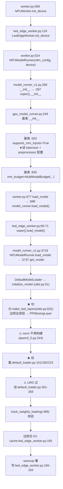
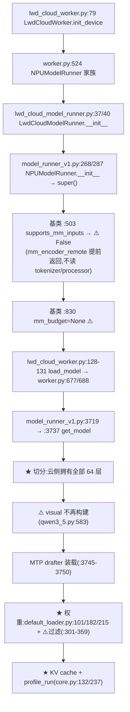

# LWD 边云分侧模型加载 —— 逐行走读手册（NPU 路径）

> 目标：从 `vllm serve` 一路读到"权重进显存 / 模型切分生效"，边侧、云侧**分开**给出，每一步都标出 `文件:行`，关键步骤用 **★** 标出，与本次提交相关的点用 **⚠️** 标出。
> 全部行号基于当前 checkout（vllm `24f7d84f5`、vllm-ascend `49b087d7e6`）。
>
> **重要**：本手册一律以 ascend 的 **NPU 路径**为准（`NPUWorker` / `NPUModelRunner`）。某些行位于上游基类（`GPUModelRunner` / `DefaultModelLoader`），文中会明确写出"经 `super().__init__()` 进入基类"，不会把基类行号当作完整路径。

---

## 0. 阅读约定

| 标记 | 含义 |
|---|---|
| **★** | 关键步骤（读配置 / 切模型 / 读权重 / 建 KV cache），走读时必须停 |
| **⚠️** | 与 commit `24f7d84f5` 相关（模块裁剪 / 云侧去 tokenizer / 权重过滤） |
| `[边]` `[云]` | 该步骤只在对应侧发生 |
| `[共]` | 两侧完全相同的步骤 |

---

## 1. 公共前置：配置加载与并行组建立（两侧相同）

### S1 `vllm serve` 命令行解析 `[共]`

| # | 位置 | 代码 / 说明 |
|---|---|---|
| S1-1 | `vllm/entrypoints/cli/main.py:95` | `args.dispatch_function(args)` |
| S1-2 | `vllm/entrypoints/cli/serve.py:52-53` | 位置参数 → `args.model = args.model_tag` |
| S1-3 | `vllm/entrypoints/cli/serve.py:148` | `uvloop.run(run_server(args))` |
| S1-4 | `vllm/entrypoints/openai/api_server.py:665 → :679` | `run_server` → `run_server_worker` |
| S1-5 | `vllm/entrypoints/openai/api_server.py:99 → :108` | `build_async_engine_client` → `build_async_engine_client_from_engine_args(engine_args, ...)` |

### S2 ★ 实例化 `ModelConfig` `[共]`

| # | 位置 | 代码 / 说明 |
|---|---|---|
| S2-1 | `vllm/entrypoints/openai/api_server.py:123` | `vllm_config = engine_args.create_engine_config(usage_context=...)` |
| S2-2 | `vllm/engine/arg_utils.py:1713` | `def create_engine_config(...)` |
| S2-3 | `vllm/engine/arg_utils.py:1746` | `model_config = self.create_model_config()` |
| S2-4 | `vllm/engine/arg_utils.py:1562` | `def create_model_config(self)` |
| S2-5 | **`vllm/engine/arg_utils.py:1576`** | **`return ModelConfig(`** ← 实例化就这一行；`:1577 model=self.model` 是路径字段 |
| S2-6 | `vllm/engine/arg_utils.py:1577-1620` | 其余字段：`model_weights` / `hf_config_path` / `tokenizer` / `skip_tokenizer_init`(:1605) / `language_model_only`(:1608) / `limit_mm_per_prompt`(:1609) … |

### S3 ★ 读 `config.json`（第一次真正读盘）`[共]`

| # | 位置 | 代码 / 说明 |
|---|---|---|
| S3-1 | `vllm/config/model.py:466` | `ModelConfig.__post_init__` |
| S3-2 | `vllm/config/model.py:501-502` | `maybe_model_redirect(self.hf_config_path)`（`VLLM_MODEL_REDIRECT_PATH`） |
| S3-3 | **`vllm/config/model.py:542-543`** | **`hf_config = get_config(self.hf_config_path or self.model, ...)`** ← 读 `config.json` |
| S3-4 | `vllm/config/model.py:557` | `self.hf_config = hf_config`（此后随配置对象在进程间传递） |
| S3-5 | `vllm/config/model.py:608-611` | `registry.inspect_model_cls(architectures, self)` → `logger.info("Resolved architecture: %s", arch)` ← 日志里那行 |
| S3-6 | `vllm/transformers_utils/config.py:1141-1172` | `try_get_generation_config`（`generation_config.json` 缺失会回落到 `config.json`，不致命） |

### S4 ★⚠️ LWD bootstrap：解析切分并回填并行度 `[共，内容按角色不同]`

`vllm/config/vllm.py:853 __post_init__`：

| # | 位置 | 代码 / 说明 |
|---|---|---|
| S4-1 | `config/vllm.py:862-863` | `self.lwd_config = LwdConfig.from_dict(additional.get("lwd_config") or {})`（`LwdConfig` 定义在 `vllm/config/lwd.py:55`，`from_dict` 在 `:65`） |
| S4-2 | `config/vllm.py:864-867` | 镜像到 `parallel_config.lwd_config`：`enable_lwd=True`、`is_edge_node=self.lwd_config.is_edge`（`is_edge` 属性 `config/lwd.py:76`） |
| S4-3 | `config/vllm.py:868-869` | 边侧必须 `--edge-npu-count > 0`，否则 `ValueError` |
| S4-4 | `config/vllm.py:873-877` | TP 回填：边=`edge_npu_count`，云=`cloud_npu_count`（使头数/KV spec/MoE 切分等派生量与运行时组态一致） |
| S4-5 | `config/vllm.py:882-889` | 若 CLI 显式给了 tp/pp → 告警并忽略 |
| S4-6 | **`config/vllm.py:890-898`** | **`world_size = edge + cloud`；`pipeline_parallel_size = 2`；`tensor_parallel_size = edge?edge_npu_count:cloud_npu_count`** ← 拓扑切分 |
| S4-7 | **⚠️ `config/vllm.py:900-916`** | **仅云侧**：`model_config.skip_tokenizer_init = True`、`multimodal_config.skip_mm_profiling = True`、`multimodal_config.mm_encoder_remote = True` + 日志 `[LWD] cloud: tokenizer and multimodal encoder are not initialized (the edge owns both)` |
| S4-8 | `config/vllm.py:1498-1499` | `self.reasoning_config.initialize_token_ids(self.model_config)` ← ⚠️ 云侧 `skip_tokenizer_init` 后此处 `cached_tokenizer_from_config()` 返回 `None`，由 `config/reasoning.py:71-77` 的新守卫直接 return |

### S5 ★ LWD 并行组建组 + 中和 PP 首尾判定 `[共]`

| # | 位置 | 代码 / 说明 |
|---|---|---|
| S5-1 | `vllm/distributed/parallel_state.py:1758` | `if parallel_config.lwd_config.enable_lwd:` ← LWD 专用建组分支 |
| S5-2 | `parallel_state.py:1762-1769` | `lwd = parallel_config.lwd_config`；`edge_count` / `cloud_count` |
| S5-3 | `parallel_state.py:1796-1799` | PP 组：边 rank（`base+0`）与云 rank0（`base+edge_count`）组成两段流水线，其余云 rank 单例 |
| S5-4 | `parallel_state.py:1800-1805` | `_PP = init_model_parallel_group(pp_groups, ...)` |
| S5-5 | **`parallel_state.py:1806-1809`** | **`_LWD_FULL_HEAD_TAIL = True`** ← **这就是"两侧都建 head+tail"的源头**（本提交要治的根因） |
| S5-6 | `parallel_state.py:563-579` | `is_pipeline_first_stage()` / `is_pipeline_last_stage()`：当 `_is_lwd_full_head_tail()` 且 `self is _PP` 时**中性化**（两侧都返回 True） |
| S5-7 | `parallel_state.py:351 / :354-368` | 标志定义与 `_is_lwd_full_head_tail()` getter |
| S5-8 | `parallel_state.py:1811-1817` | DCP/PCP 全单例（LWD 下不做上下文并行） |

### S6 引擎与 worker 启动 `[共]`

| # | 位置 | 代码 / 说明 |
|---|---|---|
| S6-1 | `vllm/v1/engine/core.py:98` | `EngineCore.__init__(vllm_config, executor_class, ...)` |
| S6-2 | `core.py:109` | `load_general_plugins()` ← ascend 插件入口（模型 loader 注册等） |
| S6-3 | **`core.py:122`** | **`self.model_executor = executor_class(vllm_config)`** ← 拉起 worker 进程 |
| S6-4 | `vllm/v1/executor/multiproc_executor.py:763`（或 `uniproc_executor.py:63`、`ray_executor.py:368`） | `self.worker.init_device()` |
| S6-5 | `core.py:132` | `kv_cache_config = self._initialize_kv_caches(vllm_config)`（边侧会内部跳过，见 E6） |
| S6-6 | `core.py:133` | `self.structured_output_manager = StructuredOutputManager(vllm_config)` ← ⚠️ 云侧 `skip_tokenizer_init` 时其内部 `structured_output/__init__.py:71` 分支被跳过 |
| S6-7 | `core.py:136` | `Scheduler = vllm_config.scheduler_config.get_scheduler_cls()`（LWD 云侧会用 `LwdCloudMixedScheduler`；其 `mm_budget` 由 `supports_mm_inputs` 决定，`v1/core/sched/scheduler.py:186-190`） |

---

## 2. 边侧（edge）全流程

### E1 进入 NPU worker 初始化 `[边]`

| # | 位置 | 代码 / 说明 |
|---|---|---|
| E1-1 | `vllm-ascend/vllm_ascend/worker/worker.py:89` | `class NPUWorker(WorkerBase)` |
| E1-2 | **`worker.py:509`** | **`def init_device(self)`** ← NPU 侧一切从这里开始 |
| E1-3 | `worker.py:509-580` | 设备/分布式初始化、显存预分配等 |
| E1-4 | **`worker.py:522` / `:524`** | `self.model_runner = NPUModelRunnerV2(self.vllm_config, self.device)`（v2）**或** `NPUModelRunner(self.vllm_config, self.device)`（v1） |
| E1-5 | `vllm_ascend/worker/lwd_edge_worker.py:66` | `class LwdEdgeWorker(NPUWorker)` |
| E1-6 | `lwd_edge_worker.py:124` | `def init_device(self)`（边侧覆写：LWD 控制面/参数准备） |
| E1-7 | `lwd_edge_worker.py:99` | `_init_worker_distributed_environment`（边云专用建组） |

### E2 ★ `NPUModelRunner` 构造：到这里读 tokenizer/processor 配置 `[边]`

| # | 位置 | 代码 / 说明 |
|---|---|---|
| E2-1 | `vllm_ascend/worker/model_runner_v1.py:267-268` | `class NPUModelRunner(GPUModelRunner)` / `def __init__(self, vllm_config, device)` |
| E2-2 | `model_runner_v1.py:273-276` | PCP padding 调整 `max_num_batched_tokens` |
| E2-3 | `model_runner_v1.py:278-284` | super 之前必须就绪的属性（`self.use_compress`，注释在 `:278-279`） |
| E2-4 | **`model_runner_v1.py:286-287`** | **`with _torch_cuda_wrapper(): super().__init__(vllm_config, device)`** ← 进入基类 |
| E2-5 | `vllm/v1/worker/gpu_model_runner.py:246` | `GPUModelRunner.__init__`（**基类**） |
| E2-6 | **`gpu_model_runner.py:503`** | **`self.supports_mm_inputs = self.mm_registry.supports_multimodal_inputs(model_config)`** |
| E2-7 | **★** `vllm/multimodal/registry.py:103/115` → `:188-196` → `vllm/tokenizers/registry.py:268-270` | ★ **边侧 `supports_mm_inputs=True` → `_create_processing_ctx(tokenizer=None)` → `cached_tokenizer_from_config()` 真的读 `tokenizer.json`/`vocab.json`/`merges.txt`/`tokenizer_config.json`**；`factories.info(ctx)` 读 `preprocessor_config.json`（边侧**必须**有这些文件） |
| E2-8 | `gpu_model_runner.py:830-834` | `self.mm_budget = MultiModalBudget(...) if self.supports_mm_inputs else None` → `encoder_budget.py:60-62` `create_processor()`（边侧会建） |
| E2-9 | `model_runner_v1.py:289-330` | super 之后的 ascend 定制（`pin_memory`、替换 `NPUPrefetchOffloader` 等） |

### E3 进入加载模型 `[边]`

| # | 位置 | 代码 / 说明 |
|---|---|---|
| E3-1 | `worker.py:677` | `def load_model(self)`（NPUWorker 版） |
| E3-2 | `worker.py:678-686` | sleep mode 的显存池上下文（未开则为 `nullcontext`） |
| E3-3 | **`worker.py:687-688`** | **`with context, set_current_vllm_config(self.vllm_config): self.model_runner.load_model()`** ← ⚠️ 这行的 `set_current_vllm_config` 是后面 LWD 权重过滤能拿到 `lwd_config` 的前提 |
| E3-4 | `lwd_edge_worker.py:69-71` | `LwdEdgeWorker.load_model()` → `super().load_model()`；之后做边侧专有动作（如 `:73-81` DeepSeek V4 hash 路由表） |
| E3-5 | **`model_runner_v1.py:3719`** | **`def load_model(self)`** ← NPUModelRunner 整体覆写上游（上游是 `gpu_model_runner.py:5282`，你的路径**不走**它） |
| E3-6 | **`model_runner_v1.py:3737`** | **`self.model: nn.Module = get_model(vllm_config=self.vllm_config)`** |
| E3-7 | `model_runner_v1.py:3738-3744` | 扫参数名探测 `_has_sinks`（NPU 独有；边侧层全占位 → 恒为 False） |
| E3-8 | `model_runner_v1.py:3745-3750` | drafter 相关（边侧无 drafter，不触发） |

### E4 ★ 模型构造与切分（边侧：全部层给云侧）`[边]`

| # | 位置 | 代码 / 说明 |
|---|---|---|
| E4-1 | `vllm/model_executor/model_loader/__init__.py:133-140` | `get_model` → `get_model_loader(load_config)`（`:125-130` 查表；`load_format=auto` → `DefaultModelLoader`，`register_model_loader` 见 `vllm-ascend/vllm_ascend/__init__.py:54-61`） |
| E4-2 | `vllm/model_executor/model_loader/base_loader.py:43` | `BaseModelLoader.load_model` → `:47-54`（`set_default_torch_dtype` + `with target_device:`）→ `:55 initialize_model` |
| E4-3 | `vllm/model_executor/model_loader/utils.py:39-51` | `initialize_model` → `get_model_architecture(model_config)` |
| E4-4 | `utils.py:214-230` → `:179-211` | `get_model_architecture`（缓存 `_MODEL_ARCH_BY_HASH`）→ `resolve_model_cls` |
| E4-5 | `vllm/model_executor/models/registry.py:1212-1264` | `resolve_model_cls`：按 `architectures` 顺序解析 → `("qwen3_5", "Qwen3_5ForConditionalGeneration")`（表项在 `registry.py:569`） |
| E4-6 | `vllm/model_executor/models/qwen3_5.py` | `Qwen3_5ForConditionalGeneration.__init__` → 语言模型 + `lm_head` + `visual` |
| E4-7 | **★ `vllm/model_executor/models/utils.py:632`** | **`make_lwd_layers(num_hidden_layers, layer_fn, prefix, lwd_config)`** ← 切分的执行点 |
| E4-8 | `models/utils.py:656-671` | 内部：`local_indices = sorted(lwd_config.local_layer_indices(num_hidden_layers))`，只对本地层调 `layer_fn`，其余位置放 `PPMissingLayer`（`utils.py:619`，`nn.Identity` 子类，零参数） |
| E4-9 | **★ `vllm/config/lwd.py:99-106`** | **`local_layer_indices`**：`is_edge` → `head ∪ tail`；否则 → `range(head, N - tail)`。你们的 `edge_head_tail_layers=[0,0]` ⇒ **边侧=∅（一层都不建）、云侧=全部 64 层** |
| E4-10 | `vllm/config/lwd.py:41-53` | `_parse_lwd_layer_split`（把 `[0,0]` 解析成 `(head, tail)`） |
| E4-11 | `vllm/config/lwd.py:79/91` | `validate()` / `validate_num_hidden_layers()`（LWD 校验） |
| E4-12 | **⚠️ `vllm/model_executor/models/qwen3_5.py:244`** | **尾部 norm**：`if get_pp_group().is_last_rank and not lwd_skips_module(vllm_config, maybe_prefix(prefix, "norm")): ... else PPMissingLayer()` ← 边侧不再建 `norm` |
| E4-13 | `vllm/model_executor/models/utils.py:674` | `lwd_skips_module(vllm_config, path)`（薄封装） |
| E4-14 | ⚠️ `vllm/config/lwd.py:37 / :109-135` | `_EDGE_UNUSED_MODULE_SUFFIXES=("model.norm",)`；`skips_module()` 仅在 `enabled and mode=="prefill_only"` 生效，按**路径后缀**匹配 |
| E4-15 | `qwen3_5.py:583/804`、`qwen3_vl.py:1673` | `visual` 的裁剪点（**边侧不裁**，因为视觉塔归边侧；云侧才裁，见 C4） |

### E5 ★ 权重加载与过滤 `[边]`

| # | 位置 | 代码 / 说明 |
|---|---|---|
| E5-1 | `vllm/model_executor/model_loader/default_loader.py:301` | `def get_all_weights(self, model, model_config)` |
| E5-2 | **`default_loader.py:101 _prepare_weights`** | ★ 解析权重来源 |
| E5-3 | `default_loader.py:117` | `is_local = os.path.isdir(model_name_or_path)` ← 本地目录走本地分支（不联网） |
| E5-4 | **`default_loader.py:182`** | **`hf_weights_files += glob.glob(os.path.join(hf_folder, pattern))`** ← 枚举磁盘上真实存在的分片 |
| E5-5 | `default_loader.py:165-194`、`vllm/model_executor/model_loader/weight_utils.py:504 download_weights_from_hf` / `:611 download_safetensors_index_file_from_hf` / `:655 filter_duplicate_safetensors_files` | index 只用于去重（磁盘上有、index 没列的分片会被过滤掉） |
| E5-6 | **`default_loader.py:215 _get_weights_iterator`** | ★ **`safe_open(...).get_tensor(name)`：权重字节此刻真正进内存** |
| E5-7 | **⚠️ `default_loader.py:301-359`** | **LWD 权重过滤**：`get_all_weights` 用 `_skip_unbuilt_weights(model, ...)` 包住 primary/secondary 迭代器；`_placeholder_module_names()`（`:348-359`）要求 `lwd_config.enabled` 才生效，取 `get_pp_missing_layer_names(model)`（`models/utils.py:741`）；过滤算法在 `vllm/model_executor/model_loader/lwd_weight_filter.py`（`parse_skip_keys` / `name_is_skipped`，**组件级匹配**）→ 边侧据此丢掉 `layers.*`（和本次改动后的 `norm`）张量 |
| E5-8 | `vllm/model_executor/models/utils.py:116`（`class AutoWeightsLoader`） | `model.load_weights(...)` 内部用它按名字把张量塞进模块 |
| E5-9 | **`default_loader.py:466 track_weights_loading`** | ★ 严格校验：有参数无权重 → `Following weights were not initialized from checkpoint ...`（⚠️ 这就是"裁剪目录必须配合本次改动"的原因） |
| E5-10 | `model_runner_v1.py:3748-3750` | ascend 量化/权重后处理（`patch_load_weights`）等 |

### E6 ★ 边侧没有 KV cache，跳过 profile `[边]`

| # | 位置 | 代码 / 说明 |
|---|---|---|
| E6-1 | `lwd_edge_worker.py:165` | `def get_kv_cache_spec(self)` → 返回空 dict |
| E6-2 | `vllm/v1/engine/core.py:132 → :237 _initialize_kv_caches` | 内部按 `has_kv_cache = any(kv_cache_spec...)` 判定 → 边侧跳过 → **不 `profile_run`、不分配 KV 张量** |
| E6-3 | `lwd_edge_worker.py:156-163` | `compile_or_warm_up_model` 覆写 ← 边侧**不做 forward warmup**（这也是"占位模块永不执行"的依据） |

### E7 边侧运行期（了解即可）`[边]`

| # | 位置 | 代码 / 说明 |
|---|---|---|
| E7-1 | `lwd_edge_worker.py:169` | `execute_model(scheduler_output)` |
| E7-2 | `lwd_edge_worker.py:240` | `_execute_lwd_embed(...)` ← 对 prompt 做嵌入（走 `embed_tokens`） |
| E7-3 | `lwd_edge_worker.py:321 / :390 / :422` | `_lwd_mm_encode_missing` / `_lwd_mm_encoder_outputs` / `_lwd_gather_chunk_mm` ← **视觉塔在这里真正被调用** |
| E7-4 | `lwd_edge_worker.py:475` | `_execute_lwd_unembed(...)` ← rank-replay + `lm_head` 还原 token |
| E7-5 | `lwd_edge_worker.py:211` | `_lwd_embed_ids_h2d` |

---

## 3. 云侧（cloud）全流程

### C1 进入 NPU worker 初始化 `[云]`

| # | 位置 | 代码 / 说明 |
|---|---|---|
| C1-1 | `vllm-ascend/vllm_ascend/worker/lwd_cloud/lwd_cloud_worker.py:46` | `class LwdCloudWorker(NPUWorker)` |
| C1-2 | `lwd_cloud_worker.py:79` | `def init_device(self)` |
| C1-3 | `lwd_cloud_worker.py:54` | `_init_worker_distributed_environment`（云侧建组） |
| C1-4 | `lwd_cloud_worker.py:255/314/341` | `_init_lwd_early_recv_state` / `_start_lwd_early_recv_thread` / `_lwd_early_recv_loop` ← 云侧提前收 UP 通道（边侧 embedding）的机制 |
| C1-5 | `lwd_cloud_worker.py:635/650` | `_register_lwd_prompt_embeds_provider`（MTP 提案者取 prompt embeds 用；提案者钩子在 `spec_decode/ll_base_proposer.py:176`） |

### C2 ★⚠️ `LwdCloudModelRunner` 构造：云侧不再读 tokenizer/processor

| # | 位置 | 代码 / 说明 |
|---|---|---|
| C2-1 | `vllm_ascend/worker/lwd_cloud/lwd_cloud_model_runner.py:37` | `class LwdCloudModelRunner(NPUModelRunner)` |
| C2-2 | `lwd_cloud_model_runner.py:40` | `def __init__(self, vllm_config, device, worker=None)` |
| C2-3 | `model_runner_v1.py:268-284` | 进入 `NPUModelRunner.__init__`（PCP pad、`use_compress`） |
| C2-4 | **`model_runner_v1.py:286-287`** | `super().__init__(vllm_config, device)` → 基类 `gpu_model_runner.py:246` |
| C2-5 | **⚠️ `gpu_model_runner.py:503` → `vllm/multimodal/registry.py:113-118`** | **`supports_multimodal_inputs()` 因 `mm_encoder_remote=True` 提前 `return False`** ← 不再构建 processor、不再加载 tokenizer（`preprocessor_config.json` 也不需要） |
| C2-6 | ⚠️ `gpu_model_runner.py:830-834` | `mm_budget = None`（`MultiModalBudget` 不构造） |
| C2-7 | ⚠️ `vllm/v1/engine/input_processor.py:54/58/62` | API 侧：`supports_mm_inputs=False` → 不建 `MultiModalBudget`（这是之前云侧崩在 `image_processor` 的那条路径） |
| C2-8 | ⚠️ `vllm/renderers/base.py:110-118`、`v1/core/sched/scheduler.py:186-190` | 同样被闸门挡住 |

### C3 进入加载模型 `[云]`

| # | 位置 | 代码 / 说明 |
|---|---|---|
| C3-1 | `lwd_cloud_worker.py:128-131` | `def load_model(self): ... super().load_model()` |
| C3-2 | `worker.py:677 → :687-688` | `set_current_vllm_config(self.vllm_config)` + `self.model_runner.load_model()` |
| C3-3 | `model_runner_v1.py:3719 → :3737` | `NPUModelRunner.load_model` → `get_model(vllm_config=...)` |
| C3-4 | `model_runner_v1.py:3738-3744` | `_has_sinks` 探测（云侧会真正命中带 sink 的模型） |
| C3-5 | `model_runner_v1.py:3745-3750` | `if self.drafter:` → `patch_load_weights` + `get_tp_context(self.drafter)` 包住 **MTP drafter** 加载 |
| C3-6 | `lwd_cloud_model_runner.py:130` | `_get_drafter()` / `:99 _lwd_restore_drafts`（云侧草稿恢复） |

### C4 ★⚠️ 模型构造与切分（云侧：全部 transformer 层）

| # | 位置 | 代码 / 说明 |
|---|---|---|
| C4-1 | `model_loader/__init__.py:133-150`、`base_loader.py:43-55`、`utils.py:39-51/179-230` | 与 E4-1~E4-5 完全相同（loader 选择、架构解析、模型类构造） |
| C4-2 | **★ `vllm/model_executor/models/utils.py:632-671` + `vllm/config/lwd.py:99-106`** | **`make_lwd_layers` + `local_layer_indices`：`edge_head_tail_layers=[0,0]` ⇒ 云侧 `range(0, 64)` = **全部 64 层实体构建**（`PPMissingLayer` 不会出现在云侧层列表里） |
| C4-3 | `vllm/model_executor/models/qwen3_5.py` | 云侧构建：`embed_tokens` + 全部 `layers` + `norm`（`:244` 条件对云侧成立）+ `lm_head` |
| C4-4 | **⚠️ `qwen3_5.py:583`**（`Qwen3_5ForConditionalGeneration.visual`） | `if lwd_skips_module(vllm_config, maybe_prefix(prefix, "visual")): self.visual = PPMissingLayer()` ← **云侧不再建视觉塔** |
| C4-5 | ⚠️ `qwen3_5.py:804` | MoE 变体 `Qwen3_5MoeForConditionalGeneration.visual` 同样处理 |
| C4-6 | ⚠️ `qwen3_vl.py:1673` | `Qwen3VLForConditionalGeneration.visual` 同样处理（并带 deepstack 守卫 `if self.use_deepstack and not isinstance(self.visual, PPMissingLayer)`） |
| C4-7 | ⚠️ `vllm/config/lwd.py:38 / :109-135` | 云侧后缀表 `_CLOUD_UNUSED_MODULE_SUFFIXES = ("visual",)` |

### C5 ★ 权重加载与过滤 `[云]`

与 E5 同一条代码路径（`default_loader.py:301 → :101 → :117/:182 → :215 → :466`），差异在**过滤集合**：

| # | 位置 | 云侧差异 |
|---|---|---|
| C5-1 | ⚠️ `default_loader.py:348-359 _placeholder_module_names` + `models/utils.py:741 get_pp_missing_layer_names` | 云侧占位模块 = 被裁掉的 `visual`（以及任何未构建的子模块） |
| C5-2 | ⚠️ `lwd_weight_filter.py:52-74 name_is_skipped` | 组件级匹配覆盖"checkpoint 名 `model.visual.*` vs 模块名 `visual`"；同时避免 `layers.3` 吞掉 `layers.30` |
| C5-3 | `default_loader.py:466` | `track_weights_loading` 校验：云侧要求 64 层 + norm + embed + lm_head（+ drafter）全部有来源 |
| C5-4 | `model_runner_v1.py:3748+` | 量化 patch / EP 过滤（`_init_ep_weight_filter`，`default_loader.py:370-375`）等 NPU 侧处理 |

### C6 ★ KV cache 与显存 profile（云侧真的会跑）`[云]`

| # | 位置 | 代码 / 说明 |
|---|---|---|
| C6-1 | `vllm/v1/engine/core.py:132` → **`:237 _initialize_kv_caches`** | 云侧 `get_kv_cache_spec()` 非空 → `has_kv_cache=True` → 进入显存 profiling 流程 |
| C6-2 | **★ `vllm/v1/worker/gpu_model_runner.py:6363 profile_run`** | 构造 dummy batch → 前向 → `determine_available_memory` → 决定 KV blocks |
| C6-3 | ⚠️ `gpu_model_runner.py:6363-6413` | 其中多模态 profiling 分支被 `skip_mm_profiling`（⚠️ 云侧强制 True）跳过；否则它会调 `embed_multimodal` 打到已被裁掉的视觉塔 |
| C6-4 | `gpu_model_runner.py:7396 / :7479` | `initialize_kv_cache_tensors` / `initialize_kv_cache` |
| C6-5 | `model_runner_v1.py:3849 / :3923 / :4822` | ascend 覆写：`initialize_kv_cache` / `initialize_kv_cache_tensors` / `initialize_attn_backend` |
| C6-6 | `core.py:132` 之后 | `kv_cache_config` 回填 `cache_config`（`core_client.py:716-730`） |

### C7 云侧运行期（了解即可）`[云]`

| # | 位置 | 代码 / 说明 |
|---|---|---|
| C7-1 | `lwd_cloud_worker.py:155` | `execute_model(scheduler_output)` |
| C7-2 | `lwd_cloud_worker.py:184/290/507/566` | `_lwd_up_post_recvs` / `_lwd_build_up_recv_request` / `get_or_post_early_recv` / `sample_tokens` |
| C7-3 | `lwd_cloud_model_runner.py:399/559/644` | `_lwd_harvest_up_batches` / `_lwd_inject_remote_embeds` / `_lwd_inject_mrope_positions` ← **把边侧算好的 embeds/mrope 注入本批输入** |
| C7-4 | `lwd_cloud_model_runner.py:255/270/298` | `_preprocess` / `_lwd_preprocess_prompt_embeds` / `_lwd_refresh_decode_embedding_mask` ← **decode 行在云侧本地走 `embed_tokens`**（对照 `gpu_model_runner.py:3632-3662`） |
| C7-5 | `lwd_cloud_model_runner.py:323`（SP 分支 `:327-336`） | `_model_forward`：`inputs_embeds` 显式传入时，若 `flash_comm_v1_enabled and not self.supports_mm_inputs` 则按 TP 切序列 ⚠️（`supports_mm_inputs` 由 True→False 会影响这条分支，**需要上机对拍**） |
| C7-6 | `lwd_cloud_model_runner.py:685/693` | `_sample` / `sample_tokens` → `lm_head` 采样 |
| C7-7 | `lwd_cloud_model_runner.py:734` | `_lwd_collect_down_payload` ← 回传边侧（token/秩） |
| C7-8 | `lwd_cloud_model_runner.py:317` | `_dummy_run`（云侧 warmup/capture 用） |

---

## 4. 两侧对照（同一段代码，不同结果）

| 环节 | 边侧 edge | 云侧 cloud |
|---|---|---|
| S4-6 并行度 | `tp=edge_npu_count(1)`、`pp=2`、`world=5` | `tp=cloud_npu_count(4)`、`pp=2`、`world=5` |
| S4-7 ⚠️ 三个开关 | 不设置（需要 tokenizer/processor） | `skip_tokenizer_init=True`、`skip_mm_profiling=True`、`mm_encoder_remote=True` |
| E2/C2 ★ 读 tokenizer+processor | **是**（`gpu_model_runner.py:503`，经 `model_runner_v1.py:287`） | **否**（⚠️ `registry.py:113-118` 提前返回） |
| E4/C4 ★ `local_layer_indices` | `∅`（一层不建，全 `PPMissingLayer`） | `range(0,64)`（全建） |
| `norm` | ⚠️ **不建**（`qwen3_5.py:244`） | 建 |
| `visual` | 建（视觉编码归边侧） | ⚠️ **不建**（`qwen3_5.py:583/804`、`qwen3_vl.py:1673`） |
| `embed_tokens` / `lm_head` | 建 | 建 |
| MTP drafter | 无 | 建（`model_runner_v1.py:3745-3750`） |
| E5/C5 ★ 权重过滤集合 | 丢弃 `layers.*`（+ ⚠️`norm`） | 丢弃 `visual.*` |
| E6/C6 ★ KV cache / profile | **跳过**（`get_kv_cache_spec()=={}`） | **执行 `profile_run`**（`gpu_model_runner.py:6363`） |
| 最小模型目录 | `config.json`+tokenizer/processor 配置+`lm_head`/`embed_tokens`/`visual` 权重 | ⚠️ **只需 `config.json`** + 云侧权重 |
| 运行期角色 | 嵌入 + 视觉编码 + unembed（不 forward） | 收 embeds → transformer → norm → lm_head → 采样 |

---

## 5. 关键步骤速查（★ 汇总，按执行顺序）

| # | 位置 | 一句话 |
|---|---|---|
| 1 | `vllm/engine/arg_utils.py:1576` | ★ `ModelConfig(...)` 实例化（路径进入配置对象） |
| 2 | `vllm/config/model.py:542` | ★ 读 `config.json`（第一次读盘） |
| 3 | `vllm/config/model.py:608-611` | ★ 架构解析 + `Resolved architecture:` 日志 |
| 4 | `vllm/config/vllm.py:863` | ★ 解析 `lwd_config` |
| 5 | `vllm/config/vllm.py:890-898` | ★ 拓扑切分（world/pp/tp 回填） |
| 6 | ⚠️ `vllm/config/vllm.py:900-916` | ★ 云侧三个开关 |
| 7 | `vllm/distributed/parallel_state.py:1800-1809` | ★ LWD PP 建组 + `_LWD_FULL_HEAD_TAIL=True` |
| 8 | `parallel_state.py:563-579` | ★ PP 首尾判定中性化（"两侧都建 head+tail"） |
| 9 | `vllm/v1/engine/core.py:122` | ★ 启动 executor（worker 进程） |
| 10 | `vllm-ascend/vllm_ascend/worker/worker.py:524` | ★ 创建 `NPUModelRunner` |
| 11 | `model_runner_v1.py:287` → `gpu_model_runner.py:503` | ★ 读 tokenizer/processor（云侧被 ⚠️ 短路） |
| 12 | `worker.py:688` | ★ `model_runner.load_model()` |
| 13 | `model_runner_v1.py:3737` | ★ `get_model(...)` |
| 14 | `models/utils.py:632` + `config/lwd.py:99` | ★ **层切分**（边 ∅ / 云 全 64） |
| 15 | ⚠️ `qwen3_5.py:244 / :583` | ★ 模块裁剪（边 norm / 云 visual） |
| 16 | `default_loader.py:117/182` | ★ 枚举磁盘分片 |
| 17 | `default_loader.py:215` | ★ 取张量（权重进内存） |
| 18 | ⚠️ `default_loader.py:301-359` | ★ 权重过滤（早于第 17 步） |
| 19 | `default_loader.py:466` | ★ 缺权重严格校验 |
| 20 | `core.py:237` → `gpu_model_runner.py:6363` | ★ KV cache / profile（边侧跳过） |

---

## 6. 断点/日志建议

| 想看什么 | 断在哪 | 预期 |
|---|---|---|
| 路径与配置是否按预期读 | `config/model.py:542` | `self.hf_config_path or self.model` 指向你的目录 |
| LWD 是否生效、tp/pp 是否被回填 | `config/vllm.py:864-898` | 边 `tp=1`、云 `tp=4`、`pp=2` |
| 云侧三开关是否生效 | `config/vllm.py:900-916` | 三个字段为 True |
| 两侧是否都建 head+tail | `parallel_state.py:1808` | `_LWD_FULL_HEAD_TAIL=True` |
| 云侧是否真的没读 tokenizer | `multimodal/registry.py:113` | 直接 `return False`，不进 `_create_processing_info` |
| 层到底分给了谁 | `models/utils.py:658` | `local_indices`：边 `[]`、云 `[0..63]` |
| 模块裁剪是否命中 | `models/utils.py:674` / `config/lwd.py:120-135` | 边 `norm`→True、云 `visual`→True |
| 哪些权重被过滤掉 | `default_loader.py:317`（方法）、`:343`（debug 日志） | `LWD weight filter: skipped N tensor(s) of placeholder modules`（debug 级） |
| 缺权重校验 | `default_loader.py:466` | 不报错即通过 |
| 边侧是否跳过 profile | `core.py:237` 内 | 边侧 `has_kv_cache=False` |

> 对拍建议：改动前后各跑同一组请求（含一次带图请求），开启 `VLLM_ASCEND_LWD_LAYER_TRACE=1`；重点关注 C7-5 的 SP 分支（`supports_mm_inputs` 由 True→False 的唯一行为差异）。
